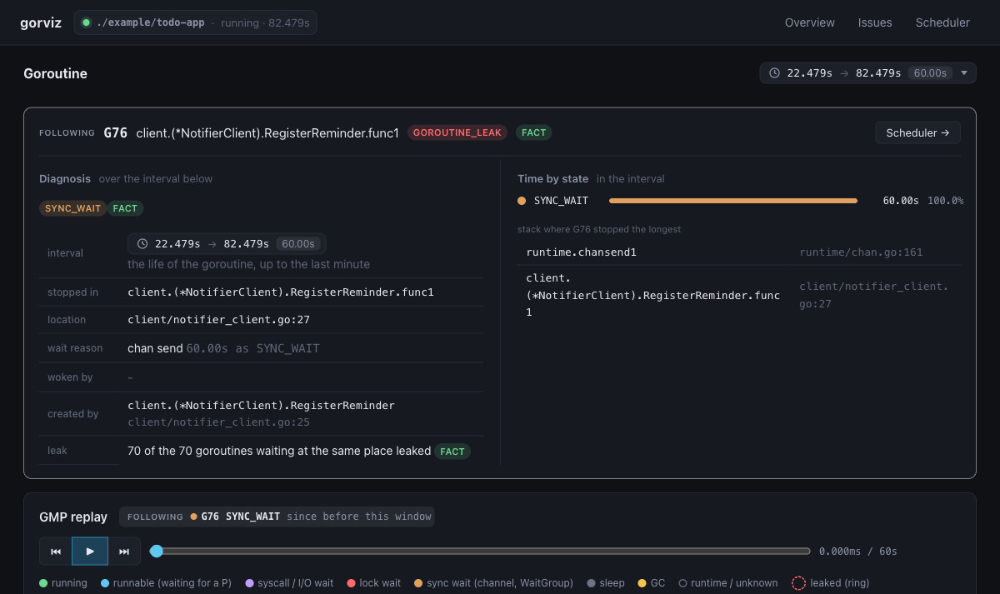
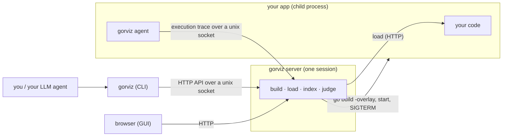
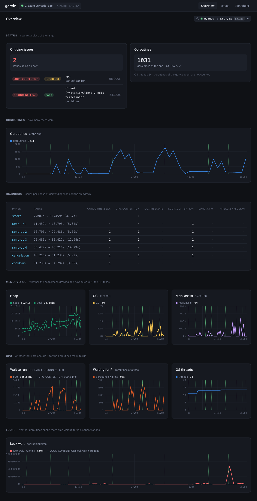
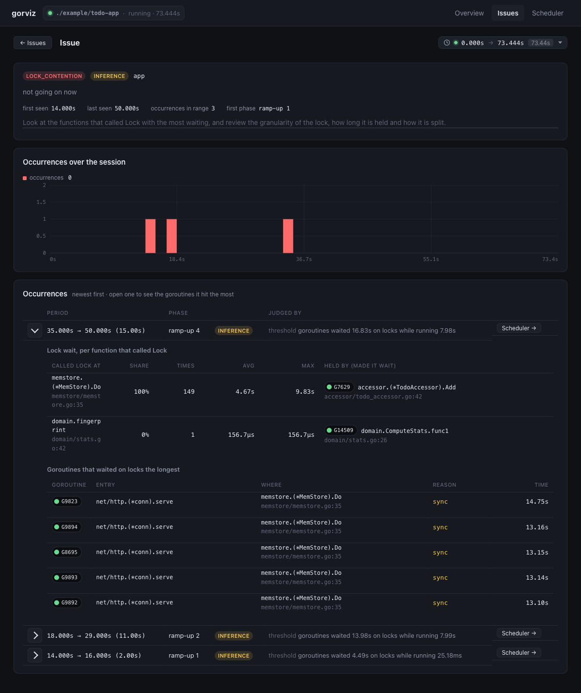
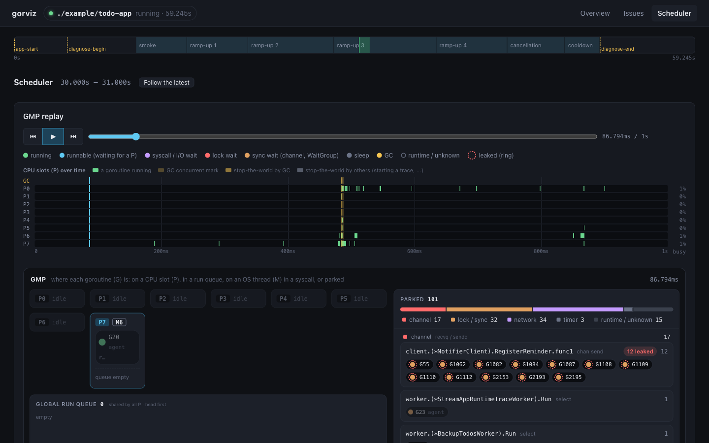

# gorviz

**Diagnose the health of the Go runtime of your app, on your machine — built for LLM agents, readable by humans.**

gorviz builds your Go app with a small agent in it, runs it, sends it load from a declarative scenario, and watches the
execution trace from start to shutdown. It reports **issues of the Go runtime** — goroutine leaks, lock contention,
waiting for the CPU, GC pressure, long stop-the-world pauses and too many OS threads — down to the goroutines behind
them and what each one was blocked on. Then it lets you replay what the scheduler did, as an animation of G, P and M.

```console
$ gorviz run ./example/todo-app
$ gorviz diagnose example/todo-app/scenario.yaml
...
  issues[3]{id,kind,target,certainty,firstPhase,occurrences}:
    I1,CPU_CONTENTION,app,INFERENCE,smoke,6
    I2,LOCK_CONTENTION,app,INFERENCE,smoke,4
    I3,GOROUTINE_LEAK,github.com/kakkky/gorviz/example/todo-app/adapter/client.(*NotifierClient).RegisterReminder,FACT,ramp-up 3,3
  exitCode: 1
$ gorviz issue I3
```



## Why

- The cause of a slow request or a goroutine leak is often not in your code or your logs, but in what a goroutine was
  waiting for inside the runtime: the CPU, a lock, I/O or GC. Few people who write Go read the scheduler fluently.
- `go tool trace` and goroutine dumps have the data, but reading them takes runtime knowledge, and you still have to
  build the load that drives the code path you care about.
- Code that leaks in production also leaks on your machine, and locks contend there too — as long as the path is driven
  concurrently. gorviz makes driving it cheap: you (or your LLM agent) only write *what* to send. *How much, how long
  and in what order* is decided by gorviz, so every run is comparable, and no load-testing code is written that could
  leak or contend by itself.

## Features

- **No changes to your code.** The agent is added at build time through `go build -overlay`. It only uses the standard
  library, so it adds no dependency to your module.
- **Fixed load phases.** `smoke` (each flow once), `ramp-up` (4 levels of concurrency based on GOMAXPROCS),
  `cancellation` (30% of requests cut by the client — where leaks usually hide) and `cooldown` (what is left after the load).
  A diagnosis takes about 35 seconds every time, plus the time smoke takes.
- **Issues with evidence.** Every issue comes with the goroutines affected the most: time by state, the main cause
  (`RUNNING`, `RUNNABLE`, `LOCK_WAIT`, `SYNC_WAIT`, `IO_WAIT`, `CGO`, `SLEEP`, `GC`), the function and `file:line`
  it was blocked at, and the goroutine that woke it (for a lock, the one that held it).
- **Honest about certainty.** Each finding is `FACT` (said by the runtime or recorded in the trace) or `INFERENCE`
  (inferred from a threshold, a trend or a stack). Goroutine leaks come from the runtime's own `goroutineleak` profile
  (Go 1.26+), so they have no false positives.
- **Coverage of the load.** The summary lists the lines the app ran under load, so "no issue" can be told apart from
  "the scenario never reached that code".
- **Made for LLM agents.** Every command answers in [TOON](https://github.com/toon-format/toon) (or JSON), bounded in
  size, with the IDs and the next commands to follow, and the GUI URL of the same thing for a human to check.
  The documents are built into the CLI (`gorviz docs`).
- **A GUI to see the scheduler.** Overview, Issues, Scheduler and Goroutine screens, with a GMP replay that steps through
  every state change of G, P and M.

## How it works



- `gorviz run` starts the server as a daemon. The server builds the app with the agent and coverage, and starts it.
- The agent starts tracing before your `main` runs, streams the execution trace to the server, and writes what the
  server asks for (phase marks, the goroutineleak profile, coverage, the number of threads). It judges nothing and keeps nothing.
- The server turns the trace into an index in memory, judges issues every second and per phase, and answers the CLI and the GUI.
- `gorviz stop` sends SIGTERM and keeps tracing until the app exits, so a shutdown that never finishes and goroutines
  left behind show up. All data of the session lives in memory and is gone after `gorviz stop`.

## Requirements

- Go 1.26 or later (for the `goroutineleak` profile), on macOS or Linux.
- The app is a main package in a Go module. gorviz builds it from source.

## Install

```sh
go install github.com/kakkky/gorviz/cmd/gorviz@latest
```

## Quick start

Try it on the example app in this repository, a todo app with a few goroutine bugs in it.

```sh
git clone https://github.com/kakkky/gorviz.git && cd gorviz
make build
./bin/gorviz run ./example/todo-app
./bin/gorviz diagnose example/todo-app/scenario.yaml
./bin/gorviz issues
./bin/gorviz issue I1
open http://127.0.0.1:24678
./bin/gorviz stop
```

The [example README](example/todo-app/README.md) walks through each bug.

## Usage

### Start a session

```sh
gorviz run <main package> [-- app arguments]
```

Pass the package the same way as `go run`. The environment of `gorviz run` is passed to the build and to the app as it is
(build tags through `GOFLAGS`, `CGO_ENABLED` and so on). The command returns once the app runs, with the GUI URL;
build errors are returned here. The output of the app itself is not shown — gorviz only looks at the runtime.

### Write a scenario (HTTP API servers)

```yaml
target: http://127.0.0.1:8080
ready:
  path: /healthz
setup:
  - method: POST
    path: /seed
flows:
  - name: create-and-complete
    weight: 3
    steps:
      - method: POST
        path: /todos
        json: {title: "todo {{seq}}"}
        capture:
          id: json:id
      - method: POST
        path: /todos/{{id}}/complete
  - name: list
    steps:
      - path: /todos
```

A scenario only says what to send: the target, a request to wait for readiness, setup requests sent once, and weighted
flows of steps that can capture values from earlier responses. It is checked before any load is sent, and every
problem comes with how to fix it. See `gorviz docs scenario`.

### Diagnose

```sh
gorviz diagnose scenario.yaml   # an API server, under load
gorviz diagnose                 # a daemon, a batch or a CLI: no load, watch until it exits (or 30 seconds)
```

A line is printed when each phase ends, then a summary with the issues and the phase each started in, statuses and
latencies per ramp-up level, cancellation counts and coverage. The exit code is `0` (no issues), `1` (issues) or
`2` (could not diagnose).

### Read the issues

```sh
gorviz issues                         # IDs and key points only
gorviz issue I2                       # timeline of occurrences + the goroutines affected the most
gorviz issue I2 --occurrence 1
gorviz goroutine 4245 --from 21.5s --to 42.5s   # follow the goroutine that made another one wait
```

Times are seconds since the session started. Every answer has the GUI URL of the same view.

### Commands

| Command | What it does |
| --- | --- |
| `gorviz run <package> [-- args]` | Start the server as a daemon, build the app with the agent and start it |
| `gorviz stop` | Watch the shutdown of the app, report what was left, and end the session |
| `gorviz status` | Whether the app runs (or its exit code), the GUI URL and the diagnosed ranges |
| `gorviz diagnose [scenario.yaml \| -]` | Run the app, under load when a scenario is given, and report issues |
| `gorviz issues` | List the issues (`--kind`, `--text`, `--after`) |
| `gorviz issue <id>` | Open an issue down to the goroutines behind it (`--occurrence`) |
| `gorviz goroutine <id>` | What one goroutine was blocked on (`--from`, `--to`) |
| `gorviz docs [name]` | The built-in documents: `getting-started`, `scenario`, `issues`, `goroutines` |

Global flags are `--socket` (the unix socket of the server, a fixed path in the temp directory by default, also `GORVIZ_SOCKET`) and `--format` (`toon` by default, or `json`).
Only one session runs per socket. The GUI listens on `127.0.0.1:24678` (`GORVIZ_GUI_ADDR` to change it).

## Issues

| Kind | What is wrong | Judged when |
| --- | --- | --- |
| `GOROUTINE_LEAK` | Goroutines that should finish stay blocked and pile up | The runtime's goroutineleak profile says so (`FACT`) |
| `CPU_CONTENTION` | Runnable goroutines wait for a P | p99 of the wait from RUNNABLE to RUNNING ≥ 1ms |
| `GC_PRESSURE` | GC takes the CPU away from the app | GC uses ≥ 50% of the CPU (`FACT`), or mark assist > 5% |
| `LOCK_CONTENTION` | Goroutines wait on `sync.Mutex`/`RWMutex` more than they run | Lock wait time > running time |
| `LONG_STW` | A stop-the-world pauses the whole app | One STW ≥ 1ms |
| `THREAD_EXPLOSION` | Too many OS threads | Over half of the limit (10,000) |

Thresholds are fixed on purpose. Their sources are in [docs/design.md](docs/design.md).

## Using it from an LLM agent

Tell your agent to read the documents first; everything it needs is in the CLI:

```text
Diagnose this app with gorviz. Run `gorviz docs getting-started` and `gorviz docs scenario` first.
Write a scenario from the handlers and routes, run `gorviz diagnose`, open each issue with `gorviz issue`,
read the code at the reported file:line, and give me the cause and the GUI URL so that I can check it.
```

## Screens

| Overview | Issue |
| --- | --- |
|  |  |

| Scheduler | Goroutine |
| --- | --- |
|  |  |

## Limitations

- Load is HTTP only.
- Goroutines created before the agent starts (by `init` of imported packages) have no record of their creation;
  their wait reason is inferred from the stack (`INFERENCE`).
- When the app ends on the spot (`os.Exit`, `log.Fatal`, a panic outside `main`), the end of the trace is missing.
  gorviz says so on the timeline and in the answers.
- The run queue a runnable goroutine waited in is not in the execution trace, so the replay infers it.

## Development

```sh
make build                       # bin/gorviz
make run APP=./example/todo-app  # build, then run the app under gorviz (APP defaults to ./example/todo-app)
make stop                        # stop the session
make vet                         # go vet ./...
make gen                         # templ, mocks, TS types and the GUI's TypeScript and CSS (needs Node; the output is committed)
make test                        # go test ./... and the GUI's tests
```

- [docs/design.md](docs/design.md) — the specification
- [docs/architecture.md](docs/architecture.md) — where things are and how they depend on each other
- [docs/coding-rule.md](docs/coding-rule.md) — how each layer is written
- [docs/frontend.md](docs/frontend.md) — how the GUI is built
