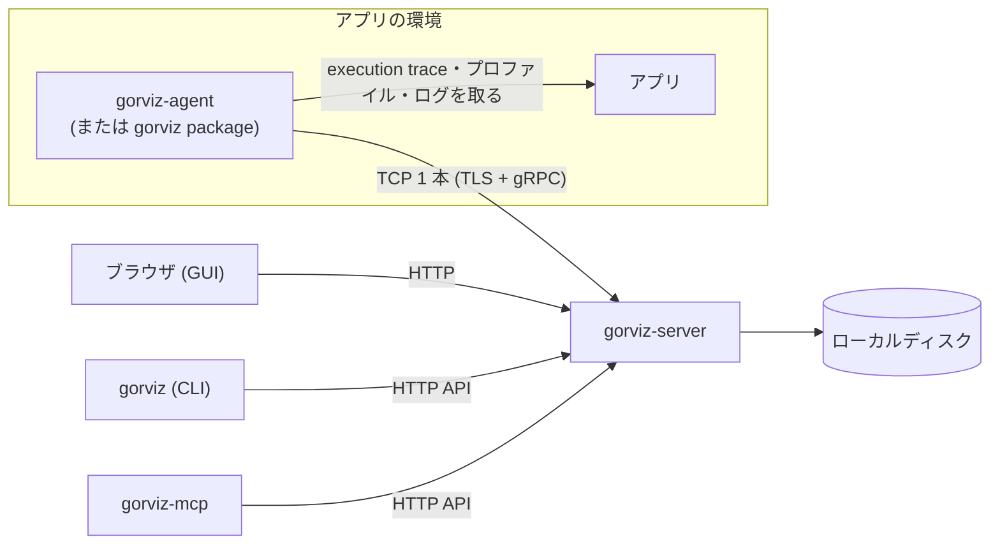

# gorviz

**Go ランタイムのスケジューラまで降りて、goroutine が「何に止まっていたか」を診断するツール。**

goroutine のリークや、遅い・失敗したリクエストの原因は、アプリのコードやログを見ても分からず、その goroutine がランタイムの中で CPU・ロック・I/O・GC のどれを待っていたかにあることがある。gorviz は execution trace を本番で常に取り続け、問題の検知・ログ・時間帯を入口に、goroutine ごとの診断と GMP の概念図での再生として見せる。

- 何に止まっていたかを言う
  - 状態別の時間内訳・主因 (`RUNNING` / `RUNNABLE` / `LOCK_WAIT` / `SYNC_WAIT` / `IO_WAIT` / `CGO` / `SLEEP` / `GC`)・止まっていた関数と file:line を、確かさ (`FACT` / `INFERENCE`) 付きで出す
- 問題の瞬間から入れる
  - runtime 層の Issue (`GOROUTINE_LEAK`・`CPU_CONTENTION`・`GC_PRESSURE`・`LOCK_CONTENTION`・`LONG_STW`・`THREAD_EXPLOSION`)、ログ 1 行、時間帯から、該当する goroutine のその瞬間に辿れる
- 後日でも調べられる
  - Issue の発生とエラーログの前後の execution trace は 31 日残すので、翌朝でも書いた瞬間の goroutine の動きを再生できる
- LLM エージェントに任せられる
  - `gorviz` (CLI) と `gorviz-mcp` が同じ操作を、少ないトークン (TOON) と次に調べる先の ID 付きで返す


> [!NOTE]
> gorviz は PoC (概念実証) の段階。仕様は [docs/design.md](docs/design.md) にあり、実装はまだそのすべてを満たしていない。

## 目次

- [仕組み](#仕組み)
- [クイックスタート](#クイックスタート)
- [インストール](#インストール)
- [アプリの用意](#アプリの用意)
- [配置](#配置)
- [設定](#設定)
- [LLM エージェントから使う](#llm-エージェントから使う)
- [開発](#開発)
- [ドキュメント](#ドキュメント)

## 仕組み



| コンポーネント | 役割 |
| --- | --- |
| `gorviz-agent` | アプリの隣で execution trace を数秒ごとのチャンクに整形し、goroutine のスナップショット・リーク判定・ログと一緒に server へ送る |
| `gorviz-server` | 届いた観測データをディスクに書き、Issue の検出・メトリクスの集計・ログを書いた goroutine の突き合わせをし、GUI と HTTP API で診断を返す |
| `gorviz` | server の HTTP API を端末から使う CLI。LLM エージェントがシェルから呼ぶ |
| `gorviz-mcp` | 同じ操作を MCP の tool として出す (stdio) |
| `gorviz-launcher` | 開発用。server と agent を 1 つのプロセスで動かす |
| `github.com/kakkky/gorviz` | アプリが import するパッケージ。agent の埋め込み (ライブラリ型) と、ロガーアダプタ (`logger/`) |

観測するアプリは「サービス」(同じアプリのインスタンスをまとめたもの) と「インスタンス」(プロセス 1 つ) の 2 段で扱う。Overview・Issues・Logs はサービス単位、Scheduler・Goroutine はインスタンス単位で見る。

## クイックスタート

手元で、例のアプリ [example/todo-app](example/todo-app) を観測する。

```sh
git clone https://github.com/kakkky/gorviz.git && cd gorviz
make launcher.up
```

- Todo アプリ
  - http://localhost:8090
- gorviz
  - http://localhost:7070 (ログインのトークンは launcher のログの `GORVIZ_TOKEN=...`)

Todo アプリには、実際の Web アプリにありがちな goroutine の不具合が入っている。gorviz での調べ方は [example/todo-app/README.md](example/todo-app/README.md) のチュートリアルを参照。画面と遷移は [docs/poc/screen-flow.md](docs/poc/screen-flow.md) にまとめてある。

自分のアプリで試すときは、アプリで pprof を公開し、出力をパイプで launcher に渡す。

```sh
go run . 2>&1 | gorviz-launcher --pprof-addr localhost:6060 --service myapp
```

| フラグ | 既定 | 中身 |
| --- | --- | --- |
| `--pprof-addr` | (必須) | 観測するアプリの pprof のアドレス |
| `--service` | `app` | サービスの名前 |
| `--data-dir` | `.gorviz` | server の保存先 |
| `--http-addr` | `localhost:7070` | GUI と HTTP API |
| `--agent-addr` | `localhost:7071` | agent からの接続 |

## インストール

Go 1.27 以上が要る (`goroutineleak` プロファイルによるリークの `FACT` 判定は Go 1.26 以上のアプリで働く)。

```sh
git clone https://github.com/kakkky/gorviz.git && cd gorviz
make build   # bin/gorviz・gorviz-server・gorviz-agent・gorviz-mcp・gorviz-launcher
```

リリースのバイナリとコンテナのイメージはまだ公開していない。

## アプリの用意

### pprof を公開する (daemon 型・sidecar 型)

```go
import _ "net/http/pprof"

go http.ListenAndServe("localhost:6060", nil)
```

アプリが `http.DefaultServeMux` で待ち受けていれば import だけでよい。自前の mux やフレームワークを使っていれば、上のように `DefaultServeMux` を別のポートで待ち受ける。

### agent を埋め込む (ライブラリ型)

agent を隣に置けない環境では、アプリの中で agent を動かす。trace は runtime の FlightRecorder から取るので、pprof の公開は要らない。

```go
go func() {
	err := gorviz.Run(ctx, gorviz.Options{
		Server:  "gorviz-server:7071",
		Token:   os.Getenv("GORVIZ_TOKEN"),
		Service: "checkout",
	})
	if err != nil {
		slog.Error("gorviz agent stopped", slog.Any("err", err))
	}
}()
```

### ロガーアダプタを差し込む

ログ 1 行とそれを書いた goroutine を確実に (`FACT` で) 結ぶ。ログを書く goroutine の上で番号を振り、同じ番号をログ行のフィールドと execution trace の両方に書く。ログの書式は変わらず、`gorviz_seq` のフィールドが 1 つ増えるだけ。ライブラリ型では、ログはこのアダプタからだけ agent に渡る。

```go
// slog
logger := slog.New(gorvizslog.NewHandler(slog.NewJSONHandler(os.Stderr, nil)))

// zap
core := zapcore.NewCore(enc, gorvizzap.WrapWriteSyncer(zapcore.AddSync(os.Stderr)), zap.InfoLevel)
logger := zap.New(gorvizzap.WrapCore(core))

// zerolog
logger := zerolog.New(gorvizzerolog.WrapWriter(os.Stderr)).Hook(gorvizzerolog.Hook())

// logrus
logger.SetFormatter(gorvizlogrus.WrapFormatter(&logrus.JSONFormatter{}))
```

パッケージは `github.com/kakkky/gorviz/logger/gorviz{slog,zap,zerolog,logrus}`。アダプタを使わなくても、agent はログの時刻から goroutine を推測する (その時刻に走っていた goroutine が 1 つだけのときに限り `INFERENCE`)。

ログの形式は設定しない。agent が slog (JSON / テキスト)・zap・zerolog・logrus・標準の log を行の形から読み分ける。所要時間 (`duration`・`latency`・`elapsed`) のあるログからは、そのリクエストの区間で goroutine を診断する。

## 配置

| 置き方 | agent | 観測するアプリ | 例 |
| --- | --- | --- | --- |
| daemon 型 | `gorviz-agent` (`GORVIZ_AGENT_MODE=daemon`) | 同じノードの、annotation `gorviz/pprof-port` を付けた Pod | Kubernetes |
| sidecar 型 | `gorviz-agent` (`GORVIZ_AGENT_MODE=sidecar`) | 同じタスクのアプリ 1 つ | ECS Fargate・Cloud Run・Kubernetes |
| ライブラリ型 | `gorviz.Run` | そのアプリ自身 | agent を置けない環境 |

マニフェストの例は [deploy/](deploy) にある。agent は server へ外向きに TCP を 1 本張るので、アプリの側に入口を開けなくてよい。通信は TLS で暗号化し、agent・CLI・MCP はトークンで認証する。証明書を用意しなければ、server が初回起動時に CA を作り、そのハッシュ (`ca_sha256`) をログに出す。

## 設定

設定は環境変数だけから読む (launcher だけはフラグ)。主なもの:

### gorviz-server

| 環境変数 | 既定 | 中身 |
| --- | --- | --- |
| `GORVIZ_DATA_DIR` | `/var/lib/gorviz` | 保存先 (ローカルディスク) |
| `GORVIZ_HTTP_ADDR` | `:7070` | GUI と HTTP API |
| `GORVIZ_AGENT_ADDR` | `:7071` | agent からの接続 |
| `GORVIZ_PUBLIC_URL` | `https://localhost:7070` | API の応答と通知に載せる GUI の URL の頭 |
| `GORVIZ_BOOTSTRAP_TOKEN` | | agent と API の両方に使えるトークン。トークンが 1 つもなければ、起動時に発行してログに出す |
| `GORVIZ_TLS_CERT_FILE` / `GORVIZ_TLS_KEY_FILE` | | 用意した証明書。なければ自分で CA と証明書を作る |
| `GORVIZ_INSECURE` | `false` | 平文でつなぐ (launcher の中など、明示したときだけ) |
| `GORVIZ_MAX_DISK_BYTES` | 100GiB | 保存先全体の上限。超えたら、すべてのデータから一番古い日の分を捨てる |
| `GORVIZ_RETENTION_*` | 31 日 (execution trace は 7 日) | データごとの保持期間 |
| `GORVIZ_NOTIFICATIONS` | | サービスごとの通知先 (Webhook・Slack・メール) の JSON |

### gorviz-agent

| 環境変数 | 既定 | 中身 |
| --- | --- | --- |
| `GORVIZ_AGENT_MODE` | `sidecar` | `sidecar` / `daemon` |
| `GORVIZ_SERVER_ADDR` | `localhost:7071` | server の agent の口 |
| `GORVIZ_TOKEN` | | トークン |
| `GORVIZ_CA_FINGERPRINT` / `GORVIZ_CA_FILE` | | server の証明書を確かめる CA |
| `GORVIZ_SERVICE` / `GORVIZ_INSTANCE` | / ホスト名 | サービスとインスタンスの名前 (sidecar 型) |
| `GORVIZ_PPROF_ADDR` | | アプリの pprof (sidecar 型) |
| `GORVIZ_LOG_FILES` | | tail するログファイル (glob、カンマ区切り) |
| `GORVIZ_LOG_TCP_ADDR` / `GORVIZ_LOG_UDP_ADDR` | | ログルーター (Fluent Bit など) から受ける口 |
| `GORVIZ_LOG_STDIN` | `false` | 標準入力からログを読む |
| `GORVIZ_NODE_NAME` | | 自分のノード (daemon 型) |

### gorviz / gorviz-mcp

| 環境変数 | 中身 |
| --- | --- |
| `GORVIZ_SERVER_URL` | server の URL (例 `https://gorviz.internal:7070`) |
| `GORVIZ_TOKEN` | API のトークン |
| `GORVIZ_CA_FINGERPRINT` / `GORVIZ_CA_FILE` | server の証明書を確かめる CA |

## LLM エージェントから使う

CLI と MCP は同じ操作 (サービス・Issue・ログの検索と集計・goroutine の診断・状態の変化・生成元ごとの集計・残っているデータ) を出す。既定では TOON で返し、`--json` (CLI) で JSON にもできる。主因・Issue の種類・確かさの意味と調べ方は、手元に埋め込んだドキュメントから引ける。

```sh
export GORVIZ_SERVER_URL=http://localhost:7070 GORVIZ_TOKEN=...
gorviz docs                         # ドキュメントの一覧
gorviz docs getting-started
gorviz list-issues --service todo
gorviz diagnose-goroutine --service todo --instance <インスタンス> --goroutine 54 --log <ログの ID>
```

MCP は stdio で動く。たとえば Claude Code には次のように登録する。

```sh
claude mcp add gorviz --env GORVIZ_SERVER_URL=http://localhost:7070 --env GORVIZ_TOKEN=... -- gorviz-mcp
```

## 開発

```sh
make build        # bin/ に 5 つの実行ファイルを作る
make test         # go test ./...
make gen          # templ・protobuf (buf)・mock (mockgen) を作り直す
make launcher.up  # example/todo-app を launcher で観測する
docker compose up # 同じ構成を、保存のたびに作り直しながら動かす
```

コードの構成は [docs/architecture.md](docs/architecture.md)、書き方の決まりは [docs/coding-rule.md](docs/coding-rule.md)、GUI の作り方は [docs/frontend.md](docs/frontend.md) にある。

## ドキュメント

- [docs/design.md](docs/design.md)
  - 仕様 (モチベーション・コンポーネント・データの持ち方・Issue の判定・診断・ユーザーストーリー)
- [docs/architecture.md](docs/architecture.md)
  - コードの全体像と処理の流れ
- [docs/coding-rule.md](docs/coding-rule.md)
  - 層ごとの書き方
- [docs/frontend.md](docs/frontend.md)
  - GUI の作り方
- [docs/poc/screen-flow.md](docs/poc/screen-flow.md)
  - PoC の画面と遷移 (スクリーンショット付き)
- [docs/poc/operational-gaps.md](docs/poc/operational-gaps.md)
  - PoC を負荷の下で動かして分かった、運用に足りないところと直す順番
- [example/todo-app/README.md](example/todo-app/README.md)
  - 調査のチュートリアル
- [deploy/README.md](deploy/README.md)
  - Kubernetes・ECS・Cloud Run での配置の例
