# Architecture

gorviz のコードの全体像。**どこに何があり、依存がどう流れ、観測データとリクエストがどう処理されるか** を扱う。図の名前は概念で、コードと一致するとは限らない。振る舞いの仕様は [design.md](design.md) にある。

この文書では、gorviz 自身の server・agent・cli・mcp・launcher を「コンポーネント」、gorviz が観測する利用者のプログラムを「アプリ」と呼ぶ (design.md と同じ)。

## リポジトリの構成

1 つの Go モジュールに、5 つのコンポーネント (実行ファイル) と、観測されるアプリが import する公開パッケージを置く。

公開パッケージ (`gorviz`・`logger/`) 以外はすべて `internal/` に置く。利用者が import できるのを公開パッケージだけに絞り、それ以外は互換を気にせず変えられるようにするため。

```
cmd/<コンポーネント>/      main (実行ファイルごと)
internal/
  app/                     コンポーネント
    agent/
    server/
    cli/
    mcp/
    launcher/
  domain/                  コンポーネントをまたぐ domain
    observation/           観測データ
  protocol/                コンポーネント同士の契約
    agentrpc/              agent と server
    serverapi/             server と cli・mcp
    loggerhook/            ロガーアダプタと agent
  pkg/                     gorviz に依らない道具
    funcname/
    histogram/
  docs/                    cli・mcp に埋め込むドキュメント
gorviz.go                  公開パッケージ (agent の埋め込み)
logger/gorviz<ロガー>/     公開パッケージ (ロガーアダプタ)
example/                   観測されるアプリの例
deploy/                    配置の例
```

## コンポーネントの境界

- コンポーネント同士は import しない。またぐものは `internal/` 直下に置く
  - 例外は launcher (server と agent を組み立てる) と、agent と server の通信のテスト
- 1 つのコンポーネントしか使わないものは、そのコンポーネントの層に置く
- 依存の向きは次の図のとおり。上が下を使い、下の段なら飛ばしてもよい。逆向きには使わない

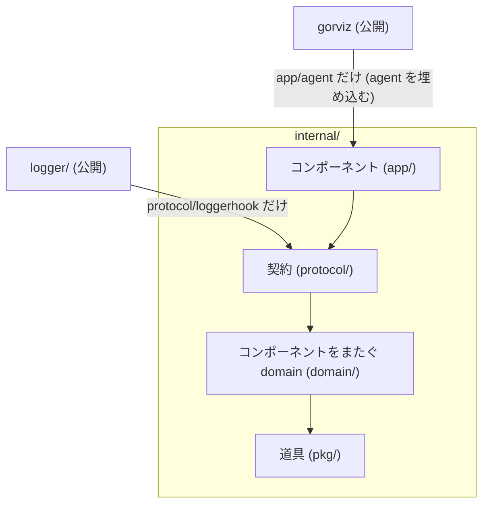

- `logger/` は `gorviz` も `app/` も import しない。ロガーアダプタだけを使うアプリ (daemon 型・sidecar 型) に agent を持ち込まないため
- 中身を表さない名前 (`shared`・`common`・`util`・`types` など) の箱は作らない

### domain/

- 複数のコンポーネントが共通して使うドメイン知識を置く。型と、型の意味から決まる振る舞いだけで、判断の規則はそれを決めるコンポーネントの `domain/` に置く
- パッケージは中身の名前で切る。コンポーネントの `domain` と並べて import するときに別名を要らなくするため
- `observation` は、agent が作り server が読み解く観測データと、server がどこまで持っているかを表すカーソル。`agentrpc` の proto とほぼ 1 対 1 に対応する。生成型を使わないのは、domain を生成コードに依存させないため

### protocol/

- 契約を相手ごとに 1 パッケージで持つ
- `agentrpc` は gRPC の形と、`domain/observation` との詰め替え
- `serverapi` は HTTP API のクライアント。応答は解釈せず、そのまま返す
- `loggerhook` はプロセスの中の契約。ログ行と trace に書く番号の決まりと、ライブラリ型で埋め込んだ agent へ行を渡す口

### pkg/

- gorviz の仕様が変わっても変わらない道具。どこにも依存しない

## コンポーネントの中の層

どのコンポーネントも、`internal/app/<コンポーネント>/` の中を同じ層に分ける。ただし、手順も判断も持たない cli は presentation だけを、mcp は driver と presentation だけを持つ。層は外側から内側へ以下。

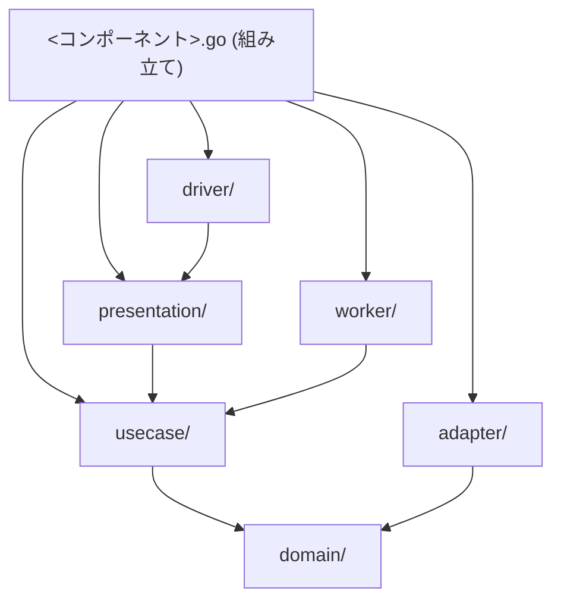

- `<コンポーネント>.go` は組み立て (エントリ)。コンポーネントの直下に置く Go ファイルはこれ 1 つ
- `driver/` は状態や後始末を持つ資源 (接続・待ち受け・保存先) の用意と起動。待ち受けは presentation に、接続は adapter に渡す
- `presentation/` は外から届いたものを受けて usecase を呼ぶ入口
- `worker/` は定期的に動く、独立した処理。外から呼ばれず、自分で usecase を呼ぶ。同じプロセスの中で、エントリが起動する
- `usecase/` は処理の手順
- `domain/` は判定・診断・組み立てのロジック / 型 / usecase が使う interface
- `adapter/` は domain の interface の実装。外との接続だけを持つ (ディスク・外部への送信・pprof など)。取る・送る・書く・読むまでで、判断はしない。取ってきたものを読み解く・それで何かを決めるのは domain
- `config/` は設定の組み立て

- 依存の向きは図のとおり。矢印の先を使い、図にない向きでは使わない。`domain` はほかの層を使わない (使うのは `internal/domain/`・`pkg/` と、形式を読むためだけの外部ライブラリ (`golang.org/x/exp/trace` など) だけ)
- `presentation`・`worker` は usecase を呼ぶ側、`adapter` は domain の interface を通して usecase から呼ばれる側で、互いに依存しない
- interface は、使う側の `domain` に置く

### agent

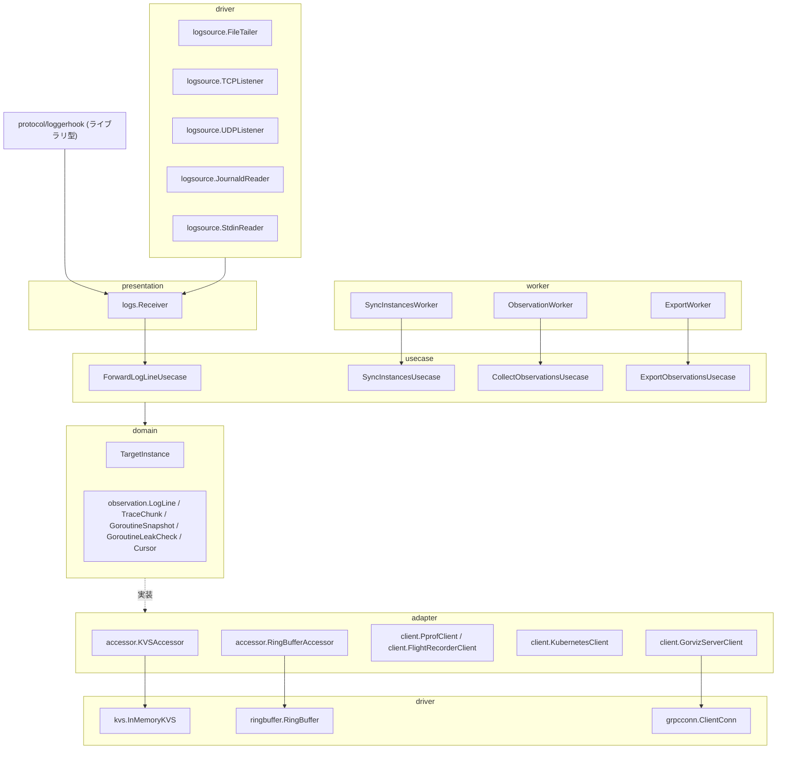

### server

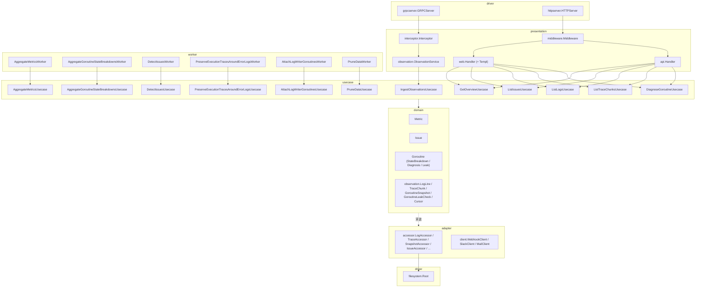

- `filesystem.Root` は保存先を開くときに、ロックを取り、形式のバージョンを確かめ、書きかけの一時ファイルを消す。一時ファイルに書いてから名前を付ける書き込みも Root が持つ
- 追記するファイルの途中で切れた末尾は、accessor がそのファイルに追記を始める前に切り詰める
- 層の外に `assets/` (CSS・JS・Stimulus controllers) を持つ

### cli

server の HTTP API を呼んでそのまま返すのと、`internal/docs/` を引くだけで、手順も判断も持たない。presentation だけを持つ。

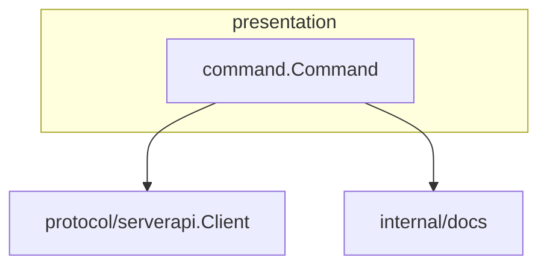

### mcp

cli と同じく手順も判断も持たない。stdio で MCP を待ち受ける driver と、presentation だけを持つ。

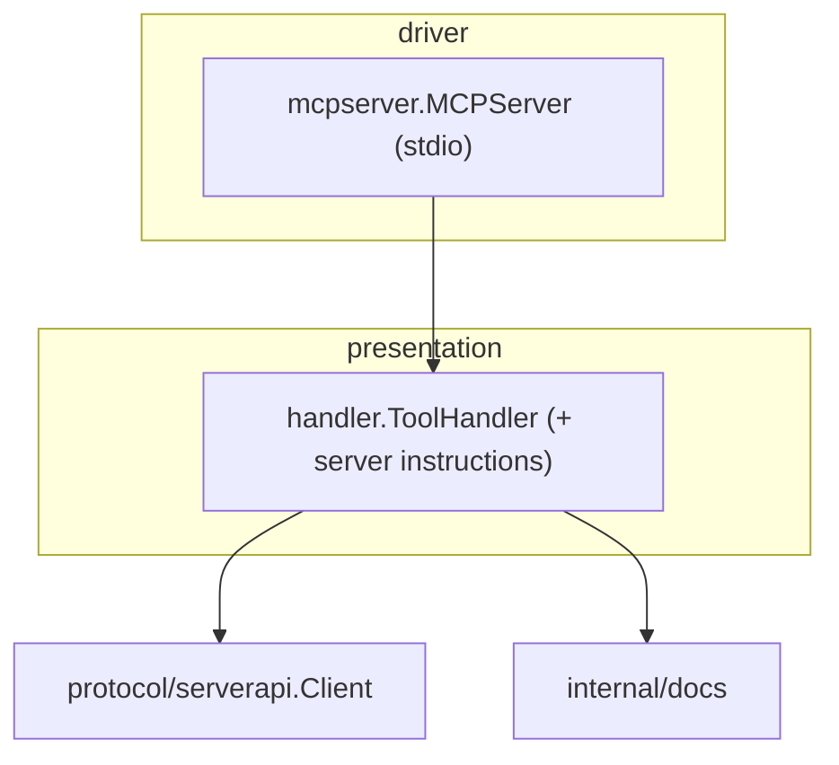

### launcher

組み立てと config だけを持つ。server と agent を同じプロセスで並べて呼び、間は TCP (localhost) でつなぐ。launcher 自身は通信の相手にならない。

## 処理の流れ

### 観測データを取る (agent)

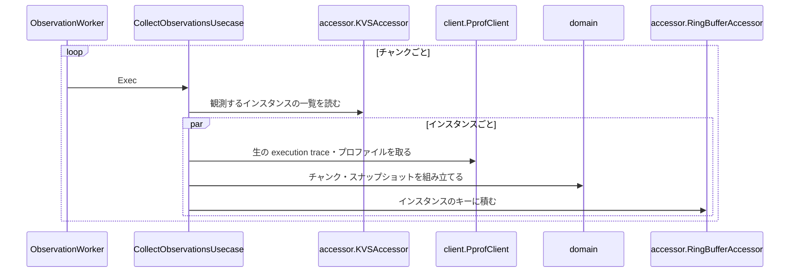

### ログを取り込む (agent)

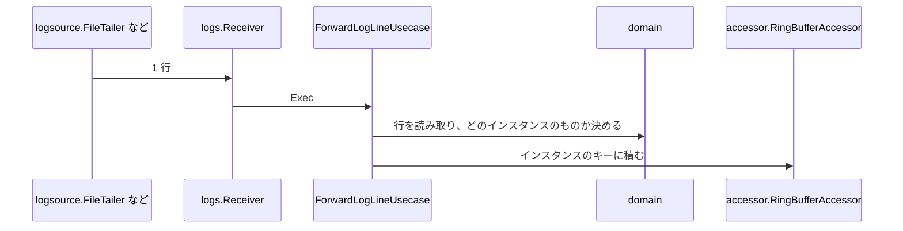

### 観測データを送る (agent → server)

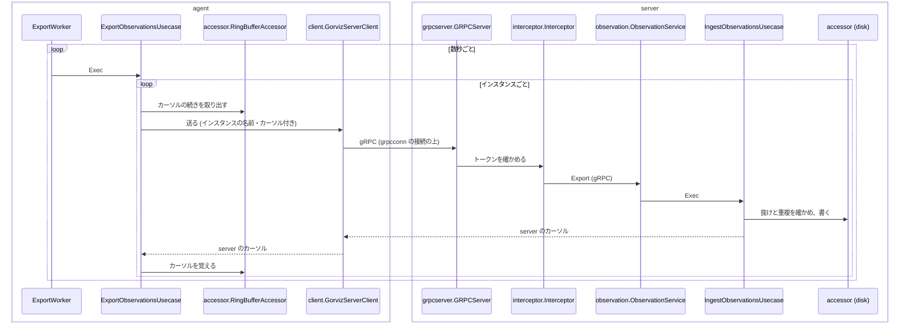

### 観測データから作る (server)

server が観測データから作るものは、作るものごとに worker を分ける (`AggregateMetricsWorker`・`AggregateGoroutineStateBreakdownsWorker`・`DetectIssuesWorker`・`PreserveExecutionTracesAroundErrorLogsWorker`・`AttachLogWriterGoroutinesWorker`)。どの worker も、チェックポイントの続きから作る。

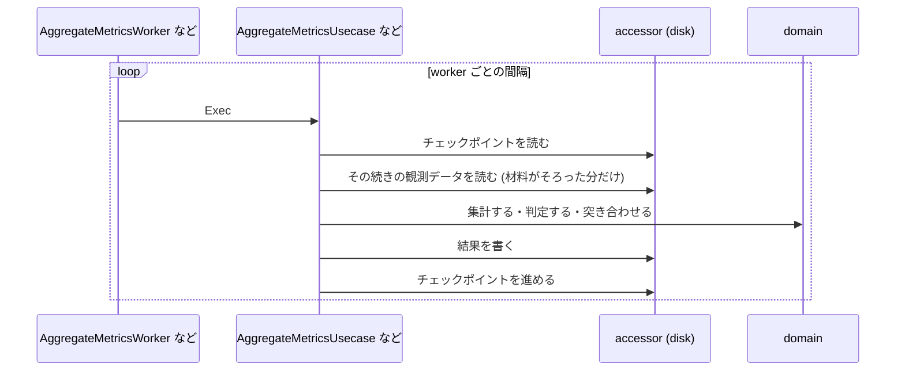

### Issue の検出と通知 (server)

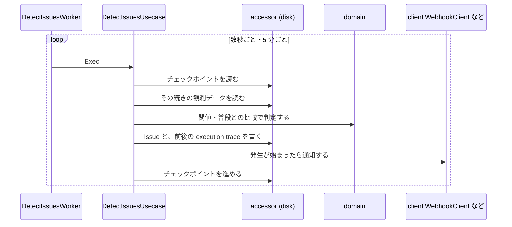

### GUI と HTTP API のリクエスト (server)

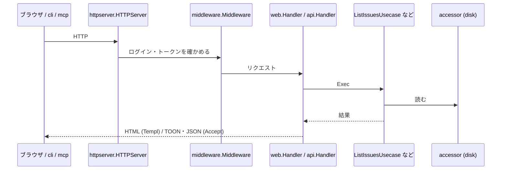

### gorviz-cli

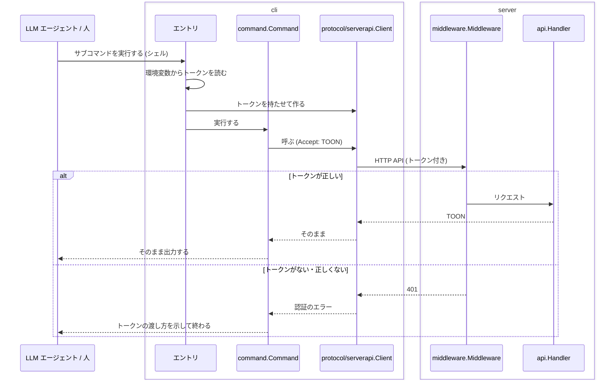

### gorviz-mcp

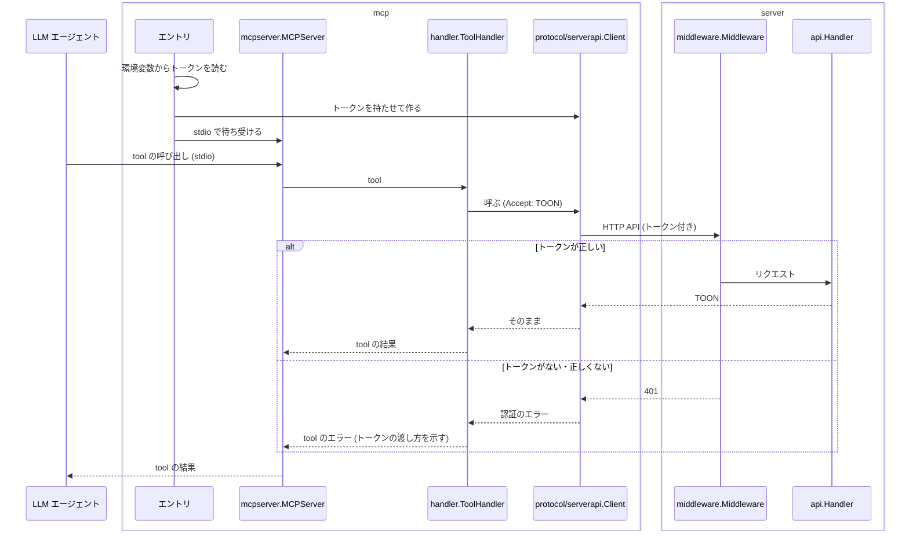

## サービスとインスタンス

- server の usecase は server 全体で 1 つ。どのサービス・インスタンスのものかは、usecase の入力で渡す
- サービスとインスタンスの区切りは、adapter のディスクの置き場 (`services/<サービス>/service/`・`services/<サービス>/instances/<インスタンス>/`) が持つ
- 観測データは、ディスクに書いてからディスクから読む。メモリに置くのは、送るまで・書くまでの分と、つながっている agent の状態だけ
- どこまで持っているか (カーソル) も、ディスクに書いてある最後の分から引く

## 横断関心事

認証・アクセスログ・エラーの返し方・panic の復旧は、各層に書かず、入口の手前でまとめて扱う。

- HTTP (GUI・HTTP API) は、`presentation/middleware` で扱う
- gRPC (agent からの観測データ) は、`presentation/interceptor` で扱う
- driver には置かない。エラーの種別 (domain) や画面 (view) を使うため
- handler・usecase は、認証やエラーのレスポンスを自分で書かない

### エラーフロー

各層は生の Go エラーを返さない。domain のエラー種別に包んで返す。種別は「invalid argument / not found / internal」の 3 つ。種別はコンポーネントごとの `domain` に置く。

HTTP の handler は、エラーをリクエストのコンテキストに載せて即 return する。outer の middleware が defer で取り出し、種別を status に変えて返す。

- invalid argument は 400、not found は 404、internal は 500
- GUI はエラーの画面を、HTTP API は Accept に応じた形 (TOON / JSON) のエラーを返す
- HTTP API の not found には、打ち間違いの候補やあるものを添える (design.md「LLM エージェントの利用に特化するためのポイント」)
- panic は同じ middleware の defer で復旧し、internal として扱う

gRPC は、interceptor が種別を gRPC の status (InvalidArgument / NotFound / Internal) に変える。panic も interceptor で復旧する。

保持期間を過ぎて出せないことは、エラーにしない。出せない欄として正常に返す。
