# Architecture

gorviz のコードの全体像。**どこに何があり、依存がどう流れ、観測データとリクエストがどう処理されるか** を扱う。図の名前は概念で、コードと一致するとは限らない。振る舞いの仕様は [design.md](design.md) にある。

この文書では、gorviz 自身の agent・server・cli を「コンポーネント」、gorviz が観測する利用者のプログラムを「アプリ」と呼ぶ (design.md と同じ)。

## リポジトリの構成

1 つの Go モジュールに、実行ファイル `gorviz` を 1 つ置く。中に 3 つのコンポーネントを持つ。

すべて `internal/` に置く。利用者が import するものはない。アプリには、agent がビルドのときに差し込まれるだけ。

```
cmd/gorviz/                main
internal/
  app/                     コンポーネント
    agent/                 アプリに差し込むソース
    server/
    cli/
  protocol/                コンポーネント同士の契約
    agentsocket/           agent と server
    serverapi/             server と cli
  docs/                    cli に埋め込むドキュメント
example/                   観測されるアプリの例
```

- `cmd/gorviz` は、デーモンとして起動されたときは server を、それ以外は cli を呼ぶ
- server と cli は同じ実行ファイルに入る。agent は実行ファイルには入らず、server がソースとして持ち、アプリのビルドに足す

## コンポーネントの境界

- コンポーネント同士は import しない。またぐものは `internal/` 直下に置く
  - 例外は、server が agent のソースを埋め込むこと (コードとして呼ぶのではなく、ファイルとして持つ) と、agent と server の通信のテスト
- 1 つのコンポーネントしか使わないものは、そのコンポーネントの層に置く
- 依存の向きは次の図のとおり。逆向きには使わない

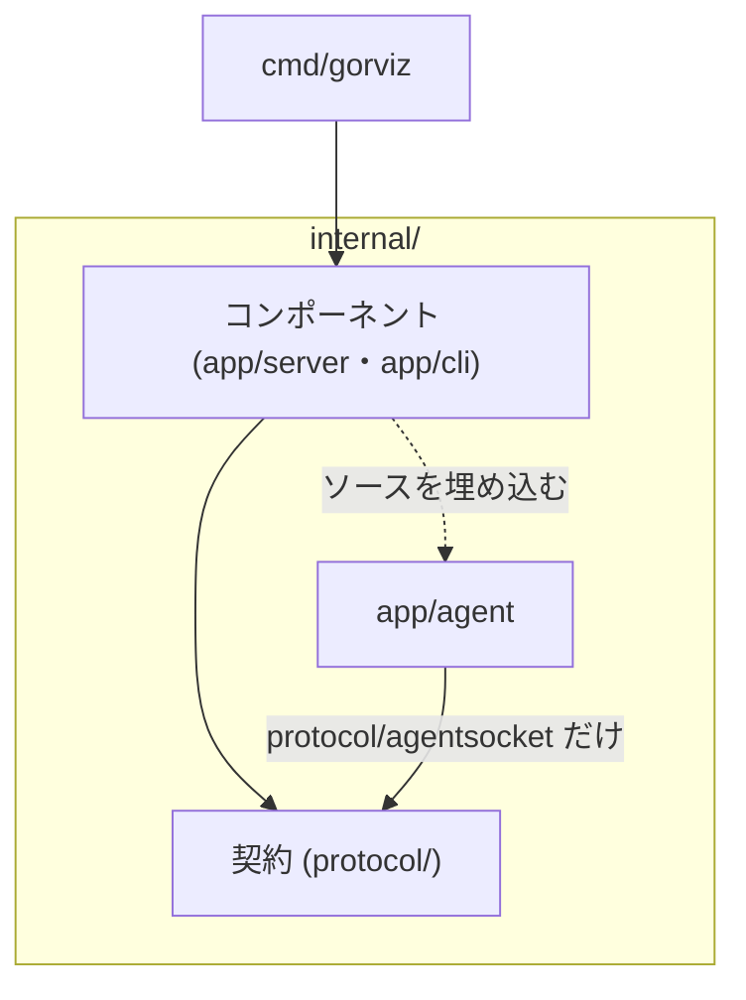

- agent が import してよいのは、標準ライブラリと `protocol/agentsocket` だけ。agent はアプリのモジュールの中でコンパイルされ、アプリの依存を増やせないため
  - server は差し込むとき、agent と agentsocket のソースを、アプリのモジュールの中のパッケージ (アプリの main パッケージの下の `gorvizagent/`) として見せ、import パスをそこへ書き換える
  - アプリの main には、agent を import する 1 行と、main が戻るときに agent を呼ぶ 1 行を足して見せる。どちらも見せるだけで、アプリのファイルは変えない
- 中身を表さない名前 (`shared`・`common`・`util`・`types` など) の箱は作らない

### protocol/

- 契約を相手ごとに 1 パッケージで持つ
- `agentsocket` は、agent と server の間の 1 本の接続に流すメッセージの形と区切り。標準ライブラリだけで書く
- `serverapi` は HTTP API のルートとクライアント。クライアントは応答を解釈せず、そのまま返す

## コンポーネントの中の層

どのコンポーネントも、`internal/app/<コンポーネント>/` の中を同じ層に分ける。ただし、手順も判断も持たない cli は driver と presentation だけを持つ。層は外側から内側へ以下。

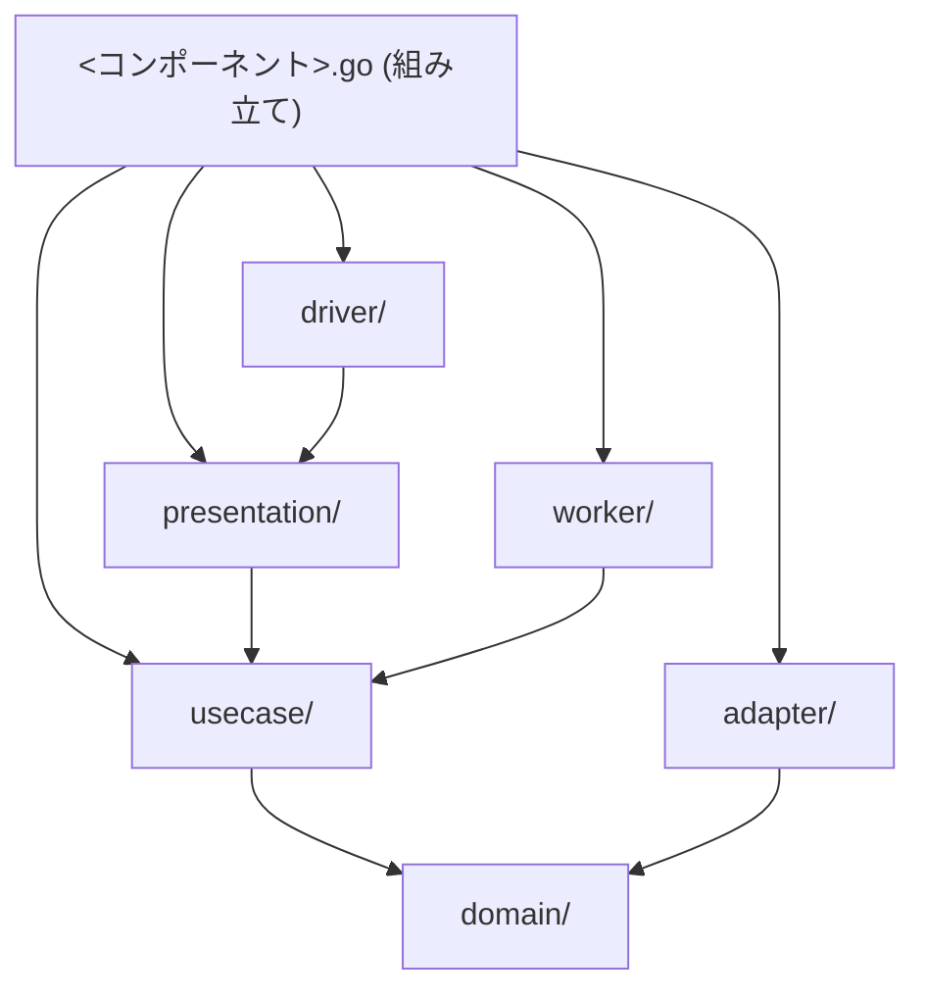

- `<コンポーネント>.go` は組み立て (エントリ)。コンポーネントの直下に置く Go ファイルはこれ 1 つ
- `driver/` は状態や後始末を持つ資源 (待ち受け・接続・プロセス・メモリの置き場) の用意と起動。待ち受けは presentation に、接続は adapter に渡す
- `presentation/` は外から届いたものを受けて usecase を呼ぶ入口
- `worker/` は定期的に動く、または何かを待ち続ける、独立した処理。外から呼ばれず、自分で usecase を呼ぶ。同じプロセスの中で、エントリが起動する
- `usecase/` は処理の手順
- `domain/` は判定・診断・組み立てのロジック / 型 / usecase が使う interface
- `adapter/` は domain の interface の実装。外との接続だけを持つ (メモリの置き場・agent への指示・アプリへの負荷・Go のツールチェーン・runtime の操作など)。取る・送る・書く・読むまでで、判断はしない。取ってきたものを読み解く・それで何かを決めるのは domain
- `config/` は設定の組み立て

- 依存の向きは図のとおり。矢印の先を使い、図にない向きでは使わない。`domain` はほかの層を使わない (使うのは `protocol/` と、形式を読むためだけの外部ライブラリ (`golang.org/x/exp/trace` など) だけ)
- `presentation`・`worker` は usecase を呼ぶ側、`adapter` は domain の interface を通して usecase から呼ばれる側で、互いに依存しない
- interface は、使う側の `domain` に置く

### agent

アプリの main から import され、init でエントリの `Start` が呼ばれる。エントリは組み立てと driver・worker の起動を済ませたら戻り、各層はアプリの裏で動き続ける。main が戻るときは、main に足した 1 行からエントリの `Finish` が呼ばれる。

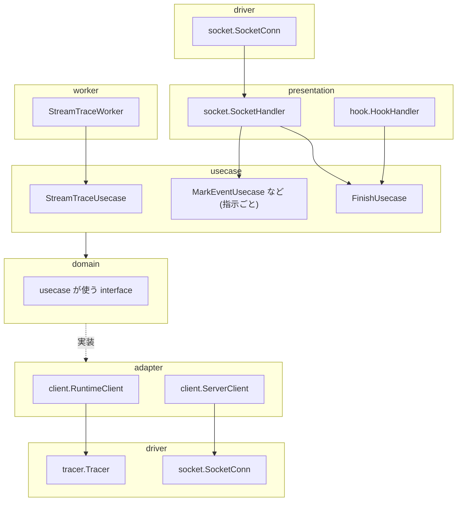

- `socket.SocketConn` は server への接続を張り、読んだ指示を `socket.SocketHandler` に、書く口を `client.ServerClient` に渡す
- `tracer.Tracer` は、用意したときに trace を取り始め、後始末で止める。書き出された trace は `client.RuntimeClient` が読む
- `hook.HookHandler` は、アプリの main が戻ったことを受けて `FinishUsecase` を呼ぶ。エントリの `Finish` は、ここへ渡すだけ
- driver の用意はエントリの中で終わるので、アプリの main が動き出す前に、接続と trace がそろう

### server

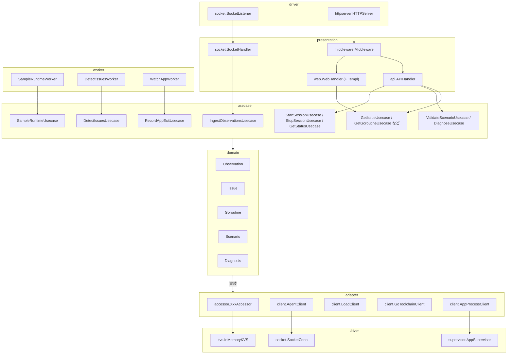

- `socket.SocketListener` は agent の接続を受け入れて `socket.SocketConn` にする。接続から読んだもののうち、観測データは `socket.SocketHandler` に、指示への返事は `client.AgentClient` に渡る
- 層の外に `assets/` (CSS・JS・Stimulus controllers) を持つ。agent のソースを埋め込むのも層の外

### cli

server の HTTP API を呼んでそのまま返すのと、`internal/docs/` を引くだけ。

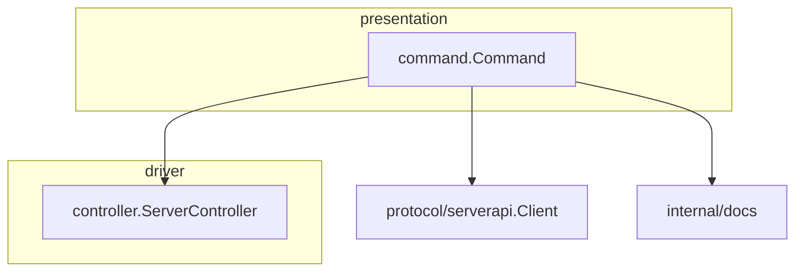

- `controller.ServerController` は、同じ実行ファイルを server のデーモンとして起動し、`gorviz stop` で止める

## 処理の流れ

### 起動 (`gorviz run`)

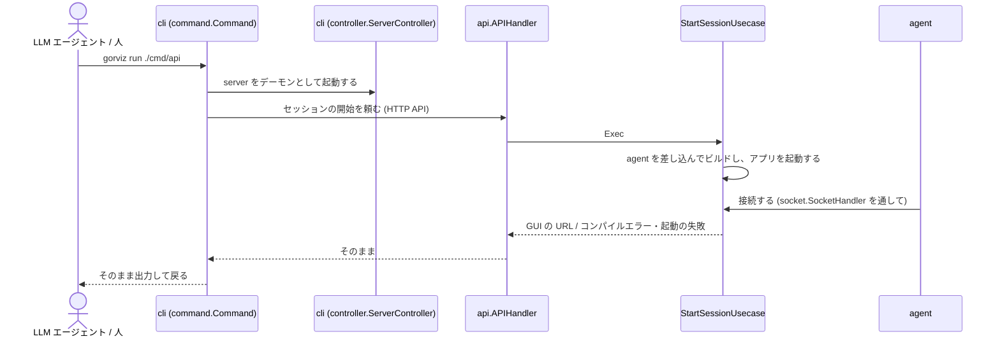

### agent の起動から終わりまで

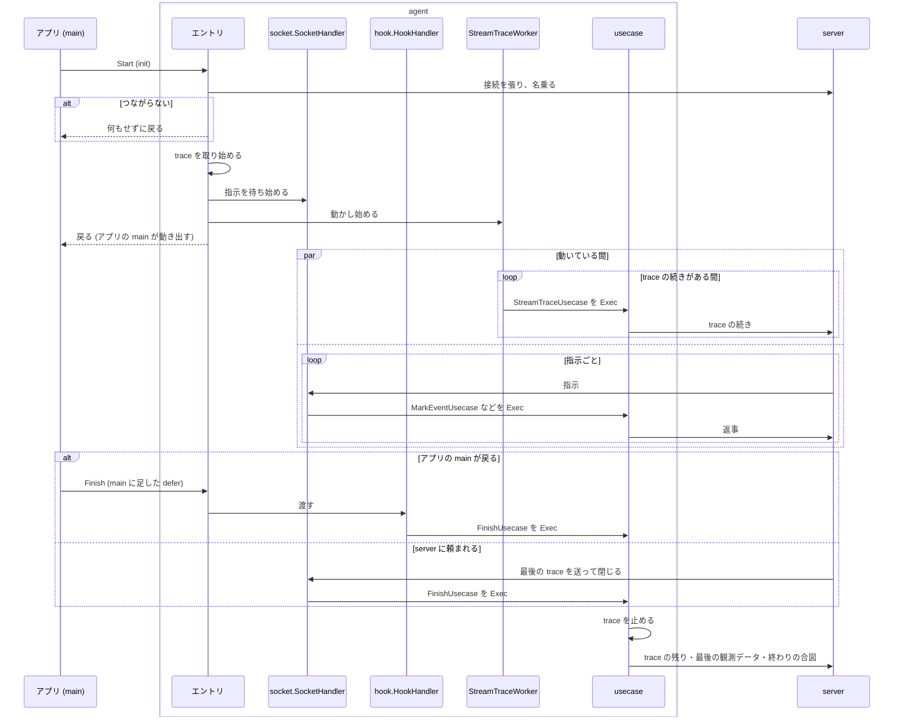

- `Finish` は送り終わるまで戻らない。戻ると、アプリのプロセスが終わる
- `os.Exit`・`log.Fatal` や main 以外の goroutine の panic では `Finish` が呼ばれず、trace の末尾が欠ける

- runtime の操作は `client.RuntimeClient`、server へ送るものはすべて `client.ServerClient` を通る

### 観測データの取り込み (server)

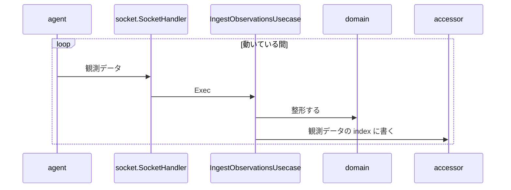

### 定期の取得と判定 (server)

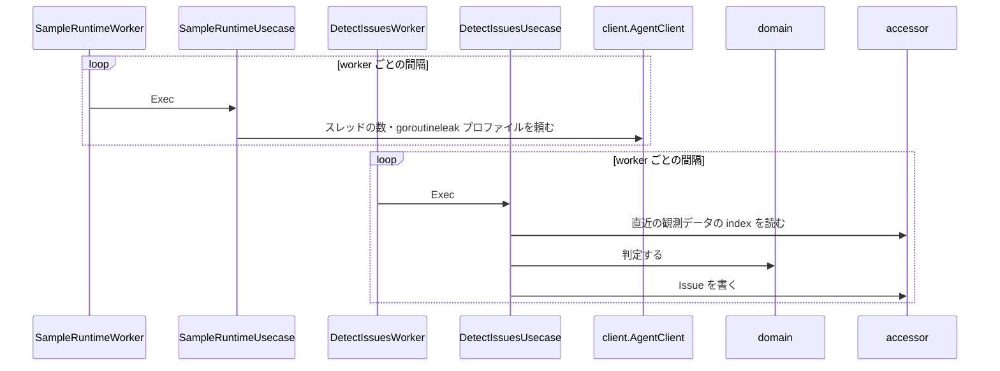

- 頼んだものは、取り込みの流れで観測データの index に入る
- `WatchAppWorker` はアプリのプロセスの終わりを待ち、`RecordAppExitUsecase` が終了コードを出来事として書く

### 診断 (`gorviz diagnose`)

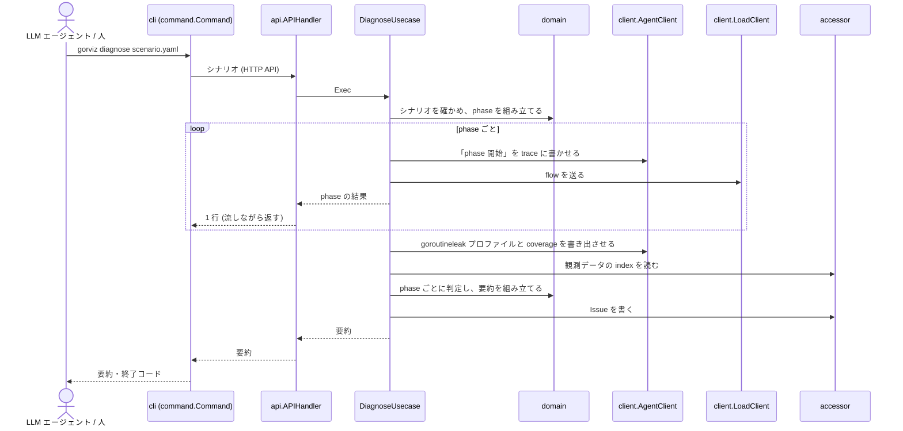

### Issue と goroutine を開く

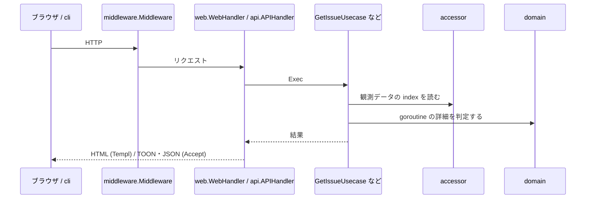

### 停止 (`gorviz stop`)

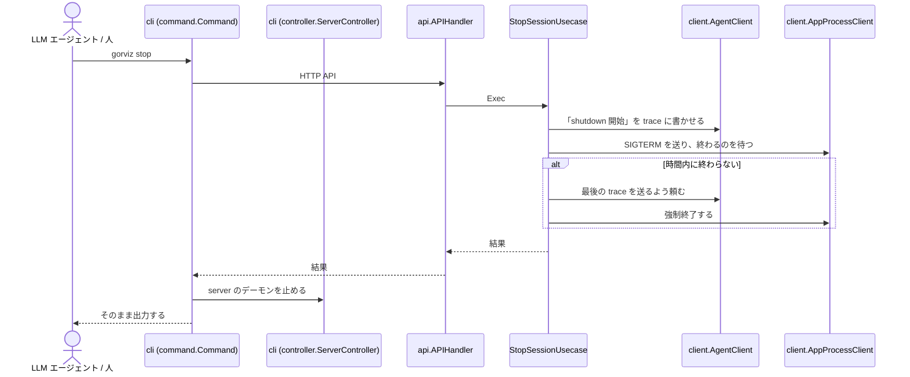

## セッション

- server のプロセス 1 つが、セッション 1 つにあたる。usecase はセッションを入力で受けない
- 観測データの index と Issue は、すべて `kvs.InMemoryKVS` に置く。server を止めると消える

## 横断関心事

アクセスログ・エラーの返し方・panic の復旧は、各層に書かず、入口の手前でまとめて扱う。

- HTTP (GUI・HTTP API) は、`presentation/middleware` で扱う
- agent からの接続は、`socket.SocketHandler` の入口で扱う
- driver には置かない。エラーの種別 (domain) や画面 (view) を使うため
- handler・usecase は、エラーのレスポンスを自分で書かない

### エラーフロー

各層は生の Go エラーを返さない。domain のエラー種別に包んで返す。種別は「invalid argument / not found / internal」の 3 つ。種別はコンポーネントごとの `domain` に置く。

HTTP の handler は、エラーをリクエストのコンテキストに載せて即 return する。outer の middleware が defer で取り出し、種別を status に変えて返す。

- invalid argument は 400、not found は 404、internal は 500
- GUI はエラーの画面を、HTTP API は Accept に応じた形 (TOON / JSON) のエラーを返す
- panic は同じ middleware の defer で復旧し、internal として扱う

agent との接続が切れることは、エラーにしない。trace の末尾が欠けたという出来事として残す。
