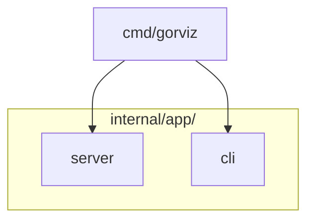
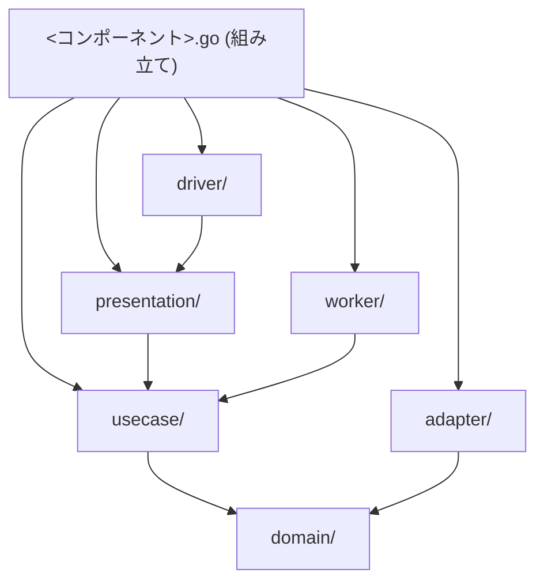
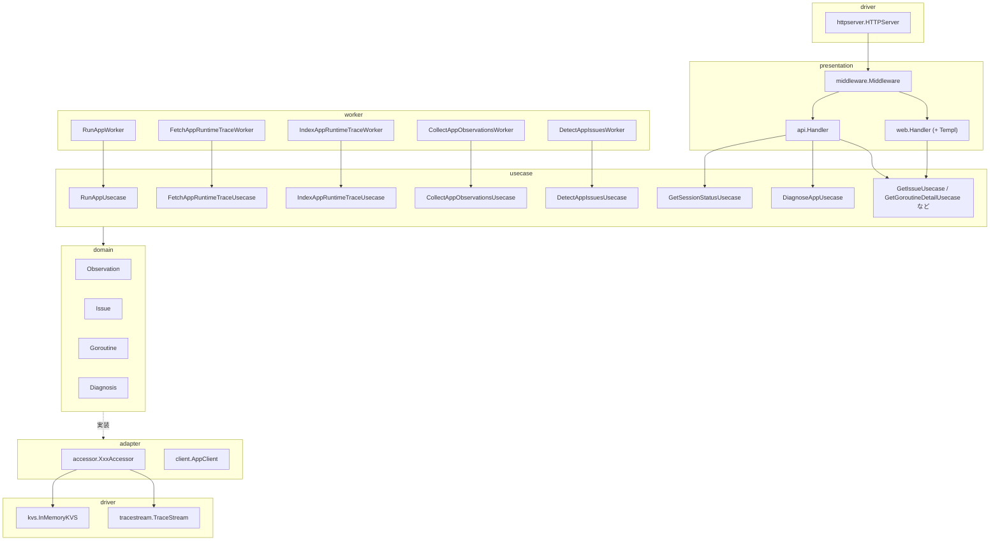

# Architecture

gorviz のコードの全体像。**どこに何があり、依存がどう流れるか** を扱う。図の名前は概念で、コードと一致するとは限らない。振る舞いの仕様と、コンポーネントのあいだの処理の流れは [design.md](design.md) にある。

この文書では、gorviz 自身の server・cli を「コンポーネント」、gorviz が観測する利用者のプログラムを「アプリ」と呼ぶ (design.md と同じ)。

## リポジトリの構成

1 つの Go モジュールに、実行ファイル `gorviz` を 1 つ置く。中に 2 つのコンポーネントを持つ。

すべて `internal/` に置く。利用者が import するものはない。アプリには、server がビルドのときに pprof を開くファイルを 1 つ足すだけ。

```
cmd/gorviz/                main
internal/
  app/                     コンポーネント
    server/
    cli/
example/                   観測されるアプリの例
```

- `cmd/gorviz` は、cli に server として起動されたときは server を、それ以外は cli を呼ぶ
- server と cli は同じ実行ファイルに入る
- アプリに足すファイルは、server の domain がソースとして組み、アプリのビルドに overlay する

## コンポーネントの境界

- コンポーネント同士は import しない
- cli と server の間の決まり (server を起動するときの環境変数・HTTP API の socket とパス) は、両側がそれぞれ持つ。揃えるのは文字列だけで、共有する型がないため
- 1 つのコンポーネントしか使わないものは、そのコンポーネントの層に置く
- 依存の向きは次の図のとおり。逆向きには使わない



- 中身を表さない名前 (`shared`・`common`・`util`・`types` など) の箱は作らない

## コンポーネントの中の層

どのコンポーネントも、`internal/app/<コンポーネント>/` の中を同じ層に分ける。ただし、手順も判断も持たない cli は presentation と adapter だけを持つ。層は外側から内側へ以下。



- `<コンポーネント>.go` は組み立て (エントリ)。コンポーネントの直下に置く Go ファイルはこれ 1 つ
- `driver/` は状態や後始末を持つ資源 (待ち受け・接続・プロセス・メモリの置き場) の用意と起動。待ち受けは presentation に、接続は adapter に渡す
- `presentation/` は外から届いたものを受けて usecase を呼ぶ入口
- `worker/` は定期的に動く、または何かを待ち続ける、独立した処理。外から呼ばれず、自分で usecase を呼ぶ。同じプロセスの中で、エントリが起動する
- `usecase/` は処理の手順
- `domain/` は判定・診断・組み立てのロジック / 型 / usecase が使う interface
- `adapter/` は domain の interface の実装。外との接続だけを持つ (メモリの置き場・アプリのビルドと起動・アプリの pprof・アプリへの負荷など)。取る・送る・書く・読むまでで、判断はしない。取ってきたものを読み解く・それで何かを決めるのは domain
- `config/` は設定の組み立て

- 依存の向きは図のとおり。矢印の先を使い、図にない向きでは使わない。`domain` はほかの層を使わない (使うのは、形式を読むためだけの外部ライブラリ (`golang.org/x/exp/trace` など) だけ)
- `presentation`・`worker` は usecase を呼ぶ側、`adapter` は domain の interface を通して usecase から呼ばれる側で、互いに依存しない
- interface は、使う側の `domain` に置く

### server



- `httpserver.HTTPServer` は、`api.Handler`・`web.Handler` が並べた handler を mux に登録し、middleware で包んで待ち受ける。各 handler の組み立ては Handler が `*usecase.UseCase` から行う
- `RunAppWorker` は server が起動したときに `RunAppUsecase` を 1 回だけ呼ぶ。`RunAppUsecase` は、アプリのビルドと起動から、アプリが終わるか server が止まるまでを 1 回の Exec の中で見届ける。アプリのプロセスは、`client.AppClient` が返した値を Exec の中で持つ
- `FetchAppRuntimeTraceWorker` は server が起動したときに `FetchAppRuntimeTraceUsecase` を 1 回だけ呼ぶ。`FetchAppRuntimeTraceUsecase` は、アプリが終わるまで、アプリの pprof から trace の区切りとスレッドの数を取り続け、`tracestream.TraceStream` に足す
- `IndexAppRuntimeTraceWorker` は server が起動したときに `IndexAppRuntimeTraceUsecase` を 1 回だけ呼ぶ。`IndexAppRuntimeTraceUsecase` は、`tracestream.TraceStream` から区切りを順に読み、観測データの index にする
- `CollectAppObservationsWorker` は、`CollectAppObservationsUsecase` を回し、アプリの pprof から goroutineleak プロファイルを取る。いつ取るかは、観測データの index の待ちの goroutine の数から domain が決める
- `client.AppClient` は、アプリとのやり取り (ビルド・子プロセスとしての起動・合図・pprof からの取得・負荷のリクエスト) をすべて持つ
- 層の外に `assets/` (CSS・JS・Stimulus controllers) を持つ

### cli

手順も判断も持たないので、presentation と adapter だけを持つ。

```
internal/app/cli/
  cli.go          組み立て (エントリ)
  config/
  presentation/
    command/      サブコマンドごとの入口。server の HTTP API を呼び、応答をそのまま出す
  adapter/
    client/       server を起動し、その HTTP API を呼ぶ
  docs/           埋め込むドキュメント (`gorviz docs` で引く・ヘルプとエラーに示す)
```

- `gorviz run` は server を起動して起動の結果を待ち、`gorviz stop` は止めるよう頼んで止まるのを待つ
- 終了コードは、server が応答に載せた値をそのまま使う
- どのサブコマンドも、決まった unix socket (引数で渡せば、その socket) で server につなぐ

## セッション

- server のプロセス 1 つが、セッション 1 つにあたる。usecase はセッションを入力で受けない
- 観測データの index (1 秒ごとの `domain.Observation`) とセッション・Issue は、すべて `kvs.InMemoryKVS` に値として置く。server を止めると消える
- `kvs.InMemoryKVS` は値を出し入れするだけで、入れた値は書き換えない。セッションと Issue は、書き手が重ならないよう、写しを書き換えて入れ直す

## 横断関心事

アクセスログ・エラーの返し方・panic の復旧は、各層に書かず、入口の手前でまとめて扱う。

- HTTP (GUI・HTTP API) は、`presentation/middleware` で扱う
- worker は、usecase が返したエラーをログに出して回り続ける
- driver には置かない。エラーの種別 (domain) や画面 (view) を使うため
- handler・usecase は、エラーのレスポンスを自分で書かない

### エラーフロー

各層は生の Go エラーを返さない。domain のエラー種別に包んで返す。種別は「invalid argument / not found / internal」の 3 つ。種別はコンポーネントごとの `domain` に置く。

HTTP の handler は、エラーをリクエストのコンテキストに載せて即 return する。outer の middleware が defer で取り出し、種別を status に変えて返す。

- invalid argument は 400、not found は 404、internal は 500
- GUI はエラーの画面を、HTTP API は Accept に応じた形 (TOON / JSON) のエラーを返す
- panic は同じ middleware の defer で復旧し、internal として扱う

アプリが終わって pprof から取れなくなることは、エラーにしない。trace の末尾が欠けたという出来事として残す。
