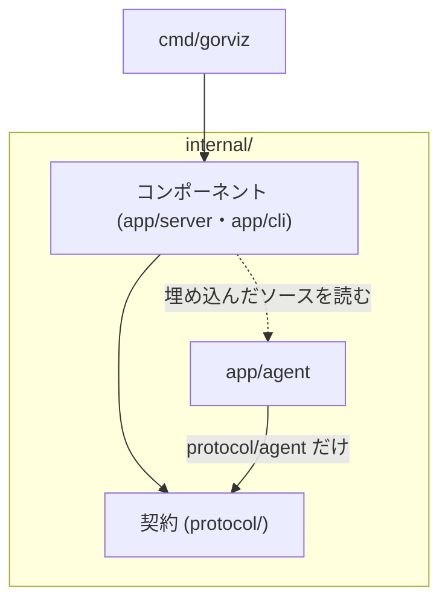
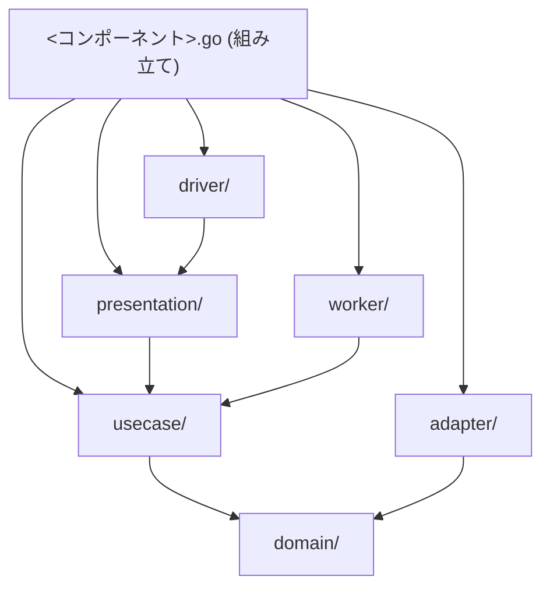
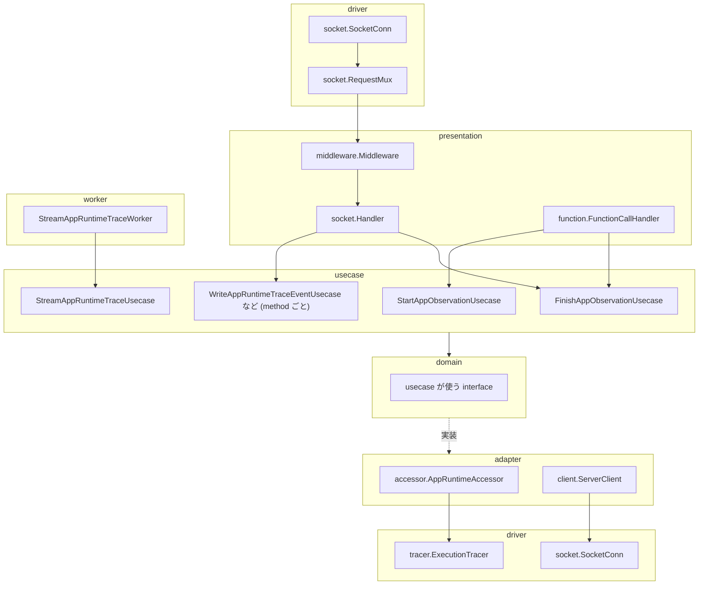
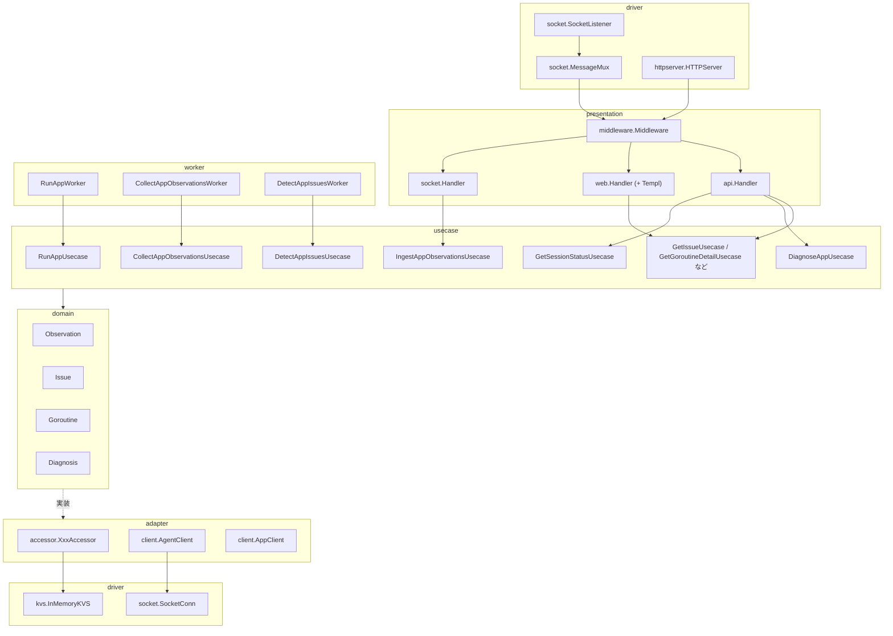

# Architecture

gorviz のコードの全体像。**どこに何があり、依存がどう流れるか** を扱う。図の名前は概念で、コードと一致するとは限らない。振る舞いの仕様と、コンポーネントのあいだの処理の流れは [design.md](design.md) にある。

この文書では、gorviz 自身の agent・server・cli を「コンポーネント」、gorviz が観測する利用者のプログラムを「アプリ」と呼ぶ (design.md と同じ)。

## リポジトリの構成

1 つの Go モジュールに、実行ファイル `gorviz` を 1 つ置く。中に 3 つのコンポーネントを持つ。

すべて `internal/` に置く。利用者が import するものはない。アプリには、agent がビルドのときに差し込まれるだけ。

```
cmd/gorviz/                main
internal/
  app/                     コンポーネント
    agent/                 アプリに差し込むソース
    server/
    cli/
  protocol/                コンポーネント同士の契約
    agent/                 agent との決まり
    server/                server との決まり
  embed_agent.go           アプリに差し込む agent のソース (app/agent と protocol/agent) を埋め込む
example/                   観測されるアプリの例
```

- `cmd/gorviz` は、cli に server として起動されたときは server を、それ以外は cli を呼ぶ
- server と cli は同じ実行ファイルに入る。agent は実行ファイルには入らず、server がソースとして持ち、アプリのビルドに overlay する

## コンポーネントの境界

- コンポーネント同士は import しない。またぐものは `internal/` 直下に置く
  - 例外は、agent と server の通信のテスト
  - server は agent を import せず、`internal/embed_agent.go` が埋め込んだ agent のソースを、ファイルとして読む。go:embed は親のディレクトリを指せず、agent のソースは `app/agent` と `protocol/agent` の 2 か所にあるので、両方を下に持つ `internal/` 直下に置く
- 1 つのコンポーネントしか使わないものは、そのコンポーネントの層に置く
- 依存の向きは次の図のとおり。逆向きには使わない



- agent が import してよいのは、標準ライブラリと `protocol/agent` だけ。agent はアプリのモジュールの中でコンパイルされ、アプリの依存を増やせないため
  - server は差し込むとき、agent と `protocol/agent` のソースを、アプリのモジュールの中のパッケージ (アプリの main パッケージの下の `gorvizagent/`) として見せ、import パスをそこへ書き換える
  - アプリの main には、agent を import して、main が戻るときに agent を止める 1 行を overlay する。これが agent の cmd に当たる。overlay なので、アプリのファイルは変えない
- 中身を表さない名前 (`shared`・`common`・`util`・`types` など) の箱は作らない

### protocol/

- 契約を相手ごとに 1 パッケージで持つ。両側が揃えるもの (型・定数・線の上の読み書き) だけを置き、片側しか使わない振る舞いは使う側に置く
- `agent` は、agent と server の間の 1 本の接続に流すメッセージの形と区切り。標準ライブラリだけで書く
- `server` は、server を起動するときの環境変数と、HTTP API のルート

## コンポーネントの中の層

どのコンポーネントも、`internal/app/<コンポーネント>/` の中を同じ層に分ける。ただし、手順も判断も持たない cli は presentation と adapter だけを持つ。層は外側から内側へ以下。



- `<コンポーネント>.go` は組み立て (エントリ)。コンポーネントの直下に置く Go ファイルはこれ 1 つ
- `driver/` は状態や後始末を持つ資源 (待ち受け・接続・プロセス・メモリの置き場) の用意と起動。待ち受けは presentation に、接続は adapter に渡す
- `presentation/` は外から届いたものを受けて usecase を呼ぶ入口
- `worker/` は定期的に動く、または何かを待ち続ける、独立した処理。外から呼ばれず、自分で usecase を呼ぶ。同じプロセスの中で、エントリが起動する
- `usecase/` は処理の手順
- `domain/` は判定・診断・組み立てのロジック / 型 / usecase が使う interface
- `adapter/` は domain の interface の実装。外との接続だけを持つ (メモリの置き場・agent への要求・アプリへの負荷・Go のツールチェーン・runtime の操作など)。取る・送る・書く・読むまでで、判断はしない。取ってきたものを読み解く・それで何かを決めるのは domain
- `config/` は設定の組み立て

- 依存の向きは図のとおり。矢印の先を使い、図にない向きでは使わない。`domain` はほかの層を使わない (使うのは `protocol/` と、形式を読むためだけの外部ライブラリ (`golang.org/x/exp/trace` など) だけ)
- `presentation`・`worker` は usecase を呼ぶ側、`adapter` は domain の interface を通して usecase から呼ばれる側で、互いに依存しない
- interface は、使う側の `domain` に置く

### agent

main が agent を import するので、main パッケージの初期化より前に、エントリの init が `Start` を呼ぶ。main が戻るときは、overlay した defer (agent の cmd) が `Stop` を呼ぶ。エントリは組み立てと driver・worker の起動を持ち、観測を始める・終えるのは presentation の `function.FunctionCallHandler` に渡す。各層はアプリの裏で動き続ける。

```go
// アプリの main に overlay するもの
import gorvizagent "<アプリのモジュール>/<main のパッケージ>/gorvizagent"

func main() {
	defer gorvizagent.Stop() // 元の main の先頭に overlay する
	...
}

// agent のエントリ
func init() { Start() }
```



- `socket.SocketConn` は server への接続を張り、読んだメッセージを `socket.RequestMux` に、書く口を `client.ServerClient` に渡す
- `socket.RequestMux` は、`socket.Handler` が method ごとに並べた handler を、middleware で包んで登録する。server からの要求を method で引いて渡し、middleware が ID を付けた応答を返す
- `accessor.AppRuntimeAccessor` は、runtime が持つ状態 (trace・coverage のカウンタ・goroutine・machine thread) を読み書きする。trace は `tracer.ExecutionTracer` を通し、coverage とプロファイルは `runtime/coverage`・`runtime/pprof` を直接触る
- `tracer.ExecutionTracer` は、execution trace の状態と書き出し先を持ち、後始末で止める。始める・読む・止めるのは `accessor.AppRuntimeAccessor` を通して usecase が行う
- `function.FunctionCallHandler` は、関数呼び出しで届くもの (エントリの init と、main の defer) を受ける。`Start` から `StartAppObservationUsecase` を、`Stop` から `FinishAppObservationUsecase` を呼ぶ。どちらも同期で、終わるまで戻らない
- `Start` が戻る前に観測が始まるので、trace を取り始めてからアプリの main が動く

### server



- `httpserver.HTTPServer` は、`api.Handler`・`web.Handler` が並べた handler を mux に登録し、middleware で包んで待ち受ける。各 handler の組み立ては Handler が `*usecase.UseCase` から行う
- `socket.SocketListener` は agent の接続を受け入れて `socket.SocketConn` にする。接続から読んだもののうち、観測データは `socket.MessageMux` に、要求への応答は `client.AgentClient` に渡る。`socket.MessageMux` は、`socket.Handler` がメッセージの型ごとに並べた handler を、middleware で包んで登録する
- `RunAppWorker` は server が起動したときに `RunAppUsecase` を 1 回だけ呼ぶ。`RunAppUsecase` は、アプリのビルドと起動から、アプリが終わるか server が止まるまでを 1 回の Exec の中で見届ける。アプリのプロセスは、`client.AppClient` が返した値を Exec の中で持つ
- `client.AppClient` は、アプリとのやり取り (ビルド・子プロセスとしての起動・合図・負荷のリクエスト) をすべて持つ
- 層の外に `assets/` (CSS・JS・Stimulus controllers) を持つ

### cli

手順も判断も持たないので、presentation と adapter だけを持つ。

```
internal/app/cli/
  cli.go          組み立て (エントリ)
  config/
  presentation/
    command/      サブコマンドごとの入口。server の HTTP API を呼び、応答をそのまま出す
  adapter/
    client/       server を起動し、その HTTP API を呼ぶ
  docs/           埋め込むドキュメント (`gorviz docs` で引く・ヘルプとエラーに示す)
```

- `gorviz run` は server を起動して起動の結果を待ち、`gorviz stop` は止めるよう頼んで止まるのを待つ
- 終了コードは、server が応答に載せた値をそのまま使う
- どのサブコマンドも、決まった unix socket (引数で渡せば、その socket) で server につなぐ

## セッション

- server のプロセス 1 つが、セッション 1 つにあたる。usecase はセッションを入力で受けない
- 観測データの index (1 秒ごとの `domain.Observation`) とセッション・Issue は、すべて `kvs.InMemoryKVS` に値として置く。server を止めると消える
- `kvs.InMemoryKVS` は値を出し入れするだけで、入れた値は書き換えない。セッションと Issue は、書き手が重ならないよう、写しを書き換えて入れ直す

## 横断関心事

アクセスログ・エラーの返し方・panic の復旧は、各層に書かず、入口の手前でまとめて扱う。

- HTTP (GUI・HTTP API) は、`presentation/middleware` で扱う
- socket (agent と server の間) も、`presentation/middleware` で扱う。server はログに出して捨て、agent は応答に載せて返す
- driver には置かない。エラーの種別 (domain) や画面 (view) を使うため
- handler・usecase は、エラーのレスポンスを自分で書かない

### エラーフロー

各層は生の Go エラーを返さない。domain のエラー種別に包んで返す。種別は「invalid argument / not found / internal」の 3 つ。種別はコンポーネントごとの `domain` に置く。

HTTP の handler は、エラーをリクエストのコンテキストに載せて即 return する。outer の middleware が defer で取り出し、種別を status に変えて返す。

- invalid argument は 400、not found は 404、internal は 500
- GUI はエラーの画面を、HTTP API は Accept に応じた形 (TOON / JSON) のエラーを返す
- panic は同じ middleware の defer で復旧し、internal として扱う

agent との接続が切れることは、エラーにしない。trace の末尾が欠けたという出来事として残す。
