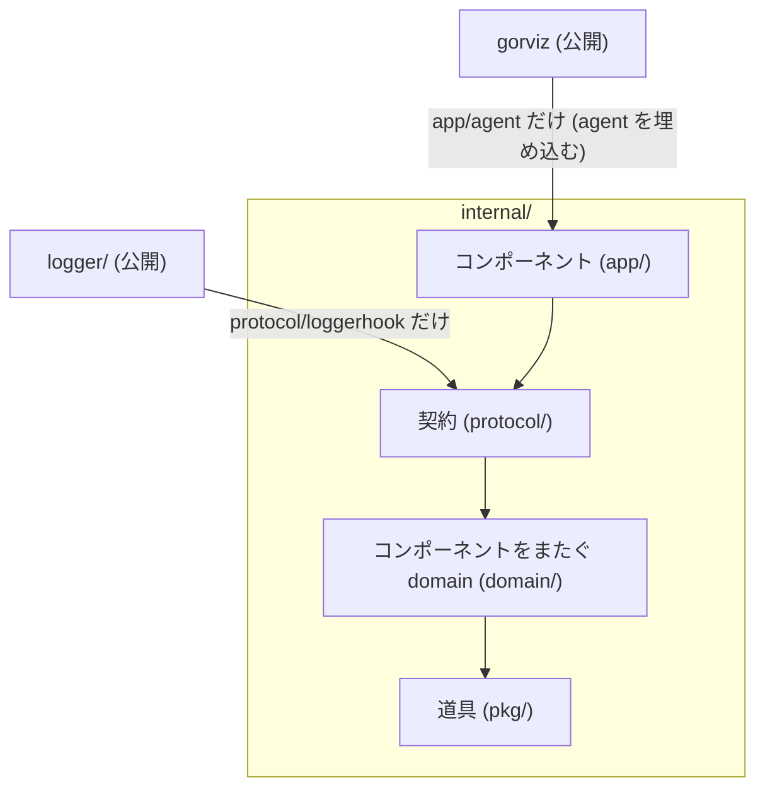
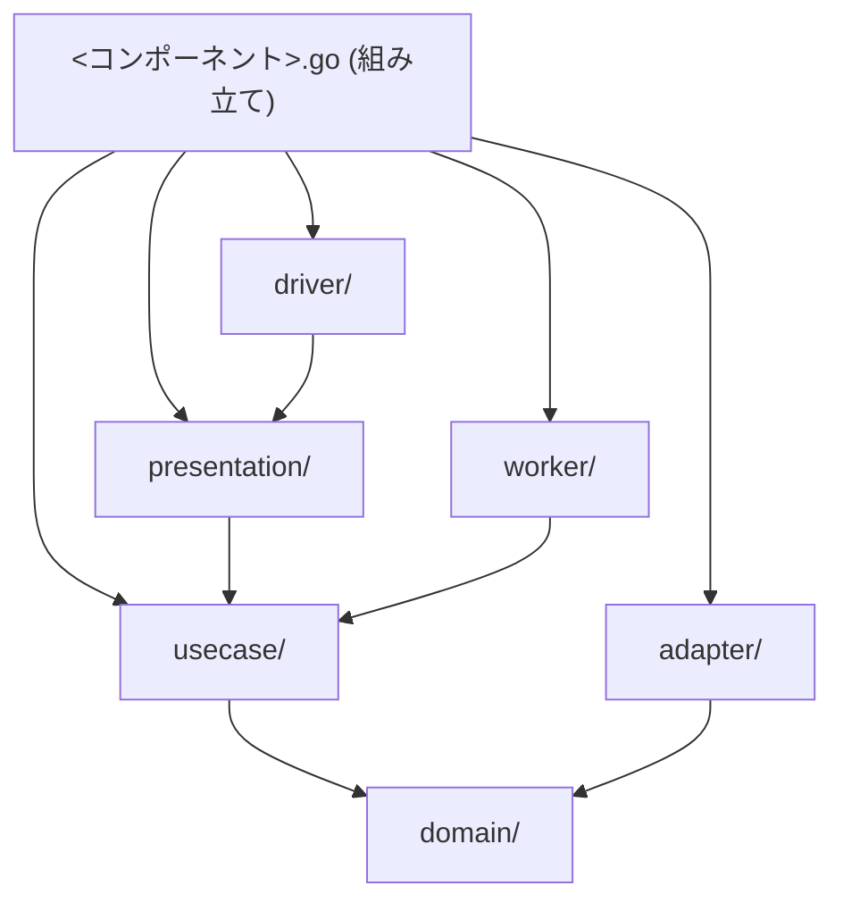
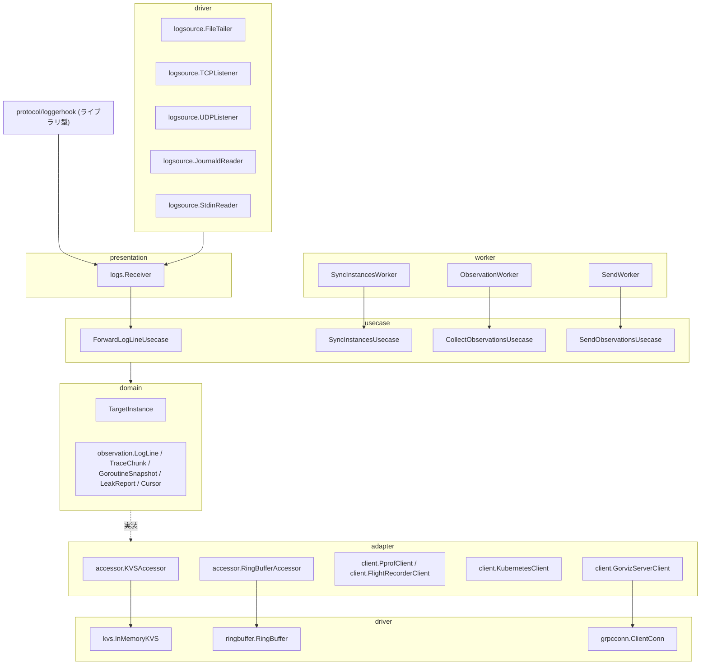
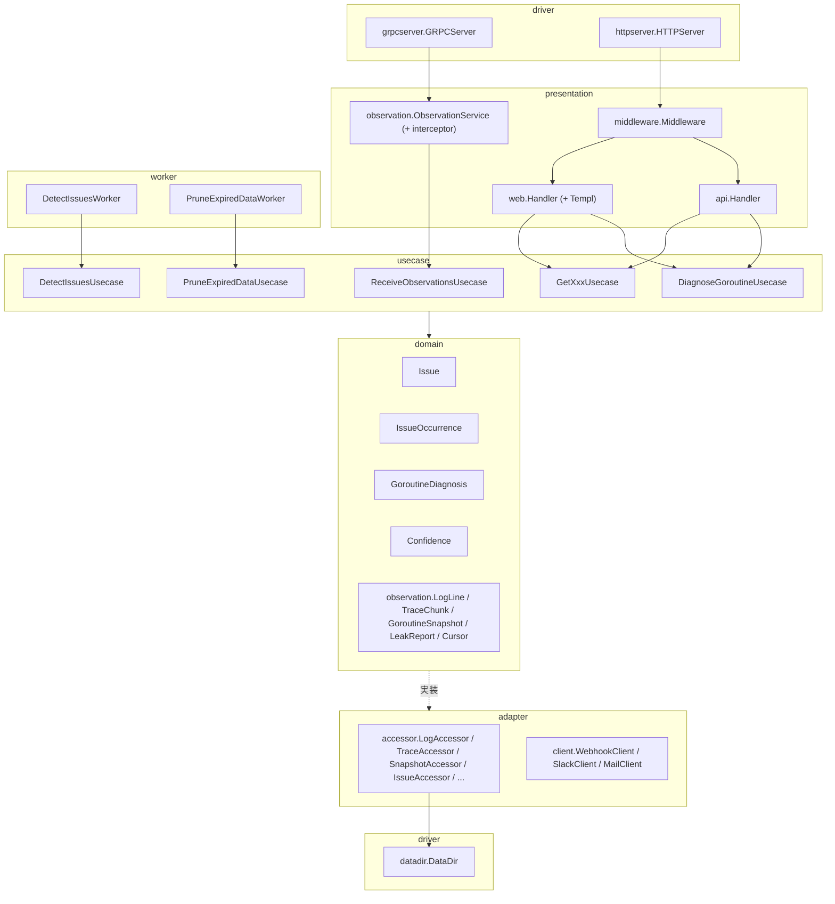
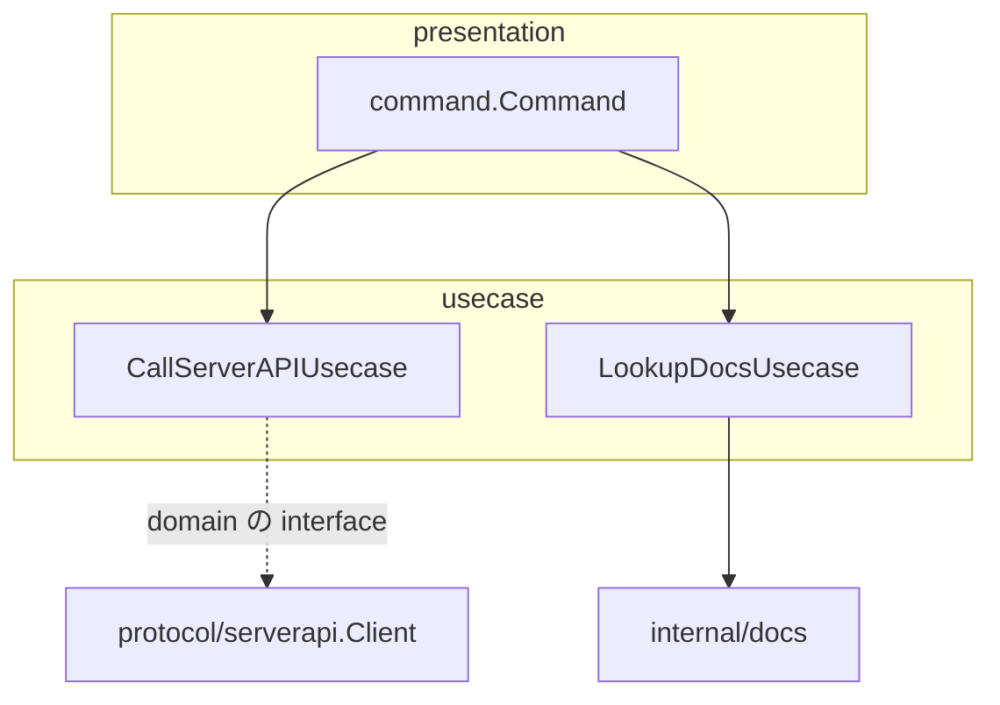
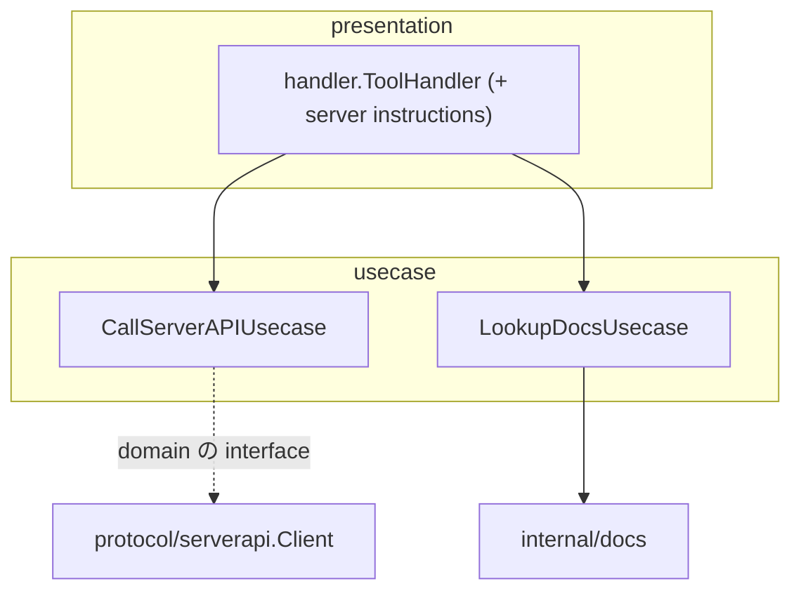

# Architecture

gorviz のコードの全体像。**どこに何があり、依存がどう流れ、観測データとリクエストがどう処理されるか** を扱う。図の名前は概念で、コードと一致するとは限らない。振る舞いの仕様は [design.md](design.md) にある。

この文書では、gorviz 自身の server・agent・cli・mcp・launcher を「コンポーネント」、gorviz が観測する利用者のプログラムを「アプリ」と呼ぶ (design.md と同じ)。

## リポジトリの構成

1 つの Go モジュールに、5 つのコンポーネント (実行ファイル) と、観測されるアプリが import する公開パッケージを置く。

公開パッケージ (`gorviz`・`logger/`) 以外はすべて `internal/` に置く。利用者が import できるのを公開パッケージだけに絞り、それ以外は互換を気にせず変えられるようにするため。

```
cmd/<コンポーネント>/      main (実行ファイルごと)
internal/
  app/                     コンポーネント
    agent/
    server/
    cli/
    mcp/
    launcher/
  domain/                  コンポーネントをまたぐ domain
    observation/           観測データ
  protocol/                コンポーネント同士の契約
    agentrpc/              agent と server
    serverapi/             server と cli・mcp
    loggerhook/            ロガーアダプタと agent
  pkg/                     gorviz に依らない道具
    funcname/
    histogram/
  docs/                    cli・mcp に埋め込むドキュメント
gorviz.go                  公開パッケージ (agent の埋め込み)
logger/gorviz<ロガー>/     公開パッケージ (ロガーアダプタ)
example/                   観測されるアプリの例
deploy/                    配置の例
```

## コンポーネントの境界

- コンポーネント同士は import しない。またぐものは `internal/` 直下に置く
  - 例外は launcher (server と agent を組み立てる) と、agent と server の通信のテスト
- 1 つのコンポーネントしか使わないものは、そのコンポーネントの層に置く
- 依存の向きは次の図のとおり。上が下を使い、下の段なら飛ばしてもよい。逆向きには使わない



- `logger/` は `gorviz` も `app/` も import しない。ロガーアダプタだけを使うアプリ (daemon 型・sidecar 型) に agent を持ち込まないため
- 中身を表さない名前 (`shared`・`common`・`util`・`types` など) の箱は作らない

### domain/

- 複数のコンポーネントが共通して使うドメイン知識を置く。型と、型の意味から決まる振る舞いだけで、判断の規則はそれを決めるコンポーネントの `domain/` に置く
- パッケージは中身の名前で切る。コンポーネントの `domain` と並べて import するときに別名を要らなくするため
- `observation` は、agent が作り server が読み解く観測データと、server がどこまで持っているかを表すカーソル。`agentrpc` の proto とほぼ 1 対 1 に対応する。生成型を使わないのは、domain を生成コードに依存させないため

### protocol/

- 契約を相手ごとに 1 パッケージで持つ
- `agentrpc` は gRPC の形と、`domain/observation` との詰め替え
- `serverapi` は HTTP API のクライアント。応答は解釈せず、そのまま返す
- `loggerhook` はプロセスの中の契約。ログ行と trace に書く番号の決まりと、ライブラリ型で埋め込んだ agent へ行を渡す口

### pkg/

- gorviz の仕様が変わっても変わらない道具。どこにも依存しない

## コンポーネントの中の層

どのコンポーネントも、`internal/app/<コンポーネント>/` の中を同じ層に分ける。層は外側から内側へ以下。



- `<コンポーネント>.go` は組み立て (エントリ)。コンポーネントの直下に置く Go ファイルはこれ 1 つ
- `driver/` は状態や後始末を持つ資源 (接続・待ち受け・保存先) の用意と起動。待ち受けは presentation に、接続は adapter に渡す
- `presentation/` は外から届いたものを受けて usecase を呼ぶ入口
- `worker/` は定期的に動く、独立した処理。外から呼ばれず、自分で usecase を呼ぶ。同じプロセスの中で、エントリが起動する
- `usecase/` は処理の手順
- `domain/` は判定・診断・組み立てのロジック / 型 / usecase が使う interface
- `adapter/` は domain の interface の実装。外との接続だけを持つ (ディスク・外部への送信・pprof など)。取る・送る・書く・読むまでで、判断はしない。取ってきたものを読み解く・それで何かを決めるのは domain
- `config/` は設定の組み立て

- 依存の向きは図のとおり。矢印の先を使い、図にない向きでは使わない。`domain` はほかの層を使わない (使うのは `internal/domain/`・`pkg/` と、形式を読むためだけの外部ライブラリ (`golang.org/x/exp/trace` など) だけ)
- `presentation`・`worker` は usecase を呼ぶ側、`adapter` は domain の interface を通して usecase から呼ばれる側で、互いに依存しない
- interface は、使う側の `domain` に置く

### agent



### server



- 層の外に `assets/` (CSS・JS・Stimulus controllers) を持つ

### cli



### mcp



### launcher

組み立てと config だけを持つ。server と agent を同じプロセスで並べて呼び、間は TCP (localhost) でつなぐ。launcher 自身は通信の相手にならない。

## 組み立て

- `<コンポーネント>.go` が、各層の `NewXxx` を内側から順に呼んで依存を渡し、driver・worker の `Run` を scope の下で起動する。DI のライブラリは使わない
- driver の後始末は、コンストラクタが cleanup として返す
- `cmd/<コンポーネント>/` の main は、シグナルで終わる ctx を作り、config を渡して 1 回呼ぶだけ

```go
// cmd/<コンポーネント>/main.go
func main() {
	ctx, stop := signal.NotifyContext(context.Background(), os.Interrupt, syscall.SIGTERM)
	defer stop()
	if err := <コンポーネント>.Run(ctx, config.MustLoad(os.Args[1:])); err != nil {
		os.Exit(1)
	}
}

// internal/app/<コンポーネント>/<コンポーネント>.go
func Run(ctx context.Context, cfg *config.Config) error {
	// driver (adapter が使う接続)
	conn, cleanup, err := xxxdriver.NewXxxConn(ctx, cfg)
	if err != nil {
		return err
	}
	defer cleanup()

	// adapter
	xxx := xxxadapter.NewXxx(cfg)
	yyy := yyyadapter.NewYyy(conn)

	// usecase
	uc := usecase.NewUseCase(xxx, yyy)

	// presentation
	xxxHandler := xxxhandler.NewXxxHandler(uc)

	// worker
	xxxWorker := worker.NewXxxWorker(cfg, uc)

	// driver (presentation を受けて待ち受ける)
	xxxListener := yyydriver.NewXxxListener(cfg, xxxHandler)

	return scope.Run(ctx, func(sc *scope.Scope) error {
		sc.Go(xxxWorker.Run)
		sc.Go(xxxListener.Run)
		return nil
	})
}
```

## 並行処理

- コンポーネントの中で回し続けるもの (待ち受け・worker・接続ごとの処理) は、エントリで 1 つの scope ([kakkky/scope](https://github.com/kakkky/scope)) の下に起動する
- どれかが失敗したら、scope の ctx が終わり、残りも止まる。`ctx` が終わるまで返らない関数として書く
- usecase の中で並列に走らせる処理 (インスタンスごと・期間ごとの集計など) も、scope の下に起動する
- goroutine を scope の外で起動しない

## 処理の流れ

### 観測データ (agent → server)

```
agent
  worker (Pod を見張る。daemon 型)
    → usecase (観測するインスタンスの一覧を差し替える)
  worker (trace・プロファイルを取り続ける)          driver/logsource → presentation/logs (ログを取り込む)
    → usecase (インスタンスごとに整形し、スナップショットを組み立て、送るまで置く)
  worker (数秒ごとにまとめて送る)
    → usecase (インスタンスごとに、server が持っている位置の続きを集め、返ってきた位置を覚える)
    → adapter (driver/grpcconn が張った接続の上の gRPC)
server
  driver/grpcserver (ハンドシェイクを読む)
    → presentation/observation (トークンを確かめ、観測データに付いた名前から service・instance を決める)
    → usecase (抜けがないか確かめ、重複を除き、ディスクに書く。インスタンスの始まりを記録する。持っている位置を返す)
    → adapter (services/<サービス>/... に書く)
```

- 接続は agent から server へ外向きに 1 本。server から agent へは呼ばない
- agent は送るまでの分しか持たない。判定はしない
- どこまで送ったかは、server が返す位置で決める。agent は、つなぎ直したことを知らなくてよい。つなぎ直しは driver に閉じる
- server は、届いた観測データを、付いている名前のサービスとインスタンスのものとして書く

### Issue の検出と通知

```
server worker (数秒ごと・5 分ごと)
  → usecase (直近の観測データとメトリクスを読む)
  → domain (閾値・普段との比較で判定)
  → adapter (Issue と、前後の execution trace を書く / 通知を送る)
```

### GUI と HTTP API のリクエスト

```
driver/httpserver (TLS)
  → presentation/middleware (認証・アクセスログ・エラー)
  → presentation/web (GUI) / presentation/api (HTTP API)
  → usecase (ディスクの観測データを読み、診断する)
  → presentation/web の Templ で HTML を返す / Accept に応じて TOON か JSON を返す
```

### gorviz-cli・gorviz-mcp

```
presentation/command (cli) / presentation/handler (mcp)
  → usecase
  → protocol/serverapi のクライアント (server の HTTP API)
```

- どちらも server の HTTP API だけを呼び、agent やアプリには直接つながない。読み取りだけを行う
- 返す形 (TOON / JSON) は Accept で server に頼み、受け取ったものをそのまま返す。TOON への書き直しは server の `presentation/api` だけが持つ

## サービスとインスタンス

- server の usecase は server 全体で 1 つ。どのサービス・インスタンスのものかは、usecase の入力で渡す
- サービスとインスタンスの区切りは、adapter のディスクの置き場 (`services/<サービス>/service/`・`services/<サービス>/instances/<インスタンス>/`) が持つ
- 観測データは、ディスクに書いてからディスクから読む。メモリに置くのは、送るまで・書くまでの分と、つながっている agent の状態だけ

## 横断関心事

認証・アクセスログ・エラーの返し方・panic の復旧は、各層に書かず、入口の手前でまとめて扱う。

- HTTP (GUI・HTTP API) は、`presentation/middleware` で扱う
- gRPC (agent からの観測データ) は、`presentation/observation` の interceptor で扱う
- driver には置かない。エラーの種別 (domain) や画面 (view) を使うため
- handler・usecase は、認証やエラーのレスポンスを自分で書かない

### エラーフロー

各層は生の Go エラーを返さない。domain のエラー種別に包んで返す。種別は「invalid argument / not found / internal」の 3 つ。種別はコンポーネントごとの `domain` に置く。

HTTP の handler は、エラーをリクエストのコンテキストに載せて即 return する。outer の middleware が defer で取り出し、種別を status に変えて返す。

- invalid argument は 400、not found は 404、internal は 500
- GUI はエラーの画面を、HTTP API は Accept に応じた形 (TOON / JSON) のエラーを返す
- HTTP API の not found には、打ち間違いの候補やあるものを添える (design.md「LLM エージェントの利用に特化するためのポイント」)
- panic は同じ middleware の defer で復旧し、internal として扱う

gRPC は、interceptor が種別を gRPC の status (InvalidArgument / NotFound / Internal) に変える。panic も interceptor で復旧する。

保持期間を過ぎて出せないことは、エラーにしない。出せない欄として正常に返す。
