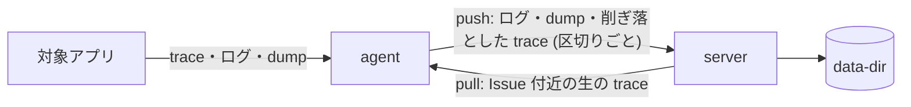

# データの持ち方

server で 31 日遡って調べられるようにする。保存先は server のローカルディスクだけ (S3 は使わない)。全体の設計は [design.md](design.md)。

状態: 提案。

## 方針

- 古くなるほど細かさを落とす。生の trace は Issue 付近だけ、それ以外は削ぎ落とした形で持つ
- 利用者が決めるのは `-data-dir` と `-disk-limit` (使ってよい大きさ) だけ。31 日分の小さいものを先に取り置き、残りを細かいものに回す。あふれたら細かいものの古い方から捨てる
- 保存はサービス単位。インスタンスはファイル名か各行の項目で持つので、再起動・スケールで履歴が切れない
- server のメモリには直近の分と索引だけを持ち、古いものは画面を開いたときにファイルから読む

## データの流れ



- agent は今と同じく生の trace をリングバッファに持つ。区切りごとに下の (1) イベント列と (2) G ごとの内訳を作って push する。agent がするのは集計だけで、判定はしない
- server は push されたものから推移を集計し、Issue を判定して、ファイルに書く
- Issue が見つかったら、その前後の生の trace を agent から pull して保存する (今のまま)

## server のファイル

```
<data-dir>/<service>/
  metrics/10s/<日付>.jsonl                    推移 (10 秒刻み)
  metrics/5m/<日付>.jsonl                     推移 (5 分刻み)
  issues/<日付>.jsonl                         Issue
  logs/<日付>/<時>.jsonl.zst                  ログ
  slow/<日付>.jsonl                           遅かった G
  goroutines/<日付>/<時>-<instance>.bin.zst   (2) 全 G の内訳
  timeline/<日付>/<時>/<分>-<instance>.bin.zst (1) イベント列
  recordings/<id>/meta.json, trace.zst        Issue 付近の生の trace
```

日付・時刻は UTC。どれもその単位が閉じたら書き足さないので、期限が来たらファイルかディレクトリごと消せる。

## 期間

必ず 31 日持つもの (小さい):

- `metrics/5m`・`issues`・`slow`
- `logs`。量はアプリしだいなので、`-disk-limit` を超えるときは古い日から捨てる

`-disk-limit` の残りで持つもの (細かい。括弧は目安):

- `metrics/10s`: 26 時間
- `timeline`: 1 日
- `goroutines`: 7 日
- `recordings`: 31 日

画面には、その時刻にどこまでの細かさが残っているか (再生できる / 内訳まで / 推移のみ) を出す。

## データの形

`.jsonl` は 1 行に 1 件。`.bin.zst` は先頭に文字列の辞書 (関数名・`file:line`・待機理由) を置き、各件はそれを番号で指す。数値は varint。

- **推移** (`metrics`): 今の `domain.MetricPoint`。待ち場所 (`Waits`) のキーの文字列が大半を占めるので、ここも辞書にする
- **Issue** (`issues`): 今の `domain.IssueOccurrence`
- **ログ** (`logs`): `model.LogLine` に、書いた G の分かることを添える。添えておけば、`goroutines` が消えたあとも、1 か月前のログから主因と止まった場所まで辿れる
  - `instance`
  - `goroutine`
  - `cause` (主因)
  - `where` (止まった場所)
- **遅かった G** (`slow`): 分ごとに、待った時間が長い上位 N 件。形は下の G の内訳と同じ
- **G の内訳** (`goroutines`): G 1 つにつき 1 件
  - `goroutine`
  - `entry` (入口の関数)
  - `from`・`to`
  - 主因 (RUNNING〜GC の 7 つ) ごとの時間 (µs)
  - `where` (いちばん長く止まった場所)
- **イベント列** (`timeline`): G の状態の移り変わり 1 回につき 1 件。P・GC・ヒープのイベントは持たないので、再生は G の動きだけになる
  - 前のイベントからの時間 (10µs 単位)
  - G (前のイベントとの差)
  - 移った先の状態
  - 待機理由
  - 止まった場所
- **生の trace** (`recordings`): FlightRecorder から切り出した区切りの重なりを除いて 1 本につなぎ、zstd で圧縮する。`meta.json` は今の `model.SavedRecording`

## 根拠 (実測)

合成の負荷 (1 リクエスト = 1 goroutine。HTTP の往復・ロック・2ms のスリープ・計算) を 60 秒取り、zstd で圧縮した。1 分あたりの大きさ:

- 100 rps
  - 生の trace: 1.6 MB
  - (1) イベント列: 0.44 MB
  - (2) G の内訳: 0.08 MB
- 1000 rps
  - 生の trace: 13.8 MB
  - (1) イベント列: 4.0 MB
  - (2) G の内訳: 0.74 MB
- 5000 rps
  - 生の trace: 49 MB
  - (1) イベント列: 19 MB
  - (2) G の内訳: 3.0 MB

分かったこと:

- 生の trace は圧縮しても 1/1.6〜1/2 にしかならない。1000 rps で 31 日持つと約 600 GB
- G の内訳は 1 件 6 B ほど。1000 rps で 7 日なら約 7 GB
- FlightRecorder の区切り (`chunk.Raw`) は前の区切りと重なっていて、つなぐと取り続けた分の 2 倍になる。保存するときは重なりを除く
