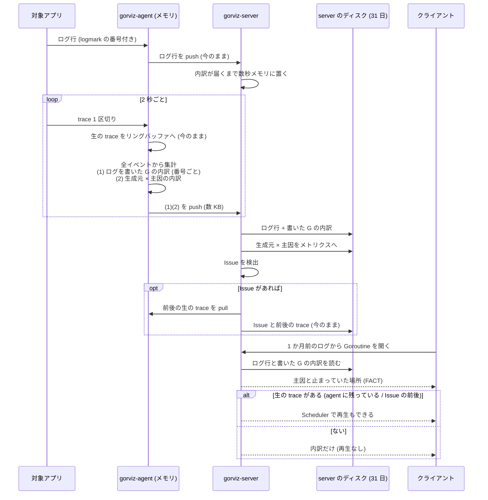

# データの持ち方 (1 か月保持の検討)

server で 1 か月 (31 日) 遡って調べられるようにするための検討。全体の設計は [design.md](design.md)。

状態: 提案。未確定の点は「[未確定](#未確定)」。

## 目次

- [データと使い道](#データと使い道)
- [今の持ち方](#今の持ち方)
- [実測](#実測)
- [提案](#提案)
- [未確定](#未確定)

## データと使い道

| データ | 取るもの・頻度 | 何に使うか | 使う画面・機能 |
| --- | --- | --- | --- |
| execution trace | agent が `-chunk` (既定 2 秒) ごとに区切って取り続ける | 状態別の時間内訳と主因 (`FACT`)、GMP の再生、CPU 待ち・GC・mark assist・ヒープの計測、ログと書いた goroutine の結びつけ (logmark) | Goroutine、Scheduler、Overview の推移、`CPU_WAIT_SPIKE` / `MEMORY_PRESSURE` の検出、`export` |
| goroutine dump | agent が `-dump-interval` (既定 1 分) ごと | 全 goroutine の生成元 (go 文) と止まっている場所、生成元ごとの数の推移、trace がないときの主因の推測 (`INFERENCE`)、Scheduler の G の入口の関数 | Overview の推移、Goroutine、`LEAK` の検出 (`INFERENCE`) |
| goroutineleak プロファイル | dump の `-leak-check-every` (既定 5) 回に 1 回 | runtime によるリークの判定 | `LEAK` の検出 (`FACT`) |
| ログ | アプリの出力をそのまま (logmark の番号付き) | 問題の瞬間を見つける入口、件数・エラーの推移、書いた goroutine と時刻への結びつけ | Logs、Goroutine (その窓で書いたログ)、Overview |
| Issue | server が数秒ごとにログ・dump・trace から検出 | 問題の一覧と回数の推移、前後の trace を保存するきっかけ | Issues、Overview、CLI `issues`、MCP |
| メトリクス | server が観測のたびに集計 | goroutine 数・状態・生成元・ヒープ・GC・CPU 待ちの推移 | Overview、Issues の推移 |

## 今の持ち方

| データ | agent (メモリ) | server (メモリ) | server (ディスク、`-save-dir`) |
| --- | --- | --- | --- |
| execution trace | リングバッファ `-trace-buffer-mib` (既定 256 MiB)。数十秒〜数分 | - | Issue の前後 (10 秒前〜2 秒後) の生の trace を 31 日 |
| goroutine dump | 最新の 1 件 | leak 検出用に `-history` (既定 30) 回分 | 生成元・状態ごとの数をメトリクスとして 31 日 |
| goroutineleak プロファイル | 最新の結果 | - | Issue として 31 日 |
| ログ | `-max-logs` (既定 5 万行) | `-max-logs` (既定 5 万行) | **なし** |
| Issue | - | - | 31 日 (`issues/<日付>.jsonl`) |
| メトリクス | - | - | 10 秒刻みを 26 時間、5 分刻みを 31 日 |

穴:

- ログはメモリにしかないので、遡れるのは直近 5 万行まで
- 主因を `FACT` で出せるのは、trace が残っている区間 (agent のリングバッファか Issue の前後) だけ。それ以外は 1 か月前どころか数分前でも出せない

## 実測

trace 2 秒分を、形を変えて gzip した大きさ。合成の負荷 (1 リクエスト = 1 goroutine。ロック・TCP の往復・スリープ・計算) を `runtime/trace` で取り、`runtimeparse.ParseTrace` と `domain.Breakdown` に通した。

| 形 | 100 rps | 1000 rps | 5000 rps | 1 か月 (1 インスタンス、100 / 1000 / 5000 rps) |
| --- | --- | --- | --- | --- |
| 生の trace | 36 KB | 260 KB | 1.08 MB | 47 GB / 336 GB / 1.4 TB |
| 再生用イベント (`Procs`・`Events`・`GC`・`Heap`) | 84 KB | 522 KB | 1.24 MB | 生より大きい |
| goroutine ごとの内訳 (全 G) | 6.3 KB (285 G) | 24.7 KB (1338 G) | 約 180 KB (推定、約 1 万 G) | 8 GB / 32 GB / 約 230 GB |
| 生成元 × 主因の内訳 | 0.45 KB | 0.45 KB | 0.35 KB | 刻みをまとめて約 10 MB |

- goroutine ごとの内訳は G 1 つあたり約 20 バイト (G の ID・入口の関数・主因ごとの時間・止まっていた場所)
- 再生用イベントは生の trace より大きいので、残す意味はない。再生には生の trace を読み直す
- 5000 rps の内訳は、下の打ち切りのせいで実測が少なく出たので推定

見つかった問題:

- 再生用イベントは 5 万件で打ち切る (`internal/runtimeparse/execution_trace.go:19`)。1000 rps で既に打ち切られた
- `domain.Breakdown` はこの打ち切られた `Events` から内訳を出す (`internal/app/server/domain/breakdown.go:136`)。忙しいアプリでは区切りの後半の内訳が誤ったまま `FACT` になる
- 内訳は再生用の上限とは別に、読み込む時点で全イベントから出す必要がある

## 提案

1 か月持つのは「ログ行 + 書いた goroutine の内訳」と「生成元 × 主因の内訳」。生の trace は今と同じく Issue の前後だけ。

- ログから goroutine に降りるには、ログを書いた G の内訳があれば足りる。全 G の内訳は 1000 rps で 1 か月 32 GB と重い
- 全体の傾向は生成元 × 主因の内訳で追える

提案後の持ち方:

| データ | agent (メモリ) | server (メモリ) | server (ディスク、31 日) |
| --- | --- | --- | --- |
| 生の trace | リングバッファ 256 MiB (今のまま) | - | Issue の前後 (今のまま) |
| ログを書いた G の内訳 | 集計したら push して捨てる | 対応するログ行が来るまで | ログ行に添える |
| 生成元 × 主因の内訳 | 集計したら push して捨てる | - | メトリクス (10 秒刻み 26 時間 / 5 分刻み 31 日) |
| ログ | 5 万行 (今のまま) | 内訳を待つ数秒分 | `logs/<日付>.jsonl` |
| dump・Issue・メトリクス | 今のまま | 今のまま | 今のまま |

- 集計は軽いので push に乗せる (重いものだけ pull にする今の分け方に沿う)。agent がするのは集計で、判定はしない
- 保存先は issuestore・metricstore と同じく、S3 などに差し替えられる形にする

## 未確定

- ログを書かなかった G の内訳を残すか。残すなら、区切りごとに BLOCKED などが長い上位 N 件を 26 時間、など (全 G だと 1000 rps で 1 日約 1 GB)
- 内訳を出すコード (`server/domain/breakdown.go`) を agent からも使える場所 (`runtimeparse` など) に移すか。移すと打ち切りの問題も一緒に直る
- ログの量。実際のアプリで 1 日に何行出るかは未計測
