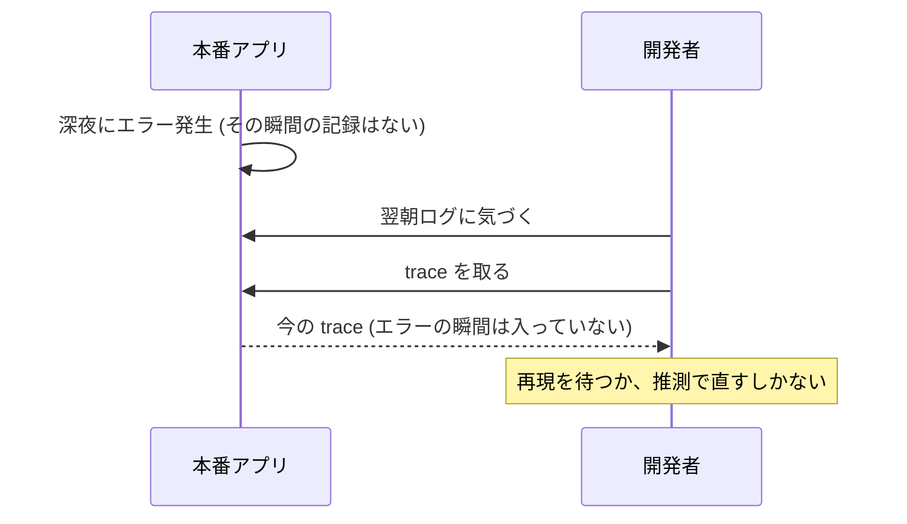
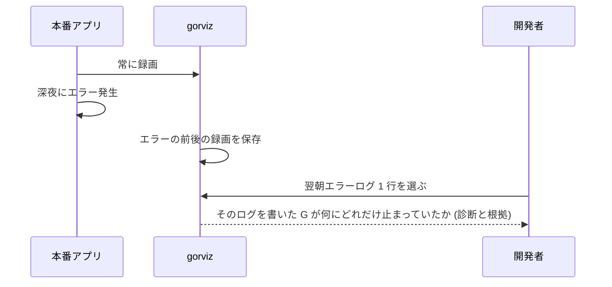
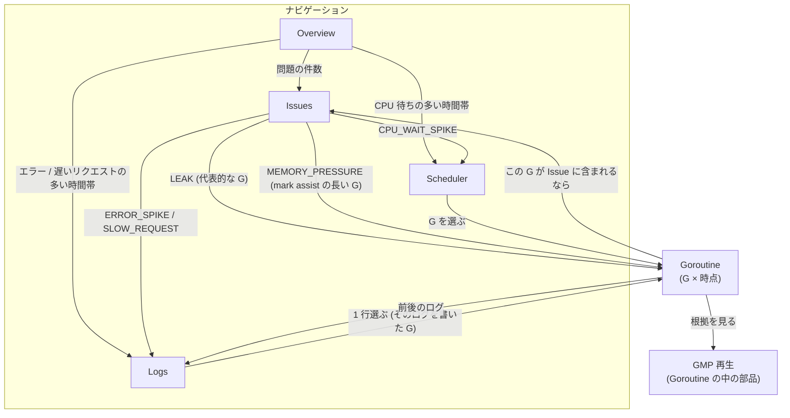
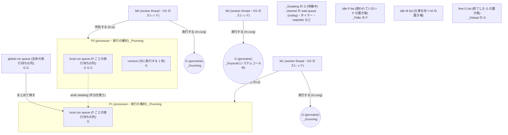
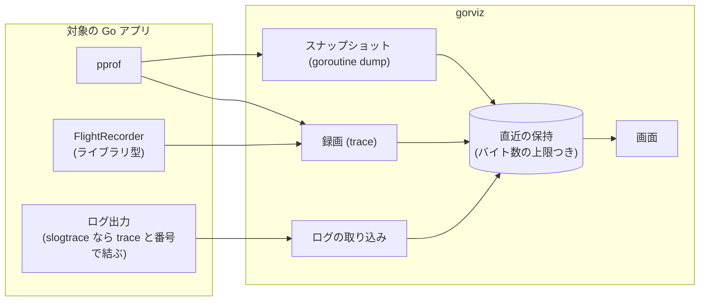
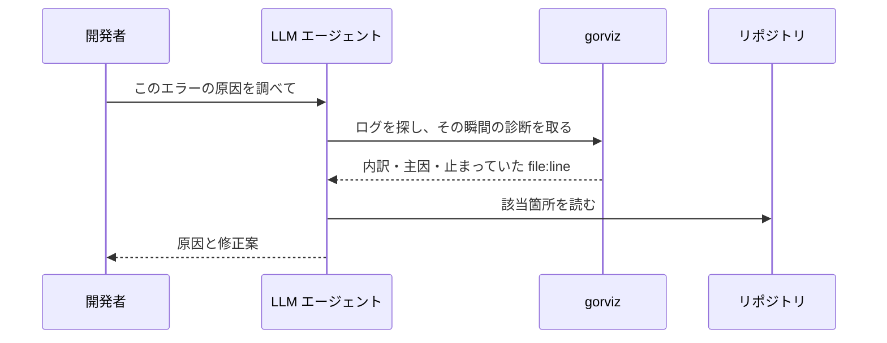
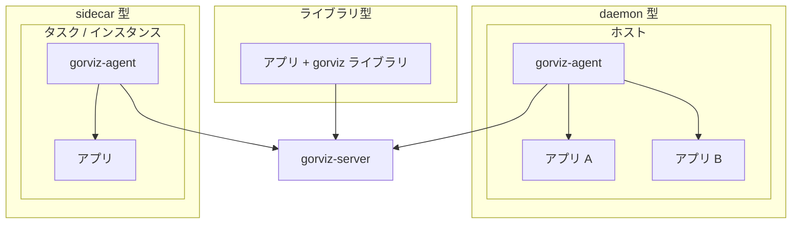
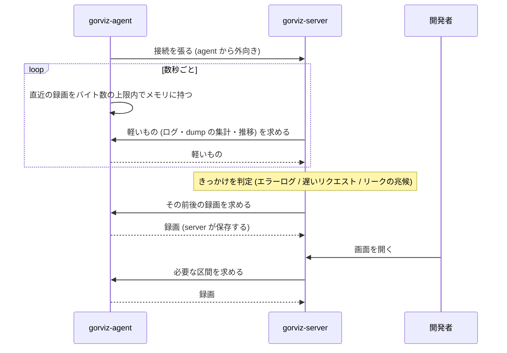

# gorviz 設計

[overview.md](overview.md) の詳細。要求定義レベルから始め、詳細設計は作りながら決め、決まったものから各章に反映する。進み具合は [roadmap.md](roadmap.md) を参照。用語は末尾の「用語集」を見る。

## 目次

- [対象と範囲](#対象と範囲)
- [背景](#背景)
  - [解きたい痛み](#解きたい痛み)
  - [開発者のジョブ](#開発者のジョブ)
  - [既存の手段との違い](#既存の手段との違い)
- [画面 (UX)](#画面-ux)
  - [画面の一覧](#画面の一覧)
  - [画面遷移](#画面遷移)
  - [Overview](#overview)
  - [Issues](#issues)
  - [Logs](#logs)
  - [Goroutine](#goroutine)
  - [Scheduler](#scheduler)
  - [TUI](#tui)
- [診断](#診断)
  - [診断の出し方](#診断の出し方)
  - [種類](#種類)
  - [確かさ](#確かさ)
  - [主因](#主因)
- [GMP の概念図](#gmp-の概念図)
  - [部品](#部品)
  - [状態の名前](#状態の名前)
  - [推測して描く部分](#推測して描く部分)
- [データの取り方](#データの取り方)
- [goroutine のラベル](#goroutine-のラベル)
- [kakkky/scope との相性](#kakkkyscope-との相性)
- [LLM を使った調査との親和性](#llm-を使った調査との親和性)
- [構成と配置](#構成と配置)
  - [構成](#構成)
  - [配置の 3 つの型](#配置の-3-つの型)
  - [サービスごとの差し替え点](#サービスごとの差し替え点)
  - [録画の持ち方](#録画の持ち方)
- [本番で使うための要求](#本番で使うための要求)
- [未決事項](#未決事項)
- [用語集](#用語集)

## 対象と範囲

**対象ユーザー**: Go でサーバアプリを作り、運用もする開発者。障害やパフォーマンス劣化の調査を自分で行う人。スケジューラの仕組みを学びたい人は副次的なユーザーとし、主要な画面の設計は上の開発者に合わせる。

**やらないこと**:

- 複数サービスをまたぐ分散トレーシング (OpenTelemetry などの領域)。gorviz は 1 プロセスの中に集中する
- メトリクスの長期保存やダッシュボード。既存の監視基盤に任せる
- server を SaaS として提供すること (組織ごとの分離・認証・保存のコストの負担など)。当面はセルフホストだけを考える
- OOM (メモリ不足でのプロセスの終了) の検出と原因調査。実行環境の監視とメモリのプロファイラ (heap プロファイルなど) に任せる。gorviz は、ランタイムの中で見えるメモリの逼迫 (`MEMORY_PRESSURE`) までを扱う

## 背景

### 解きたい痛み

goroutine が絡む障害は調査が難しい。今の Go の標準の道具では、必要な情報を自分で集めて読み解く必要があり、認知負荷が高い。しかも読み解くには Go のランタイムのスケジューラの理解が要るが、多くの開発者はそこまで把握していない。

#### 痛み 1: goroutine が増えているのは分かるが、どれが増えているか分からない

goroutine 数をメトリクスで見ていれば、「デプロイ後から右肩上がり」には気づける。たとえば次のようなコードを入れてしまった場合だ。

```go
func handle(w http.ResponseWriter, r *http.Request) {
	ch := make(chan User)
	go func() {
		ch <- fetchUser(r.Context())
	}()
	select {
	case u := <-ch:
		json.NewEncoder(w).Encode(u)
	case <-time.After(100 * time.Millisecond):
		http.Error(w, "timeout", http.StatusGatewayTimeout)
		// ここで帰ると、誰も ch を受け取らない。上の goroutine は送信で永遠に止まる
	}
}
```

グラフが教えてくれるのは総数だけ。どれが増えているかを知るには goroutine dump を取って読む。

```
goroutine 4821 [chan send, 12 minutes]:
main.handle.func1()
	/app/handler.go:5 +0x68
created by main.handle in goroutine 4790
	/app/handler.go:4 +0x8c

goroutine 4822 [chan send, 12 minutes]:
...（同じようなブロックが数千〜数万件続く）
```

ここから犯人を見つけるには、数千件を「どの go 文で作られ、どこで止まっているか」ごとに手で集計し、時間を置いて取り直して「増え続けているもの」を見分け、該当する行を読み解く必要がある。

#### 痛み 2: 遅い / エラーの瞬間に、goroutine が何を待っていたか分からない

APM のトレースでは「handler の中で 800ms かかった」までは分かるが、計測点を打っていない部分は空白になる。CPU プロファイルはプロセス全体の集計なので、「その 1 リクエストの、その瞬間」は分からない。

その時間の正体は、たいてい次の 4 つのどれかで、対処はまったく違う。どれだったかが分からないと次の手が打てない。

- **CPU 待ち**: 動ける状態なのに、P が空かずに順番を待っていた
- **ロック / channel 待ち**: 他の goroutine が持っている mutex や、詰まった channel で止まっていた
- **I/O / syscall 待ち**: ネットワークやディスクの応答を待っていた
- **GC**: 世界が止まった (STW) か、GC の手伝い (mark assist) をさせられていた

#### 痛み 3: `go tool trace` なら分かるが、肝心の瞬間を録れていない

上の 4 つを見分けられるのは、Go 標準の execution trace だけ。ただ、実務では使いにくい。

- **事前に取っておく必要がある**: 取っている間しか記録されないので、気づいてから取り始めても、その瞬間はもう過ぎている
- **ログからその瞬間に辿り着けない**: 運よく取れても、「このエラーログを出した goroutine はどれか」を探す手段が標準にはない
- **読解が重い**: 情報は豊富だが、どこを見ればよいかを知らないと原因に辿り着けない



gorviz を使うと次のようになる。



### 開発者のジョブ

gorviz を開く場面 (ジョブ) ごとに、出す診断を定める。診断を受けて次に何をするかは開発者が決め、gorviz は責務を持たない。

| ジョブ | 解く痛み | 入口 | 診断 | 根拠 |
| --- | --- | --- | --- | --- |
| 1. リークを見つけて、直す場所を特定する | 1 | リークの兆候、または goroutine 数の増加 | 生成元の go 文 (file:line)・止まっている場所・待機理由・件数の推移 | 代表的な G の状態別の時間内訳と GMP 再生 (Issues の `LEAK` から Goroutine に降りて見る) |
| 2. 遅い / 失敗したリクエストの原因を切り分ける | 2・3 | エラーログや遅いリクエストのログを 1 行選ぶ | 主因 (「[主因](#主因)」を参照) と、止まっていた場所 (file:line) | その瞬間の前後 (所要時間のあるログならそのリクエストの区間) の状態別の時間内訳と、GMP 再生 |
| 3. (補助) スケジューラの挙動を理解する | — | ジョブ 1・2 の根拠を確かめたいとき | — | GMP の概念図での再生 |

どのジョブも、常に録っておくことで痛み 3 の「その瞬間が録れていない」を、診断の形で出すことで「trace の読み方を知らなくてよい」を満たす。

### 既存の手段との違い

| 手段 | 重なる点 | 足りない点 (gorviz が受け持つこと) |
| --- | --- | --- |
| `go tool trace` / pprof | 情報は最も豊富 | 取得の準備と読解が重い。常に録っておき、ログから入れて、診断と根拠の形で出す |
| APM / 継続的プロファイリング | 本番での集計に強い | 1 行のログから、その goroutine のスケジューリングまで降りられない |
| Datadog の Timeline view | 遅いリクエストから、関わった goroutine のタイムラインに入れる | trace は既定で無効で、有効にしても 15 分ごとに最大 1 分しか録らず、目的のリクエストが録れていないことが多い。主因の診断はなく、読み解くのは人間。GMP 再生もない |
| Uber LeakProf / panicparse | goroutine dump をスタックごとに集計する | LeakProf は件数からの推測で判定する。panicparse はその時点の 1 回分の集計だけ。gorviz は runtime の判定 (`FACT`) と件数の推移 (`INFERENCE`) を確かさで分け、Goroutine に降りて根拠まで見せる |
| gotraceui | `go tool trace` より見やすい trace のビューア | trace を自分で取って開く前提で、常時の録画もログからの入口もない |

出典:

- Datadog: https://docs.datadoghq.com/profiler/connect_traces_and_profiles/?tab=go
- LeakProf: https://www.uber.com/us/en/blog/leakprof-featherlight-in-production-goroutine-leak-detection
- panicparse: https://github.com/cockroachdb/panicparse
- gotraceui: https://github.com/dominikh/gotraceui

## 画面 (UX)

ジョブごとに入口を分ける。診断 → 根拠の順に見せ、再生を主役にはしない。

### 画面の一覧

| 画面 | 役割 | ナビゲーション |
| --- | --- | --- |
| Overview | 全体の様子を見る入口 | 置く |
| Issues | 検出した問題の一覧。1 件選んで調べに入る | 置く |
| Logs | ログ一覧 | 置く |
| Scheduler (見出しは Runtime Scheduler) | スケジューラの動きを GMP の概念図で再生する | 置く |
| Goroutine | 1 つの G を、ある時点で詳しく見る (調査の行き着く先) | 置かない (他の画面から降りてくる) |

### 画面遷移



- どの入口から入っても、調査は Goroutine に行き着く
- Goroutine からは、その G に関係する画面 (その G を含む Issue、前後のログ) に戻れる
- Logs と Scheduler は、Issues や Overview から開くときに時刻や条件で絞った状態で開く (例: `ERROR_SPIKE` なら、そのエラーの種類と時間帯で絞ったログ一覧)

### Overview

全体の様子を 1 画面で見せる。

- goroutine 数の推移
- エラーと遅いリクエストの量の推移
- CPU 待ちの量の推移
- ヒープの大きさと GC の目標値の推移
- 未解決の問題の件数 (Issues へ)

### Issues

検出した問題 (Issue) を一覧にする。1 件の Issue は 1 つの種類と 1 つの確かさを持つ (「[種類](#種類)」「[確かさ](#確かさ)」を参照)。

どの種類も同じ形で見せ、種類ごとに特別な画面は作らない。1 件の Issue には次を出す。

- 種類と確かさ
- 件数や量の推移
- 関係する場所 (file:line。リークなら生成元と止まっている場所、エラーならログを書いた場所)
- 調べに入る先 (代表的な G の Goroutine、絞った Logs、時間帯を指定した Scheduler)

### Logs

取り込んだログの一覧。時間軸のヒストグラムと、文字列・レベル・種類での絞り込みを持つ。1 行選ぶと、そのログを書いた G の、その時点の Goroutine に移る。

- **単位**: アプリが出したログ 1 行。リクエスト単位にまとめ直すことはしない。アプリがリクエストごとのログ (アクセスログ) を出していれば、それも 1 行ずつ並ぶ
- **エラーの種類**: メッセージが同じ (または数値や ID を伏せると同じ形になる) ものを 1 つの種類にまとめて数える
- **所要時間**: ログに所要時間のフィールド (`duration`・`latency` など。キー名は設定で変えられる) があれば読む。アクセスログはリクエストが終わってから書かれるので、遅かった理由は書いた瞬間ではなく、その前の所要時間ぶんにある。そのため Goroutine では「書いた時刻 − 所要時間」から「書いた時刻」までの区間を見る。`SLOW_REQUEST` の判定にもこの所要時間を使う
- **限界**: ハンドラの中で別の goroutine を起動して待っている場合、本当に止まっていたのはそちらで、ログを書いた G はそれを待っていただけになる。このとき、ログを書いた G の主因は `BLOCKED` と出る。子の goroutine までは追わない

### Goroutine

1 つの G を、ある時点の前後で詳しく見る。所要時間のあるログから来たときは、そのリクエストの区間を見る。

- 診断: 主因と、止まっていた場所 (file:line)・入口の関数
- 根拠: 状態別の時間内訳と、GMP 再生 (ログから来たときは、ログを書いた瞬間で止め、その G を強調する)

### Scheduler

GMP の概念図で、最新の観測窓を再生し続ける。録画の残っている範囲なら、時刻を指定して過去を再生することもできる。観察と学習用で、G を選ぶと Goroutine に移る。

### TUI

GUI で見せているものを、おおむね端末でも TUI で見られるようにする (Overview・Issues・Logs・Goroutine・Scheduler)。人間が読むためのもので、LLM エージェント向けの構造化データ (JSON など) は MCP だけで返す。

## 診断

### 診断の出し方

どの画面でも、診断は次のように出す。

- **ラベルを付ける**: 表示名は英語の大文字にする

  | ラベル | 付ける先 | 値 |
  | --- | --- | --- |
  | 種類 | Issue | `LEAK` / `ERROR_SPIKE` / `SLOW_REQUEST` / `CPU_WAIT_SPIKE` / `MEMORY_PRESSURE` |
  | 確かさ | すべての診断 (Issue・主因・ログと G の結びつき) | `FACT` / `INFERENCE` |
  | 主因 | Goroutine の診断 | `RUNNING` / `CPU_WAIT` / `BLOCKED` / `IO_WAIT` / `CGO` / `SLEEP` / `GC` |

- **事実と推測を分ける**: runtime の判定や trace の記録から言えることと、gorviz が推測したこと (件数の推移からのリーク判定、run queue の中身など) を、確かさのラベルで区別する
- **根拠を添える**: Goroutine の診断には、状態別の時間内訳と GMP 再生。`MEMORY_PRESSURE` には、ヒープの推移と mark assist の長かった G
- **直し方は示さない**: gorviz はコードの構造を知らないので、原因の経路や直し方は示さない。コードを読んで原因を特定し、次に何をするかを決めるのは開発者か LLM の役割。gorviz は、そのための事実・場所 (file:line)・根拠を渡す

### 種類

| 種類 | 意味 | 1 件の単位 | `FACT` になるとき | `INFERENCE` になるとき |
| --- | --- | --- | --- | --- |
| `LEAK` | goroutine のリーク | 生成元 (go 文) | runtime の goroutineleak プロファイルが判定した | 件数の推移から判定した (goroutineleak を持たない古い Go) |
| `ERROR_SPIKE` | 同じ種類のエラーログが多く出ている | エラーの種類 | 利用者が決めた固定の閾値を超えた | 普段の分布との比較で多いと判定した |
| `SLOW_REQUEST` | 遅いリクエストが増えている。ログに載った所要時間で判定する | 未決 | 利用者が決めた固定の閾値を超えた | 普段の分布との比較で遅いと判定した |
| `CPU_WAIT_SPIKE` | goroutine が P に乗れず待つ時間が多い | 時間帯 | 利用者が決めた固定の閾値を超えた | 普段の分布との比較で多いと判定した |
| `MEMORY_PRESSURE` | ヒープが GC の目標値や上限 (GOMEMLIMIT) に張り付いている、または GC が頻発している | 時間帯 | 利用者が決めた固定の閾値を超えた | 普段の分布との比較で多いと判定した |

### 確かさ

| 確かさ | 意味 |
| --- | --- |
| `FACT` (事実) | runtime の判定か、trace / dump の記録から直接言えること |
| `INFERENCE` (推測) | gorviz が推移・比較・時刻の突き合わせなどから推し量ったこと |

どの診断にも、何から判定したかでどちらも付きうる。種類ごとの条件は「[種類](#種類)」の表のとおり。種類以外では次のとおり。

| 診断 | `FACT` になるとき | `INFERENCE` になるとき |
| --- | --- | --- |
| 主因 | 前後の trace が録れていて、状態別の時間内訳から決めた | trace がなく、goroutine dump だけから決めた |
| ログ 1 行と G の結びつき | `slogtrace` の番号で結んだ | ログの時刻から当たりを付けた |

### 主因

状態別の時間内訳のうち、一番長かったもの。内訳は全部の時間をもれなく次のどれかに分ける。

| 主因 | 意味 | trace / dump の状態 |
| --- | --- | --- |
| `RUNNING` | その G 自身が CPU で処理をしていた | running |
| `CPU_WAIT` | 動ける状態なのに、P が空かずに順番を待っていた | runnable |
| `BLOCKED` | ロックや channel で止まっていた | waiting (chan / select / sync.Mutex / WaitGroup など) |
| `IO_WAIT` | ネットワークやディスク、システムコールを待っていた | syscall (cgo を除く)、waiting (netpoll) |
| `CGO` | cgo で C のコードを実行していた。C の側で計算していても I/O 待ちに見えないように分ける | syscall のうち cgo の呼び出し (trace 上の見分け方は要確認) |
| `SLEEP` | スリープやタイマーで止まっていた | waiting (`time.Sleep`、タイマー) |
| `GC` | GC に止められたか、GC を手伝わされていた | STW、mark assist |

- リークの「待機理由」(chan send など) は、ラベルではなく runtime が出す名前をそのまま使う
- メモリは G ではなくプロセス全体で共有するので、主因には入れず、種類 (`MEMORY_PRESSURE`) で扱う
- G ごとの割り当て量は出さない。通常の trace に入らず、取るには負荷の大きい仕組み (Go 1.23 の実験的な `GODEBUG=traceallocfree=1`) が要るため。代わりに mark assist の時間 (割り当ての多い G ほど長くなる) を手がかりにする

## GMP の概念図

再生画面は、Go のスケジューラを次の部品で描く。部品の呼び方と状態の名前は、Go の公式の情報源に合わせる。

- スケジューラの設計コメント: `$GOROOT/src/runtime/proc.go` の冒頭 (「Goroutine scheduler」)
- 構造体と状態の定義: `$GOROOT/src/runtime/runtime2.go`
- ランタイムの開発者向け文書: `$GOROOT/src/runtime/HACKING.md` (「Scheduler structures」)
- 設計文書: https://golang.org/s/go11sched



- M は P を所有しているときだけ Go のコードを実行できる。M2 のようにシステムコール中の M は、P を所有していない (P が付いたままのこともあるが、スケジューラが取り上げて別の M に渡せる)
- G が run queue から取り出されて実行されると、M の `curg` (実行中の goroutine) になる。待機に入ると run queue から外れ、待っているもの (channel・タイマー・I/O など) に記録される

### 部品

| 部品 | runtime での名前 | 説明 |
| --- | --- | --- |
| G (goroutine) | `g` | 終了すると free G list に戻され、別の goroutine に再利用される |
| M (worker thread / machine) | `m` | OS のスレッド。Go のコードやランタイムのコード、システムコールを実行する。システムコールで止まる M がいくらでもいるので、数に上限はない |
| P (processor・実行の権利) | `p` | ユーザの Go のコードを実行するのに必要な資源 (スケジューラやメモリ割り当ての状態)。ちょうど GOMAXPROCS 個ある。M は P を所有しているときだけ Go のコードを実行できる |
| local run queue (P ごとの実行待ちの列) | `p.runq` | 空になった P は、global run queue からまとめて取るか、他の P の local run queue から半分を奪う (work stealing) |
| runnext (次に実行する 1 枠) | `p.runnext` | 今走っている G が起こした G は、local run queue より先にここから実行される |
| global run queue (全体の実行待ちの列) | `sched.runq` | コードのコメントでは global runnable queue とも書かれる |
| idle P list (使われていない P の置き場) | `sched.pidle` | |
| idle M list (仕事を待つ M の置き場) | `sched.midle` | |
| free G list (終了した G の置き場) | `p.gFree` / `sched.gFree` | `_Gdead` の G を再利用のために置いておく。P ごとと全体の 2 つがある |
| wait queue と sudog (待ち行列と、そこに並ぶ G の代理) | `sudog` | `_Gwaiting` の G は、待っているものに記録されて起こされるのを待つ。channel の場合は、channel の待ち行列に sudog (pseudo-g) として並ぶ。タイマーや netpoller (ネットワーク I/O の待ち受け) で待つ G もある |

解説記事でよく使われる LRQ / GRQ (local run queue / global run queue の略) は、Go のランタイムのコードでは使われていない。gorviz の画面では公式の呼び方を使う。

### 状態の名前

G の状態 (`runtime2.go` の `_G...`):

| 状態 | 意味 |
| --- | --- |
| `_Grunnable` (実行待ち) | run queue に並んでいて、まだ実行されていない |
| `_Grunning` (実行中) | M と P を持って、ユーザのコードを実行している |
| `_Gsyscall` (システムコール中) | M は持っているが、P は所有していない (P が付いたままのこともある) |
| `_Gwaiting` (待機中) | ランタイムの中でブロックしている (channel、mutex、sleep、I/O など)。run queue には並んでいない |
| `_Gdead` (未使用) | 終了した直後か、free G list にある |

P の状態 (`runtime2.go` の `_P...`):

| 状態 | 意味 |
| --- | --- |
| `_Pidle` (空き) | ユーザのコードもスケジューラも実行していない。たいてい idle P list にある |
| `_Prunning` (使用中) | M に所有され、ユーザのコードかスケジューラを実行している |
| `_Pgcstop` (GC で停止中) | GC の STW のために止められている |
| `_Pdead` (廃止) | 使われなくなった (GOMAXPROCS が減った) |

P にはシステムコール中を表す状態はない。手元の Go 1.27 では `_Psyscall_unused` (もう使われていない状態) になっており、「システムコール中かどうかは goroutine の状態で判断する」とコメントされている。システムコール中の M は P を手放し、別の M が P を引き継ぐことがある (handoff)。

### 推測して描く部分

local run queue / global run queue の中身は runtime が外に出さないので、trace から推測して描き、推測であることを画面に示す。runnext と local run queue の区別も推測になる。

## データの取り方



| データ | 取り方 | 頻度 (既定) | 使い道 |
| --- | --- | --- | --- |
| execution trace | pprof から取り続ける (ライブラリ型は FlightRecorder) | 常時 | 状態別の時間内訳・主因・GMP 再生 |
| goroutine dump | pprof | 60 秒に 1 回まで | 生成元ごとの集計・`LEAK` の `INFERENCE` 判定 |
| goroutineleak プロファイル | pprof | dump より間隔を空ける (実測で決める) | `LEAK` の `FACT` 判定 |
| ログ | 対象の出力を取り込む | 常時 | 入口・`ERROR_SPIKE`・`SLOW_REQUEST`。ログに書かれた時刻で録画のどの瞬間かを決める |
| schedtrace (ローカル専用) | 対象を gorviz から起動したときだけ、`GODEBUG` で有効にする | runtime が定期的に出す | run queue の長さを取り、trace からの推測と突き合わせる |

- **trace の保持**: 直近をメモリのリングバッファに持つ (録画)。上限は時間ではなくバイト数で決め、利用者が設定できる。trace は毎秒数 MB (忙しいサービスなら 10 MB) 出るので、持てる時間は負荷によって変わる。画面には、実際に持てている区間を示す (https://go.dev/blog/flight-recorder)
- **trace の経路は 1 つ**: trace は対象のプロセスで同時に 1 本しか取れないので、gorviz の中で取る経路は 1 つにし、すべての画面はその録画から読む
- **trace の録り方は選べる**: 既定は常時。間欠 (例: 15 分ごとに 1 分) にすると負荷の総量は減るが、問題の瞬間が録れていないことがある
- **dump とリーク判定の間隔は変えられる**: dump は STW を伴い、リーク判定は GC を伴うので、既定では間隔を空ける
- **ログと goroutine の結びつき**: 対象が `slogtrace` を使っていれば、ログ 1 行と trace を番号で結び、そのログを書いた goroutine まで正確に特定する。ログの時刻の精度にも左右されない

## goroutine のラベル

goroutine を 2 つの名前で呼び分ける。

- **入口の関数**: go 文で起動された関数。G が生きている間は変わらないので、「何の処理をする G か」の名前に使う
- **今いる関数**: スタックのうち runtime 内部を除いた一番上の関数。「今どこで止まっているか」を表す

goroutine を代わりに起動するライブラリ (kakkky/scope、errgroup など) では、ライブラリ内部の関数ではなく、利用者が渡した関数を入口の関数とみなす。

## kakkky/scope との相性

gorviz は、structured concurrency のライブラリ [kakkky/scope](https://github.com/kakkky/scope) と相性よく使えることを要求とする。

- scope を使ったアプリでも、goroutine を正しく見分けられる (上の「goroutine のラベル」)
- どの goroutine がどのスコープに属するかを示せる
- scope が約束していることが守られているかを確かめられる
  - **寿命の保証**: スコープを抜けた時点で、その中の goroutine がすべて終わっているか
  - **キャンセルの伝播**: エラーや panic でキャンセルされたとき、兄弟の goroutine がすぐ抜けるか。抜けない goroutine はどこで止まっているか
  - **止まったスコープ**: 子が返らないせいで、スコープが待ち続けていないか
  - **オプションの効き方**: 並列数の上限やタイムアウトが効いているか

スコープへの所属や開始・終了は外からは分からないので、scope 側に計装 (trace の task / region、または pprof labels) を入れる必要がある。方式は未決。

## LLM を使った調査との親和性

開発者が LLM のエージェントに調査を任せたり、一緒に調べたりする使い方を前提にする。gorviz は「ランタイムで何が起きたか」を、LLM は「コードのどこをどう直すか」を受け持つ。



- **口は MCP に絞る**: 画面と同じ診断を、MCP から構造化データ (JSON など) で返す。TUI は人間向けにとどめる
- **要約を既定にする**: 詳細は ID で追加で取れるようにする (LLM が一度に読める量には限りがあるため)
- **事実と推測を区別して返す**: 確かさのラベルを付け、LLM が推測を事実として扱い、誤った結論を出すのを防ぐ
- **根拠に戻れる ID を付ける**: LLM の回答から、人間が画面で根拠を確かめられるようにする
- **まとめて持ち出せる**: 1 つの問題について、要約と元データを 1 つにまとめて書き出せる
- **安全に渡す**: 読み取りの操作だけにする。ログの中の機密を伏せられるようにする。本番では画面と同じ認証を通す

## 構成と配置

Kubernetes・ECS・Cloud Run など、さまざまなコンテナ系サービスで使えるようにする。gorviz を置ける場所は次の 3 つの型のどれかに収まるので、型ごとに作り、サービスごとの違いは差し替え点に閉じ込める。

### 構成

用途ごとに別のバイナリにする。usecase 以下の処理は共有し、cmd ごとに入口と presentation だけを持つ。

| 部品 | 入口 | 置く場所 | 役割 |
| --- | --- | --- | --- |
| gorviz-agent | `cmd/agent` | 対象の隣 (ホストかタスクの中) | ・録画・goroutine dump・ログの取り込み<br>・server に求められたら返す<br>・判定はしない。画面も持たない (UI や MCP を含まない小さいバイナリ) |
| gorviz-server | `cmd/server` | どこか 1 か所 | ・GUI (Web)<br>・agent を束ね、サービス単位で見せる<br>・送られた録画の保存 |
| TUI | `cmd/tui` | 開発者の端末 | ・GUI とおおむね同じ画面を対話的に見る (今の `gorviz top` を広げる) |
| CLI | `cmd/cli` | 開発者の端末 | ・非対話の操作 (録画の書き出し・持ち出しなど)<br>・ローカルでの起動 (対象の起動 `run`、agent と server をまとめて起動する) |
| MCP サーバ | `cmd/mcp` | 開発者の端末 (stdio) か server の隣 (リモート、Streamable HTTP) | ・LLM エージェント向けの構造化データ (JSON など) を返す唯一の口<br>・診断は server から取る (agent には直接つながない)<br>・リモートでは画面と同じ認証を通す |
| gorviz ライブラリ (任意) | — (アプリが import する) | アプリの中 | ・ログと goroutine の結びつけ (`slogtrace`)<br>・ライブラリ型の録画 |

agent を小さくするのは、sidecar ではアプリと同じタスクの資源を分け合うため。

話す相手は server を中心に決める。agent は server とだけ話し、GUI・TUI・CLI・MCP も server とだけ話す。agent や対象に直接つなぐ部品は作らない。CLI がローカルで agent・server・対象を起動するのは、プロセスを立ち上げるだけで、話す相手ではない。

```
agent ──(agent から外向きにつなぐ)──> server <── GUI / TUI / CLI / MCP
```

責務は配置によらず次のように分ける。ローカルでも agent と server は別のプロセスにし、本番と同じ口でつなぐ。

| 責務 | 担う部品 |
| --- | --- |
| 取る (trace・dump・ログ) | agent |
| 持つ (直近のリングバッファ) | agent |
| 求められたら返す | agent |
| 取りに行く (何をいつ取るかを決める) | server |
| 保存のきっかけを見つける | server |
| 束ねる (インスタンスをサービス単位に) | server |
| 保存する (きっかけの前後の録画) | server |
| 診断する (Issue の検出・主因・状態別の時間内訳) | server |
| 見せる・返す | GUI (server)・TUI・CLI・MCP |

配置ごとに、agent の責務を誰が担うかだけが変わる。

| 配置 | agent の責務を担うもの |
| --- | --- |
| ローカル | 別プロセスの agent (`cmd/agent`)。CLI が server とまとめて起動する |
| daemon 型・sidecar 型 | 別プロセスの agent (`cmd/agent`) |
| ライブラリ型 | アプリの中の gorviz ライブラリ |

### 配置の 3 つの型



| 型 | 置く場所 | 観測する対象 | 向く環境 | 注意 |
| --- | --- | --- | --- | --- |
| daemon 型 | ホストに 1 つ | 同じホスト上の複数の対象 | VM、ECS on EC2、Kubernetes | |
| sidecar 型 | ワークロードの隣に 1 つ | 同じタスク / インスタンス内の対象 1 つ | Fargate、Cloud Run | アプリと同じタスクの資源を使う |
| ライブラリ型 | アプリの中 | そのアプリ | agent を置けない環境 (sidecar を常時動かせないなど) | runtime の FlightRecorder で直近をメモリに持ち、agent と同じ口で server に外向きにつなぎ、求められたら返す。録画がアプリのメモリにあるので、プロセスが落ちると直前の録画は残らない。trace 自体は裏で常に動くので、trace の負荷は常時の録画と変わらない。軽くなるのは、録画を agent が読み取って運ぶぶんだけ |

### サービスごとの差し替え点

- **対象の見つけ方**: 観測するかどうかは対象側で明示的に許可する (Kubernetes の annotation、ECS の docker label、VM の設定ファイルなど)
- **ログの取り方**: ホスト上のログファイル、ログルーティング、アプリ内のライブラリから送る、のいずれか
- **付けるメタデータ**: どのサービスのどのインスタンスかを束ねるための情報 (Pod 名、タスク、ホスト名など)

### 録画の持ち方



- **接続は agent から張る**: agent から server へ外向きにつなぎ、server からの要求はその接続の上で受け取る。対象の環境の内側に、外からの入口を開けずに済む
- **やり取りは server からの pull**: 何をいつ取るかは server が決める。agent は求められたら返すだけで、判定はしない
- **軽いものは数秒ごとに取る**: ログ・goroutine dump の生成元ごとの集計・goroutine 数やヒープなどの推移。trace に比べて桁違いに小さいので、常に取っても方針とぶつからない。server はこれで Issue を検出し、Overview を描く
- **trace は必要なときだけ取る**: 直近だけを agent のメモリに持ち、server が必要なときに求める。trace は量が多く、大半は何も起きていない区間なので、常に送って保存すると転送と保存のコストが割に合わない (既存のツールが常時録らない主な理由)
- **きっかけで保存する**: server が軽いものからきっかけを判定し、その前後の trace を取りに行って保存する。リングバッファが上書きされる前に取りに行く必要がある。開発者が気づくのが後 (翌朝など) でも、保存した録画から調べられる。短命なインスタンスでも録画が消えず、インシデントの振り返りで共有・再生できる
- **間欠のとき**: 問題の前後が録れていないことがある。そのときは録れていないことを画面に示す

## 本番で使うための要求

- **アプリに負荷をかけない**: 負荷の目安は Datadog の Go プロファイラと同程度とする。実測で確かめ、上限を設定できるようにする

  | 取得 | 負荷 | 抑え方 |
  | --- | --- | --- |
  | execution trace | 録っている間の CPU 増加は 1〜2% 程度 (Go 1.21 以降)。Datadog は 15 分ごとに最大 1 分だけ録る | 間欠も選べる |
  | goroutine dump | STW。goroutine 1 つあたり約 1µs | 既定では 60 秒に 1 回まで |
  | goroutineleak プロファイル | GC を 1 回強制する | dump より間隔を空ける |
  | メモリと帯域 | 録画のリングバッファ。sidecar 型ではアプリと同じタスクの資源を使う | リングバッファはバイト数の上限を超えない。trace は server が必要なときだけ取る。agent の資源にも上限を設ける |

  出典: https://docs.datadoghq.com/profiler/profile_types/?tab=go 、 https://docs.datadoghq.com/profiler/connect_traces_and_profiles/?tab=go 、 https://go.dev/blog/execution-traces-2024

- **安全に繋げる**: 対象へは環境の内側 (ホスト内・タスク内・クラスタ内) からだけアクセスする。観測は対象側の明示的な許可がある場合だけ行う。agent と server の間は agent から外向きにつなぎ、やり取りは server からの pull にする
- **server はセルフホスト**: server は利用者が自分の環境に置く。server を対象と別の環境に置くときは、agent が送る前に機密を伏せられるようにする
- **複数インスタンス**: gorviz-server がインスタンスを束ね、サービス単位で見られる
- **保持と持ち出し**: 問題が起きたときの録画を保存し、共有・再生できる

## 未決事項

**録画と負荷**

- リーク判定 (goroutineleak プロファイル) の既定の間隔: 実測で決める
- リングバッファの既定の上限 (バイト数)。PoC では 256 MiB
- agent が pprof から trace を読み続けるときの、アプリ側の負荷 (trace の書き出しと転送): 実測で確かめる
- 問題の前後を保存するきっかけの決め方: どのログ (レベル・種類) や兆候で保存するか。前後をどれだけ切り出すか。PoC では Issue ごとに 1 分に 1 回、前 10 秒・後ろ 2 秒を保存する
- server が軽いものを取りに行く間隔: リングバッファが持てる時間より十分短くする。PoC では `-refresh` (2 秒)
- 終了の直前だけ agent から push するか: インスタンスが消える (SIGTERM を受ける) とき、server が次に取りに来る前の分は失われる。そのときだけ agent から送るか、諦めるか

**診断**

- `SLOW_REQUEST` の 1 件の単位 (パスごと・ハンドラごとなど)
- 所要時間のフィールドの既定のキー名と、値の形式。PoC では `duration` / `latency` / `elapsed` を読み、数値はナノ秒 (slog の JSON の既定)、文字列は `"1.2s"` の形とした
- cgo の呼び出しの見分け方: PoC では syscall に入ったスタックの `runtime.cgocall` で見分けた。cgo を使う対象での確認は未

**配置**

- gorviz-server と agent の間の認証と暗号化。通信方式は PoC で、agent が外向きに張った TCP の上で server が net/rpc (gob) の呼び出し側になる形にした
- 保存した録画を置く場所と保持期間
- Azure (Container Apps など) がどの型に入るか (未調査)

**kakkky/scope**

- scope 側に入れる計装の方式。PoC では pprof label `scope` にスコープの名前を載せる前提で、gorviz はその label で G をまとめる
- 可視化を主に誰のために作るか: 作者が scope 自体の約束を検証するためか、利用者が自分のコードを調べるためか

**LLM**

- LLM に渡す前、agent から server に送る前に伏せる項目の決め方

## 用語集

GMP の部品 (local run queue・runnext など) と状態の名前は「[GMP の概念図](#gmp-の概念図)」、診断のラベルは「[診断](#診断)」を見る。

| 用語 | 説明 |
| --- | --- |
| goroutine (G) | Go の軽量なスレッド。`go f()` で 1 つ作られる |
| M | worker thread / machine。Go のコードやシステムコールを実行する OS のスレッド |
| P | processor。ユーザの Go のコードを実行するのに必要な資源。ちょうど GOMAXPROCS 個ある |
| GMP | G を、P を持った M が走らせる、Go のスケジューラの仕組み |
| GOMAXPROCS | 同時に Go のコードを走らせる P の数 |
| GOMEMLIMIT | Go のランタイムに与えるメモリの上限の目安。近づくと GC が頻繁に走る |
| 診断 | gorviz が出す、G が何に止まっていたかの判定。主因 (リークなら待機理由と生成元) と止まっていた場所 (file:line)。原因の経路や直し方は含まない |
| 根拠 | 診断を確かめるための材料 (「[診断の出し方](#診断の出し方)」を参照) |
| goroutine のリーク | 終わるはずの G が、何かを待ったまま永遠に止まり、溜まり続けること。メモリを食い続け、やがて障害になる |
| goroutine dump | その瞬間の全 G のスタックを並べたテキスト |
| goroutineleak プロファイル | Go 1.26 で入った、runtime 自身によるリーク判定。「誰も起こせなくなった goroutine」を GC の仕組みで見つけるので、誤検知がない |
| execution trace | G ごとに「いつ走り、いつ待ち、いつ syscall に入ったか」をナノ秒単位で記録したもの。`go tool trace` で開く |
| リングバッファ | 決まった大きさの入れ物に新しいデータを入れ続け、満杯になったら一番古いものから上書きする仕組み。gorviz は直近の trace をこれで持つ |
| FlightRecorder | Go 1.25 で標準に入った機能。trace を直近の一定期間だけメモリに持ち続け、必要なときに切り出せる |
| pprof | Go 標準のプロファイリングの仕組み。HTTP 経由で goroutine dump や trace を取れる |
| schedtrace | 環境変数 `GODEBUG` で有効にすると、runtime がスケジューラの状態を定期的に書き出す機能 |
| STW (Stop The World) | 全 G を一瞬止めること。GC の一部の段階や goroutine dump で起きる |
| mark assist | アロケーションの多い G が、GC の作業を肩代わりさせられること。その間、本来の処理が進まない |
| handoff | システムコールで止まった M が P を手放し、別の M が引き継ぐこと |
| sidecar | アプリのコンテナと同じタスク (Pod) に並べて置く補助のコンテナ |
| slogtrace | gorviz が提供する slog ハンドラ。ログ 1 行と trace を番号で結ぶ |
| structured concurrency | goroutine の寿命をコード上のスコープに縛る考え方。スコープを抜けるときには、その中で起動した goroutine がすべて終わっていることを保証する |
| MCP (Model Context Protocol) | LLM のエージェントが外部のツールやデータを呼び出すための共通の仕組み |
