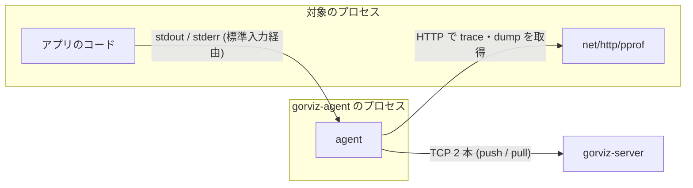
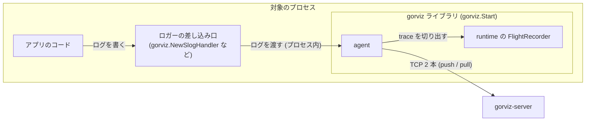
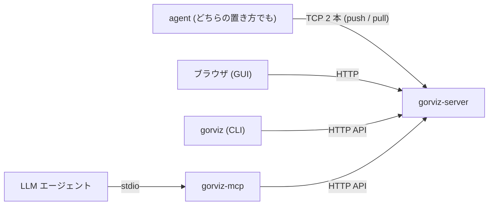
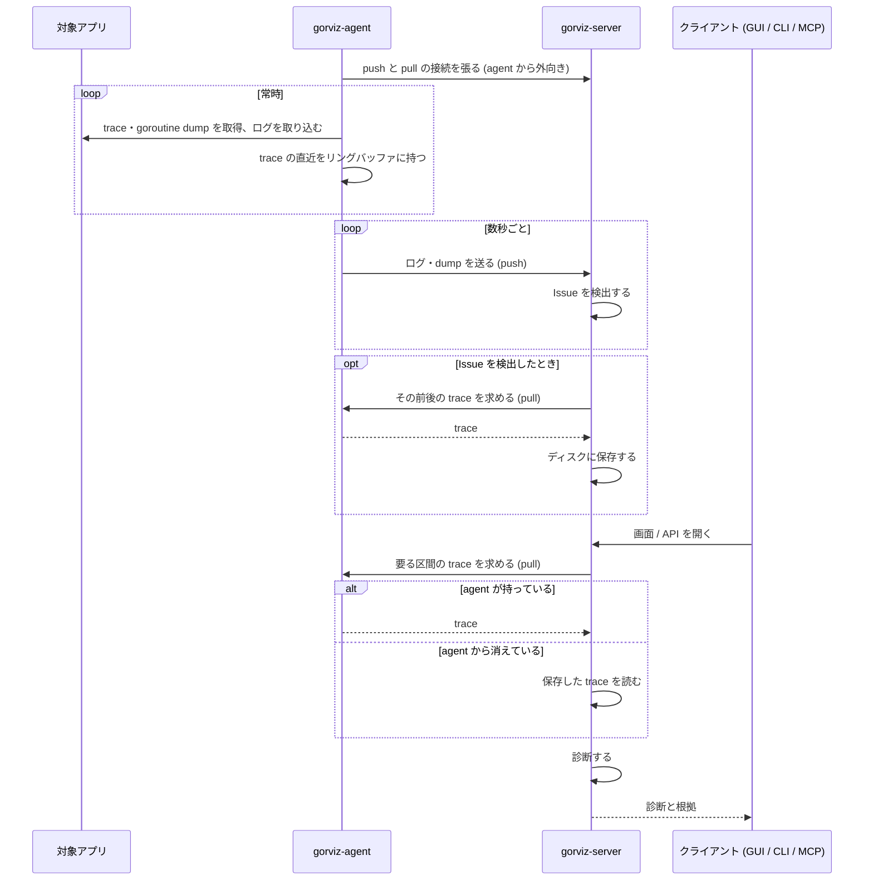

# gorviz 設計

用語の説明は脚注 (`[1]` のような番号) から飛べる。

## 目次

- [概要](#概要)
- [モチベーション](#モチベーション)
- [構成](#構成)
  - [プロセスの依存の向き](#プロセスの依存の向き)
  - [処理の流れ](#処理の流れ)
  - [agent の置き方](#agent-の置き方)
- [コンポーネント別設計](#コンポーネント別設計)
  - [gorviz-agent](#gorviz-agent)
  - [gorviz-server](#gorviz-server)
  - [gorviz ライブラリ](#gorviz-ライブラリ)
  - [クライアント (CLI / MCP)](#クライアント-cli--mcp)
  - [gorviz-launcher](#gorviz-launcher)
- [診断](#診断)
- [ユーザーストーリー](#ユーザーストーリー)
- [やらないこと](#やらないこと)

## 概要

- **見えにくい Go ランタイムのスケジューリングを可視化し、goroutine が絡む問題の調査に使うツール**
- 扱う問題: goroutine のリーク[^leak]、遅い / 失敗したリクエスト
- 中心に置くもの: その goroutine がランタイムの中で何を待っていたか
  - GMP[^gmp] の概念図での再生: goroutine を P と M がどう走らせ、どこで待たせたか
  - 診断[^diagnosis]: CPU 待ち・ロック・I/O・GC のどれに止まっていたかと、止まっていた場所 (file:line)。その根拠[^evidence]も添える
- 入口: 問題の兆候やログ 1 行から、該当の goroutine のその瞬間に辿る
- 直し方は出さない。コードを読んで直すのは開発者か LLM
- 対象ユーザー: Go のサーバアプリを作り、運用もする開発者

## モチベーション

goroutine が絡む障害の原因は、たいていランタイムのスケジューリング (CPU を待ったのか、ロックか、I/O か、GC か) にある。ところがスケジューラの動きはふだん見えず、標準の道具で読み解くにはランタイムの知識が要る。

| 困りごと | 今の道具でできること | 足りないこと |
| --- | --- | --- |
| リーク | goroutine の総数の推移は見える | どの go 文の goroutine が増えているかは、goroutine dump[^dump] を手で集計しないと分からない |
| 遅い / エラー | APM で「どこで時間がかかったか」までは分かる | その goroutine が CPU・ロック・I/O・GC のどれを待っていたかが分からない |
| execution trace[^trace] | 上の 2 つを見分けられる唯一の手段 | 事前に取っておかないとその瞬間が残らない / ログから該当の goroutine に辿れない / 読むのが重い |

gorviz の方針:

- trace を常に取り続け、直近だけを持っておく。問題の前後は保存する
- ログ 1 行から、そのログを書いた goroutine に辿る
- スケジューリングを、trace の生データではなく GMP の概念図と診断の形で見せる。ランタイムの知識がなくても読める
- 本番に置ける負荷に収める (Datadog の Go プロファイラと同程度)

既存の手段との違い:

- `go tool trace` / gotraceui: 取得と読解を自分でやる前提。常時の取得もログからの入口もない
- APM / 継続的プロファイリング: 集計まで。1 つのログの goroutine のスケジューリングまでは降りられない
- Datadog の Timeline view: trace は間欠取得 (15 分ごとに最大 1 分) で、目的の瞬間が残らないことが多い。主因の判定はない
- LeakProf / panicparse: dump の集計まで。runtime 自身のリーク判定や、goroutine の根拠までは見せない

## 構成

### プロセスの依存の向き

- 通信の中心は **server**。他のすべてが server に向かってつなぐ
- agent → server は agent から外向きの TCP 2 本 (push / pull)。対象の環境に外からの入口を開けない
- クライアントは server の HTTP API とだけ話し、agent や対象に直接つながない
- agent の置き方は 2 通り。server から見るとどちらも同じ agent で、違いは agent が対象からどうデータを取るかだけ

矢印は「接続を張る / 呼び出す側 → 相手」。

#### agent を別プロセスにする場合 (daemon 型・sidecar 型)

- agent は対象の pprof を HTTP で叩いて trace・goroutine dump を取る。対象のコードは pprof を公開するだけ
- ログは対象の出力を agent が読む

#### agent をアプリに埋め込む場合 (ライブラリ型)

- agent はアプリと同じプロセスの中で動き、trace は FlightRecorder から直接取る。pprof の公開は要らない
- ログは、ロガーの差し込み口から agent に直接渡る。アプリが出力したバイト列そのまま
- trace がアプリのメモリにあるので、プロセスが落ちると直前の trace は残らない

#### server とクライアント (共通)

### 処理の流れ

agent と server の間の 2 本の接続:

| 接続 | 張る側 | 呼び出す側 | 運ぶもの | いつ |
| --- | --- | --- | --- | --- |
| push | agent | agent | 軽いもの (ログ・goroutine dump) | 数秒ごと (`-refresh`)。変わっていないものは送らない |
| pull | agent | server | 重いもの (execution trace) | server が要るときだけ (保存するとき・画面で見るとき) |

trace だけ pull にしているのは、量が多く大半は何も起きていない区間なので、常に送ると転送と保存が割に合わないため。

- 診断は、クライアントが求めたときにだけ行う。Issue を検出したときは保存するだけで、診断はしない
- server が持つ trace は、Issue の前後を保存したものだけ (Issue 自体は保存せず、要るたびにログ・dump から検出し直す)
  - Issue の前後は後で求められるが、agent のリングバッファ[^ringbuffer]からは数十秒〜数分で消えるため
  - それ以外は求められることが少なく、量が多いので保存しない (直近なら agent に残っている)
- 診断に使う trace は、まず agent に求める。agent のリングバッファから消えていれば、保存したものを使う
- ローカルでも agent と server は別プロセスにし、本番と同じ口でつなぐ

### agent の置き方

agent の役割を誰が担うかだけが変わる。server とクライアントは共通。それぞれのプロセスの関係は「[プロセスの依存の向き](#プロセスの依存の向き)」を参照。

| 置き方 | agent の役割を担うもの | 置く場所 | 観測する対象 | 向く環境 |
| --- | --- | --- | --- | --- |
| daemon 型 | gorviz-agent | ホストに 1 つ | 同じホストの複数の対象 (`-target` をカンマ区切り) | VM、ECS on EC2、Kubernetes |
| sidecar 型 | gorviz-agent | ワークロードの隣に 1 つ | 同じタスク内の対象 1 つ | Fargate、Cloud Run |
| ライブラリ型 | gorviz ライブラリ (`gorviz.Start`) | アプリの中 | そのアプリ自身 | agent を置けない環境 |

- sidecar 型はアプリと資源を分け合うので、agent は小さく保つ (画面・判定を持たない)
- Kubernetes・ECS・Cloud Run での設定例は `deploy/`

## コンポーネント別設計

各コンポーネントについて「何をするか / 何に依存するか / 何をしないか」を書く。

### gorviz-agent

`cmd/agent`。対象の隣で、データを取って持つ。

- **やること**
  - 対象の pprof[^pprof] から取得する
    - execution trace: `-chunk` (既定 2 秒) ごとに区切って取り続ける
    - goroutine dump (`debug=2`): `-dump-interval` (既定 1 分) ごと。STW[^stw] を伴うので間隔を空ける
    - goroutineleak プロファイル[^goroutineleak]: dump の `-leak-check-every` 回に 1 回。GC を伴うため
  - ログを取り込む (標準入力。`-logs -`)
  - trace の直近をリングバッファ (`-trace-buffer-mib`、既定 256 MiB) に持つ。上限はバイト数なので、対象が忙しいほど持てる時間は短い
  - 軽いものを server へ push し、trace は server に求められたら返す
  - つないだときに `-name` (インスタンス) と `-service` (対象のアプリ) を名乗る
- **依存先**: 対象の pprof、server
- **やらないこと**: 判定・診断・画面
- 1 つの対象を観測する agent は 1 つ (trace はプロセスで同時に 1 本しか取れないため)

### gorviz-server

`cmd/server`。agent を束ね、診断して見せる。

- **やること**
  - agent からの接続を受け、agent ごとにセッションを持つ (`internal/app/server`)
  - 数秒ごとに、push で届いたログ・dump から Issue を検出する
  - Issue をきっかけに、その前後の trace を pull してディスクに保存する (`-save-dir`)
  - 診断: goroutine ごとの状態別の時間内訳[^breakdown]と主因[^cause]
  - GUI (Web) と JSON の API を出す
  - 保存した trace を `go tool trace` で開ける形で書き出す
- **依存先**: agent (pull)、ディスク
- **やらないこと**: 対象に直接つなぐこと

GUI の画面:

| 画面 | 役割 |
| --- | --- |
| Overview | 全体の様子 (未解決 Issue の数、goroutine 数・エラー・CPU 待ち・ヒープの推移) |
| Issues | 検出した問題の一覧 (30 日残る)。1 つ選ぶと、回数の推移と見つかった回ごとの調べに入る先 |
| Logs | ログ一覧と件数の推移。行を開くと JSON のキーと値を見られ、`Goroutine →` で書いた goroutine (分からなければその時刻の Scheduler) を開く |
| Scheduler | 録画を GMP[^gmp] の概念図で再生する。最新を見ているあいだは新しい窓を追い、窓の端まで再生すると録画の続きをつなぐ。G を選ぶとその Goroutine を開く |
| Goroutine | 1 つの goroutine の診断と根拠 (その窓で書いたログを含む)。どの画面から入っても最後はここに行き着く |

見る対象 (agent) は画面ではなく、見出しの切り替えで選ぶ。agent は `-service` (launcher は起動するコマンドから取る) を名乗り、切り替えでは service ごとにインスタンスを並べる。
選ぶのはインスタンスで、同じ service の複数のインスタンスを合わせて見ることはしない (録画は agent ごとに別々に持つため)

### gorviz ライブラリ

アプリが import する。どれも任意。

- **直下の `package gorviz`**
  - `gorviz.Start`: agent をアプリに埋め込む (ライブラリ型)
    - trace は runtime の FlightRecorder[^flightrecorder] から取る。pprof の公開は要らない
    - server へのつなぎ方は gorviz-agent と同じ
  - `gorviz.NewSlogHandler`: slog のハンドラを包む (下の「ロガーの差し込み口」)
- **`logger/` の下のアダプタ**: slog 以外の主要なロガー用

  | ロガー | パッケージ | 差し込み口 |
  | --- | --- | --- |
  | slog | `gorviz` (直下) | `NewSlogHandler(h)` |
  | zap | `logger/zapadapter` | `WrapCore(core)` + `WrapWriteSyncer(ws)` |
  | zerolog | `logger/zerologadapter` | `Hook()` + `WrapWriter(w)` |
  | logrus | `logger/logrusadapter` | `WrapFormatter(f)` |

- **ロガーの差し込み口がすること** (どのロガーでも同じ)
  - ログを書く goroutine の上で番号を振り、同じ番号を trace のログイベントとログ行の `gorviz_seq` に書く。これでログ 1 行と、それを書いた goroutine を確実に結べる
  - `Start` で agent を埋め込んでいれば、出力したログ行をそのまま agent に渡す (slog だけは出力のバイト列を取り出せないので、JSON で書き直して渡す)
  - ログの書式は変えない。`gorviz_seq` のフィールドが 1 つ足されるだけ
  - agent を別プロセスにする場合でも使える。使わなければ、ログの時刻から goroutine を推測する
- **依存の向き**: 直下とアダプタは、どちらも `internal/logmark` (番号を振る・agent に渡す) を使う。アダプタから直下は呼ばない
- **依存先**: server (`Start` を使うときだけ)

### クライアント (CLI / MCP)

すべて server の HTTP API のクライアント。型と呼び出しのクライアントはどちらも `internal/app/api/serverapi`。

| コンポーネント | 入口 | 誰向け | やること |
| --- | --- | --- | --- |
| gorviz (CLI) | `cmd/cli` | 人間 (端末) | `issues` で Issue を表示、`export` で保存した trace を書き出す |
| gorviz-mcp | `cmd/mcp` | LLM エージェント | MCP[^mcp] サーバ (stdio)。画面と同じ診断を JSON で返す。読み取りだけ |

- LLM 向けの構造化データは MCP だけが返す
- MCP は事実と推測を確かさ[^certainty]のラベルで分けて返す (LLM が推測を事実として扱わないように)

### gorviz-launcher

`cmd/launcher`。ローカルで server と agent を 1 つのプロセスでまとめて動かす。

- プロセスは 1 つでも、server と agent は別々のアプリのまま。間は gorviz-server と gorviz-agent と同じく TCP (`-agent-addr`) でつなぐ
- launcher 自身は組み立てるだけで、通信の相手にはならない
- `--` の後ろに対象を起動するコマンドを書くと、対象も子プロセスとして起動する (`gorviz-launcher -target http://localhost:6060 -- go run ./myapp`)。対象の標準出力・標準エラー出力をそのまま端末に出しながら、ログとして取り込む。対象が終わると launcher も終わる
- コマンドを書かなければ対象は起動しない。すでに動いている対象のログは `./app 2>&1 | gorviz-launcher -logs -` のように標準入力へ流す

## 診断

診断には 3 種類のラベルを付ける。

| ラベル | 付ける先 | 値 |
| --- | --- | --- |
| Issue の種類 | Issue | `LEAK` / `CPU_WAIT_SPIKE` / `MEMORY_PRESSURE` |
| 確かさ[^certainty] | すべての診断 | `FACT` / `INFERENCE` |
| 主因[^cause] | goroutine の診断 | `RUNNING` / `CPU_WAIT` / `BLOCKED` / `IO_WAIT` / `CGO` / `SLEEP` / `GC` |

Issue の種類:

| 種類 | 意味 | `FACT` | `INFERENCE` |
| --- | --- | --- | --- |
| `LEAK` | goroutine のリーク | runtime の goroutineleak プロファイルが判定 | 生成元ごとの待機中の数が減らずに増え続けている (古い Go 向け) |
| `CPU_WAIT_SPIKE` | P に乗れず待つ時間が多い | 固定の閾値を超えた | 普段との比較 |
| `MEMORY_PRESSURE` | GC が頻発 | GC の頻度 | - |

Issue は runtime 層の問題だけにする。遅いリクエストやエラーの増加 (アプリ層) に気づくのは APM (Datadog など) の役目で、gorviz はそこで見つけたログ・時間帯から goroutine と runtime を調べる入口を用意する (Logs の検索と時間の絞り込み)。

主因 (状態別の時間内訳のうち最も長いもの):

| 主因 | 意味 |
| --- | --- |
| `RUNNING` | 自分で CPU を使っていた |
| `CPU_WAIT` | 動けるのに P が空かず待っていた |
| `BLOCKED` | ロック・channel で止まっていた |
| `IO_WAIT` | ネットワーク・ディスク・システムコールを待っていた |
| `CGO` | cgo で C のコードを実行していた (スタックの `runtime.cgocall` で見分ける) |
| `SLEEP` | スリープ・タイマーで止まっていた |
| `GC` | GC に止められた / mark assist[^markassist] をさせられていた |

その他の確かさ:

- 主因: 前後の trace から決めたら `FACT`、dump だけから決めたら `INFERENCE`
- ログと goroutine の結びつき: ロガーの差し込み口が振った番号で結んだら `FACT`、その時刻に走っていた goroutine が 1 つだけなら `INFERENCE`

限界:

- ハンドラが別の goroutine を起動して待っている場合、ログを書いた goroutine の主因は `BLOCKED` になる。子の goroutine までは追わない
- local run queue / global run queue の中身は runtime が出さないので、GMP の概念図では trace から推測して描く

## ユーザーストーリー

| # | 誰が | いつ | 何をする | gorviz が返すもの |
| --- | --- | --- | --- | --- |
| 1 | 運用する開発者 | goroutine 数が増え続けているのに気づいた | Issues の `LEAK` から goroutine に降りる | 生成元の go 文と止まっている場所 (file:line)・待機理由・件数の推移 |
| 2 | 運用する開発者 | 深夜のエラーに翌朝気づいた | Logs でそのエラーログの `Goroutine →` を押す | 保存済みの前後の trace から、書いた goroutine の主因と止まっていた場所 |
| 3 | 運用する開発者 | 遅いリクエストを調べたい | 所要時間のあるログを選ぶ | そのリクエストの区間 (書いた時刻 − 所要時間 〜 書いた時刻) の内訳と主因 |
| 4 | 開発者 + LLM | 原因調査を LLM に任せたい | LLM が MCP でログを探し、診断を取り、コードを読む | 確かさ付きの診断を JSON で。LLM が原因と修正案を出す |
| 5 | 開発者 | 診断が本当か確かめたい / スケジューラを理解したい | Goroutine や Scheduler で再生する | GMP の概念図での再生 |
| 6 | 開発者 | 振り返りで共有したい | CLI の `export` で書き出す | `go tool trace` で開けるファイル |

## やらないこと

- 複数サービスをまたぐ分散トレーシング
- メトリクスの長期保存・ダッシュボード
- server の SaaS 提供 (セルフホストのみ)
- OOM の調査 (runtime の中で見えるメモリの逼迫 `MEMORY_PRESSURE` まで)
- 直し方の提示

[^leak]: **goroutine のリーク**: 終わるはずの goroutine が何かを待ったまま止まり、溜まり続けること
[^diagnosis]: **診断**: goroutine が何に止まっていたかの判定。主因 (リークなら待機理由と生成元) と止まっていた場所 (file:line)
[^evidence]: **根拠**: 診断を確かめる材料。状態別の時間内訳と GMP の概念図での再生
[^breakdown]: **状態別の時間内訳**: ある区間で、その goroutine がどの状態 (実行中・CPU 待ち・ロック待ちなど) にどれだけいたか
[^cause]: **主因**: 状態別の時間内訳のうち最も長いもの
[^certainty]: **確かさ**: `FACT` (runtime の判定や trace / dump の記録から直接言える) と `INFERENCE` (gorviz が推移や比較から推し量った)
[^trace]: **execution trace**: goroutine ごとに「いつ走り、いつ待ち、いつ syscall に入ったか」をナノ秒単位で記録したもの。`go tool trace` で開く
[^dump]: **goroutine dump**: その瞬間の全 goroutine のスタックを並べたテキスト
[^goroutineleak]: **goroutineleak プロファイル**: Go 1.26 で入った、runtime 自身によるリーク判定。誰も起こせなくなった goroutine を GC の仕組みで見つけるので誤検知がない
[^pprof]: **pprof**: Go 標準のプロファイリングの仕組み。HTTP 経由で trace や dump を取れる
[^flightrecorder]: **FlightRecorder**: Go 1.25 で入った、trace の直近を常にメモリに持ち、必要なときに切り出せる機能
[^ringbuffer]: **リングバッファ**: 決まった大きさの入れ物に入れ続け、満杯になったら古いものから上書きする仕組み
[^gmp]: **GMP**: Go のスケジューラの仕組み。G (goroutine) を、P (実行の権利。GOMAXPROCS 個) を持った M (OS のスレッド) が走らせる
[^stw]: **STW (Stop The World)**: 全 goroutine を一瞬止めること。GC の一部や goroutine dump で起きる
[^markassist]: **mark assist**: 割り当ての多い goroutine が GC の作業を肩代わりさせられること。その間は本来の処理が進まない
[^mcp]: **MCP (Model Context Protocol)**: LLM エージェントが外部のツールやデータを呼び出すための共通の仕組み
