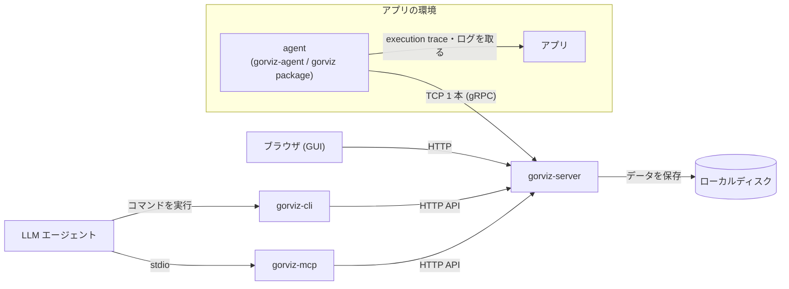
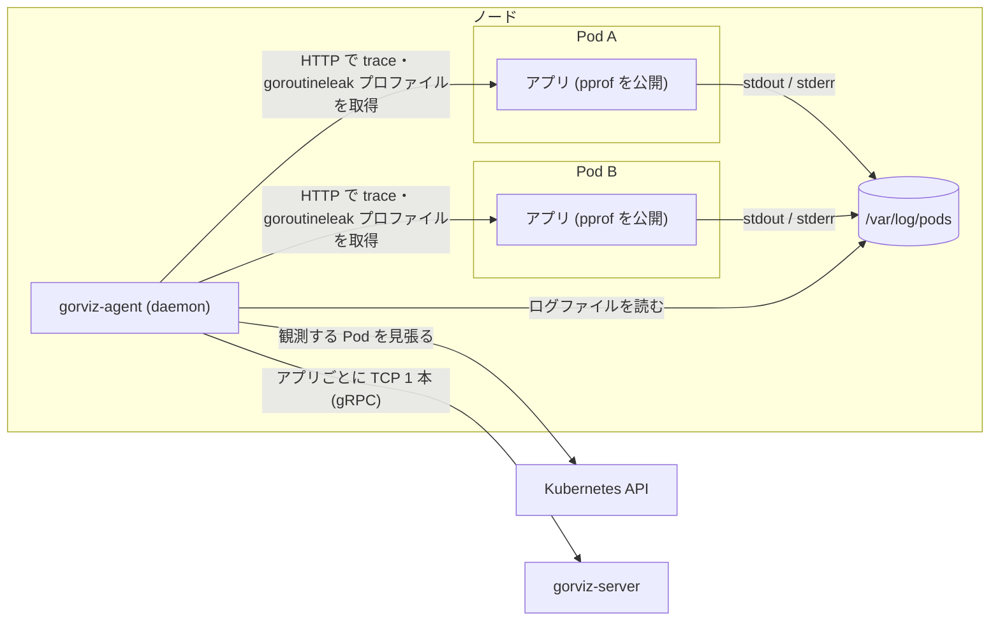
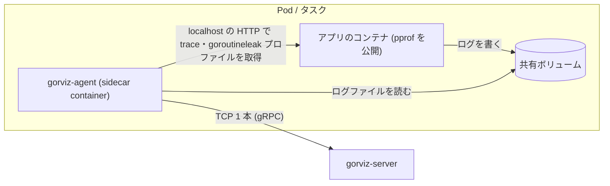
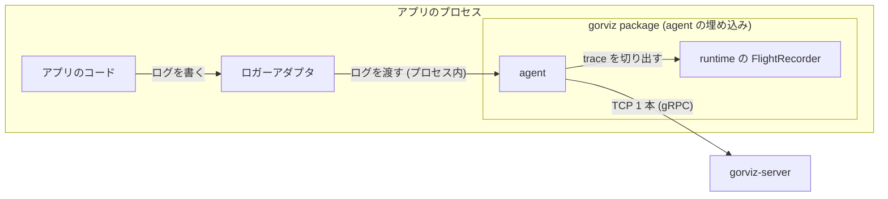
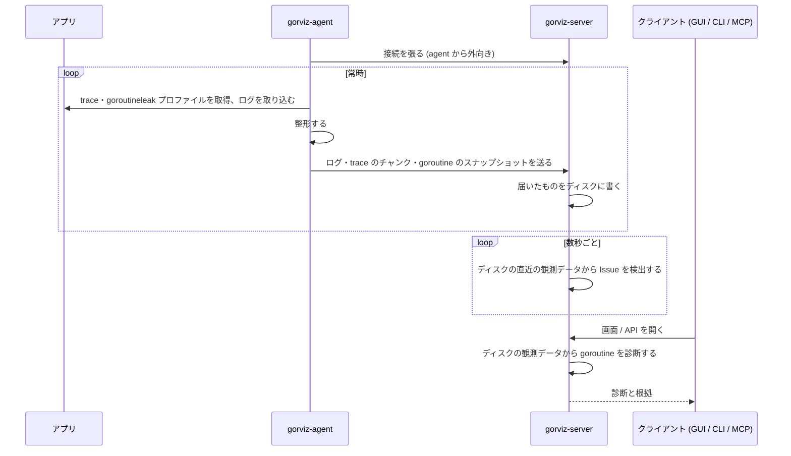
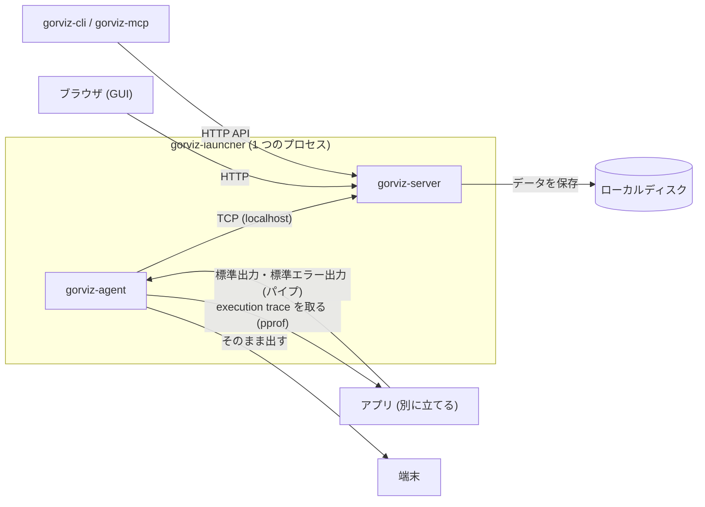

# gorviz 設計

用語の説明は脚注にまとめた。本文の番号 (`[1]` など) から飛べる。

## 目次

- [1. 概要](#1-概要)
- [2. モチベーション](#2-モチベーション)
- [3. アーキテクチャ設計](#3-アーキテクチャ設計)
  - [3.1 コンポーネント](#31-コンポーネント)
  - [3.2 依存関係](#32-依存関係)
  - [3.3 データフロー](#33-データフロー)
  - [3.4 サービスとインスタンス](#34-サービスとインスタンス)
- [4. コンポーネント仕様](#4-コンポーネント仕様)
  - [4.1 gorviz-agent](#41-gorviz-agent)
  - [4.2 gorviz-server](#42-gorviz-server)
- [5. クライアントツール仕様](#5-クライアントツール仕様)
  - [5.1 LLM エージェントの利用に特化するためのポイント](#51-llm-エージェントの利用に特化するためのポイント)
  - [5.2 操作](#52-操作)
  - [5.3 gorviz-cli](#53-gorviz-cli)
  - [5.4 gorviz-mcp](#54-gorviz-mcp)
- [6. gorviz package](#6-gorviz-package)
- [7. gorviz-launcher](#7-gorviz-launcher)
- [8. ユーザーストーリー](#8-ユーザーストーリー)
  - [8.1 goroutine が溜まり続けている](#81-goroutine-が溜まり続けている)
  - [8.2 ロックの待ちでレイテンシが悪化した](#82-ロックの待ちでレイテンシが悪化した)
  - [8.3 深夜のエラーを翌朝調べる](#83-深夜のエラーを翌朝調べる)
  - [8.4 遅いリクエストを調べる](#84-遅いリクエストを調べる)
  - [8.5 APM で気づいた時間帯を調べる](#85-apm-で気づいた時間帯を調べる)
  - [8.6 調査を LLM に任せる](#86-調査を-llm-に任せる)
  - [8.7 リリース前に手元で確かめる](#87-リリース前に手元で確かめる)
  - [8.8 診断を確かめる・スケジューラを理解する](#88-診断を確かめるスケジューラを理解する)

## 1. 概要

- Go のサーバアプリを作り運用する開発者が、パフォーマンスやバグの原因を Go ランタイムまで降りて調べるためのツール
- 問題の検知・ログ・時間帯を入口として、goroutine の粒度での診断を提供する。当時の Go ランタイムのスケジューラの動きを根拠として見せるため、開発者は事象を視覚的に理解できる

## 2. モチベーション

### 2.1 課題

- バグやパフォーマンス低下の原因は、アプリのコードやログを見ても分からず、Go ランタイムまで掘り下げないと辿り着けないことがある (goroutine が CPU・ロック・I/O・GC のどれを待っていたか、など)。ところが Go で開発する人でも、ランタイムのスケジューラまで理解している人はそう多くない。そのため調査が難航する。

- ランタイムの動きは execution trace[^trace] や goroutine dump[^dump] で見られるが、それらを使って効果的に調査するのは難しく、うまく扱えないことが多い。また、それらはその場で取るものであり、定常的に集めておく仕組みがない。そのため、後日に調べようとしても、問題が起きた瞬間のデータが残っていない。

### 2.2 アプローチ

- ランタイムを理解していなくても読める形で見せる
  - trace の生データをそのまま見せるのではなく、goroutine ごとの診断と、Go ランタイムのスケジューラの動きのアニメーションとして見せる
- 問題が起きた瞬間のランタイムの動きを、後から辿れる形で残しておく
  - 定常的に取り続け、問題が検知された前後の時間帯のものを一定期間残しておく。後日でもその瞬間を調べられるようにする
  - 問題の検知・ログ・時間帯を入口に、該当する goroutine に辿れるようにする

### 2.3 既存ツールとの差異

| ツール | できること | 残る課題 |
| --- | --- | --- |
| [pprof](https://pkg.go.dev/net/http/pprof) | goroutine の総数と goroutine dump を取る | - その場で取るだけで、定常的には残らない<br>- どの go 文の goroutine がリーク[^leak]しているかは、goroutine dump を手で読み解かないと分からない |
| [LeakProf](https://www.uber.com/en-US/blog/leakprof-featherlight-in-production-goroutine-leak-detection/) / [panicparse](https://github.com/maruel/panicparse) | goroutine dump を集計する | 止まっている場所の集計まで。ランタイムの中で何を待っていたかを読み解くのは利用者に残る |
| [`go tool trace`](https://pkg.go.dev/cmd/trace) / [gotraceui](https://gotraceui.dev/) | execution trace を開いて、スケジューリングまで見分けられる | - 生データを読み解くにはランタイムの知識が要る<br>- 定常的に取る仕組みがなく、問題が起きた瞬間が残らない<br>- 問題の検知・ログ・時間帯から、該当する goroutine に辿れない |

## 3. アーキテクチャ設計

### 3.1 コンポーネント

- gorviz-agent
  - 観測するアプリと同じホスト (または同じタスク) で動き、そのアプリから execution trace・ログを取り、整形して server へ送る
- gorviz-server
  - agent から届いたデータを持ち、問題の検知と goroutine ごとの診断を行う。結果を GUI (Web) と HTTP API で提供する
- gorviz-cli
  - LLM エージェント (または人) が端末から server の API を使う
- gorviz-mcp
  - LLM エージェントが MCP で server の API を使う

### 3.2 依存関係

矢印は「接続を張る / 呼び出す側 → 相手」。

#### 3.2.1 全体図



#### 3.2.2 agent とアプリ

agent をアプリに対してどう配置するかを 3 通り用意する。

| | agent | 観測するアプリ | 具体環境例 |
| --- | --- | --- | --- |
| daemon 型 | gorviz-agent | 同じホストの複数のアプリ | Kubernetes |
| sidecar 型 | gorviz-agent | 同じタスク内のアプリ 1 つ | Fargate、Cloud Run |
| ライブラリ型 | gorviz package (agent の埋め込み) | そのアプリ自身 | agent を置けない環境 |

##### 3.2.2.1 daemon 型



- 1 つの agent が、同じノードに載った複数のアプリ (annotation で印を付けた Pod) をまとめて観測する。アプリごとに別のインスタンスとして server へ送る
- execution trace・goroutineleak プロファイルを、各アプリが公開する pprof の HTTP から取る
- ログを、ノードの `/var/log/pods` にある各コンテナのログファイルから取る

##### 3.2.2.2 sidecar 型



- agent をアプリ 1 つの隣に置き、そのアプリだけを観測する
- execution trace・goroutineleak プロファイルを、アプリが公開する pprof の HTTP から localhost で取る
- ログを、共有ボリュームのファイルから取る。ECS Fargate では FireLens から tcp で受けることもできる

##### 3.2.2.3 ライブラリ型



- execution trace を、runtime の FlightRecorder から直接取る (pprof の公開は要らない)
- ログを、アプリのロガーからプロセス内で受け取る。アプリが出力したバイト列をそのまま受け取る

##### 3.2.2.4 ログの取り方

agent には、アプリごとに「ログをどこからどう読むか」を設定する。1 つの設定に書くのは次のとおり。

- 読み方 (下の表の種類)
- 読む場所 (ファイルのパス・待ち受けるポートなど)
- サービスの名前
- そのアプリの pprof (このログと trace が同じアプリのものだと結びつけるため)

ログの形式は設定しない。agent が行の形から読み分ける (slog の JSON / テキスト・zap・zerolog・logrus・標準の log)。

| 種類 | 読むもの |
| --- | --- |
| file | ファイルを tail する。ローテーションに追従し、ワイルドカードでも指定できる。Kubernetes のログファイルの行頭 (時刻・stream・P/F) は剥がす |
| tcp / udp | 待ち受けたポートに届いた行。Fluent Bit などのログルーターから送ってもらう |
| 標準入力 | パイプで渡された行 |
| ロガー | アプリのロガーから、同じプロセスの中で渡された行 (ライブラリ型だけ) |

| 置き方 | 環境 | 種類 | 読む場所 |
| --- | --- | --- | --- |
| daemon 型 | Kubernetes | file | ノードの `/var/log/pods` (コンテナの stdout / stderr) |
| sidecar 型 | Kubernetes、Cloud Run、ECS Fargate | file | アプリと共有するボリューム上のファイル。アプリがそこにログを書く |
| sidecar 型 | ECS Fargate | tcp | FireLens (Fluent Bit) が転送するアプリの stdout / stderr |
| ライブラリ型 | どこでも | ロガー | アプリのロガー (ロガーアダプタ経由) |

- sidecar 型では、隣のコンテナの stdout を直接は読めない。そのため共有ボリュームのファイルか、ログルーターを経由する
- ECS Fargate では、FireLens の送り先を agent の tcp にする
- 参考
  - [Datadog Agent のログ収集](https://docs.datadoghq.com/agent/logs/)
  - [Datadog の Kubernetes でのログ収集](https://docs.datadoghq.com/containers/kubernetes/log/)
  - [Datadog の Cloud Run サイドカーでのログ収集](https://docs.datadoghq.com/serverless/google_cloud_run/containers/sidecar/nodejs/)
  - [Datadog の ECS Fargate での FireLens によるログ収集](https://datadoghq.com/blog/collect-fargate-logs-with-firelens)

### 3.3 データフロー



#### 3.3.1 agent と server の通信

- agent から server へ TCP を 1 本張り、TLS で暗号化した上で gRPC を流す。暗号化した直後に、agent がハンドシェイクでインスタンスの名前・サービスの名前・トークンを送る (「[通信の暗号化と認証](#428-通信の暗号化と認証)」)
- 観測データはまとめて gzip で圧縮して送る
- 切れたら agent が張り直し、つながらない間の分を上限まで持って送り直す。送り直しで同じ分が 2 回届いても、server は 1 回分だけ持つ
- keepalive で、止まった相手や黙って切られた接続を見つける

### 3.4 サービスとインスタンス

gorviz は、観測するアプリを「サービス」と「インスタンス」の 2 段で扱う。

| | 指すもの | 扱い |
| --- | --- | --- |
| サービス | 同じアプリのインスタンスをまとめたもの。デプロイやスケールでインスタンスが入れ替わっても、サービスは同じまま | Overview・Issues・Logs で見る単位。ログ・Issue・メトリクスなどを、インスタンスをまたいで 1 本の履歴として持つ |
| インスタンス | アプリのプロセス 1 つ。コンテナで動かす場合は、コンテナの 1 回分の起動にあたる | Scheduler・Goroutine で見る単位。execution trace・goroutine のスナップショットを持ち、goroutine を区別する |

- どちらの名前も、agent がハンドシェイクで server に送る

#### 3.4.1 インスタンスのライフサイクル

インスタンスは、アプリのプロセスが始まってから終わるまで。インスタンスに起きることと、gorviz での扱いは次のとおり。

| ライフイベント | 扱い |
| --- | --- |
| 始まった (デプロイ・スケールアウト) | 新しいインスタンスとして記録し、サービスの時間軸に加える |
| 終わった (デプロイ・スケールイン) | 終わりを記録する。データは保持期間まで残る |
| 同じ名前のまま再起動した (クラッシュによるコンテナの再起動など) | 再起動の前後を、名前が同じ別々のインスタンスとして扱う。前のインスタンスの終わりと、新しいインスタンスの始まりを記録する |

- インスタンスの始まりと終わりは、server がサービスごとに記録する
- goroutine は、インスタンスと goroutine の ID の組で区別する

## 4. コンポーネント仕様

各コンポーネントについて、責務と依存コンポーネントを書く。

### 4.1 gorviz-agent

観測するアプリと同じホスト (または同じタスク) で動き、そのアプリから execution trace・ログを取り、整形して server へ送る。

#### 4.1.1 責務

##### 4.1.1.1 観測するアプリ

| 置き方 | 観測するアプリの決め方 |
| --- | --- |
| daemon 型 | 自分のノードの Pod のうち、annotation で印を付けた Pod (「[Kubernetes での Pod の見つけ方](#415-kubernetes-での-pod-の見つけ方)」) |
| sidecar 型 | 利用者が指定したアプリ |
| ライブラリ型 | 組み込まれたアプリ自身 |

##### 4.1.1.2 取得するもの

| 取得するもの | 取得元 |
| --- | --- |
| execution trace | アプリの pprof[^pprof] (「[pprof から取るもの](#413-pprof-から取るもの)」) |
| goroutineleak プロファイル[^goroutineleak] | アプリの pprof |
| OS のスレッドの数 | アプリの pprof の threadcreate プロファイル (ライブラリ型は runtime の指標) |
| ログ | 「[ログの取り方](#3224-ログの取り方)」のとおり |

##### 4.1.1.3 server に送るもの

| 送るもの | 中身 |
| --- | --- |
| ハンドシェイク | インスタンスの名前とサービスの名前 (「[サービスとインスタンス](#34-サービスとインスタンス)」)。つないだときに送る |
| ログ | 取り込んだ行を読み取ったもの |
| execution trace のチャンク | 整形したもの。生の trace は送らない |
| goroutine のスナップショット | trace のチャンクの終わりの時点で生きている全 goroutine の状態。trace から作る (「[goroutine のスナップショットの作り方](#414-goroutine-のスナップショットの作り方)」) |
| リーク判定 | goroutineleak プロファイルを読み取ったもの |

- 各項目は「[観測データ](#417-観測データ)」のとおり
- 送り方 (つながらない間に持っておく分・送り直し) は「[agent と server の通信](#331-agent-と-server-の通信)」のとおり

#### 4.1.2 依存コンポーネント

- アプリの pprof
- ログの置き場所 (ファイル・ログルーター)
- Kubernetes API (Pod の annotation を読むとき)
- gorviz-server

#### 4.1.3 pprof から取るもの

##### 4.1.3.1 execution trace

- 数秒ごとのチャンク[^chunk]に切り分けて取り続ける
- チャンクごとに、G と P の状態の変化の列・P ごとの実行区間・GC の区間・ヒープの推移・ログの印・集計に整形する。項目は「[execution trace (1 チャンク)](#4174-execution-trace-1-チャンク)」のとおり

##### 4.1.3.2 goroutineleak プロファイル

- `GOROUTINE_LEAK` を誤検知なしで判定するために取る
- 間隔を空けて取る。取るたびに GC が 1 回走るため
- リークと判定された goroutine だけを、スタックごとの件数で取る。全 goroutine を書き出す形式は、書き出す間ずっと STW[^stw] になるので使わない

##### 4.1.3.3 threadcreate プロファイル

- `THREAD_EXPLOSION` を判定するために、runtime が持つ OS のスレッドの数を取る
- execution trace のチャンクごとに取り、件数だけを使う

#### 4.1.4 goroutine のスナップショットの作り方

goroutine のスナップショットは、goroutine dump の代わりになるもの。goroutine dump はアプリ全体を止めるので取らず、execution trace から作る。trace は、チャンクの中でイベントを出さなかった goroutine についても、今の状態とスタックを記録する。

項目ごとの作り方は次のとおり。

| 項目 | 元にするデータ | 作り方 |
| --- | --- | --- |
| 状態・入口・今いる関数 | trace の、チャンクの終わりの状態の記録 (状態とスタック) | そのまま使う。入口はスタックの一番下、今いる関数は一番上 |
| 待機理由 | trace の、待機に入ったときのイベント (理由つき) | trace のチャンクの終わりの記録には入らないので、goroutine ごとに覚えて次の trace のチャンクに持ち越す |
| 待っている時間 | trace の、待機に入ったときのイベント (時刻つき) | 待機に入った時刻を覚え、trace のチャンクの終わりとの差にする |
| 生成元 | trace の、作られたときのイベント (作った側のスタックつき) | trace のチャンクの終わりの記録には入らないので、goroutine ごとに覚える |
| リーク | goroutineleak プロファイル | プロファイルのスタックと、goroutine のスタックを突き合わせる |

リークの突き合わせ方は次のとおり。

- goroutineleak プロファイルは「このスタックの goroutine が N 個リークしている」という件数で届く。どの goroutine かは書かれない
- 同じスタック (同じ場所で待っている) の goroutine でも、待っている相手がまだ起こしうるものとリークしたものが混ざる。たとえばタイムアウトで受け手が先に帰ると、送り手だけが同じ行で待ち続ける
- スナップショットに同じスタックの goroutine がちょうど N 個あれば、その全部をリークとする
- N 個より多ければ、どれがリークかは決められない。リークした goroutine は二度と起きず待っている時間が伸び続けるので、同じスタックの M 個のうち待っている時間が長い順に N 個をリークと推定する
- どちらの場合も、「このスタックの M 個のうち N 個がリーク」という件数はスタック単位で持つ

##### 4.1.4.1 goroutine の識別

goroutine は「インスタンス + goroutine の ID」で識別する (「[サービスとインスタンス](#34-サービスとインスタンス)」)。agent は、同じ名前のまま中のプロセスが入れ替わったことを次のように見分ける。

| 置き方 | プロセスが入れ替わったことの見分け方 |
| --- | --- |
| ライブラリ型 | agent もアプリと一緒に起動し直すので、そのまま新しいインスタンスになる |
| daemon 型 | アプリのコンテナの ID が変わる。Kubernetes API で Pod を見ているので取れる |
| sidecar 型 | 最大の goroutine の ID が減る。agent が再起動しても、減っていなければ同じインスタンスのまま |

goroutine ごとに覚えている情報 (待機理由・待ち始めた時刻・生成元) は、次のように扱う。

| 場面 | 例 | 覚えている情報 |
| --- | --- | --- |
| 新しいインスタンスになった | デプロイ・クラッシュによるコンテナの再起動 | 引き継がない。前のインスタンスの分は、そのまま server に残る |
| agent だけが再起動した | agent のコンテナの再起動・更新 | agent の記憶は消えるので、server が前のスナップショットから同じ goroutine の分を引き継ぐ |

#### 4.1.5 Kubernetes での Pod の見つけ方

daemon 型の agent は、自分のノードに載っている Pod のうち、観測してほしいと印を付けられた Pod だけを観測する。印は、利用者がアプリの Pod に付ける annotation[^annotation] で表す。

```yaml
apiVersion: apps/v1
kind: Deployment
metadata:
  name: checkout
spec:
  template:
    metadata:
      annotations: # Deployment 自体ではなく Pod のテンプレートに書く
        gorviz/pprof-port: "6060" # agent はこの Pod の IP とこのポートで pprof に取りに行く
        gorviz/log-container: app # stdout / stderr をログとして取るコンテナ。envoy のログは取らない
    spec:
      containers:
        - name: app
          image: example/checkout
          ports:
            - containerPort: 6060
        - name: envoy
          image: envoyproxy/envoy
```

- ログは、ノードの `/var/log/pods` にある、指定したコンテナのログファイルから読む
- agent は Kubernetes API で自分のノードの Pod を見張り、annotation の付いた Pod が現れたら観測を始め、消えたらやめる
- annotation の付いていない Pod は、同じノードにあっても観測しない。観測する Pod を利用者が明示的に選ぶため

#### 4.1.6 制約

- 1 つのアプリを観測する agent は 1 つ (trace はプロセスで同時に 1 本しか取れないため)
- アプリにかける負荷は、本番に常時置ける程度 (Datadog の Go プロファイラと同程度) に収める
- agent が起動していない間に待機に入った・作られた goroutine は、スナップショットの情報が一部不十分になる
  - 原因
    - 待機理由・待ち始めた時刻・生成元は、その瞬間の trace のイベントにしか入らないため
  - 対処
    - 待機理由は、trace のチャンクの終わりの状態の記録にあるスタックの上の方の runtime の関数 (channel の受信・ロック・スリープ・ネットワークなど) から推定する (`INFERENCE`)
    - 待っている時間は、agent が見始めてからの下限で持つ
    - 生成元は、入口の関数で代用する

#### 4.1.7 観測データ

agent が送るものをまとめて観測データ[^observation]と呼ぶ。

| 運ぶもの | いつ | 単位 |
| --- | --- | --- |
| ログ | 数秒ごと | 前回送った後に増えた行をまとめて |
| goroutine のスナップショット | trace のチャンク (数秒) ごと | 1 回分 |
| リーク判定 | goroutineleak プロファイルを取るたび | 1 回分 |
| execution trace | チャンク (数秒) ごと | 1 チャンク。生の trace は送らない |

- trace を整形した形で送るのは、生の trace より小さく、server もこの形だけを持って読めば済むため。`go tool trace` に渡す生の trace は残さない

##### 4.1.7.1 ログ (1 行)

| 項目 | 中身 |
| --- | --- |
| 番号 | 取り込んだ順の通し番号 |
| 時刻 | ログに書かれた時刻。なければ取り込んだ時刻 (どちらかを区別して持つ) |
| レベル・メッセージ | ログから読み取ったもの |
| 元の行 | 取り込んだ行そのもの |
| 取り込み元 | ログを取った口 (ファイル・TCP / UDP・標準入力・ロガー) |
| trace との対応 | ロガーアダプタが振った番号。trace のログの印と同じ番号 |
| 所要時間 | ログに書かれていれば |

##### 4.1.7.2 goroutine のスナップショット (1 回分)

| 項目 | 中身 |
| --- | --- |
| 時刻 | trace のチャンクの終わりの時刻 |
| goroutine の並び | その時点で生きている全 goroutine。1 つにつき下の表の項目を持つ |

| goroutine の項目 | 中身 |
| --- | --- |
| ID | goroutine の ID |
| 状態 | 状態と待機理由。待機理由をスタックから推定したかも持つ |
| 待っている時間 | その状態にいる時間。agent の起動前から続いていて下限しか分からないかも持つ |
| 入口 | go 文で起動された関数 |
| 今いる関数 | trace のチャンクの終わりに止まっている関数 |
| 生成元 | go 文を書いた関数と場所 |
| リーク | runtime がリークと判定したか |
| 待ちを起こした goroutine | `LOCK_WAIT`・`SYNC_WAIT` で待っていたとき、その待ちを終わらせて起こした goroutine と、起こした場所。そこへ移れる |

##### 4.1.7.3 リーク判定 (1 回分)

| 項目 | 中身 |
| --- | --- |
| 時刻 | 取った時刻 |
| 状態 | runtime によるリーク判定をしたか (した / 使えない / 切ってある) |
| リークした goroutine | スタックごとの件数 |

##### 4.1.7.4 execution trace (1 チャンク)

| 項目 | 中身 |
| --- | --- |
| 始まり | チャンクの始まりの壁時計の時刻。チャンクの中の時刻は、ここからの経過時間で持つ |
| 長さ | チャンクの長さ。前のチャンクと重なる部分は取り除いてある |
| 状態の変化 | G と P の状態の変化の列 (時刻順。全イベントを持ち、間引かない)。項目は下の表 |
| P の区間 | P ごとに、どの G がどの M の上で走ったかの区間 |
| 入口 | G ごとの入口の関数 |
| GC の区間 | stop-the-world (理由つき)・mark assist (どの G か)・concurrent mark |
| ヒープ | ヒープの大きさと GC の目標値の推移。GC が終わるたびの live heap と目標値 |
| 件数 | チャンクの中で作られた・終わった G の数と、始まった GC の回数 |
| スレッドの数 | チャンクの終わりに、runtime が持っていた OS のスレッドの数 |
| ログの印 | ロガーアダプタが振った番号ごとに、書いた G とその時刻 |
| 集計 | 全イベントから数えた値。項目は下の表 |

| 状態の変化の項目 | G の変化 | P の変化 |
| --- | --- | --- |
| 時刻 | 変化した時刻 (チャンクの始まりからの経過時間) | 変化した時刻 (チャンクの始まりからの経過時間) |
| 対象 | どの G か | どの P か |
| 移った先 | 走っている / ローカルの実行待ちキュー / グローバルの実行待ちキュー / 待機 / システムコール / 終了 | 空いた / G を走らせ始めた |
| P・M | 使っている P と M | どの M の上か |
| 待機理由 | 待機に移ったときの理由。cgo の中にいるかも持つ | - |
| 止まった場所 | 止まった関数と、それを呼んだ利用者のコードの場所 | - |
| 作られたか | G が作られたときの変化か | - |
| 起こした G | 起こした G と、起こしたときにその G がいた関数と場所 | - |

| 集計の項目 | 中身 |
| --- | --- |
| P の数 | チャンクの中に現れた P の数 |
| 実行待ち | G が実行待ちだった時間の合計 |
| 待ち場所 | 種類・待機理由・入口・止まった関数ごとに、回数・合計時間・最大と、止まった場所 (file:line) |
| 実行待ちの時間 | `RUNNABLE` (実行待ち) になってから `RUNNING` (実行中) になるまでの時間の分布 |
| stop-the-world | 1 回の長さの分布 |
| GC の占有 | 短い時間幅ごとに見た、GC が P を占めた割合の最大 |
| P の使い方 | 全 P のうち G を走らせていた時間と、GC に使われた時間 |

### 4.2 gorviz-server

agent から届いたデータを持ち、問題の検知と goroutine ごとの診断を行う。結果を GUI (Web) と HTTP API で提供する。

#### 4.2.1 責務

##### 4.2.1.1 受け取るもの

| 受け取るもの | 送り手 |
| --- | --- |
| ハンドシェイク | agent。接続を張った直後に送ってくる。server はインスタンスごとに受け口を持つ |
| 観測データ (ログ・trace のチャンク・goroutine のスナップショット・リーク判定) | agent |

##### 4.2.1.2 行うこと

| 処理 | いつ | 中身 |
| --- | --- | --- |
| Issue の検出 | 数秒ごと | 届いた観測データから Issue を検出する |
| 通知 | Issue の発生が始まったとき | 決めた送り先に知らせる (「[通知](#429-通知)」) |
| goroutine の診断 | クライアントが求めたとき | 観測データから、goroutine ごとの状態別の時間内訳・主因・止まっていた場所を出す (「[goroutine の診断](#426-goroutine-の診断)」) |
| データの保持 | 常に | 届いた観測データをディスクに書き、古くなったら間引く。Issue の発生・エラーログの前後の execution trace は長く残す (「[データの持ち方](#423-データの持ち方)」) |

##### 4.2.1.3 提供するもの

| 提供するもの | 使う側 |
| --- | --- |
| GUI (Web) | ブラウザ (「[GUI](#424-gui)」) |
| HTTP API (JSON) | gorviz-cli・gorviz-mcp |

#### 4.2.2 依存コンポーネント

- ローカルディスク
- 通知の送り先 (Webhook の受け手・Slack・SMTP サーバ)

#### 4.2.3 データの持ち方

- 生の trace はどこにも持たない。agent が整形した trace のチャンクだけを扱う
- データはサービスの下にインスタンスがぶら下がる形で持つ。インスタンスが入れ替わっても、サービスの履歴は 1 本につながる

##### 4.2.3.1 agent

- 送るまでの分だけ持つ
- 待機理由・待ち始めた時刻・生成元は、goroutine ごとに、インスタンスが続く間覚える

##### 4.2.3.2 server

- 届いた観測データはすべてディスクに書き、読むのもディスクから。保存先はローカルディスクだけ (セルフホストのため)。利用者が決めるのは置き場所と、データごとの期間だけ
- サービスとインスタンスの 2 層で管理する (「[サービスとインスタンス](#34-サービスとインスタンス)」)。インスタンスが入れ替わっても、サービスの履歴は切れない

###### 4.2.3.2.1 ファイル構成

```sh
<保存先>/
├── server/                                      # server 自身のもの
│   ├── tls/
│   │   ├── ca.pem                               # 自分で作った CA の証明書
│   │   └── server.pem                           # server の証明書
│   └── auth-tokens.jsonl                        # 発行したトークン
└── services/
    └── <サービス>/
        ├── service/                             # サービス単位 (Overview・Issues・Logs)
        │   ├── metrics/2026-11-21.jsonl         # メトリクス (goroutine 数・エラー数・ヒープ・RUNNABLE の時間の p99・GC と mark assist の CPU の割合・ロックの待ちと実行中の時間・スレッドの数など、10 秒刻み)
        │   ├── issues/                          # Issue
        │   │   └── 2026-11-21/                  # 日ごと
        │   │       └── <種類>--<対象>--<ハッシュ>.json # その日の発生の一覧 (発生ごとに影響の大きかった goroutine を含む)。例: GOROUTINE_LEAK--main-Server-handle--3f9a1c.json
        │   ├── logs/2026-11-21T14.jsonl         # ログ
        │   └── instance-lifecycle/2026-11-21.jsonl # インスタンスの始まりと終わり
        └── instances/                           # インスタンス単位 (Scheduler・Goroutine)
            └── <インスタンスの名前>/             # 例: checkout-7d9f-abcde
                ├── execution-traces/            # 整形済みの execution trace
                │   ├── 2026-11-21T14.pb.gz
                │   └── 2026-11-21T14.index
                ├── execution-traces-around-issues/  # Issue の発生の前後の execution trace
                │   └── 2026-11-21/                  # 日ごと
                │       └── <種類>--<対象>--<ハッシュ>/   # Issue のファイル名と同じ
                │           └── <発生した時刻>.pb.gz     # 例: 2026-11-21T14-03-12.pb.gz
                ├── execution-traces-around-error-logs/  # エラーログの前後の execution trace
                │   └── 2026-11-21/                  # 日ごと
                │       └── <メッセージの形>--<ハッシュ>/   # 例: request-failed-user-id-n--8b21e0
                │           └── <書いた時刻>.pb.gz
                ├── goroutine-snapshots/         # goroutine のスナップショット
                │   └── 2026-11-21T14.pb.gz
                └── goroutine-state-breakdowns/  # goroutine ごとの状態別の時間内訳
                    └── 2026-11-21.jsonl
```

- `.jsonl` は 1 行 1 件のデータ。`.pb.gz` は agent から届いた protobuf を gzip したもので、届いた形のまま書く
- ファイルは時刻 (UTC) で区切り、ファイル名を区切りの始まりの時刻にする
  - 量の多いもの (execution trace・goroutine のスナップショット・ログ) は 1 時間ごと (`2026-11-21T14`)
  - それ以外は 1 日ごと (`2026-11-21`)
  - Issue と、Issue の発生・エラーログの前後の execution trace は、日ごとのディレクトリの下に置く。1 つの Issue は、発生した日ごとのファイルに分かれる
- インスタンスのディレクトリ名は、インスタンスの名前。同じ名前のまま新しいインスタンスになったときは、同じディレクトリに続けて書く。どこで切り替わったかは `service/instance-lifecycle/` で分かる
- 文字列から作る名前は、`<読める形>--<ハッシュ>` の形にそろえる
  - 読める形は、元の文字列のうちファイル名に使えない文字を `-` に置き換え、短く切り詰めたもの
  - ハッシュは、元の文字列から作る短い値。切り詰めても別のものと名前が重ならないようにする。同じ文字列からは必ず同じ名前になる

| 名前 | 元の文字列 | 形 | 例 |
| --- | --- | --- | --- |
| Issue のファイル | Issue の種類と対象 | `<種類>--<対象>--<ハッシュ>` | `GOROUTINE_LEAK--main-Server-handle--3f9a1c` |
| ログの前後の execution trace のディレクトリ | メッセージの形 (メッセージの値の部分をならしたもの) | `<メッセージの形>--<ハッシュ>` | `request-failed-user-id-n--8b21e0` |

- 同じ Issue は、どの日のファイルでも同じ名前になる。Issues で 1 件を開くときは、同じ名前のファイルを日をまたいで集める。同じ形のメッセージは同じディレクトリにまとまる
- Issue のファイルには、発生[^occurrence]ごとに次を持つ
  - 発生した時刻 (UTC) とインスタンス
  - 前後の execution trace のファイル名。`execution-traces-around-issues/<日>/<Issue のファイル名>/<発生した時刻>.pb.gz`
  - 影響の大きかった goroutine の上位。前後の execution trace が消えても、ここから調べ始められる
- Issue の発生の前後の execution trace は、発生したインスタンスの `execution-traces-around-issues/` へ写す。Issue のファイルの発生の一覧から、そのファイルを引ける
- エラーログ (`ERROR` 以上) の前後の execution trace も、書いたインスタンスの `execution-traces-around-error-logs/` へ写す。ログの行から、そのファイルを引ける
  - 毎回写す。同じディレクトリで、前後の範囲が前に写したものと重なるときは、重なった分は写し直さない
- execution trace は、チャンクを 1 つずつ gzip して時刻順につなげて書く。索引には、チャンクごとに始まりと終わりの時刻と、ファイルの中の位置を持つ。読むときは、索引で時刻から位置を引き、その範囲のチャンクだけを読む

###### 4.2.3.2.2 保持期間

データごとに、何に使うかから持つ期間を決める。期間は利用者が変えられる。表の期間は、変えなかったときの期間。

| データ | 置き場所 | 使い道 | 期間 |
| --- | --- | --- | --- |
| メトリクス (10 秒刻み) | `service/metrics/` | Overview の推移と、Issue の普段との比較 | 31 日 |
| Issue | `service/issues/` | Issues の一覧と、発生ごとの調べ始め | 31 日 |
| ログ (書いた goroutine を添える) | `service/logs/` | Logs と、書いた goroutine への動線 | 31 日 |
| インスタンスの始まりと終わり | `service/instance-lifecycle/` | 時間軸の印と、同じ名前のインスタンスの区切り | 31 日 |
| execution trace | `instances/<インスタンス>/execution-traces/` | 直近の、スケジューラの動きの再生 (Scheduler) と、ログ 1 行のリクエストの区間の goroutine の診断 | 7 日 |
| Issue の発生の前後の execution trace | `instances/<インスタンス>/execution-traces-around-issues/` | 後日でも、Issue の発生の前後のスケジューラの動きを再生し、goroutine を診断する | 31 日 |
| エラーログの前後の execution trace | `instances/<インスタンス>/execution-traces-around-error-logs/` | 後日でも、エラーログを書いた前後のスケジューラの動きを再生し、書いた goroutine を診断する | 31 日 |
| goroutine のスナップショット | `instances/<インスタンス>/goroutine-snapshots/` | execution trace が消えたあとの、goroutine の状態・生成元・リーク | 31 日 |
| goroutine ごとの状態別の時間内訳 (1 分ごと。入口・主因ごとの時間・止まっていた場所と待機理由) | `instances/<インスタンス>/goroutine-state-breakdowns/` | execution trace が消えたあとの、主因と止まっていた場所 | 31 日 |

- execution trace だけ 7 日にしているのは、ほかのデータより桁違いに大きいため (負荷に比例して増える)。7 日を過ぎると、スケジューラの動きの再生と、リクエストの区間に合わせた正確な診断ができなくなる (Issue の発生・エラーログの前後に写した分を除く)。goroutine の状態・主因・止まっていた場所は、スナップショットと状態別の時間内訳から引き続き分かる
- 期間を過ぎたものは、ファイルごと捨てる。空になったディレクトリ (インスタンスのディレクトリなど) も捨てる

#### 4.2.4 GUI

| 画面 | 単位 | 役割 |
| --- | --- | --- |
| Overview | サービス | 全体の様子 (発生中の Issue の数、goroutine 数・エラー・CPU 待ち・ヒープの推移) |
| Issues | サービス | 検出した問題の一覧 (31 日残る)。1 つ選ぶと、発生の回数の推移と、発生ごとに調べ始める先を示す |
| Logs | サービス | ログ一覧と件数の推移。行を開くと JSON のキーと値を見られ、そこから書いた goroutine の Goroutine (分からなければその時刻の Scheduler) へ移れる |
| Scheduler | インスタンス | execution trace から、スケジューラの動きを GMP[^gmp] の概念図で再生する。最新を見ているあいだは新しく届いた分を追い、見ている範囲の端まで再生すると続きをつなぐ。G を選ぶとその Goroutine を開く |
| Goroutine | インスタンス | 1 つの goroutine の診断と根拠 (調べる期間に書いたログを含む)。どの画面から入っても最後はここに行き着く |

- 見るサービスは、画面ではなく見出しの切り替えで選ぶ
- サービス単位の画面では、インスタンスをまたいで 1 本に並べ、各行にどのインスタンスのものかを出す
- Scheduler と Goroutine はインスタンス単位で見る。trace のチャンクはインスタンスごとに別のものなので、まとめない。サービス単位の画面の行から移るとき、その行のインスタンスに決まる
- サービスの名前とインスタンスの名前は、agent がハンドシェイクで送ったものを使う
- `GOROUTINE_LEAK` の Issue は、スタックごとに 1 行で、生成元・止まっている場所 (file:line) と「同じ場所で待っている M 個のうち N 個がリーク」を示す。同じ場所で待っていても、リークしたものとまだ起こされうるものが混ざるため (「[goroutine のスナップショットの作り方](#414-goroutine-のスナップショットの作り方)」)
- `LOCK_CONTENTION` の Issue は、`Lock` を呼んだ関数ごとに 1 行で、待ち時間の多い順に示す
  - 1 行に出すのは、待ち時間の割合・回数・1 回あたりの平均と最大・止まった場所 (file:line)・待たせていた関数とその場所
  - 回数と 1 回あたりの長さを並べるのは、ロックを取る回数が多すぎるのか、誰かがロックを長く持っているのかを見分けるため
  - 待たせていた関数から、その goroutine の Goroutine へ移れる。待たせていた側がロックを持っている間に何をしていたかを見るため
- Scheduler と Goroutine では、goroutine ごとのリークを、確かさ (`FACT` / `INFERENCE`) が分かる形で示す
- インスタンスの始まりと終わり・再起動は、時間軸に印として示す (「[サービスとインスタンス](#34-サービスとインスタンス)」)
- 保持期間を過ぎて出せない情報があるときは、その欄を隠さず、保持期間を過ぎたため出せないと示す (何がいつまで出せるかは「[元にするデータ](#4263-元にするデータ)」)
  - goroutine の診断には、何から算出したか (execution trace / 1 分ごとの状態別の時間内訳 / goroutine のスナップショット) を添える。1 分ごとの内訳から算出したときは、期間が 1 分単位で合わせたものだと示す
  - スケジューラの動きを再生できない時刻でも、近くに Issue の発生やエラーログの前後に写した execution trace があれば、そこへ移れるようにする

#### 4.2.5 Issue

Issue は、runtime 層の問題を server が観測データから見つけたもの。

遅いリクエストやエラーの増加 (アプリ層) に気づくのは APM (Datadog など) の役目で、gorviz はそこで見つけたログ・時間帯から goroutine と runtime を調べる入口を用意する。

- Issue に解決の状態は持たない。どこかのインスタンスで発生[^occurrence]が続いている Issue を発生中とし、続いていなければ発生中でないとする。利用者が解決にする操作も持たない
- 数える・比べる・同じ Issue とみなす単位は、コードの場所 (file:line) ではなく関数にする。デプロイで行番号がずれても、推移や普段との比較が途切れず、同じ Issue として追えるようにするため。file:line は、その関数の中で実際に止まった場所として見せる
  - 無名関数 (`handle.func1` など) は、外側の関数にまとめる。同じ関数の中で無名関数を足し引きすると、番号がずれるため
  - ジェネリクスの関数は、型パラメータの部分をならして 1 つにまとめる

##### 4.2.5.1 Issue の種類

ネクストアクションは、どこを見直せばよいかの方向。直し方そのものは示さない。

| 種類 | 何の問題か | ネクストアクション |
| --- | --- | --- |
| `GOROUTINE_LEAK` | 終わるはずの goroutine が、何かを待ったまま溜まり続ける | 生成元の go 文と止まっている場所を見て、goroutine が終われる道 (context のキャンセル・channel を閉じる・タイムアウト) があるかを見直す |
| `CPU_CONTENTION` | CPU の取り合いで、`RUNNABLE` の goroutine が P を待たされる | 同じ時間帯に CPU を長く使っている goroutine の処理を見直す。または CPU の割り当て (コンテナの CPU の上限・インスタンスの数) を見直す |
| `GC_PRESSURE` | GC が CPU を奪い、アプリの処理が進まない | mark assist の長い goroutine の割り当てを減らす。または GOGC・GOMEMLIMIT を見直す |
| `LOCK_CONTENTION` | goroutine が、仕事より長い時間をロックの待ちに取られる | 待ちの多かった `Lock` を呼んだ関数を見て、ロックの粒度・持つ時間・分け方を見直す |
| `LONG_STW` | stop-the-world で、アプリ全体が長く止まる | STW の理由を見て、STW を起こす呼び出し (`runtime.ReadMemStats`・`runtime.GC`・プロファイルの取得など) を見直す |
| `THREAD_EXPLOSION` | OS のスレッドが増えすぎる | syscall・cgo の場所を見て、同時に呼ぶ数を絞る |

##### 4.2.5.2 判定

閾値での判定は trace のチャンクごとに、普段との比較は 5 分ごとに行う (「[普段との比較](#42521-普段との比較)」)。資源が足りずに処理が止まっていた量で判定し、実行待ちの goroutine の数や GC の回数のような、P の数やヒープの大きさで意味が変わる値では判定しない。

| 種類 | 判定の材料 | `FACT` | `INFERENCE` |
| --- | --- | --- | --- |
| `GOROUTINE_LEAK` | goroutineleak プロファイル・goroutine のスナップショット | runtime の goroutineleak プロファイルが判定した | 生成元 (go 文を書いた関数) ごとの待機中の数が、減らずに増え続けている (goroutineleak プロファイルのない古い Go 向け) |
| `CPU_CONTENTION` | `RUNNABLE` から `RUNNING` になるまでの時間の分布 | - | p99 が 1ms 以上になった、または普段より大きく外れた |
| `GC_PRESSURE` | GC と mark assist が使った CPU の割合 | GC の CPU の割合が 50% に達した | mark assist の CPU の割合が 5% を超えた、または GC の CPU の割合が普段より大きく外れた |
| `LOCK_CONTENTION` | goroutine が `sync.Mutex`・`sync.RWMutex` の `Lock` で待たされた時間と、実行中だった時間 | - | ロックで待たされた時間が実行中の時間を超えた、または普段より大きく外れた |
| `LONG_STW` | stop-the-world の区間と理由 | - | 1 回の STW が 1ms 以上 |
| `THREAD_EXPLOSION` | runtime が持つ OS のスレッドの数 | - | スレッドの数が上限 (既定 10,000) の半分を超えた、または普段より大きく外れた |

閾値は利用者には変えさせない。閾値の根拠・参考は次のとおり。

| 閾値 | 根拠・参考 |
| --- | --- |
| `RUNNABLE` から `RUNNING` になるまでの時間の p99 が 1ms | [CockroachDB](https://www.cockroachlabs.com/blog/rubbing-control-theory/) が、スケジューリングの遅延の目安としている値を参考にした |
| GC の CPU の割合 50% | Go の runtime が、GC に使う CPU の上限としている値。これを超えると、runtime はメモリの上限を守るより GC を抑える方を選ぶ ([GC ガイド](https://go.dev/doc/gc-guide)) |
| mark assist の CPU の割合 5% | [GC ガイド](https://go.dev/doc/gc-guide)が、アプリの割り当てが GC を追い越している兆しとしている値 |
| 1 回の STW が 1ms | GC の STW は通常 100µs 未満 ([Go 1.8 のリリースノート](https://go.dev/doc/go1.8#gc))。その 10 倍を、異常に長い目安とした |
| ロックで待たされた時間が実行中の時間を超える | 仕事をしている時間より、ロックを待っている時間の方が長い状態。GC の CPU の割合 50% (GC の CPU がアプリの CPU を上回る線) と同じ考え方をロックに当てはめた。外部の根拠はない |
| スレッドの数が上限の半分 | 上限 (既定 10,000) を超えるとプロセスが落ちる ([runtime/debug.SetMaxThreads](https://pkg.go.dev/runtime/debug#SetMaxThreads))。落ちる前に気づけるよう、半分を目安とした |

- `LOCK_CONTENTION` のロックの待ちは、trace の待機理由が「sync」で、かつ待機に入ったときのスタックに `sync.(*Mutex).Lock`・`sync.(*RWMutex).Lock`・`sync.(*RWMutex).RLock` があるものに限る。待機理由の「sync」には `sync.(*WaitGroup).Wait` などの待ちも入っていて、子の goroutine を待つような普通の待ちまでロックの待ちに数えてしまうため
- `LOCK_CONTENTION` は、関数ごとではなくインスタンス全体の値で判定する。関数ごとの待ちは内訳として見せる
- コンテナで CPU を制限していると、OS がスレッドを止める (throttling) ことがある。止められている間、goroutine は trace の上では走っているままに見えるので、その goroutine の主因は `RUNNING` になる。ただし同じ間、ほかの goroutine は P が空かず待たされるので、`CPU_CONTENTION` としては表れる。Go 1.25 からは、GOMAXPROCS が既定でコンテナの CPU の制限に合わせて決まるので、throttling は起きにくい ([Go 1.25 のリリースノート](https://go.dev/doc/go1.25))

###### 4.2.5.2.1 普段との比較

`INFERENCE` の「普段より大きく外れた」は、どの種類も同じ決め方で判定する。

| 項目 | 決め方 | 理由・根拠 |
| --- | --- | --- |
| 比べる値 | メトリクス (`service/metrics/`) の値を、5 分ごとにまとめたもの | 短い時間幅だと、たまたまの揺れで外れたと判定してしまうため ([Datadog の anomaly detection](https://docs.datadoghq.com/monitors/types/anomaly/)) |
| 比べる相手 | 同じサービスの、過去の同じ曜日・同じ時刻の前後 30 分の 5 分ごとの値。そろっている分だけ、直近 3 週分まで使う (1 週あたり 12 個、3 週で 36 個) | 曜日や時間帯で負荷が変わっても、毎回外れたと判定しないため。3 週分の中央値にするのは、過去のどこか 1 週の異常に基準が引きずられないため ([GitLab の異常検知](https://about.gitlab.com/blog/anomaly-detection-using-prometheus/))。インスタンスは入れ替わるので、サービス単位で比べる |
| 外れ具合 | 修正 z スコア = 0.6745 × (今の値 − 中央値) ÷ MAD (中央絶対偏差)。中央値と MAD は比べる相手から出す | 平均と標準偏差ではなく中央値と MAD を使い、比べる相手に含まれる外れ値に引きずられないようにする |
| 外れの目安 | 修正 z スコアが 3.5 を超えた (大きくなる向きだけ) | Iglewicz と Hoaglin の推奨 ([NIST の統計ハンドブック](https://www.itl.nist.gov/div898/handbook/eda/section3/eda35h.htm)) |
| MAD が 0 のとき | 1.253314 × 平均絶対偏差を MAD の代わりに使う。それも 0 (比べる相手がすべて同じ値) なら、普段との比較では判定しない | 平均絶対偏差で代えるのは、修正 z スコアでの一般的な逃げ道 ([Oracle の Modified Z-Score](https://docs.oracle.com/en/cloud/saas/freeform/ffuuu/insights_metrics_MODIFIED_Z_SCORE.html))。判定しなくても、どの種類にも固定の線の判定があるので見逃さない |
| 判定しないとき | 同じ曜日の履歴が 1 週分そろうまで | 比べる相手がそろわないため。その間も、固定の線の判定は働く |

##### 4.2.5.3 影響の大きかった goroutine

Issue の発生ごとに、影響の大きかった goroutine の上位を Issue のファイルに持つ (「[server](#4232-server)」)。前後の execution trace が消えても、ここから調べ始められる。

| 種類 | 影響の大きかった goroutine |
| --- | --- |
| `GOROUTINE_LEAK` | リークした goroutine (スタックごとの件数) |
| `CPU_CONTENTION` | `RUNNABLE` の時間が長かった goroutine |
| `GC_PRESSURE` | mark assist をさせられた時間の長かった goroutine |
| `LOCK_CONTENTION` | ロックで長く待たされた goroutine と、待ちの多かった `Lock` を呼んだ関数、その待ちを起こした関数 (ロックを持って待たせていた側) |
| `LONG_STW` | STW を起こした goroutine と、STW の理由 |
| `THREAD_EXPLOSION` | syscall・cgo で OS のスレッドを長く占有した goroutine |


#### 4.2.6 goroutine の診断

goroutine の診断は、ある期間に 1 つの goroutine が何に止まっていたかを判定するもの。

##### 4.2.6.1 調べる期間

調べる期間は、どこから goroutine を開いたかで決まる。

| 開いたところ | 調べる期間 |
| --- | --- |
| 所要時間のあるログ | そのリクエストの区間 (書いた時刻 − 所要時間 〜 書いた時刻) |
| 所要時間のないログ | 書いた時刻の前後 |
| Issue の発生 | 発生の前後 |
| Scheduler で選んだ G | 再生している範囲 |
| 待ちを起こした goroutine (`LOCK_CONTENTION` の待たせていた関数を含む) | 起こされた側が待っていた区間 |

##### 4.2.6.2 提供する情報

| 提供する情報 | 中身 |
| --- | --- |
| 状態別の時間内訳 | その期間に、実行中・CPU 待ち・ロック待ちなどの各状態にどれだけいたか |
| 主因 | 状態別の時間内訳のうち最も長い状態 (「[主因](#4264-主因)」) |
| 止まっていた場所 | 最も長く止まっていた関数と場所 (file:line) |
| リーク | runtime がリークと判定したか |
| スケジューラの動きの再生 | その期間に、goroutine を P と M がどう走らせ、どこで待たせたかを GMP[^gmp] の概念図で再生したもの |

- 状態別の時間内訳とスケジューラの動きの再生は、主因と止まっていた場所の根拠として見せる

##### 4.2.6.3 元にするデータ

どの項目も、その期間について残っている中で一番細かいデータから算出する。データごとに保持期間が違い、期間によっては細かいデータが残っていないため、次の順に粗いデータへ落としていく (「[保持期間](#42322-保持期間)」)。

| 順 | 元にするデータ | 細かさ | 算出できるもの |
| --- | --- | --- | --- |
| 1 | trace のチャンク | 状態の変化を 1 つずつ持つので、期間をそのまま切り出せる | 状態別の時間内訳・主因・止まっていた場所・スケジューラの動きの再生 |
| 2 | 保存した状態別の時間内訳 | 1 分ごとの合計。期間は 1 分単位でしか合わせられない | 状態別の時間内訳・主因・止まっていた場所 |
| 3 | goroutine のスナップショット | trace のチャンクの終わりごとの、その瞬間の状態だけ | 主因 (状態と待機理由から)・止まっていた場所 (今いる関数) |

- リークは、どの場合も goroutine のスナップショットから出す

##### 4.2.6.4 主因

状態別の時間内訳のうち最も長い状態。

| 主因 | 意味 |
| --- | --- |
| `RUNNING` | 自分で CPU を使っていた |
| `RUNNABLE` | 実行できる状態なのに、P が空かず待っていた |
| `LOCK_WAIT` | `sync.Mutex`・`sync.RWMutex` の `Lock` で待っていた |
| `SYNC_WAIT` | channel・`select`・`sync.WaitGroup`・`sync.Cond` で、ほかの goroutine を待っていた |
| `IO_WAIT` | ネットワーク・ディスク・システムコールを待っていた |
| `CGO` | cgo で C のコードを実行していた (スタックに cgo の呼び出しがあるかで見分ける) |
| `SLEEP` | スリープ・タイマーで止まっていた |
| `GC` | GC に止められた / mark assist[^markassist] をさせられていた |

- `LOCK_WAIT` と、`sync.WaitGroup` の待ちの `SYNC_WAIT` は、trace の待機理由がどちらも「sync」になるので、待機に入ったときのスタックで見分ける (「[判定](#4252-判定)」)

##### 4.2.6.5 限界

- 別の goroutine を起動して終わりを待つ goroutine は、主因が `SYNC_WAIT` になる。遅かった理由は待っていた相手の側にあるので、待ちを起こした goroutine へ移って調べる。起こした goroutine が分かるのは、execution trace が残っている間だけ
- 実行待ちの goroutine がどのキュー (どの P の local run queue か、global run queue か) に並んでいたかは trace に残らないので、GMP の概念図では推測して描く。実行待ちの時間と、どの P・M で走ったかは trace の記録どおり

#### 4.2.7 確かさ

Issue と goroutine の診断には、確かさを付ける。

| 確かさ | 意味 |
| --- | --- |
| `FACT` | runtime の判定や trace の記録から直接言える |
| `INFERENCE` | gorviz が推移や比較から推し量った |

Issue の確かさは「[判定](#4252-判定)」の表のとおり。goroutine の診断の確かさは次のとおり。

| 判定するもの | `FACT` | `INFERENCE` |
| --- | --- | --- |
| 主因 | trace のチャンクの状態の変化から決めた | goroutine のスナップショットの、スタックから推定した待機理由だけで決めた |
| ログと goroutine の結びつき | ロガーアダプタが振った番号で結んだ | その時刻に走っていた goroutine が 1 つだけ |
| goroutine ごとのリーク | 同じスタックの goroutine がちょうどリークの件数だけあった | 同じスタックの goroutine のうち、待っている時間が長い順に件数分を選んだ |

#### 4.2.8 通信の暗号化と認証

server が待ち受ける口は、agent からの接続と、GUI・HTTP API の 2 つ。同じネットワークの中に置く場合でも、どちらも暗号化する。観測データには、ログの中身や関数名・ファイルの場所が入るため。

##### 4.2.8.1 agent と server の通信

- TCP を張ったら、まず TLS で暗号化する。ハンドシェイクと gRPC は、その上で流す
- agent は、CA で server の証明書を確かめる
- agent はハンドシェイクでトークンを送る。server は、知らないトークンの接続を断る
- トークンは server 全体で共通のもの。複数を発行でき、1 つずつ無効にできる (入れ替えや、漏れたときに止めるため)
- 求められれば、agent にもクライアント証明書を持たせる (相互 TLS)
- 平文でつなぐのは、利用者が明示したときと、gorviz-launcher の中 (同じプロセスの中の localhost) だけ

##### 4.2.8.2 GUI と HTTP API

| 使う側 | 認証 |
| --- | --- |
| ブラウザ (GUI) | ログイン |
| gorviz-cli・gorviz-mcp | トークン |

- agent との通信と同じ証明書で、TLS で暗号化する
- gorviz-cli・gorviz-mcp のトークンも、複数を発行でき、1 つずつ無効にできる
- 組織の SSO を使う場合は、認証を前段の認証付きリバースプロキシに任せることもできる

##### 4.2.8.3 証明書

| 場面 | 証明書 |
| --- | --- |
| 利用者が証明書を用意できる | 利用者が差し込む (社内の CA・cert-manager・Let's Encrypt など) |
| 用意できない | server が初回起動時に自分で CA と証明書を作り、CA のハッシュを示す。agent とクライアントは、そのハッシュで server を確かめる |

#### 4.2.9 通知

Issue が起きたことを、利用者が gorviz を開いていなくても気づけるように、server から知らせる。

##### 4.2.9.1 送り先

| 送り先 | 送り方 |
| --- | --- |
| Webhook | gorviz の形の JSON を、指定した URL に POST する |
| Slack | Slack の Incoming Webhook の URL に、Slack のメッセージの形で POST する |
| メール | 利用者が用意した SMTP サーバから送る |

- 送り先はサービスごとに決め、1 つのサービスに複数を決められる
- Slack を Webhook と分けるのは、Slack の Incoming Webhook が決まった形のメッセージしか受け付けないため。送る仕組みは Webhook と同じで、中身の形だけが違う

##### 4.2.9.2 知らせるとき

- Issue の発生[^occurrence]が、どのインスタンスでも続いていない状態から始まったときに知らせる
- 発生が続いている間は、別のインスタンスで同じ Issue の発生が始まっても知らせない。同じ Issue の知らせが何度も届かないようにするため

##### 4.2.9.3 知らせる中身

- Issue の種類・対象・確かさ
- 発生が始まった時刻と、発生しているインスタンス
- ネクストアクション (「[Issue の種類](#4251-issue-の種類)」)
- その Issue を開く GUI の URL

## 5. クライアントツール仕様

gorviz-cli と gorviz-mcp は、LLM エージェントに調査を任せるときの使い方に合わせて作る。2 つが出す操作は同じで、違うのはつなぎ方だけ。どちらも gorviz-server の HTTP API のクライアントで、agent やアプリには直接つながない。server にはトークンで認証してつなぐ (「[通信の暗号化と認証](#428-通信の暗号化と認証)」)。どちらも読み取りだけを行う。

### 5.1 LLM エージェントの利用に特化するためのポイント

- 入口 (ログ・Issue の発生など) を渡せば、調べる期間は server が決める (「[調べる期間](#4261-調べる期間)」)
- 次に調べる先の ID を添え、画面を移る代わりに ID をたどって調べられるようにする
- 再生の代わりに、goroutine の状態の変化を時刻順に返す
- 確かさと、何から算出したかを添え、推測を事実として扱わせない
- 保持期間を過ぎた項目は省かず、出せないと返す
- コードの場所は、関数と file:line の組で返す
- 既定では TOON[^toon] で返し、JSON でも返せる。JSON より少ないトークンで同じ中身を渡すため
- 一覧は、次に調べる先の ID と要点だけを返す。中身は詳細を取る操作で返す
- 件数ではなく返す量で区切り、続きの取り方を添える。ログ 1 行やスタックの長さはまちまちで、件数で区切るとコンテキストを埋めてしまうため
- 生のデータを 1 件ずつ取らせる前に、集計を返せるようにする
- 同じものを開く GUI の URL を添え、人に再生で確かめてもらえるようにする
- 見つからないときは、打ち間違いの候補やあるものを返す。データが残っていないときは、近くに残っている先を返す
- 主因・Issue の種類・確かさの意味と調べ方の流れを、ドキュメントとして引けるようにする
- 対話の要る操作は持たない。トークンは環境変数か設定ファイルで渡す

### 5.2 操作

| 操作 | 返すもの |
| --- | --- |
| サービスの一覧 | サービスと、そのインスタンス (始まり・終わり・再起動) |
| サービスの様子 | Overview と同じ推移 (発生中の Issue の数、goroutine 数・エラー・CPU 待ち・ヒープ) を数値で |
| Issue の一覧 | 種類・対象・確かさ・発生の回数・最後の発生 |
| Issue の詳細 | 発生の回数の推移、発生ごとの影響の大きかった goroutine (「[影響の大きかった goroutine](#4253-影響の大きかった-goroutine)」)、ネクストアクション |
| ログの検索 | 期間・レベル・インスタンス・JSON のキーと値・文字列で絞ったログの一覧 |
| ログの集計 | 期間・レベル・インスタンス・JSON のキーと値で絞り、キーごとに数えた件数 |
| ログの詳細 | JSON のキーと値、書いた goroutine (結びつきの確かさ付き) |
| goroutine の診断 | 「[提供する情報](#4262-提供する情報)」のうち、スケジューラの動きの再生を除いたもの |
| goroutine の状態の変化 | その期間の状態の変化を時刻順に |
| goroutine の集計 | ある期間のインスタンスの goroutine を、生成元の関数ごとにまとめた主因と状態別の時間 |
| ある時刻の goroutine の一覧 | その時刻に近い goroutine のスナップショットを、生成元と止まっている場所ごとにまとめたもの |
| 残っているデータ | ある期間について、どのデータ (trace のチャンク・1 分ごとの状態別の時間内訳・goroutine のスナップショット) が残っているか |
| ドキュメントの一覧 | 引けるドキュメントの名前と、何が書いてあるか |
| ドキュメント | 1 つのドキュメントの中身 |

- ドキュメントは gorviz-cli と gorviz-mcp に埋め込む。server とは別に、手元の版のまま引けるようにするため

### 5.3 gorviz-cli

端末から使うコマンド。LLM エージェントがシェルから呼ぶほか、人が叩いてもよい。

#### 5.3.1 責務

- 「[操作](#52-操作)」の 1 つを 1 つのサブコマンドとして出す
- ヘルプとエラーの出力に、ドキュメントの一覧を引くサブコマンドを示す。エージェントが、まずドキュメントを読んでから使えるようにするため

#### 5.3.2 依存コンポーネント

- gorviz-server の HTTP API

### 5.4 gorviz-mcp

LLM エージェント向けの MCP[^mcp] サーバ。LLM エージェントとは stdio でやり取りする。

#### 5.4.1 責務

- 「[操作](#52-操作)」の 1 つを 1 つの tool として出す
- MCP の server instructions で、まずドキュメントを引くよう促す

#### 5.4.2 依存コンポーネント

- gorviz-server の HTTP API

## 6. gorviz package

アプリが import するライブラリ。agent の埋め込みとロガーアダプタからなり、どれを使うかは任意。

### 6.1 agent の埋め込み

ライブラリ型の agent。

#### 6.1.1 責務

- agent をアプリと同じプロセスの中で動かす
- execution trace を runtime の FlightRecorder[^flightrecorder] から取る。pprof の公開は要らない
- ロガーアダプタからログを受け取る
- server へのつなぎ方と送るものは gorviz-agent と同じ

#### 6.1.2 依存コンポーネント

- gorviz-server

### 6.2 ロガーアダプタ

アプリが使っているロガーを包み、ログを書くたびに gorviz の処理を挟む。どのロガーでも、ログを書く goroutine の上で番号を振り、その番号をフィールドとしてログ行に足すのと同時に、`runtime/trace.Log` で trace にも書く。

| ロガー | 包むもの | 番号を足すところ | agent に渡す行 |
| --- | --- | --- | --- |
| slog | `slog.Handler` | `Handle` で Record に属性を足してから、包んだハンドラに渡す。`WithAttrs`・`WithGroup` が返すハンドラも包み直す | 出力のバイト列を取り出せないので、Record を JSON に書き直したもの |
| zap | `zapcore.Core` と `zapcore.WriteSyncer` | Core の `Write` でフィールドを足してから、包んだ Core に渡す。`With` が返す Core も包み直す | WriteSyncer に書かれたバイト列 |
| zerolog | `zerolog.Hook` と `io.Writer` | Hook の `Run` でフィールドを足す | Writer に書かれたバイト列 |
| logrus | `logrus.Formatter` | `Format` で Entry の Data にフィールドを足してから、包んだ Formatter に渡す | 包んだ Formatter が返したバイト列 |

- 番号を振るのは、ログを書く関数を呼んだ goroutine の上でなければならない。trace のログイベントは、`trace.Log` を呼んだ goroutine のものとして記録されるため。どのロガーでも、包むところはログを書く関数から同期的に呼ばれる
- agent は、行と trace のログイベントを、行の中の番号のフィールドで結ぶ。書き出しを別の goroutine に任せるもの (zap の `BufferedWriteSyncer`・zerolog の diode など) を挟んでも、行の順番がずれても結べるようにするため
- slog で `WithGroup` の後に書いたログでは、番号はそのグループの中に入る。agent はグループの中も探す
- trace を取っていない間は、`trace.Log` は何もしない

#### 6.2.1 責務

- ログ 1 行と、それを書いた goroutine を確実に結べるようにする
- agent を埋め込んでいれば、上の表の「agent に渡す行」を agent に渡す
- ログの書式は変えない。番号のフィールドが 1 つ足されるだけ
- ライブラリ型では必ず使う。ライブラリ型の agent は、ロガーアダプタからしかログを受け取れないため (「[ログの取り方](#3224-ログの取り方)」)
- daemon 型・sidecar 型でも、基本は使う。使わなくても動くが、その場合はログの時刻から goroutine を推測する。ただし推測で結べるのは、その時刻に走っていた goroutine が 1 つだけのときに限られる (「[確かさ](#427-確かさ)」)。普段は複数の goroutine が同時に走っているので、ほとんどのログは書いた goroutine に結べず、Logs からはその時刻の Scheduler へしか移れない

#### 6.2.2 依存コンポーネント

- なし (agent を埋め込んでいれば、その agent にログを渡す)

## 7. gorviz-launcher

開発環境用。手元で server と agent を 1 つのプロセスでまとめて動かし、開発中のアプリをすぐに観測できるようにする。本番では server と agent を別々に置く。



### 7.1 責務

- server と agent を 1 つのプロセスで起動する。プロセスは 1 つでも別々のプログラムのままで、間は gorviz-server と gorviz-agent と同じく TCP でつなぐ
- launcher 自身は組み立てるだけで、通信の相手にはならない
- 観測するアプリは別に立てておき、launcher にはそのアプリの pprof のアドレスを渡す
- ログは標準入力から読む。アプリの出力をパイプで渡せば、取り込みながら端末にもそのまま出す。渡さなければ、ログなしで trace だけを見る
- サービスの名前は渡してもよい。渡さなければ決まった名前を使う

### 7.2 使い方

観測するアプリで pprof を公開しておく。

```go
import _ "net/http/pprof"
```

- アプリが `http.DefaultServeMux` で待ち受けていれば (`http.ListenAndServe(":8080", nil)` など)、これだけで足りる。pprof のアドレスにはアプリのアドレスを渡す
- 自前の mux やフレームワーク (chi・gin・echo など) を使っていれば、import だけでは pprof はどこにも出ない。`DefaultServeMux` を別のポートで待ち受ける (`go http.ListenAndServe("localhost:6060", nil)`)。フレームワークを問わずこの 1 行で済む

アプリの出力をパイプで launcher に渡し、pprof のアドレスを指定する。

```sh
go run . 2>&1 | gorviz-launcher --pprof-addr localhost:6060
```

起動したら、launcher が示す GUI の URL をブラウザで開く。

### 7.3 依存コンポーネント

- gorviz-server
- gorviz-agent

## 8. ユーザーストーリー

### 8.1 goroutine が溜まり続けている

運用する開発者が、ほかの監視 (Datadog など) で本番のアプリのメモリ使用量が増え続けているアラートを受けた。または、アプリが OOM で再起動していた。

1. Overview を開くと、発生中の `GOROUTINE_LEAK` が出ている。Issues でそれを開く
2. スタックごとの行で、生成元の go 文・止まっている場所 (file:line)・「同じ場所で待っている M 個のうち N 個がリーク」を見る
3. 行から Goroutine へ移り、待機理由と、リークの確かさ (`FACT` / `INFERENCE`) を見る
4. ネクストアクションとして、生成元の go 文と止まっている場所のコードを開き、goroutine が終われる道 (context のキャンセル・channel を閉じる・タイムアウト) があるかを見直す

### 8.2 ロックの待ちでレイテンシが悪化した

運用する開発者が、APM (Datadog など) で本番のアプリのレイテンシの悪化に気づいた。

1. Overview を開くと、その時間帯に `LOCK_CONTENTION` が出ている。Issues でそれを開く
2. `Lock` を呼んだ関数ごとの行で、待ち時間の割合・回数・1 回あたりの平均と最大を見て、ロックを取る回数が多すぎるのか、誰かがロックを長く持っているのかを見分ける
3. 待たせていた関数から、その goroutine の Goroutine へ移り、ロックを持っている間に何をしていたかを見る
4. ネクストアクションとして、待ちの多かった `Lock` を呼んだ関数と、待たせていた関数のコードを開き、ロックの粒度・持つ時間・分け方を見直す

### 8.3 深夜のエラーを翌朝調べる

運用する開発者が、深夜に出ていたエラーに翌朝気づいた。

1. Logs でそのエラーログを探して開く
2. エラーログから、書いた goroutine の Goroutine へ移る。エラーログの前後は細かく残してあるので、翌朝でも書いた瞬間の goroutine の動きを見られる
3. 主因と止まっていた場所を見る。主因が `SYNC_WAIT` なら、待ちを起こした goroutine へ移る
4. ネクストアクションとして、止まっていた場所のコードを開き、エラーに至った待ちの原因を見直す

### 8.4 遅いリクエストを調べる

運用する開発者が、遅かったリクエストの原因を知りたい。

1. Logs で、そのリクエストの所要時間のあるログを開く
2. 書いた goroutine の Goroutine へ移る。調べる期間は、そのリクエストの区間 (書いた時刻 − 所要時間 〜 書いた時刻) になる
3. 状態別の時間内訳と主因を見る。主因が `RUNNABLE` なら同じ時間帯の `CPU_CONTENTION`、`GC` なら `GC_PRESSURE` の Issue があるかを見る
4. ネクストアクションとして、主因に応じて、止まっていた場所のコードか、同じ時間帯の Issue のネクストアクションを見る

### 8.5 APM で気づいた時間帯を調べる

運用する開発者が、APM (Datadog など) で 14 時台にレイテンシやエラーが増えたのに気づいた。

1. Overview で、そのサービスのその時間帯の推移を見る
2. その時間帯に Issue が出ていれば、Issues から開いて 8.1・8.2 と同じように調べる
3. 出ていなければ、Scheduler でその時刻を再生し、runtime 層に原因があったかを確かめる
4. ネクストアクションとして、runtime 層に原因がなければ、アプリ層 (外部の依存先・クエリなど) を APM で調べる

### 8.6 調査を LLM に任せる

開発者が、原因の調査を LLM エージェントに任せたい。

1. LLM が gorviz-mcp か gorviz-cli で、ドキュメントを引いて主因・Issue の種類・確かさの意味を確かめる
2. Issue の一覧と、ログ・goroutine の集計で当たりを付ける
3. 当たりを付けたログや Issue の発生を入口に、goroutine の診断と状態の変化を取る。返ってきた次に調べる先の ID をたどる
4. 返ってきた関数と file:line から、手元のコードを読む
5. ネクストアクションとして、LLM が原因と修正案を、確かめるための GUI の URL と一緒に人に渡す。人は Goroutine や Scheduler の再生で確かめる

### 8.7 リリース前に手元で確かめる

開発者が、リリース前に手元の負荷試験でリークやロックの待ちが出ないかを見たい。

1. アプリで pprof を公開し、`go run . 2>&1 | gorviz-launcher --pprof-addr localhost:6060` で立てる (「[使い方](#72-使い方)」)
2. 負荷をかけながら、GUI の Issues と Scheduler を見る
3. Issue が出ていれば、8.1・8.2 と同じように調べる
4. ネクストアクションとして、リリース前にコードを直し、もう一度負荷をかけて Issue が出ないことを確かめる

### 8.8 診断を確かめる・スケジューラを理解する

開発者が、診断が本当か確かめたい。または Go のスケジューラの動きを理解したい。

1. Goroutine で、診断の根拠になった期間のスケジューラの動きを再生する
2. Scheduler で、goroutine を P と M がどう走らせ、どこで待たせたかを GMP[^gmp] の概念図で見る
3. ネクストアクションとして、再生で見た待ちが診断の主因と合っているかを確かめる。合っていなければ、その診断の確かさが `INFERENCE` になっていないかを見る

[^observation]: **観測データ**: agent がアプリから取って整形したもの。ログ・execution trace のチャンク・goroutine のスナップショット・リーク判定
[^leak]: **goroutine のリーク**: 終わるはずの goroutine が何かを待ったまま止まり、溜まり続けること
[^trace]: **execution trace**: goroutine ごとに「いつ走り、いつ待ち、いつ syscall に入ったか」をナノ秒単位で記録したもの。`go tool trace` で開く
[^dump]: **goroutine dump**: その瞬間の全 goroutine のスタックを並べたテキスト
[^goroutineleak]: **goroutineleak プロファイル**: Go 1.26 で入った、runtime 自身によるリーク判定。誰も起こせなくなった goroutine を GC の仕組みで見つけるので誤検知がない
[^annotation]: **annotation**: Kubernetes のオブジェクトに付けられるキーと値の組。Kubernetes 自身は中身を解釈せず、外のツールが設定を読み取るのに使う。Pod を選び出すための label とは別物
[^pprof]: **pprof**: Go 標準のプロファイリングの仕組み。HTTP 経由で trace やプロファイルを取れる
[^flightrecorder]: **FlightRecorder**: Go 1.25 で入った、trace の直近を常にメモリに持ち、必要なときに切り出せる機能
[^occurrence]: **発生**: 同じ Issue (種類と対象が同じもの) が起きた 1 回 1 回。インスタンスごとに、条件を満たし始めてから満たさなくなるまでを 1 回と数える。たとえば同じインスタンスで `CPU_CONTENTION` が 14 時と 18 時に起きたら、1 つの Issue に 2 回の発生がある。同じ時刻に 3 つのインスタンスで起きたら、3 回の発生と数える
[^chunk]: **チャンク**: execution trace を数秒ごとに切り分けた 1 つ分。agent が整形して server へ送り、server が持つ単位
[^gmp]: **GMP**: Go のスケジューラの仕組み。G (goroutine) を、P (実行の権利。GOMAXPROCS 個) を持った M (OS のスレッド) が走らせる
[^stw]: **STW (Stop The World)**: 全 goroutine を止めること。GC の一部や、全 goroutine のスタックを書き出す goroutine dump で起きる
[^markassist]: **mark assist**: 割り当ての多い goroutine が GC の作業を肩代わりさせられること。その間は本来の処理が進まない
[^mcp]: **MCP (Model Context Protocol)**: LLM エージェントが外部のツールやデータを呼び出すための共通の仕組み
[^toon]: **TOON (Token-Oriented Object Notation)**: JSON と同じ中身を、インデントと表の形で少ないトークンに収める形式 ([toon-format/toon](https://github.com/toon-format/toon))
