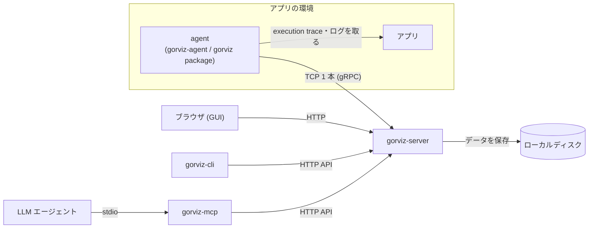
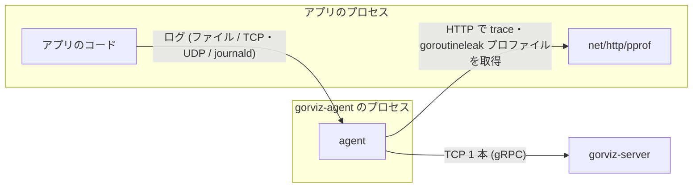
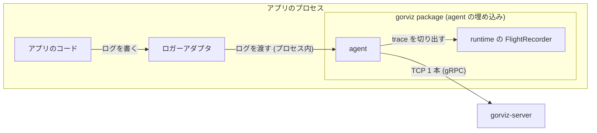
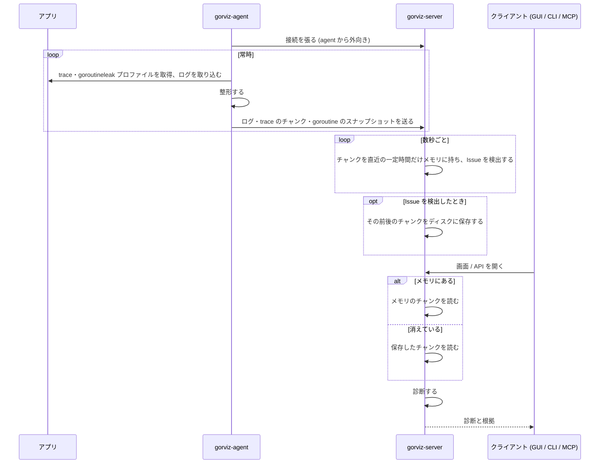

# gorviz 設計

用語の説明は脚注にまとめた。本文の番号 (`[1]` など) から飛べる。

## 目次

- [1. 概要](#1-概要)
- [2. モチベーション](#2-モチベーション)
- [3. アーキテクチャ設計](#3-アーキテクチャ設計)
  - [3.1 コンポーネント](#31-コンポーネント)
  - [3.2 依存関係](#32-依存関係)
  - [3.3 データフロー](#33-データフロー)
- [4. コンポーネント仕様](#4-コンポーネント仕様)
  - [4.1 gorviz-agent](#41-gorviz-agent)
  - [4.2 gorviz-server](#42-gorviz-server)
- [5. クライアントツール仕様](#5-クライアントツール仕様)
  - [5.1 gorviz-cli](#51-gorviz-cli)
  - [5.2 gorviz-mcp](#52-gorviz-mcp)
- [6. gorviz package](#6-gorviz-package)
- [7. gorviz-launcher](#7-gorviz-launcher)
- [8. ユーザーストーリー](#8-ユーザーストーリー)

## 1. 概要

- Go のサーバアプリを作り運用する開発者が、パフォーマンスやバグの原因を Go ランタイムまで降りて調べるためのツール
- 問題の検知・ログ・時間帯を入口として、goroutine の粒度での診断を提供する。当時の Go ランタイムのスケジューラの動きを根拠として見せるため、開発者は事象を視覚的に理解できる

## 2. モチベーション

### 2.1 課題

- バグやパフォーマンス低下の原因は、アプリのコードやログを見ても分からず、Go ランタイムまで掘り下げないと辿り着けないことがある (goroutine が CPU・ロック・I/O・GC のどれを待っていたか、など)。ところが Go で開発する人でも、ランタイムのスケジューラまで理解している人はそう多くない。そのため調査が難航する。

- ランタイムの動きは execution trace[^trace] や goroutine dump[^dump] で見られるが、それらを使って効果的に調査するのは難しく、うまく扱えないことが多い。また、それらはその場で取るものであり、定常的に集めておく仕組みがない。そのため、後日に調べようとしても、問題が起きた瞬間のデータが残っていない。

### 2.2 アプローチ

- ランタイムを理解していなくても読める形で見せる
  - trace の生データをそのまま見せるのではなく、goroutine ごとの診断と、Go ランタイムのスケジューラの動きのアニメーションとして見せる
- 問題が起きた瞬間のランタイムの動きを、後から辿れる形で残しておく
  - 定常的に取り続け、問題が検知された前後の時間帯のものを一定期間残しておく。後日でもその瞬間を調べられるようにする
  - 問題の検知・ログ・時間帯を入口に、該当する goroutine に辿れるようにする

### 2.3 既存ツールとの差異

| ツール | できること | 残る課題 |
| --- | --- | --- |
| [pprof](https://pkg.go.dev/net/http/pprof) | goroutine の総数と goroutine dump を取る | - その場で取るだけで、定常的には残らない<br>- どの go 文の goroutine がリーク[^leak]しているかは、goroutine dump を手で読み解かないと分からない |
| [LeakProf](https://www.uber.com/en-US/blog/leakprof-featherlight-in-production-goroutine-leak-detection/) / [panicparse](https://github.com/maruel/panicparse) | goroutine dump を集計する | 止まっている場所の集計まで。ランタイムの中で何を待っていたかを読み解くのは利用者に残る |
| [`go tool trace`](https://pkg.go.dev/cmd/trace) / [gotraceui](https://gotraceui.dev/) | execution trace を開いて、スケジューリングまで見分けられる | - 生データを読み解くにはランタイムの知識が要る<br>- 定常的に取る仕組みがなく、問題が起きた瞬間が残らない<br>- 問題の検知・ログ・時間帯から、該当する goroutine に辿れない |

## 3. アーキテクチャ設計

### 3.1 コンポーネント

- gorviz-agent
  - 観測するアプリと同じホスト (または同じタスク) で動き、そのアプリから execution trace・ログを取り、整形して server へ送る
- gorviz-server
  - agent から届いたデータを持ち、問題の検知と goroutine ごとの診断を行う。結果を GUI (Web) と HTTP API で提供する
- gorviz-cli
  - 人間が端末から server の API を使う
- gorviz-mcp
  - LLM エージェントが MCP で server の API を使う

### 3.2 依存関係

矢印は「接続を張る / 呼び出す側 → 相手」。

#### 3.2.1 全体図



#### 3.2.2 agent とアプリ

agent をアプリに対してどう配置するかを 3 通り用意する。

| | agent | 観測するアプリ | 具体環境例 |
| --- | --- | --- | --- |
| daemon 型 | gorviz-agent | 同じホストの複数のアプリ | VM、ECS on EC2、Kubernetes |
| sidecar 型 | gorviz-agent | 同じタスク内のアプリ 1 つ | Fargate、Cloud Run |
| ライブラリ型 | gorviz package (agent の埋め込み) | そのアプリ自身 | agent を置けない環境 |

##### 3.2.2.1 agent を別プロセスにする場合 (daemon 型・sidecar 型)



- execution trace・goroutineleak プロファイルを、アプリが公開する pprof の HTTP から取る
- ログを、置き方に応じた口から取る (下の「[ログの取り方](#3223-ログの取り方)」)

##### 3.2.2.2 agent をアプリに埋め込む場合 (ライブラリ型)



- execution trace を、runtime の FlightRecorder から直接取る (pprof の公開は要らない)
- ログを、アプリのロガーからプロセス内で受け取る。アプリが出力したバイト列をそのまま受け取る

##### 3.2.2.3 ログの取り方

agent には、アプリごとに「ログをどこからどう読むか」を設定する。1 つの設定に書くのは次のとおり。

- 読み方 (下の表の種類)
- 読む場所 (ファイルのパス・待ち受けるポートなど)
- service (アプリの名前)
- そのアプリの pprof (このログと trace が同じアプリのものだと結びつけるため)

ログの形式は設定しない。agent が行の形から読み分ける (slog の JSON / テキスト・zap・zerolog・logrus・標準の log)。

| 種類 | 読むもの |
| --- | --- |
| file | ファイルを tail する。ローテーションに追従し、ワイルドカードでも指定できる。Kubernetes のログファイルの行頭 (時刻・stream・P/F) は剥がす |
| tcp / udp | 待ち受けたポートに届いた行。Fluent Bit などのログルーターから送ってもらう |
| journald | systemd journal |
| 標準入力 | パイプで渡された行 |
| ロガー | アプリのロガーから、同じプロセスの中で渡された行 (ライブラリ型だけ) |

| 置き方 | 環境 | 種類 | 読む場所 |
| --- | --- | --- | --- |
| daemon 型 | Kubernetes | file | ノードの `/var/log/pods` (コンテナの stdout / stderr) |
| daemon 型 | VM、ECS on EC2 | file / journald | アプリのログファイル / systemd journal |
| sidecar 型 | Kubernetes、Cloud Run、ECS Fargate | file | アプリと共有するボリューム上のファイル。アプリがそこにログを書く |
| sidecar 型 | ECS Fargate | tcp | FireLens (Fluent Bit) が転送するアプリの stdout / stderr |
| ライブラリ型 | どこでも | ロガー | アプリのロガー (ロガーアダプタ経由) |

- sidecar 型では、隣のコンテナの stdout を直接は読めない。そのため共有ボリュームのファイルか、ログルーターを経由する
- ECS Fargate では、FireLens の送り先を agent の tcp にする
- 参考
  - [Datadog Agent のログ収集](https://docs.datadoghq.com/agent/logs/)
  - [Datadog の Kubernetes でのログ収集](https://docs.datadoghq.com/containers/kubernetes/log/)
  - [Datadog の Cloud Run サイドカーでのログ収集](https://docs.datadoghq.com/serverless/google_cloud_run/containers/sidecar/nodejs/)
  - [Datadog の ECS Fargate での FireLens によるログ収集](https://datadoghq.com/blog/collect-fargate-logs-with-firelens)

### 3.3 データフロー



#### 3.3.1 agent と server の通信

- agent から server へ TCP を 1 本張り、その上で gRPC を流す。張った直後に、agent がハンドシェイクでインスタンスの名前と service の名前を送る
- 観測データはまとめて gzip で圧縮して送る
- 切れたら agent が張り直し、つながらない間の分を上限まで持って送り直す。送り直しで同じ分が 2 回届いても、server は 1 回分だけ持つ
- keepalive で、止まった相手や黙って切られた接続を見つける

## 4. コンポーネント仕様

各コンポーネントについて、責務と依存コンポーネントを書く。

### 4.1 gorviz-agent

観測するアプリと同じホスト (または同じタスク) で動き、そのアプリから execution trace・ログを取り、整形して server へ送る。

#### 4.1.1 責務

##### 4.1.1.1 観測するアプリ

| 置き方 | 観測するアプリの決め方 |
| --- | --- |
| daemon 型 (Kubernetes) | 自分のノードの Pod のうち、annotation で印を付けた Pod (「[Kubernetes での Pod の見つけ方](#415-kubernetes-での-pod-の見つけ方)」) |
| daemon 型 (VM・ECS on EC2)・sidecar 型 | 利用者が指定したアプリ |
| ライブラリ型 | 組み込まれたアプリ自身 |

##### 4.1.1.2 取得するもの

| 取得するもの | 取得元 |
| --- | --- |
| execution trace | アプリの pprof[^pprof] (「[pprof から取るもの](#413-pprof-から取るもの)」) |
| goroutineleak プロファイル[^goroutineleak] | アプリの pprof |
| ログ | 「[ログの取り方](#3223-ログの取り方)」のとおり |

##### 4.1.1.3 server に送るもの

| 送るもの | 中身 |
| --- | --- |
| ハンドシェイク | インスタンス[^instance]の名前とアプリ (service) の名前。つないだときに送る |
| ログ | 取り込んだ行を読み取ったもの |
| execution trace のチャンク | 整形したもの。生の trace は送らない |
| goroutine のスナップショット | チャンクの終わりの時点で生きている全 goroutine の状態。trace から作る (「[goroutine のスナップショットの作り方](#414-goroutine-のスナップショットの作り方)」) |
| リーク判定 | goroutineleak プロファイルを読み取ったもの |

- 各項目は「[観測データ](#417-観測データ)」のとおり
- 送り方 (つながらない間に持っておく分・送り直し) は「[agent と server の通信](#331-agent-と-server-の通信)」のとおり

#### 4.1.2 依存コンポーネント

- アプリの pprof
- ログの置き場所 (ファイル・journald・ログルーター)
- Kubernetes API (Pod の annotation を読むとき)
- gorviz-server

#### 4.1.3 pprof から取るもの

##### 4.1.3.1 execution trace

- 数秒ごとのチャンク[^chunk]に切り分けて取り続ける
- チャンクごとに、G と P の状態の変化の列・P ごとの実行区間・GC の区間・ヒープの推移・ログの印・集計に整形する。項目は「[execution trace (1 チャンク)](#4174-execution-trace-1-チャンク)」のとおり

##### 4.1.3.2 goroutineleak プロファイル

- `LEAK` を誤検知なしで判定するために取る
- 間隔を空けて取る。取るたびに GC が 1 回走るため
- リークと判定された goroutine だけを、スタックごとの件数で取る。全 goroutine を書き出す形式は、書き出す間ずっと STW[^stw] になるので使わない

#### 4.1.4 goroutine のスナップショットの作り方

goroutine のスナップショットは、goroutine dump の代わりになるもの。goroutine dump はアプリ全体を止めるので取らず、execution trace から作る。trace は、チャンクの中でイベントを出さなかった goroutine についても、今の状態とスタックを記録する。

項目ごとの作り方は次のとおり。

| 項目 | 元にするデータ | 作り方 |
| --- | --- | --- |
| 状態・入口・今いる関数 | trace の、チャンクの終わりの状態の記録 (状態とスタック) | そのまま使う。入口はスタックの一番下、今いる関数は一番上 |
| 待機理由 | trace の、待機に入ったときのイベント (理由つき) | チャンクの終わりの記録には入らないので、goroutine ごとに覚えて次のチャンクに持ち越す |
| 待っている時間 | trace の、待機に入ったときのイベント (時刻つき) | 待機に入った時刻を覚え、チャンクの終わりとの差にする |
| 生成元 | trace の、作られたときのイベント (作った側のスタックつき) | チャンクの終わりの記録には入らないので、goroutine ごとに覚える |
| リーク | goroutineleak プロファイル | プロファイルのスタックと、goroutine のスタックを突き合わせる |

リークの突き合わせ方は次のとおり。

- goroutineleak プロファイルは「このスタックの goroutine が N 個リークしている」という件数で届く。どの goroutine かは書かれない
- スナップショットに同じスタックの goroutine がちょうど N 個あれば、その全部をリークとする
- N 個より多ければ、どれがリークかは決められない。リークした goroutine は二度と起きず待っている時間が伸び続けるので、同じスタックの M 個のうち待っている時間が長い順に N 個をリークと推定する
- どちらの場合も、「このスタックの M 個のうち N 個がリーク」という件数はスタック単位で持つ

##### 4.1.4.1 goroutine の識別

goroutine は「プロセスの識別子 + goroutine の ID」で識別する。goroutine の ID はプロセスごとに 1 から振り直されるので、インスタンスの名前と ID だけでは、アプリのプロセスが入れ替わったとき (アプリだけの再起動、VM でアプリと agent を一緒に再起動したときなど) に前後の goroutine が混ざる。

プロセスの識別子は、アプリのプロセスが変わるたびに変わる値にする。

| 置き方 | プロセスの識別子 |
| --- | --- |
| ライブラリ型 | agent が起動時に作る値 (同じプロセスの中にいるので確実に分かる) |
| Kubernetes の daemon 型 | アプリのコンテナの ID (コンテナが再起動するたびに変わる) |
| sidecar 型・VM の daemon 型 | agent が作る値。goroutine の ID は同じプロセスの中では増える一方で使い回されないので、最大の ID が前より小さくなったら別のプロセスとみなし、新しい値にする。agent が入れ替わったときは、server が前のスナップショットと比べ、最大の ID が減っていなければ前の値を引き継ぐ |

- プロセスの識別子が変わったら、agent は覚えている goroutine の情報を捨てる
- agent だけが入れ替わり、プロセスの識別子が同じなら、server が前のスナップショットから同じ識別子の goroutine の待機理由・待ち始めた時刻・生成元を引き継ぐ
- スナップショットの各 goroutine は、プロセスの識別子も持つ

#### 4.1.5 Kubernetes での Pod の見つけ方

daemon 型の agent は、自分のノードに載っている Pod のうち、観測してほしいと印を付けられた Pod だけを観測する。印は、利用者がアプリの Pod に付ける annotation[^annotation] で表す。

```yaml
apiVersion: apps/v1
kind: Deployment
metadata:
  name: checkout
spec:
  template:
    metadata:
      annotations: # Deployment 自体ではなく Pod のテンプレートに書く
        gorviz/pprof-port: "6060" # agent はこの Pod の IP とこのポートで pprof に取りに行く
        gorviz/log-container: app # stdout / stderr をログとして取るコンテナ。envoy のログは取らない
    spec:
      containers:
        - name: app
          image: example/checkout
          ports:
            - containerPort: 6060
        - name: envoy
          image: envoyproxy/envoy
```

- ログは、ノードの `/var/log/pods` にある、指定したコンテナのログファイルから読む
- agent は Kubernetes API で自分のノードの Pod を見張り、annotation の付いた Pod が現れたら観測を始め、消えたらやめる
- annotation の付いていない Pod は、同じノードにあっても観測しない。観測する Pod を利用者が明示的に選ぶため

#### 4.1.6 制約

- 1 つのアプリを観測する agent は 1 つ (trace はプロセスで同時に 1 本しか取れないため)
- アプリにかける負荷は、本番に常時置ける程度 (Datadog の Go プロファイラと同程度) に収める
- agent が起動していない間に待機に入った・作られた goroutine は、スナップショットの情報が一部不十分になる
  - 原因
    - 待機理由・待ち始めた時刻・生成元は、その瞬間の trace のイベントにしか入らないため
  - 対処
    - 待機理由は、チャンクの終わりの状態の記録にあるスタックの上の方の runtime の関数 (channel の受信・ロック・スリープ・ネットワークなど) から推定する (`INFERENCE`)
    - 待っている時間は、agent が見始めてからの下限で持つ
    - 生成元は、入口の関数で代用する

#### 4.1.7 観測データ

agent が送るものをまとめて観測データ[^observation]と呼ぶ。

| 運ぶもの | いつ | 単位 |
| --- | --- | --- |
| ログ | 数秒ごと | 前回送った後に増えた行をまとめて |
| goroutine のスナップショット | チャンク (数秒) ごと | 1 回分 |
| リーク判定 | goroutineleak プロファイルを取るたび | 1 回分 |
| execution trace | チャンク (数秒) ごと | 1 チャンク。生の trace は送らない |

- trace を整形した形で送るのは、生の trace より小さく、server もこの形だけを持って読めば済むため。`go tool trace` に渡す生の trace は残さない

##### 4.1.7.1 ログ (1 行)

| 項目 | 中身 |
| --- | --- |
| 番号 | 取り込んだ順の通し番号 |
| 時刻 | ログに書かれた時刻。なければ取り込んだ時刻 (どちらかを区別して持つ) |
| レベル・メッセージ | ログから読み取ったもの |
| 元の行 | 取り込んだ行そのもの |
| 取り込み元 | ログを取った口 (ファイル・TCP / UDP・journald・標準入力・ロガー) |
| trace との対応 | ロガーアダプタが振った番号。trace のログの印と同じ番号 |
| 所要時間 | ログに書かれていれば |

##### 4.1.7.2 goroutine のスナップショット (1 回分)

| 項目 | 中身 |
| --- | --- |
| 時刻 | チャンクの終わりの時刻 |
| goroutine の並び | その時点で生きている全 goroutine。1 つにつき下の表の項目を持つ |

| goroutine の項目 | 中身 |
| --- | --- |
| ID | プロセスの識別子と goroutine の ID |
| 状態 | 状態と待機理由。待機理由をスタックから推定したかも持つ |
| 待っている時間 | その状態にいる時間。agent の起動前から続いていて下限しか分からないかも持つ |
| 入口 | go 文で起動された関数 |
| 今いる関数 | チャンクの終わりに止まっている関数 |
| 生成元 | go 文を書いた関数と場所 |
| リーク | runtime がリークと判定したか |

##### 4.1.7.3 リーク判定 (1 回分)

| 項目 | 中身 |
| --- | --- |
| 時刻 | 取った時刻 |
| 状態 | runtime によるリーク判定をしたか (した / 使えない / 切ってある) |
| リークした goroutine | スタックごとの件数 |

##### 4.1.7.4 execution trace (1 チャンク)

| 項目 | 中身 |
| --- | --- |
| 始まり | チャンクの始まりの壁時計の時刻。チャンクの中の時刻は、ここからの経過時間で持つ |
| 長さ | チャンクの長さ。前のチャンクと重なる部分は取り除いてある |
| 状態の変化 | G と P の状態の変化の列 (時刻順。全イベントを持ち、間引かない)。項目は下の表 |
| P の区間 | P ごとに、どの G がどの M の上で走ったかの区間 |
| 入口 | G ごとの入口の関数 |
| GC の区間 | stop-the-world (理由つき)・mark assist (どの G か)・concurrent mark |
| ヒープ | ヒープの大きさと GC の目標値の推移。GC が終わるたびの live heap と目標値 |
| 件数 | チャンクの中で作られた・終わった G の数と、始まった GC の回数 |
| ログの印 | ロガーアダプタが振った番号ごとに、書いた G とその時刻 |
| 集計 | 全イベントから数えた値。項目は下の表 |

| 状態の変化の項目 | G の変化 | P の変化 |
| --- | --- | --- |
| 時刻 | 変化した時刻 (チャンクの始まりからの経過時間) | 変化した時刻 (チャンクの始まりからの経過時間) |
| 対象 | どの G か | どの P か |
| 移った先 | 走っている / ローカルの実行待ちキュー / グローバルの実行待ちキュー / 待機 / システムコール / 終了 | 空いた / G を走らせ始めた |
| P・M | 使っている P と M | どの M の上か |
| 待機理由 | 待機に移ったときの理由。cgo の中にいるかも持つ | - |
| 止まった場所 | 止まった関数と、それを呼んだ利用者のコードの場所 | - |
| 作られたか | G が作られたときの変化か | - |
| 起こした G | 起こした G と、起こしたときにその G がいた関数と場所 | - |

| 集計の項目 | 中身 |
| --- | --- |
| P の数 | チャンクの中に現れた P の数 |
| 実行待ち | G が実行待ちだった時間の合計 |
| 待ち場所 | 種類・待機理由・入口・止まった関数・場所ごとに、回数・合計時間・最大 |
| 走り出すまで | 実行待ちに入ってから走り出すまでの時間の分布 |
| stop-the-world | 1 回の長さの分布 |
| GC の占有 | 短い時間幅ごとに見た、GC が P を占めた割合の最大 |
| P の使い方 | 全 P のうち G を走らせていた時間と、GC に使われた時間 |

### 4.2 gorviz-server

agent から届いたデータを持ち、問題の検知と goroutine ごとの診断を行う。結果を GUI (Web) と HTTP API で提供する。

#### 4.2.1 責務

##### 4.2.1.1 受け取るもの

| 受け取るもの | 送り手 |
| --- | --- |
| ハンドシェイク | agent。接続を張った直後に送ってくる。server はインスタンスごとに受け口を持つ |
| 観測データ (ログ・チャンク・goroutine のスナップショット・リーク判定) | agent |

##### 4.2.1.2 行うこと

| 処理 | いつ | 中身 |
| --- | --- | --- |
| Issue の検出 | 数秒ごと | 届いた観測データから Issue を検出する |
| Issue の前後の保存 | Issue を検出したとき | その前後のチャンクをディスクに保存する |
| 診断 | クライアントが求めたとき | goroutine ごとの状態別の時間内訳[^breakdown]と主因[^cause]を出す (「[診断](#425-診断)」) |
| データの保持 | 常に | チャンクの直近をメモリに、Issue・推移・ログなどをディスクに持つ (「[データの持ち方](#423-データの持ち方)」) |

##### 4.2.1.3 提供するもの

| 提供するもの | 使う側 |
| --- | --- |
| GUI (Web) | ブラウザ (「[GUI](#424-gui)」) |
| HTTP API (JSON) | gorviz-cli・gorviz-mcp |

#### 4.2.2 依存コンポーネント

- ローカルディスク
- agent は server へ接続してくる側なので、依存先には入らない

#### 4.2.3 データの持ち方

- 生の trace はどこにも持たない。agent が整形したチャンクだけを扱う (生の trace は圧縮しても 1000 rps・31 日で約 600 GB になり、持ちきれない)
- データはサービスの下にインスタンスがぶら下がる形で持つ。インスタンスが入れ替わっても、サービスの履歴は 1 本につながる

##### 4.2.3.1 agent

- 送るまでの分だけ持つ
- 待機理由・待ち始めた時刻・生成元は、goroutine ごとに、プロセスの識別子が変わるまで覚える

##### 4.2.3.2 server のメモリ

インスタンスごとに持つ。チャンクはインスタンスごとに別のものなので、まとめない。

```
サービス
└── インスタンス
    ├── チャンクの直近 (一定時間)
    ├── ログの直近
    └── goroutine のスナップショットの履歴 (リーク判定と、agent が入れ替わったときの引き継ぎに使う)
```

- チャンクは、直近の一定時間だけ持つ。持つ時間は利用者が決める
- server のメモリの上限を超えそうなときは古い方から捨て、持てている時間を画面に示す

##### 4.2.3.3 server のディスク

- 保存先はローカルディスクだけ (セルフホストのため)。利用者が決めるのは置き場所と、使ってよい容量だけ
- サービスごとにディレクトリを分ける。インスタンスでは分けず、どのファイルの行もどのインスタンスのものかを項目として持つ。そのため、デプロイ・再起動・スケールで履歴が切れない
- 古くなるほど細かさを落として持つ。小さいものは必ず 31 日持ち、細かいものは残りの容量で持って、あふれたら古い方から捨てる

```
<保存先>/
└── <サービス>/
    ├── issues/        Issue
    ├── trends/
    │   ├── 5m/        推移 (5 分刻み)
    │   └── 10s/       推移 (10 秒刻み)
    ├── logs/          ログ (日ごとのファイル)
    ├── slow/          遅かった goroutine
    ├── chunks/        Issue の前後のチャンク (Issue ごと)
    ├── breakdowns/    goroutine ごとの内訳 (日ごとのファイル)
    └── transitions/   goroutine の状態の移り変わり (時間ごとのファイル)
```

| データ | 期間 | 容量を超えたら |
| --- | --- | --- |
| Issue | 31 日 | 捨てない |
| 推移 (5 分刻み) | 31 日 | 捨てない |
| ログ (書いた goroutine の主因と止まっていた場所を添える) | 31 日 | 古い日から捨てる |
| 遅かった goroutine (1 分ごとの上位) | 31 日 | 捨てない |
| Issue の前後のチャンク | 31 日 | 古い方から捨てる |
| 推移 (10 秒刻み) | 26 時間 | 古い方から捨てる |
| goroutine ごとの内訳 (入口・主因ごとの時間・止まっていた場所) | 7 日 | 古い方から捨てる |
| goroutine の状態の移り変わり | 1 日 | 古い方から捨てる |

- ログに主因と止まっていた場所を添えるので、チャンクや内訳が消えたあとも、1 か月前のログから主因まで辿れる
- 画面には、その時刻に何が残っているか (再生できる / 内訳まで / 推移のみ) を示す

#### 4.2.4 GUI

| 画面 | 単位 | 役割 |
| --- | --- | --- |
| Overview | サービス | 全体の様子 (未解決 Issue の数、goroutine 数・エラー・CPU 待ち・ヒープの推移) |
| Issues | サービス | 検出した問題の一覧 (31 日残る)。1 つ選ぶと、回数の推移と、見つかった回ごとに調べ始める先を示す |
| Logs | サービス | ログ一覧と件数の推移。行を開くと JSON のキーと値を見られ、`Goroutine →` で書いた goroutine (分からなければその時刻の Scheduler) を開く |
| Scheduler | インスタンス | 録画を GMP[^gmp] の概念図で再生する。最新を見ているあいだは新しい窓を追い、窓の端まで再生すると録画の続きをつなぐ。G を選ぶとその Goroutine を開く |
| Goroutine | インスタンス | 1 つの goroutine の診断と根拠 (その窓で書いたログを含む)。どの画面から入っても最後はここに行き着く |

- 見るサービスは、画面ではなく見出しの切り替えで選ぶ
- サービス単位の画面では、インスタンスをまたいで 1 本に並べ、各行にどのインスタンスのものかを出す
- Scheduler と Goroutine はインスタンス単位で見る。チャンクはインスタンスごとに別のものなので、まとめない。サービス単位の画面の行から移るとき、その行のインスタンスに決まる
- service の名前とインスタンスの名前は、agent がハンドシェイクで送ったものを使う (launcher は service の名前を起動するコマンドから取る)
- `LEAK` の Issue は、スタックごとに「同じ場所で待っている M 個のうち N 個がリーク」と件数で示す
- Scheduler と Goroutine では、goroutine ごとのリークを、確かさ (`FACT` / `INFERENCE`) が分かる形で示す

#### 4.2.5 診断

診断には 3 種類のラベルを付ける。

| ラベル | 付ける先 | 値 |
| --- | --- | --- |
| Issue の種類 | Issue | `LEAK` / `CPU_WAIT_SPIKE` / `MEMORY_PRESSURE` |
| 確かさ[^certainty] | すべての診断 | `FACT` / `INFERENCE` |
| 主因[^cause] | goroutine の診断 | `RUNNING` / `CPU_WAIT` / `BLOCKED` / `IO_WAIT` / `CGO` / `SLEEP` / `GC` |

##### 4.2.5.1 Issue の種類

| 種類 | 意味 | `FACT` | `INFERENCE` |
| --- | --- | --- | --- |
| `LEAK` | goroutine のリーク | runtime の goroutineleak プロファイルが判定 | 生成元ごとの待機中の数が減らずに増え続けている (古い Go 向け) |
| `CPU_WAIT_SPIKE` | P に乗れず待つ時間が多い | 固定の閾値を超えた | 普段との比較 |
| `MEMORY_PRESSURE` | GC が頻発 | GC の頻度が固定の閾値を超えた | - |

- Issue は runtime 層の問題だけにする
- 遅いリクエストやエラーの増加 (アプリ層) に気づくのは APM (Datadog など) の役目。gorviz はそこで見つけたログ・時間帯から goroutine と runtime を調べる入口を用意する (Logs の検索と時間の絞り込み)

##### 4.2.5.2 主因

状態別の時間内訳のうち最も長いもの。

| 主因 | 意味 |
| --- | --- |
| `RUNNING` | 自分で CPU を使っていた |
| `CPU_WAIT` | 動けるのに P が空かず待っていた |
| `BLOCKED` | ロック・channel で止まっていた |
| `IO_WAIT` | ネットワーク・ディスク・システムコールを待っていた |
| `CGO` | cgo で C のコードを実行していた (スタックに cgo の呼び出しがあるかで見分ける) |
| `SLEEP` | スリープ・タイマーで止まっていた |
| `GC` | GC に止められた / mark assist[^markassist] をさせられていた |

##### 4.2.5.3 確かさの付け方

Issue の確かさは「Issue の種類」の表のとおり。

| 診断 | `FACT` | `INFERENCE` |
| --- | --- | --- |
| 主因 | 前後の trace の状態の変化から決めた | スタックから推定した待機理由だけで決めた |
| ログと goroutine の結びつき | ロガーアダプタが振った番号で結んだ | その時刻に走っていた goroutine が 1 つだけ |
| goroutine ごとのリーク | 同じスタックの goroutine がちょうどリークの件数だけあった | 同じスタックの goroutine のうち、待っている時間が長い順に件数分を選んだ |

##### 4.2.5.4 限界

- ハンドラが別の goroutine を起動して待っている場合、ログを書いた goroutine の主因は `BLOCKED` になる。子の goroutine までは追わない
- local run queue / global run queue の中身は runtime が出さないので、GMP の概念図では trace から推測して描く

## 5. クライアントツール仕様

どれも gorviz-server の HTTP API のクライアントで、agent やアプリには直接つながない。

### 5.1 gorviz-cli

人間が端末から使うコマンド。

#### 5.1.1 責務

- Issue の一覧を表示する

#### 5.1.2 依存コンポーネント

- gorviz-server の HTTP API

### 5.2 gorviz-mcp

LLM エージェント向けの MCP[^mcp] サーバ。LLM エージェントとは stdio でやり取りする。

#### 5.2.1 責務

- 画面と同じ診断を JSON で返す
- 事実と推測を確かさ[^certainty]のラベルで分けて返す (LLM が推測を事実として扱わないように)
- 読み取りだけを行う

#### 5.2.2 依存コンポーネント

- gorviz-server の HTTP API

## 6. gorviz package

アプリが import するライブラリ。agent の埋め込みとロガーアダプタからなり、どれを使うかは任意。

### 6.1 agent の埋め込み

ライブラリ型の agent。

#### 6.1.1 責務

- agent をアプリと同じプロセスの中で動かす
- execution trace を runtime の FlightRecorder[^flightrecorder] から取る。pprof の公開は要らない
- ロガーアダプタからログを受け取る
- server へのつなぎ方と送るものは gorviz-agent と同じ

#### 6.1.2 依存コンポーネント

- gorviz-server

### 6.2 ロガーアダプタ

アプリが使っているロガーを包み、ログを書くたびに gorviz の処理を挟む。

| ロガー | 包むもの |
| --- | --- |
| slog | ハンドラ |
| zap | Core と WriteSyncer |
| zerolog | Hook と Writer |
| logrus | Formatter |

#### 6.2.1 責務

- ログを書く goroutine の上で番号を振り、同じ番号を trace のログイベントとログ行の両方に書く。これでログ 1 行と、それを書いた goroutine を確実に結べる
- agent を埋め込んでいれば、出力したログ行をそのまま agent に渡す (slog だけは出力のバイト列を取り出せないので、JSON で書き直して渡す)
- ログの書式は変えない。番号のフィールドが 1 つ足されるだけ
- agent を別プロセスにする場合でも使える。使わなければ、ログの時刻から goroutine を推測する

#### 6.2.2 依存コンポーネント

- なし (agent を埋め込んでいれば、その agent にログを渡す)

## 7. gorviz-launcher

ローカルで server と agent を 1 つのプロセスでまとめて動かす。

### 7.1 責務

- server と agent を 1 つのプロセスで起動する。プロセスは 1 つでも別々のプログラムのままで、間は gorviz-server と gorviz-agent と同じく TCP でつなぐ
- launcher 自身は組み立てるだけで、通信の相手にはならない
- アプリを起動するコマンドを渡すと、アプリも子プロセスとして起動する。アプリの標準出力・標準エラー出力をそのまま端末に出しながら、ログとして取り込む
- アプリが終わると launcher も終わる
- コマンドを渡さなければアプリは起動しない。すでに動いているアプリのログは標準入力へ流す

### 7.2 依存コンポーネント

- gorviz-server
- gorviz-agent

## 8. ユーザーストーリー

| # | 誰が | いつ | 何をする | gorviz が返すもの |
| --- | --- | --- | --- | --- |
| 1 | 運用する開発者 | goroutine 数が増え続けているのに気づいた | Issues の `LEAK` から goroutine を開く | 生成元の go 文と止まっている場所 (file:line)・待機理由・件数の推移 |
| 2 | 運用する開発者 | 深夜のエラーに翌朝気づいた | Logs でそのエラーログの `Goroutine →` を押す | 保存済みの前後のチャンクから、書いた goroutine の主因と止まっていた場所 |
| 3 | 運用する開発者 | 遅いリクエストを調べたい | 所要時間のあるログを選ぶ | そのリクエストの区間 (書いた時刻 − 所要時間 〜 書いた時刻) の内訳と主因 |
| 4 | 開発者 + LLM | 原因調査を LLM に任せたい | LLM が MCP でログを探し、診断を取り、コードを読む | 確かさ付きの診断を JSON で。LLM が原因と修正案を出す |
| 5 | 開発者 | 診断が本当か確かめたい / スケジューラを理解したい | Goroutine や Scheduler で再生する | GMP の概念図での再生 |

[^observation]: **観測データ**: agent がアプリから取って整形したもの。ログ・execution trace のチャンク・goroutine のスナップショット・リーク判定
[^leak]: **goroutine のリーク**: 終わるはずの goroutine が何かを待ったまま止まり、溜まり続けること
[^breakdown]: **状態別の時間内訳**: ある区間で、その goroutine がどの状態 (実行中・CPU 待ち・ロック待ちなど) にどれだけいたか
[^cause]: **主因**: 状態別の時間内訳のうち最も長いもの
[^certainty]: **確かさ**: `FACT` (runtime の判定や trace の記録から直接言える) と `INFERENCE` (gorviz が推移や比較から推し量った)
[^trace]: **execution trace**: goroutine ごとに「いつ走り、いつ待ち、いつ syscall に入ったか」をナノ秒単位で記録したもの。`go tool trace` で開く
[^dump]: **goroutine dump**: その瞬間の全 goroutine のスタックを並べたテキスト
[^goroutineleak]: **goroutineleak プロファイル**: Go 1.26 で入った、runtime 自身によるリーク判定。誰も起こせなくなった goroutine を GC の仕組みで見つけるので誤検知がない
[^annotation]: **annotation**: Kubernetes のオブジェクトに付けられるキーと値の組。Kubernetes 自身は中身を解釈せず、外のツールが設定を読み取るのに使う。Pod を選び出すための label とは別物
[^pprof]: **pprof**: Go 標準のプロファイリングの仕組み。HTTP 経由で trace やプロファイルを取れる
[^flightrecorder]: **FlightRecorder**: Go 1.25 で入った、trace の直近を常にメモリに持ち、必要なときに切り出せる機能
[^instance]: **インスタンス**: 観測するアプリのプロセス 1 つ。Kubernetes では多くの場合 Pod 1 つ、ECS ではタスク 1 つにあたる
[^chunk]: **チャンク**: execution trace を数秒ごとに切り分けた 1 つ分。agent が整形して server へ送り、server が持つ単位
[^gmp]: **GMP**: Go のスケジューラの仕組み。G (goroutine) を、P (実行の権利。GOMAXPROCS 個) を持った M (OS のスレッド) が走らせる
[^stw]: **STW (Stop The World)**: 全 goroutine を止めること。GC の一部や、全 goroutine のスタックを書き出す goroutine dump で起きる
[^markassist]: **mark assist**: 割り当ての多い goroutine が GC の作業を肩代わりさせられること。その間は本来の処理が進まない
[^mcp]: **MCP (Model Context Protocol)**: LLM エージェントが外部のツールやデータを呼び出すための共通の仕組み
