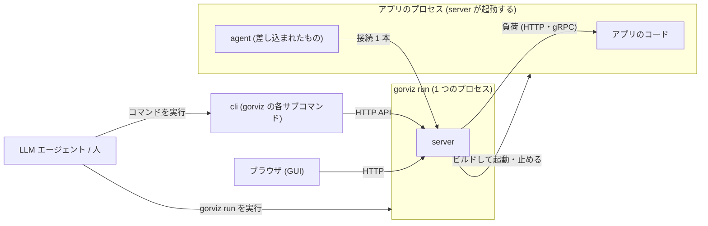
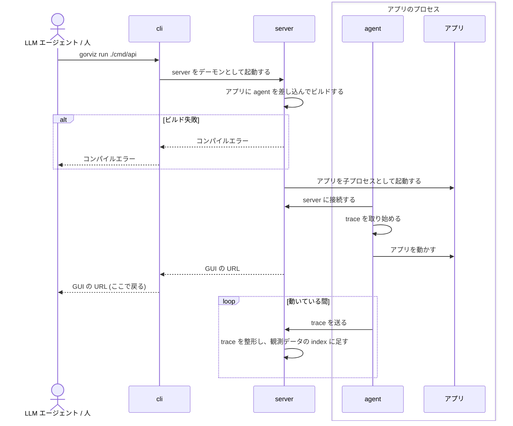
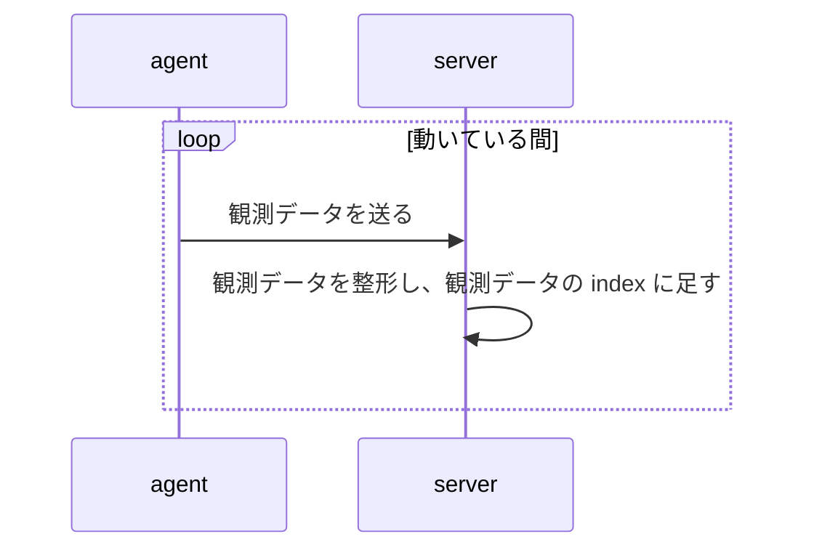
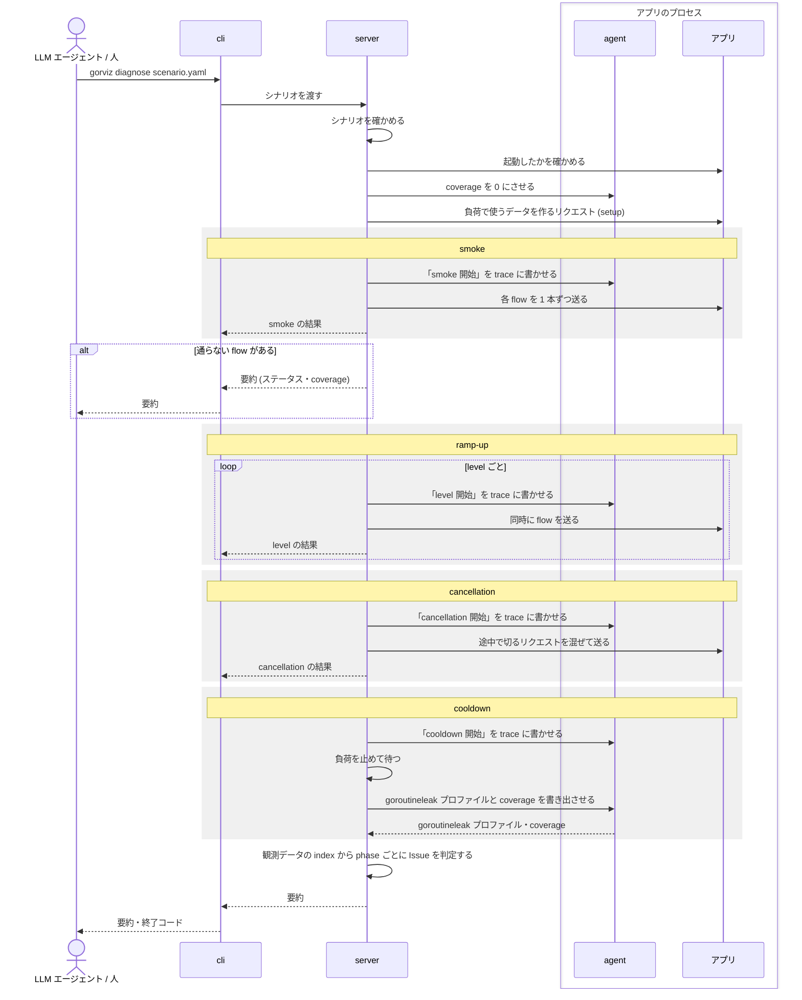
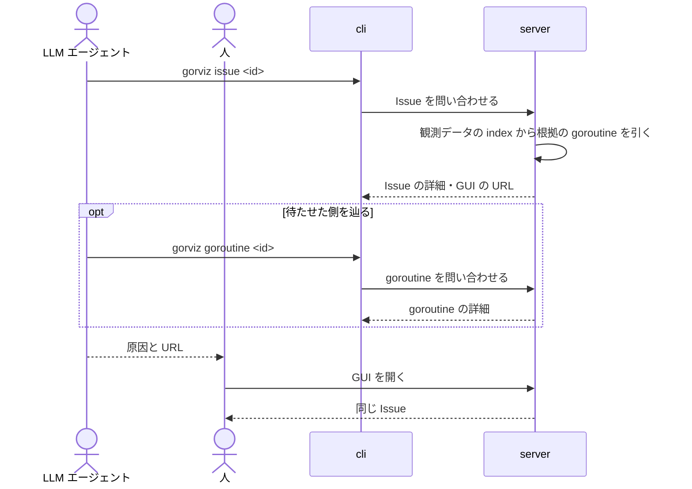
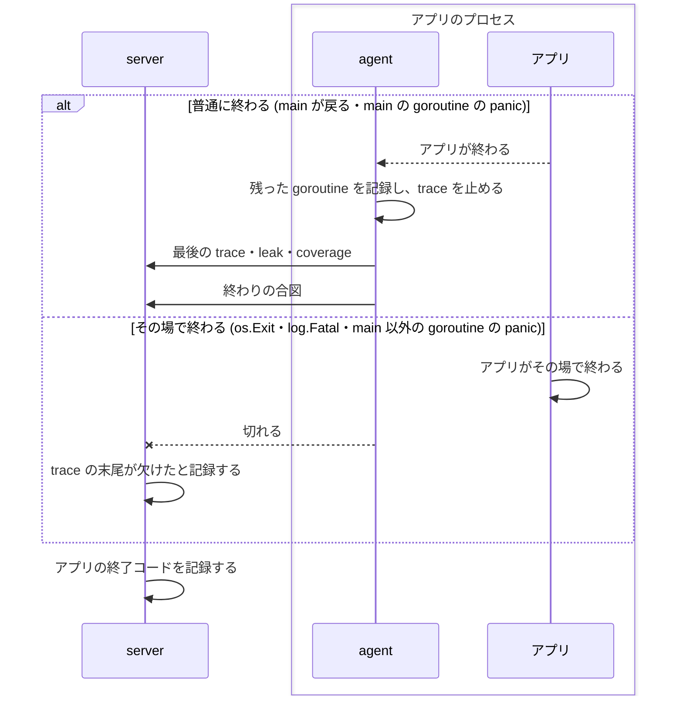
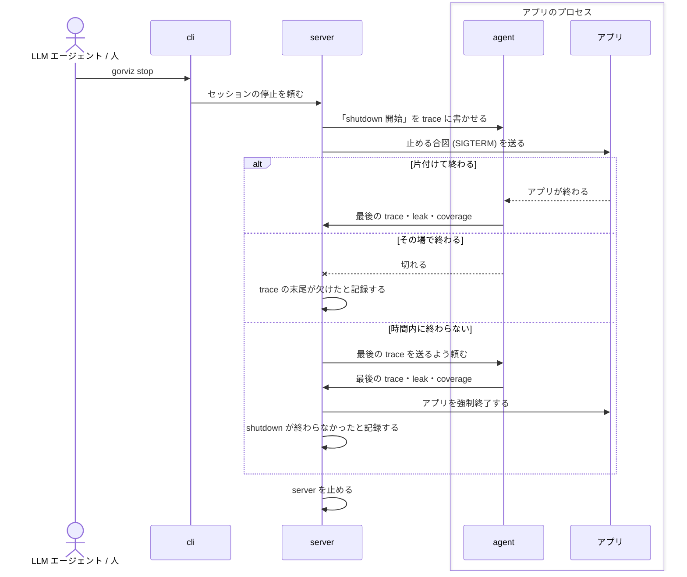

# gorviz 設計

用語の説明は脚注にまとめた。本文の番号 (`[1]` など) から飛べる。

## 目次

- [1. 概要](#1-概要)
- [2. モチベーション](#2-モチベーション)
- [3. アーキテクチャ設計](#3-アーキテクチャ設計)
  - [3.1 コンポーネント](#31-コンポーネント)
  - [3.2 依存関係](#32-依存関係)
  - [3.3 データフロー](#33-データフロー)
  - [3.4 セッション](#34-セッション)
- [4. コンポーネント仕様](#4-コンポーネント仕様)
  - [4.1 agent](#41-agent)
  - [4.2 server](#42-server)
- [5. クライアントツール仕様](#5-クライアントツール仕様)
  - [5.1 LLM エージェントの利用に特化するためのポイント](#51-llm-エージェントの利用に特化するためのポイント)
  - [5.2 サブコマンド](#52-サブコマンド)
- [6. ユーザーストーリー](#6-ユーザーストーリー)

## 1. 概要

- 手元で Go のアプリを動かし、そのあいだ Go ランタイムが健康かどうか (goroutine のリーク・ロックの取り合い・CPU の待ち・GC・STW・スレッドの増えすぎ) を診断するツール
- 診断は、アプリを動かして Issue を出すこと。API サーバー (HTTP・gRPC) には gorviz が負荷をかけ、それ以外 (daemon・バッチ・CLI) は動かすだけで見る。詳しく知りたければ、Issue を開く
- 診断を回すのは主に LLM エージェント。何を送るか (シナリオ) は LLM エージェントか人が書き、負荷のかけ方と Issue の判定は gorviz が持つ。人は GUI で Issue の根拠を確かめ、スケジューラの動きを見て Go ランタイムを理解する

## 2. モチベーション

### 2.1 課題

- バグやパフォーマンス低下の原因は、アプリのコードやログを見ても分からず、Go ランタイムまで掘り下げないと辿り着けないことがある (goroutine が CPU・ロック・I/O・GC のどれを待っていたか、など)。ところが Go で開発する人でも、ランタイムのスケジューラまで理解している人はそう多くない。そのため調査が難航する
- ランタイムの動きは execution trace[^trace] や goroutine dump[^dump] で見られるが、それらを使って効果的に調査するのは難しく、うまく扱えないことが多い
- 本番で goroutine の細かいところまで常に取り続けるのは、監視のコストにも、観測されるアプリへの負担にも見合わない
- 一方で、本番でリークするコードは手元でもリークし、ロックも手元で取り合う。ただしそれは、その経路を通し、同時に動かしたときだけ。手元で確かめるには、経路を通す負荷を作る手間がかかる

### 2.2 アプローチ

- ランタイムを理解していなくても読める形で見せる
  - trace の生データをそのまま見せるのではなく、Issue と、その根拠になった goroutine が何に止まっていたか、Go ランタイムのスケジューラの動きのアニメーションとして見せる
- 手元でアプリを動かし、その起動から終了までをまるごと観測する
  - アプリのコードは変えない。gorviz がアプリをビルドするときに agent を差し込む
- 経路を通す負荷は、何を送るか (シナリオ) だけを書けば作れるようにする
  - シナリオは人が書いてもよいが、LLM エージェントが書くことを主に考えて作る。LLM エージェントはコードを読めるので、何を送れば意味のあるリクエストになるかを書ける
  - 負荷のかけ方 (同時実行数・時間・順番) は gorviz が決まった手順で握る。回すたびに条件がそろい、シナリオを書く側には何を送るかだけを考えさせる
  - 負荷のコードを書かせない。書かせたコード自体が goroutine を漏らしたり取り合ったりして、診断が濁るため。シナリオは宣言的なファイルにする
- 診断を信じてよいかを示す
  - 負荷のあいだにアプリが通った行 (coverage[^coverage]) を返す。「問題なし」が本当に問題ないのか、通していないだけなのかを見分けられるようにする

### 2.3 既存ツールとの差異

| ツール | できること | 残る課題 |
| --- | --- | --- |
| [pprof](https://pkg.go.dev/net/http/pprof) | goroutine の総数と goroutine dump を取る | どの go 文の goroutine がリーク[^leak]しているかは、goroutine dump を手で読み解かないと分からない |
| [LeakProf](https://www.uber.com/en-US/blog/leakprof-featherlight-in-production-goroutine-leak-detection/) / [panicparse](https://github.com/maruel/panicparse) | goroutine dump を集計する | 止まっている場所の集計まで。ランタイムの中で何を待っていたかを読み解くのは利用者に残る |
| [`go tool trace`](https://pkg.go.dev/cmd/trace) / [gotraceui](https://gotraceui.dev/) | execution trace を開いて、スケジューリングまで見分けられる | - 生データを読み解くにはランタイムの知識が要る - trace を取る間に、問題の経路を通す負荷は自分で用意する |
| [k6](https://k6.io/) / [vegeta](https://github.com/tsenart/vegeta) | 負荷をかけ、レイテンシとステータスを測る | - ランタイムの中は見ない - k6 のシナリオはコード (JavaScript) なので、LLM に書かせると負荷の側の不具合が混ざる |

## 3. アーキテクチャ設計

### 3.1 コンポーネント

コマンドは `gorviz` 1 つ。中は次の 3 つのコンポーネントからなる。gorviz が観測する利用者のプログラムを「アプリ」、LLM のことを「LLM エージェント」と呼び、gorviz の agent と区別する。

- agent
  - アプリをビルドするときに差し込まれ、アプリのプロセスの中で動く
  - execution trace を server へ流し、server に言われたものを書き出す。判断も、データを溜めることもしない
- server
  - アプリをビルドして子プロセスとして起動し、終わるまで見届ける
  - シナリオのとおりにアプリへ負荷をかける
  - agent から届いた観測データ[^observation]を整形して観測データの index として持ち、Issue を判定する。結果を GUI (Web) と HTTP API で提供する
- cli
  - LLM エージェント (または人) が端末から server の HTTP API を使う

### 3.2 依存関係

矢印は「接続を張る / 呼び出す側 → 相手」。

- agent から server へは、agent のほうから接続する。server はアプリの居場所を知らなくてよく、アプリが終われば接続も切れる
- server は手元のマシンからの接続だけを受ける。手元で使う前提なので、ログイン・トークン・暗号化は持たない
- cli と agent は、ネットワークを通さず、同じマシンの中のプロセス間通信 (unix socket) で server につなぐ。cli は決まった socket につなぎ、別の socket で動かすときは、cli の引数で渡す
  - 同じ socket で動かせる server は 1 つなので、手元で同時に動かせるセッションも 1 つ
- GUI だけは、ブラウザから開くので、手元のアドレス (localhost) で待ち受ける。開発でよく使うポートとぶつかりにくい番号を既定にする

### 3.3 データフロー

場面ごとに、cli・server・agent・アプリのやり取りを示す。

#### 3.3.1 起動

- agent は、アプリより先に動き出し、trace を取り始めてからアプリを動かす (「[差し込み方](#411-差し込み方)」)
- server はデーモンとして動き、`gorviz run` はアプリが動き出したところで戻る。LLM エージェントも人も、そのまま次のサブコマンドを叩ける
- ビルドの失敗とアプリの起動の失敗は、`gorviz run` が戻る前に返す
- server は `gorviz stop` で止めるまで動き続ける (「[停止](#336-停止)」)

#### 3.3.2 観測データの取り込み

- 観測データは、agent が送るもの (trace・goroutineleak プロファイル・coverage・スレッドの数)
- 問い合わせのたびに観測データを読み直さず、観測データの index を引く (「[データの持ち方](#423-データの持ち方)」)
- 観測データは取りこぼさない。観測データの index が遅れても、判定はそれが追いつくまで待つ

#### 3.3.3 診断

- 各 phase が何をするかは「[診断](#425-診断)」のとおり
- シナリオを渡さなければ負荷はかけず、アプリが終わるまで (終わらないアプリは決めた時間だけ) 見て要約を返す
- cli が切れたら、server は負荷をやめる

#### 3.3.4 Issue を開く

- Issue の詳細には、影響の大きかった goroutine が何に止まっていたかまで含める。LLM エージェントが、Issue を開くだけで原因まで読めるようにするため
- cli と GUI は、同じ結果を同じ ID で出す。LLM エージェントが言ったことを、人がそのまま画面で確かめられるようにするため

#### 3.3.5 アプリが自分で終わる

- アプリが終わっても server は残る。CLI やバッチが終わったあとに、cli と GUI で調べられるようにするため

#### 3.3.6 停止

- 止める合図 (SIGTERM) を送ってからも trace を流し続け、graceful shutdown を見届ける。止まれと言われても終わらない goroutine や、終わらない shutdown は、止めるときにだけ表れるため
- 合図を受ける処理を書いていないアプリは、その場で終わる
- agent は止める合図を横取りしない。横取りすると、アプリの止まり方が変わってしまうため

### 3.4 セッション

`gorviz run` の 1 回を、セッションと呼ぶ。gorviz が観測し、Issue を出す単位はセッション。

- セッションは `gorviz run` を実行してから、`gorviz stop` で止めるまで
- 1 つのセッションで観測するアプリのプロセスは 1 つ。アプリの起動から終了 (shutdown を含む) までを、1 本の時間軸として扱う
- Issue・診断の結果は、すべてセッションの中のもの。セッションを止めると消える
- goroutine は、セッションの中では goroutine の ID だけで区別する

時間軸には、次の出来事を出す。GUI では時間軸の上の線として、cli では Issue がいつ起きたかの手がかりとして見せる。

| 出来事 | いつ |
| --- | --- |
| アプリの起動 | アプリのプロセスが始まったとき |
| 診断 | `gorviz diagnose` の始まりと終わり。負荷をかけるときは、各 phase (ramp-up は level ごと) の始まり |
| shutdown | server がアプリに止める合図を送ったとき |
| アプリの終了 | アプリのプロセスが終わったとき。終了コードと、trace の末尾が欠けたかを添える |

## 4. コンポーネント仕様

各コンポーネントについて、責務と依存コンポーネントを書く。

### 4.1 agent

アプリのプロセスの中で動き、execution trace を server へ流し、server に言われたものを書き出す。

#### 4.1.1 差し込み方

- server がアプリをビルドするときに、agent を足す。アプリのソースのファイルは変えない
- agent は、アプリより先に動き出し、trace を取り始めてからアプリを動かす。アプリが終わったところでは、trace を最後まで書き切る
- agent は、アプリの依存を増やさない

#### 4.1.2 責務

- 起動したとき
  - アプリより先に動き出し、server に接続する
  - Go のバージョンと P の数を server に伝える
  - trace を取り始め、接続へ流す
- 動いている間
  - trace を server へ流し続ける
  - server に言われたら、phase の始まりなどの出来事を trace に書く
  - server に言われたら、coverage のカウンタを 0 にする
  - server に言われたら、coverage を書き出して送る
  - server に言われたら、goroutineleak プロファイル[^goroutineleak]を書き出して送る
  - server に言われたら、OS のスレッドの数を送る
- 終わるとき
  - アプリが終わったら、残っている goroutine を記録し、trace を止めて書き切る
  - 最後の goroutineleak プロファイルと coverage を送る
  - 終わりの合図を送り、接続を閉じる
  - server に頼まれたら、アプリが終わるのを待たずに同じことをする

#### 4.1.3 やらないこと

- 判定・集計・trace の読み解き。すべて server が行う
- データを溜めること・送り直すこと。接続が切れたら、それきり何もしない
- アプリの動きを変えること。server につながらなければ何もせず、止める合図も横取りしない

#### 4.1.4 取るもの

agent が取るのは、アプリのプロセスの中からしか取れないものだけ。外から取れるものは server が取る (「[外から取るもの](#4222-外から取るもの)」)。

| 取るもの | 取り方 | 使い道 |
| --- | --- | --- |
| execution trace | 起動から終わりまで、すべてを流し続ける。直近だけを持つ形にはしない | goroutine の状態・待ち・GC・STW・ヒープ・スケジューラの動き。判定のほとんどすべて |
| goroutineleak プロファイル | server に言われたとき・終わるとき | `GOROUTINE_LEAK` を誤検知なしで判定する |
| OS のスレッドの数 | server に言われたとき | `THREAD_EXPLOSION` を判定する |
| coverage | server に言われたとき・終わるとき | 負荷のあいだに、アプリのどの行を通ったか |

- goroutineleak プロファイルは、取るたびに GC が 1 回走るので、間隔を空けて取る。全 goroutine を書き出す形式は、書き出す間ずっと STW[^stw] になるので使わない
- phase の始まりは trace の中に書くので、負荷と trace の時刻を突き合わせる処理は要らない

#### 4.1.5 制約

- agent より先に作られた goroutine は、作られたときの記録がない。import したパッケージの初期化で起動される goroutine がこれにあたる
  - 生成元は、入口の関数で代用する
  - 待機理由は、スタックの上の方の runtime の関数 (channel の受信・ロック・スリープ・ネットワークなど) から推定する (`INFERENCE`)
- アプリがその場で終わったとき (`os.Exit`・`log.Fatal`・main 以外の goroutine の panic、止める合図を受ける処理がないとき) は、trace の末尾が欠ける。欠けたことは時間軸と Issue に示す
  - main の goroutine の panic では、trace を書き切ってから panic が続く
- agent 自身の goroutine (agent が trace を取るために runtime に作らせたものを含む) は、消さずに agent のものだと分かるように示す。agent がアプリの中で何をしているかも、見ようと思えば見られるようにするため
  - 見分けるのは、作られたときのスタックに agent があるかどうか。agent はアプリの中で別のパッケージとして動くので、確かに見分けられる
  - Issue の判定と、影響の大きかった goroutine には数えない。agent が起こした STW (goroutineleak プロファイルを取るときの GC など) も数えない。Issue はアプリの問題だけを出すため
  - goroutine 数などの推移も、アプリの goroutine だけで数える

#### 4.1.6 依存コンポーネント

- server

### 4.2 server

アプリをビルドして起動し、負荷をかけ、agent から届いた trace から Issue を判定する。結果を GUI (Web) と HTTP API で提供する。

#### 4.2.1 責務

| 処理 | いつ | 中身 |
| --- | --- | --- |
| アプリをビルドし、起動する | `gorviz run` のとき | アプリに agent を差し込み、coverage を取れるようにアプリをビルドし、アプリを起動する (「[アプリの扱い](#422-アプリの扱い)」) |
| 観測データの index を作る | agent から観測データが届くたび | 届いた観測データを整形し、観測データの index としてメモリに持つ (「[データの持ち方](#423-データの持ち方)」) |
| 観測データの index から Issue を見つける | 定期的に・`gorviz diagnose` の終わり | 定期的に、直近の観測データの index から Go ランタイムの問題を見つけ、Issue にする。`gorviz diagnose` の終わりには、その範囲を phase ごとに判定する (「[Issue](#426-issue)」) |
| アプリを診断する | `gorviz diagnose` のとき | シナリオがあればアプリに負荷をかけ、phase ごとに Issue を判定し、要約を cli に返す (「[診断](#425-診断)」) |
| goroutine の詳細を出す | Issue を開いたとき | 観測データの index から、Issue の根拠になった goroutine が何に止まっていたかを出す (「[goroutine の詳細](#427-goroutine-の詳細)」) |
| アプリを止める | `gorviz stop` のとき | アプリの shutdown を見届けてから、アプリと server を止める (「[停止](#336-停止)」) |

提供するものは次のとおり。

| 提供するもの | 使う側 |
| --- | --- |
| GUI (Web) | ブラウザ (「[GUI](#428-gui)」) |
| HTTP API (TOON・JSON) | cli |

#### 4.2.2 アプリの扱い

##### 4.2.2.1 ビルドと起動

- `go run` と同じ形で、パッケージとアプリの引数を受け取る (`gorviz run ./cmd/api -- --port 8080`)。環境変数は `gorviz run` のものを、ビルドにもアプリにもそのまま渡す。ふだんのビルドに付けている設定 (ビルドタグ・cgo の有無など) も、環境変数で同じものを渡せるようにするため
- ビルドを済ませたバイナリは受け取らない。agent を差し込めないため
- アプリの標準出力・標準エラーは扱わない。エラーはアプリ層の話で、gorviz は Go ランタイムの健康だけを扱うため
- アプリは server の子プロセスとして起動する。server がアプリの終わりと終了コードを見届け、止める合図を送れるようにするため。server が止まるときにアプリが残っていれば、アプリも止める

##### 4.2.2.2 外から取るもの

アプリのプロセスの外から取れるものは、agent を通さずに server が取る。agent が死んでも残り、agent を小さく保てるため。

| 取るもの | 取り方 |
| --- | --- |
| 終了コードと終わった時刻 | アプリのプロセスが終わるのを見る |
| リクエストごとのステータスとレイテンシ | 負荷をかける側として自分で測る |

#### 4.2.3 データの持ち方

- agent から届いた観測データは、受け取ったら整形し、観測データの index としてメモリに持つ。coverage だけは観測データの index にせず、診断の結果として返して捨てる
  - 観測データの index は、1 秒ごとの塊として持つ。1 秒が閉じたら、その秒の塊を入れて以後は書き換えない。塊には秒の頭の goroutine の状態も入れ、問い合わせはその期間の秒の塊だけを取り出して答える
  - そのため、問い合わせに出るのは閉じた秒まで (最大 1 秒遅れ)。phase の始まりなどの出来事だけは、秒が閉じるのを待たずに伝える
- データはすべて server のメモリに持ち、セッションを止めると消える

| データ | 元 | 使い道 |
| --- | --- | --- |
| goroutine ごとの状態の移り変わり・待ち・起こした側・生成元 | trace | Issue の判定・goroutine の詳細・スケジューラの動きの再生 |
| GC・STW・ヒープの移り変わり | trace | Issue の判定 (`GC_PRESSURE`・`LONG_STW`)・スケジューラの動きの再生 |
| 出来事 (アプリの起動・phase の始まり・shutdown・アプリの終了) | trace・server | 時間軸に出す・phase ごとの判定 |
| 短い時間幅ごとの値 (goroutine 数・CPU 待ち・GC・ヒープ・スレッドの数) | trace・スレッドの数 | Overview・定期の Issue の判定 |
| リーク判定 | goroutineleak プロファイル | `GOROUTINE_LEAK` の判定 |
| Issue | 観測データの index | `gorviz issues`・`gorviz issue <id>`・GUI |

#### 4.2.4 シナリオ

シナリオは、アプリに何を送るかを書いた宣言的なファイル。LLM エージェントか人が、アプリの handler・ルート・OpenAPI などを読んで書く。

- シナリオに書くもの
  - 負荷を当てる先のアドレス
  - アプリの起動が終わったかを確かめるリクエスト
  - 負荷の前に 1 回だけ送り、負荷で使うデータを作るリクエスト (setup)。たとえば、一覧や集計の経路を通すために先に todo を作っておく
  - 送るリクエストの並び (flow) と、その重み
  - 前のレスポンスから値を拾い、次のリクエストで使うこと。作ってから更新する、のような状態のある経路まで届かせるため
- シナリオに書かないもの
  - 負荷のかけ方 (同時実行数・時間・順番)。gorviz が決める (「[診断](#425-診断)」)
- シナリオの誤りは、`gorviz diagnose` が負荷をかける前に返す。どこがどう違うかと直し方を添える

#### 4.2.5 診断

1 回の `gorviz diagnose` で、アプリを動かして Issue を出す。

- シナリオを渡したとき
  - 負荷をかけ、下の 4 つの phase を順に流す
- シナリオを渡さないとき
  - 負荷はかけない。アプリが終わるまで見る。終わらないアプリ (daemon など) は、決めた時間だけ見る
  - アプリがもう終わっていれば、待たずにセッション全体の要約を返す

phase は、何を起こしたいかから決めている。名前は負荷試験で一般的な呼び方に合わせた。

| phase | 流し方 | 起こしたいこと |
| --- | --- | --- |
| smoke | 各 flow を 1 本ずつ順に 1 回通す | シナリオが通るか (ステータスと coverage) を確かめる |
| ramp-up | 同時実行数を、アプリの P の数から決めた level ごとに上げていく。level ごとに一定時間流す | CPU・ロック・GC・スレッドの取り合いを、どの同時実行数から起きるかとともに出す |
| cancellation | 途中でクライアントが切るリクエストを混ぜて flow を送る | キャンセル・タイムアウトの経路を通す。リークはこの経路で起きることが多いが、正常に返るリクエストだけでは通らない |
| cooldown | 止めて待ち、goroutineleak プロファイルと coverage を書き出させる | 負荷のあとに残った goroutine をリークとして見る |

- smoke で通らない flow があれば、そこで止めて要約を返す。通らないまま流しても意味がなく、シナリオを直してもらうほうが早いため
- 同時実行数は rps より取り合いに効くので、level は同時実行数で決める。必要な同時実行数は P の数で決まるので、利用者にもシナリオにも選ばせない
- flow は混ぜて流す。別々の handler が同じロックを取り合う、という実際の取り合いを出すため。どの経路のものかは、Issue に出る関数から分かる
- 負荷を受ける VU[^vu] は、VU ごとに cookie を持つ

##### 4.2.5.1 返すもの

- 流している間は、phase (ramp-up は level) が終わるたびに 1 行ずつ返す
- phase の長さは gorviz が決めているので、診断にかかる時間は毎回ほぼ同じになる。どれくらいかかるかはドキュメントに書き、LLM エージェントが待ち方を決められるようにする
- 最後に要約を返す
  - Issue と、どの phase から出始めたか
  - 次に叩くコマンド
- 負荷をかけたときは、要約に次も含める
  - smoke で通った flow の数
  - ramp-up の level ごとの同時実行数・rps・レイテンシ・ステータスの内訳
  - cancellation のリクエストの数と、切った割合
  - coverage
- 終了コードで、Issue がなかったか・あったか・診断できなかったかを返す
- 要約のうち rps・レイテンシ・ステータスの内訳と coverage は、返したら持たない。診断の間だけ使うもので、Issue は別に残るため
- ステータスの内訳は、シナリオが正しく通ったかを、書いた側 (LLM エージェントか人) が判断するための材料。診断の要約としてだけ返し、Issue・GUI には出さない。エラーはアプリ層の話で、gorviz は Go ランタイムの健康だけを扱うため

##### 4.2.5.2 coverage

- 診断の始まりに coverage を 0 にし、cooldown で書き出させる。起動の処理や前の診断で通った行を混ぜず、その診断 1 回で通った行だけを数えるため
- 診断の結果の一部として、要約と一緒に返す。返したら持たない
- 関数ごとに、通っていない行を行の範囲でまとめて返す。要約が長くなりすぎないようにするため
- ステータスの内訳と並べて見られるようにする。「この flow は全部 400 で、この関数の後半を通っていない」と分かれば、シナリオを書いた側は直せる

#### 4.2.6 Issue

Issue は、Go ランタイムの問題を server が観測データの index から見つけたもの。

- Issue はセッションの中のもの。解決の状態は持たない
- 数える・同じ Issue とみなす単位は、コードの場所 (file:line) ではなく関数にする。file:line は、その関数の中で実際に止まった場所として見せる
  - 無名関数 (`handle.func1` など) は、外側の関数にまとめる
  - ジェネリクスの関数は、型パラメータの部分をならして 1 つにまとめる
- 発生[^occurrence]は時間軸の上に並べる。phase にかかった発生には、その phase を添える

##### 4.2.6.1 Issue の種類

ネクストアクションは、どこを見直せばよいかの方向。直し方そのものは示さない。

| 種類 | 何の問題か | ネクストアクション |
| --- | --- | --- |
| `GOROUTINE_LEAK` | 終わるはずの goroutine が、何かを待ったまま溜まり続ける | 生成元の go 文と止まっている場所を見て、goroutine が終われる道 (context のキャンセル・channel を閉じる・タイムアウト) があるかを見直す |
| `CPU_CONTENTION` | CPU の取り合いで、`RUNNABLE` の goroutine が P を待たされる | 同じ時間帯に CPU を長く使っている goroutine の処理を見直す |
| `GC_PRESSURE` | GC が CPU を奪い、アプリの処理が進まない | mark assist の長い goroutine の割り当てを減らす。または GOGC・GOMEMLIMIT を見直す |
| `LOCK_CONTENTION` | goroutine が、仕事より長い時間をロックの待ちに取られる | 待ちの多かった `Lock` を呼んだ関数を見て、ロックの粒度・持つ時間・分け方を見直す |
| `LONG_STW` | stop-the-world で、アプリ全体が長く止まる | STW の理由を見て、STW を起こす呼び出し (`runtime.ReadMemStats`・`runtime.GC`・プロファイルの取得など) を見直す |
| `THREAD_EXPLOSION` | OS のスレッドが増えすぎる | syscall・cgo の場所を見て、同時に呼ぶ数を絞る |

##### 4.2.6.2 判定

資源が足りずに処理が止まっていた量で判定し、実行待ちの goroutine の数や GC の回数のような、P の数やヒープの大きさで意味が変わる値では判定しない。閾値は固定で、利用者には変えさせない。

| 種類 | 判定の材料 | `FACT` | `INFERENCE` |
| --- | --- | --- | --- |
| `GOROUTINE_LEAK` | goroutineleak プロファイル・ある時刻の goroutine の状態 | runtime の goroutineleak プロファイルが判定した | 生成元 (go 文を書いた関数) ごとの待機中の数が、減らずに増え続けている (goroutineleak プロファイルのない古い Go 向け) |
| `CPU_CONTENTION` | `RUNNABLE` から `RUNNING` になるまでの時間の分布 | - | p99 が 1ms 以上になった |
| `GC_PRESSURE` | GC と mark assist が使った CPU の割合 | GC の CPU の割合が 50% に達した | mark assist の CPU の割合が 5% を超えた |
| `LOCK_CONTENTION` | goroutine が `sync.Mutex`・`sync.RWMutex` の `Lock` で待たされた時間と、実行中だった時間 | - | ロックで待たされた時間が実行中の時間を超えた |
| `LONG_STW` | stop-the-world の区間と理由 | - | 1 回の STW が 1ms 以上 |
| `THREAD_EXPLOSION` | OS のスレッドの数 | - | スレッドの数が上限 (既定 10,000) の半分を超えた |

閾値の根拠・参考は次のとおり。

| 閾値 | 根拠・参考 |
| --- | --- |
| `RUNNABLE` から `RUNNING` になるまでの時間の p99 が 1ms | [CockroachDB](https://www.cockroachlabs.com/blog/rubbing-control-theory/) が、スケジューリングの遅延の目安としている値を参考にした |
| GC の CPU の割合 50% | Go の runtime が、GC に使う CPU の上限としている値。これを超えると、runtime はメモリの上限を守るより GC を抑える方を選ぶ ([GC ガイド](https://go.dev/doc/gc-guide)) |
| mark assist の CPU の割合 5% | [GC ガイド](https://go.dev/doc/gc-guide)が、アプリの割り当てが GC を追い越している兆しとしている値 |
| 1 回の STW が 1ms | GC の STW は通常 100µs 未満 ([Go 1.8 のリリースノート](https://go.dev/doc/go1.8#gc))。その 10 倍を、異常に長い目安とした |
| ロックで待たされた時間が実行中の時間を超える | 仕事をしている時間より、ロックを待っている時間の方が長い状態。GC の CPU の割合 50% (GC の CPU がアプリの CPU を上回る線) と同じ考え方をロックに当てはめた。外部の根拠はない |
| スレッドの数が上限の半分 | 上限 (既定 10,000) を超えるとプロセスが落ちる ([runtime/debug.SetMaxThreads](https://pkg.go.dev/runtime/debug#SetMaxThreads))。落ちる前に気づけるよう、半分を目安とした |

- `LOCK_CONTENTION` のロックの待ちは、trace の待機理由が「sync」で、かつ待機に入ったときのスタックに `sync.(*Mutex).Lock`・`sync.(*RWMutex).Lock`・`sync.(*RWMutex).RLock` があるものに限る。待機理由の「sync」には `sync.(*WaitGroup).Wait` などの待ちも入っていて、子の goroutine を待つような普通の待ちまでロックの待ちに数えてしまうため
- `LOCK_CONTENTION` は、関数ごとではなくアプリ全体の値で判定する。関数ごとの待ちは内訳として見せる

##### 4.2.6.3 判定する範囲

| 範囲 | 判定するもの |
| --- | --- |
| `gorviz diagnose` の外も含めた、アプリが動いている間ずっと | 定期的に、直近の時間について `GOROUTINE_LEAK` 以外のすべて。`GOROUTINE_LEAK` は、定期的に取る goroutineleak プロファイルで |
| ramp-up の level ごと | `GOROUTINE_LEAK` 以外のすべて。どの同時実行数から出始めたかを出す |
| cancellation | `GOROUTINE_LEAK` 以外のすべて |
| smoke | phase としては判定しない。1 本ずつ順に流すので取り合いは起きない (定期の判定は動いている) |
| 負荷をかけた診断の全体 | `GOROUTINE_LEAK`。cooldown のあとに取った goroutineleak プロファイルで、負荷のあとに残ったものを出す |
| shutdown | アプリが終わった時点で残っていた goroutine と、shutdown が決めた時間内に終わらなかったこと |

- 定期の判定があるので、`gorviz diagnose` を叩かずに、人が手でアプリを触っている間に起きた問題も Issue になる。Issue は起きたそばから GUI と `gorviz issues` に出る
- ramp-up では、gorviz が自分で同時実行数を P の数より大きく上げるので、`CPU_CONTENTION` はどこかの level で出る。実際に CPU が足りなくなっているので、ほかと同じく Issue として出す。出始めた level から、どの同時実行数で CPU が足りなくなるかが分かる
  - `CPU_CONTENTION` より先に、より低い level で `LOCK_CONTENTION` などが出ていれば、CPU が足りなくなる前にアプリの中で詰まっている
- goroutineleak プロファイルは「その時点で残っているもの」なので、どの phase で漏れたかまでは言えない。生成元と止まっている場所から、どの経路のものかが分かる

##### 4.2.6.4 影響の大きかった goroutine

Issue の発生ごとに、影響の大きかった goroutine の上位を出す。Issue の詳細には、それぞれの goroutine の詳細 (「[goroutine の詳細](#427-goroutine-の詳細)」) を含める。

| 種類 | 影響の大きかった goroutine |
| --- | --- |
| `GOROUTINE_LEAK` | リークした goroutine (スタックごとの件数) |
| `CPU_CONTENTION` | `RUNNABLE` の時間が長かった goroutine |
| `GC_PRESSURE` | mark assist をさせられた時間の長かった goroutine |
| `LOCK_CONTENTION` | ロックで長く待たされた goroutine と、待ちの多かった `Lock` を呼んだ関数、その待ちを起こした関数 (ロックを持って待たせていた側) |
| `LONG_STW` | STW を起こした goroutine と、STW の理由 |
| `THREAD_EXPLOSION` | syscall・cgo で OS のスレッドを長く占有した goroutine |

#### 4.2.7 goroutine の詳細

goroutine の詳細は、ある期間に 1 つの goroutine が何に止まっていたかを判定するもの。Issue の根拠として出す。元にするのは常に観測データの index 。

- Issue の詳細に、影響の大きかった goroutine の詳細を含める
- そこから待ちを起こした goroutine を辿るときに、その goroutine の詳細を単独で出す

##### 4.2.7.1 調べる期間

調べる期間は、どこから goroutine を開いたかで決まる。

| 開いたところ | 調べる期間 |
| --- | --- |
| Issue の発生 | 発生の前後 |
| shutdown | 止める合図を送ってからアプリの終了まで |
| Scheduler で選んだ G | 再生している範囲 |
| 待ちを起こした goroutine (`LOCK_CONTENTION` の待たせていた関数を含む) | 起こされた側が待っていた区間 |

##### 4.2.7.2 提供する情報

| 提供する情報 | 中身 |
| --- | --- |
| 状態別の時間内訳 | その期間に、実行中・CPU 待ち・ロック待ちなどの各状態にどれだけいたか |
| 主因 | 状態別の時間内訳のうち最も長い状態 (「[主因](#4273-主因)」) |
| 止まっていた場所 | 最も長く止まっていた関数と場所 (file:line) |
| 待ちを起こした goroutine | `LOCK_WAIT`・`SYNC_WAIT` で待っていたとき、その待ちを終わらせて起こした goroutine と、起こした場所。そこへ移れる |
| 生成元 | go 文を書いた関数と場所 |
| リーク | runtime がリークと判定したか |
| スケジューラの動きの再生 | その期間に、goroutine を P と M がどう走らせ、どこで待たせたかを GMP[^gmp] の概念図で再生したもの |

- 状態別の時間内訳とスケジューラの動きの再生は、主因と止まっていた場所の根拠として見せる

##### 4.2.7.3 主因

状態別の時間内訳のうち最も長い状態。

| 主因 | 意味 |
| --- | --- |
| `RUNNING` | 自分で CPU を使っていた |
| `RUNNABLE` | 実行できる状態なのに、P が空かず待っていた |
| `LOCK_WAIT` | `sync.Mutex`・`sync.RWMutex` の `Lock` で待っていた |
| `SYNC_WAIT` | channel・`select`・`sync.WaitGroup`・`sync.Cond` で、ほかの goroutine を待っていた |
| `IO_WAIT` | ネットワーク・ディスク・システムコールを待っていた |
| `CGO` | cgo で C のコードを実行していた (スタックに cgo の呼び出しがあるかで見分ける) |
| `SLEEP` | スリープ・タイマーで止まっていた |
| `GC` | GC に止められた / mark assist[^markassist] をさせられていた |

- `LOCK_WAIT` と、`sync.WaitGroup` の待ちの `SYNC_WAIT` は、trace の待機理由がどちらも「sync」になるので、待機に入ったときのスタックで見分ける (「[判定](#4262-判定)」)

##### 4.2.7.4 goroutine ごとのリーク

リーク判定はスタックごとの件数で届くので、server が同じ時刻の goroutine の状態と突き合わせて、どの goroutine がリークしたかを決める。

- goroutineleak プロファイルは「このスタックの goroutine が N 個リークしている」という件数で届く。どの goroutine かは書かれない
- 同じスタック (同じ場所で待っている) の goroutine でも、待っている相手がまだ起こしうるものとリークしたものが混ざる。たとえばタイムアウトで受け手が先に帰ると、送り手だけが同じ行で待ち続ける
- 同じ時刻に同じスタックの goroutine がちょうど N 個あれば、その全部をリークとする (`FACT`)
- N 個より多ければ、どれがリークかは決められない。リークした goroutine は二度と起きず待っている時間が伸び続けるので、同じスタックの M 個のうち待っている時間が長い順に N 個をリークと推定する (`INFERENCE`)
- どちらの場合も、「このスタックの M 個のうち N 個がリーク」という件数はスタック単位で持つ

##### 4.2.7.5 限界

- 別の goroutine を起動して終わりを待つ goroutine は、主因が `SYNC_WAIT` になる。遅かった理由は待っていた相手の側にあるので、待ちを起こした goroutine へ移って調べる
- 実行待ちの goroutine がどのキュー (どの P の local run queue か、global run queue か) に並んでいたかは trace に残らないので、GMP の概念図では推測して描く。実行待ちの時間と、どの P・M で走ったかは trace の記録どおり

##### 4.2.7.6 確かさ

Issue と goroutine の詳細には、確かさを付ける。

| 確かさ | 意味 |
| --- | --- |
| `FACT` | runtime の判定や trace の記録から直接言える |
| `INFERENCE` | gorviz が閾値・推移・スタックから推し量った |

Issue の確かさは「[判定](#4262-判定)」の表のとおり。goroutine の詳細の確かさは次のとおり。

| 判定するもの | `FACT` | `INFERENCE` |
| --- | --- | --- |
| 主因 | trace の状態の変化から決めた | agent より前に待機に入った goroutine で、スタックから推定した待機理由だけで決めた |
| goroutine ごとのリーク | 同じスタックの goroutine がちょうどリークの件数だけあった | 同じスタックの goroutine のうち、待っている時間が長い順に件数分を選んだ |

#### 4.2.8 GUI

| 画面 | 役割 |
| --- | --- |
| Overview | セッション全体の様子。phase ごとの Issue の数と、goroutine 数・CPU 待ち・GC・ヒープ・スレッドの数の推移 |
| Issues | 検出した問題の一覧。入口はここ。1 つ選ぶと、発生の時間軸と、影響の大きかった goroutine の詳細を示す |
| Scheduler | 観測データの index から、スケジューラの動きを GMP の概念図で再生する。アプリが動いている間は、新しく届いた分を追う。G を選ぶとその Goroutine を開く |
| Goroutine | 1 つの goroutine の詳細と、その根拠になったスケジューラの動き |

- どの画面も、時間軸に「[セッション](#34-セッション)」の出来事を出す
- cli が返す GUI の URL は、その Issue や goroutine の画面を直接開く
- `GOROUTINE_LEAK` の Issue は、スタックごとに 1 行で、生成元・止まっている場所 (file:line) と「同じ場所で待っている M 個のうち N 個がリーク」を示す。同じ場所で待っていても、リークしたものとまだ起こされうるものが混ざるため (「[goroutine ごとのリーク](#4274-goroutine-ごとのリーク)」)
- `LOCK_CONTENTION` の Issue は、`Lock` を呼んだ関数ごとに 1 行で、待ち時間の多い順に示す
  - 1 行に出すのは、待ち時間の割合・回数・1 回あたりの平均と最大・止まった場所 (file:line)・待たせていた関数とその場所
  - 回数と 1 回あたりの長さを並べるのは、ロックを取る回数が多すぎるのか、誰かがロックを長く持っているのかを見分けるため
  - 待たせていた関数から、その goroutine の Goroutine へ移れる。待たせていた側がロックを持っている間に何をしていたかを見るため
- Scheduler と Goroutine では、goroutine ごとのリークを、確かさ (`FACT` / `INFERENCE`) が分かる形で示す
- trace の末尾が欠けたところは、隠さず欠けたと示す
- agent の goroutine は、既定で畳んで数だけを示し、開けば目立たない色と「agent」の印で示す。アプリの goroutine を見る邪魔をしないため。P の上で走っている間は、P が埋まっていることを隠さないよう畳まない
- cli の `gorviz goroutine` でも、agent のものだと分かるようにする

#### 4.2.9 依存コンポーネント

- Go のツールチェーン (アプリのビルド)
- アプリ (負荷の送り先)

## 5. クライアントツール仕様

cli は、LLM エージェントに診断を任せるときの使い方に合わせて作る。診断は `gorviz diagnose` で行い、詳しく知りたければ Issue を開く。`gorviz run` 以外のサブコマンドは、どれも server の HTTP API のクライアントで、agent やアプリには直接つながない。

### 5.1 LLM エージェントの利用に特化するためのポイント

- 入口は Issue。Issue を開けば、根拠になった goroutine まで返す。調べる期間は server が決める (「[調べる期間](#4271-調べる期間)」)
- 次に調べる先の ID と、次に叩くコマンドを添え、画面を移る代わりに ID をたどって調べられるようにする
- 確かさを添え、推測を事実として扱わせない
- コードの場所は、関数と file:line の組で返す
- 既定では TOON[^toon] で返し、JSON でも返せる。JSON より少ないトークンで同じ中身を渡すため
- 一覧は、次に調べる先の ID と要点だけを返す。中身は詳細を取るサブコマンドで返す
- 件数ではなく返す量で区切り、続きの取り方を添える。スタックの長さはまちまちで、件数で区切るとコンテキストを埋めてしまうため
- 同じものを開く GUI の URL を添え、人に再生で確かめてもらえるようにする
- 見つからないときは、打ち間違いの候補やあるものを返す
- 時間のかかるサブコマンド (`gorviz diagnose`) は、黙って待たせず、途中の結果を流す。かかる時間はドキュメントに書く
- 主因・Issue の種類・確かさの意味、シナリオの書き方、調べ方の流れを、ドキュメントとして引けるようにする。ドキュメントは cli に埋め込む
- 対話の要るサブコマンドは持たない
- ヘルプとエラーの出力に、ドキュメントを引くサブコマンドを示す。LLM エージェントが、まずドキュメントを読んでから使えるようにするため

### 5.2 サブコマンド

#### 5.2.1 セッション

| サブコマンド | すること |
| --- | --- |
| `gorviz run <パッケージ> [-- アプリの引数]` | server をデーモンとして起動し、アプリをビルドして起動する。アプリが動き出したら GUI の URL を出して戻る |
| `gorviz stop` | アプリの shutdown を見届けてから、セッションを止める |
| `gorviz status` | アプリが動いているか (終わっていれば終了コード)、GUI の URL、これまでに診断した時間帯 |

#### 5.2.2 診断

| サブコマンド | すること |
| --- | --- |
| `gorviz diagnose [シナリオ]` | アプリを動かして Issue を出す。シナリオがあれば負荷をかける。phase ごとの行を流し、最後に要約を返す (「[返すもの](#4251-返すもの)」) |

#### 5.2.3 Issue

| サブコマンド | 返すもの |
| --- | --- |
| `gorviz issues` | 種類・対象・確かさ・発生の回数・出始めた phase |
| `gorviz issue <id>` | 発生の時間軸、影響の大きかった goroutine とその詳細 (「[影響の大きかった goroutine](#4264-影響の大きかった-goroutine)」)、ネクストアクション |
| `gorviz goroutine <id>` | 1 つの goroutine の詳細。「[提供する情報](#4272-提供する情報)」のうち、スケジューラの動きの再生を除いたもの。Issue の詳細から、待ちを起こした goroutine を辿るときに使う |

#### 5.2.4 ドキュメント

| サブコマンド | 返すもの |
| --- | --- |
| `gorviz docs` | 引けるドキュメントの名前と、何が書いてあるか |
| `gorviz docs <名前>` | 1 つのドキュメントの中身 |

## 6. ユーザーストーリー

### 6.1 API サーバーの健康を LLM に確かめさせる

開発者が、手元の API サーバーの Go ランタイムが健康かを、LLM エージェントに確かめさせたい。

1. 開発者が「gorviz でこのアプリを診断して」と頼む
2. LLM エージェントが `gorviz docs` でシナリオの書き方を読み、`gorviz run ./cmd/api` で立てる
3. handler・ルートを読んでシナリオを書き、`gorviz diagnose` で流す。シナリオに誤りがあれば、返ってきた直し方に沿って直す
4. smoke で通らない flow があれば、要約のステータスの内訳と coverage を見てシナリオを直し、もう一度流す
5. 要約に Issue が出ていれば、`gorviz issue <id>` で原因を読む。待たせていた側を辿るときは `gorviz goroutine <id>` を使う。返ってきた関数と file:line から手元のコードを読む
6. ネクストアクションとして、LLM エージェントが原因と、確かめるための GUI の URL を開発者に渡す。開発者は Goroutine や Scheduler の再生で確かめる

### 6.2 キャンセルの経路で goroutine が漏れる

1. `gorviz diagnose` の要約に、`GOROUTINE_LEAK` が出ている
2. `gorviz issue <id>` で、生成元の go 文・止まっている場所 (file:line)・「同じ場所で待っている M 個のうち N 個がリーク」を見る
3. 止まっている場所が、クライアントが切ったあとも channel を待ち続ける行だと分かる
4. ネクストアクションとして、生成元の go 文と止まっている場所のコードを開き、goroutine が終われる道 (context のキャンセル・channel を閉じる・タイムアウト) があるかを見直す

### 6.3 同時実行数を上げるとロックで詰まる

1. `gorviz diagnose` の要約で、ramp-up の途中の level から `LOCK_CONTENTION` が出始めている
2. `gorviz issue <id>` で、`Lock` を呼んだ関数ごとの待ち時間の割合・回数・1 回あたりの平均と最大を見て、ロックを取る回数が多すぎるのか、誰かがロックを長く持っているのかを見分ける
3. Issue の詳細に出た待たせていた側の goroutine を `gorviz goroutine <id>` で開き、ロックを持っている間に何をしていたかを見る
4. ネクストアクションとして、待ちの多かった `Lock` を呼んだ関数と、待たせていた関数のコードを開き、ロックの粒度・持つ時間・分け方を見直す

### 6.4 バッチの終わりに goroutine が残る

開発者が、手元のバッチが終わるときに片付けを漏らしていないかを見たい。

1. `gorviz run ./cmd/batch -- --input data.csv` でバッチを動かす
2. シナリオを渡さずに `gorviz diagnose` を叩く。バッチが終わるまで待って、要約が返る。セッションは残る
3. 要約と `gorviz issue <id>` で、バッチの間に出た Issue と、バッチが終わった時点で残っていた goroutine を見る
4. ネクストアクションとして、残っていた goroutine の生成元と止まっている場所のコードを開き、終わる前に止める道があるかを見直す

### 6.5 graceful shutdown が終わらない

1. 負荷のあとに `gorviz stop` で止めると、shutdown が決めた時間内に終わらなかったと出る
2. `gorviz issue <id>` で、shutdown の間に何を待って止まっていたかを見る
3. ネクストアクションとして、止まっていた場所のコードを開き、止まれと言われたときに終われる道 (context のキャンセル・channel を閉じる) があるかを見直す

### 6.6 報告を確かめる・スケジューラを理解する

開発者が、LLM エージェントの報告が本当か確かめたい。または Go のスケジューラの動きを理解したい。

1. LLM エージェントが渡した GUI の URL から、Goroutine を開く
2. Issue の根拠になった期間のスケジューラの動きを再生し、goroutine を P と M がどう走らせ、どこで待たせたかを GMP の概念図で見る
3. 時間軸の phase の始まりを見て、同時実行数が上がるにつれて動きがどう変わるかを見る
4. ネクストアクションとして、再生で見た待ちが goroutine の詳細の主因と合っているかを確かめる。合っていなければ、その主因の確かさが `INFERENCE` になっていないかを見る

[^observation]: **観測データ**: agent がアプリのプロセスの中から取り、server に送るもの。trace・goroutineleak プロファイル・coverage・スレッドの数
[^leak]: **goroutine のリーク**: 終わるはずの goroutine が何かを待ったまま止まり、溜まり続けること
[^trace]: **execution trace**: goroutine ごとに「いつ走り、いつ待ち、いつ syscall に入ったか」をナノ秒単位で記録したもの。`go tool trace` で開く
[^dump]: **goroutine dump**: その瞬間の全 goroutine のスタックを並べたテキスト
[^goroutineleak]: **goroutineleak プロファイル**: Go 1.26 で入った、runtime 自身によるリーク判定。誰も起こせなくなった goroutine を GC の仕組みで見つけるので誤検知がない
[^coverage]: **coverage**: プログラムを動かしたときに通った行。`go build -cover` でビルドしたプログラムは、動かしながら通った行を数える
[^vu]: **VU (仮想ユーザー)**: 負荷をかける側で、flow を繰り返し送る 1 本の流れ。同時実行数は、同時に動かす VU の数
[^occurrence]: **発生**: 同じ Issue (種類と対象が同じもの) が起きた 1 回 1 回。条件を満たし始めてから満たさなくなるまでを 1 回と数える
[^gmp]: **GMP**: Go のスケジューラの仕組み。G (goroutine) を、P (実行の権利。GOMAXPROCS 個) を持った M (machine。OS のスレッド) が走らせる
[^stw]: **STW (Stop The World)**: 全 goroutine を止めること。GC の一部や、全 goroutine のスタックを書き出す goroutine dump で起きる
[^markassist]: **mark assist**: 割り当ての多い goroutine が GC の作業を肩代わりさせられること。その間は本来の処理が進まない
[^toon]: **TOON (Token-Oriented Object Notation)**: JSON と同じ中身を、インデントと表の形で少ないトークンに収める形式 ([toon-format/toon](https://github.com/toon-format/toon))
