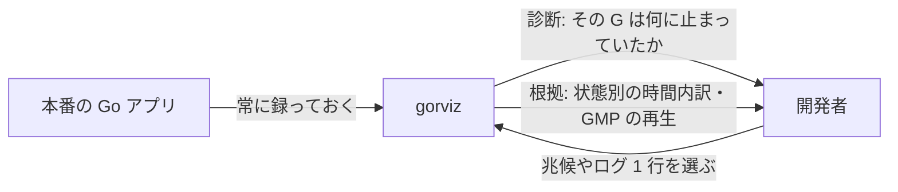

# gorviz 概要

詳細は [design.md](design.md)、進み具合は [roadmap.md](roadmap.md) を参照。

## What

Go アプリの **goroutine のリーク** と **遅い / 失敗したリクエストの原因** を調べるツール。

問題の兆候やログ 1 行から、**その瞬間に goroutine が何に止まっていたか** を診断し、**その根拠** を見せる。次に何をするかは開発者が決める。

特徴:

- **ログ 1 行から goroutine に降りられる**: APM やプロファイラは集計まで。gorviz はそのログを書いた goroutine の、その瞬間のスケジューリングまで見せる
- **肝心の瞬間が録れている**: 本番で常に trace を録っておくので、気づいてから取り直さなくてよい。録っている間の負荷は Datadog の Go プロファイラと同程度
- **trace を読まなくてよい**: `go tool trace` の生データではなく、診断と根拠 (状態別の時間内訳・GMP の再生) の形で出す

対象と範囲:

- 対象: Go のサーバアプリを作り、運用もする開発者
- やらないこと: 分散トレーシング、メトリクスの長期保存、OOM の調査

## Why

goroutine が絡む障害は調査が難しい。今の Go の標準の道具では、必要な情報を自分で集めて読み解く必要があり、認知負荷が高い。しかも読み解くには Go のランタイムのスケジューラの理解が要るが、多くの開発者はそこまで把握していない。

- **リーク**: goroutine が増えているのは分かるが、どれが増えているかは dump 数千件を手で集計しないと分からない
- **遅い / エラー**: その瞬間に goroutine が CPU・ロック・I/O・GC のどれを待っていたかが分からない
- **trace**: `go tool trace` なら分かるが、肝心の瞬間を録れておらず、ログからも辿れず、読むのも重い

## How

- **常に録り、問題の前後だけ残す**: execution trace・goroutine dump・ログを取り続け、直近だけをメモリに持つ。エラーなどのきっかけで、その前後を切り出して保存する
- **ログ 1 行から入る**: そのログを書いた goroutine の、その瞬間を診断する
- **診断と根拠を見せる**: 根拠は、その G の状態別の時間内訳と、GMP の概念図での再生
- **本番に置ける**: agent / server / ライブラリの組み合わせで、主要なコンテナ系サービスに対応する
- **端末からも見られる**: GUI とおおむね同じものを TUI で見られる
- **LLM エージェントからも使える**: 画面と同じ診断を、MCP から構造化データ (JSON など) で取れる
