# PoC の画面と遷移

gorviz-server の GUI (PoC) の画面と、画面どうしの行き来をまとめたもの。振る舞いの仕様は [design.md](../design.md) の「4.2.4 GUI」にある。ここに書くのは、今の PoC で実際にどう見え、どこからどこへ移れるか。

見た目は旧 PoC の画面を引き継ぎ、design.md で増えた欄 (確かさ・何から算出したか・保持期間を過ぎた欄・インスタンス・発生ごとの影響の大きかった goroutine など) を同じ部品の形で足している。

スクリーンショットは、[example/todo-app](../../example/todo-app) を `make launcher.up` で観測し、チュートリアルの不具合 (リーク・ロックの待ち・CPU の取り合い・GC・エラーログ) を起こしたあとに撮った。インスタンスの名前は、launcher を動かしたホストの名前 (`MacBookAir`) になっている。

## 目次

- [遷移図](#遷移図)
- [共通の部品](#共通の部品)
- [ログイン](#ログイン)
- [Overview](#overview)
- [Issues](#issues)
- [Issue の詳細](#issue-の詳細)
- [Logs](#logs)
- [Goroutine](#goroutine)
- [Scheduler](#scheduler)
- [PoC で足りていないところ](#poc-で足りていないところ)

## 遷移図

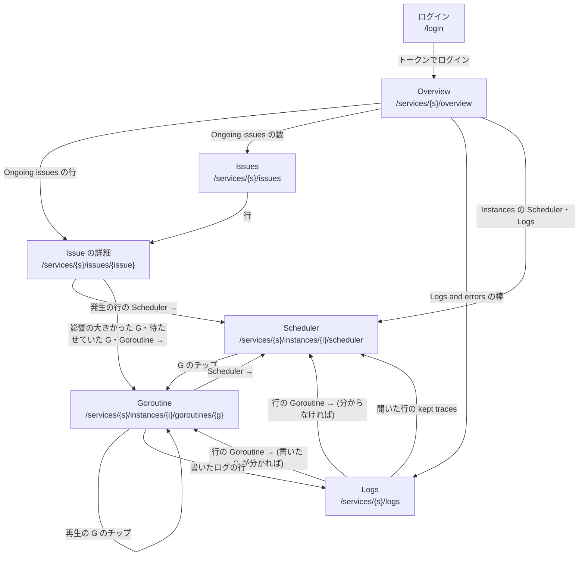

- どの画面からも、見出しの `Overview`・`Issues`・`Logs`・`Scheduler` へ移れる
  - `Scheduler` は、見ているインスタンス (なければ動いているインスタンス) の Scheduler
- 見るサービスとインスタンスは、見出しのピルで切り替える
- サービス単位の画面 (Overview・Issues・Logs) から、インスタンス単位の画面 (Scheduler・Goroutine) へ移るとき、行のインスタンスに決まる
- Goroutine の調べる期間は、URL の query で入口ごとに決まる (design.md「4.2.6.1 調べる期間」)
  - `?log={ログの ID}`
    - 所要時間のあるログならそのリクエストの区間、なければ書いた時刻の前後
  - `?issue={Issue}&occurrence={発生の時刻}`
    - 発生の前後
  - `?from&to`
    - Scheduler で選んだ G (再生している範囲)

## 共通の部品

### 見出し

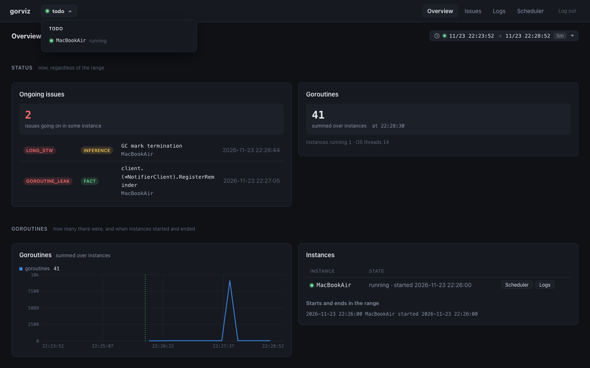

- 左から `gorviz`、サービスとインスタンスのピル、右寄せで `Overview`・`Issues`・`Logs`・`Scheduler` のタブ、`Log out`
- ピルの緑の点は、動いているインスタンスがあること
- ピルを開くと、サービスごとにインスタンスが並ぶ
  - サービスの名前 (`TODO`) を押すと、そのサービスの Overview
  - インスタンスを押すと、そのインスタンスの Scheduler
  - インスタンスの横に `running`・`ended`

### 期間を選ぶ部品

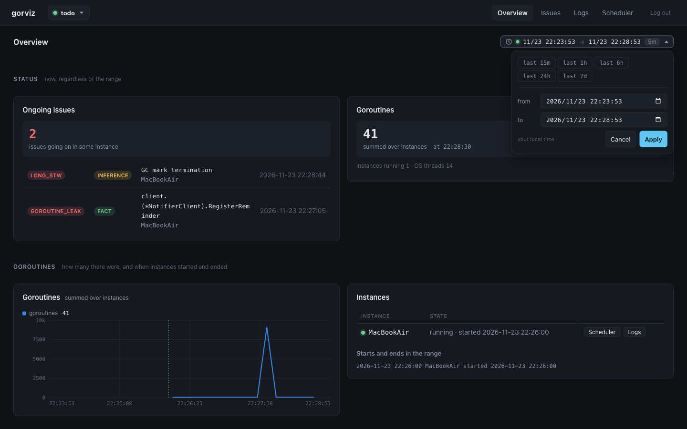

- 右上のピルに、時計・最新を追っているかの緑の点・期間 (`11/23 22:23:52 → 11/23 22:28:52`)・長さ (`5m`) が出る
- 開くと、上の段によく使う期間、下の段に from・to の入力欄 (ブラウザの時刻) が出る
- 画面ごとに候補が違う
  - Overview は `last 15m` 〜 `last 7d`
  - Issues は 31 日まで
  - Logs は `last 5m` 〜 `last 24h`
  - Scheduler は `latest 5s` 〜 `latest 1m`
- URL にはそのまま `from`・`to` (RFC 3339 か `-15m` のような今からの相対) で載るので、URL を共有すれば同じ期間を開ける

## ログイン

- GUI はログインが要る。server が発行したトークンを入れる (launcher はログに `GORVIZ_TOKEN=...` として出す)
- ログインすると cookie にトークンを持ち、もとの URL (なければ最初のサービスの Overview) に戻る
- HTTP API (cli・mcp) は同じトークンを `Authorization: Bearer` で渡す

## Overview

サービスの全体の様子。サービスを開いたときの最初の画面。旧 PoC と同じく、小見出し (STATUS・GOROUTINES・LOGS・MEMORY & GC・CPU・LOCKS) で区切る。

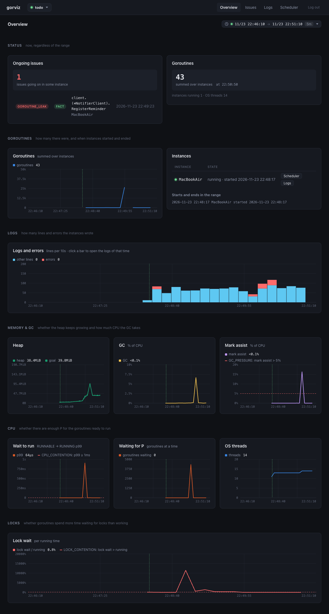

- STATUS
  - Ongoing issues
    - どこかのインスタンスで発生が続いている Issue の数 (押すと Issues)
    - 行は種類・確かさ・対象・発生しているインスタンス・最後に始まった時刻。押すとその Issue の詳細
  - Goroutines
    - 最新の goroutine の数 (インスタンスを足し合わせたもの)、動いているインスタンスの数、OS のスレッドの数
- GOROUTINES
  - Goroutines の推移
  - Instances
    - インスタンスごとの状態と、`Scheduler`・`Logs` へのボタン
    - 期間の中の始まり・終わりの一覧
- LOGS
  - Logs and errors
    - 10 秒ごとの行の数を、エラー (赤) とそれ以外 (青) で積み上げる。棒を押すと、その時間の Logs
- MEMORY & GC
  - Heap (heap と GC の目標値)・GC の CPU の割合・mark assist の CPU の割合
- CPU
  - Wait to run (`RUNNABLE` から `RUNNING` になるまでの p99)・Waiting for P (P を待っていた goroutine の数の平均)・OS threads
- LOCKS
  - Lock wait (ロックの待ちと実行中の時間の比)
- どのグラフも横軸の時刻がそろっている
  - 赤の点線は Issue の判定の線 (凡例に何の線かが出る)
  - 緑の縦の点線はインスタンスの始まり、黄色は同じ名前での再起動、灰色は終わり (design.md「3.4.1 インスタンスのライフサイクル」)
  - 凡例の数字は、期間の最後の値
  - 区切りにマウスを載せると、その時間の値が出る
- 最新を追っている間は、SSE で数秒ごとに描き直す

この画像では、ロックの待ち・CPU 待ち・mark assist の山と、ヒープの山が同じころに出ている (チュートリアルで起こした不具合)。

## Issues

検出した runtime 層の問題の一覧 (31 日残る)。

- 上の検索欄で、対象の文字列と種類で絞る
- 期間の中の発生の数、種類ごとの数と割合、種類で積み上げた発生の推移
- 一覧の列は、種類 (発生中なら赤い点)・確かさ・対象・今の様子・発生の回数・期間の中の推移・最初と最後の発生
  - 対象は、`GOROUTINE_LEAK` なら生成元の関数、`LONG_STW` なら STW の理由、ほかの種類ならサービス (インスタンス全体で判定するため)
  - 確かさの印にマウスを載せると意味が出る
    - `FACT` は runtime の判定や trace の記録から直接言える
    - `INFERENCE` は gorviz が推移や比較から推し量った
- 行を押すと「[Issue の詳細](#issue-の詳細)」

## Issue の詳細

上に Issue の要点、真ん中に日ごとの発生の回数、下に発生ごとの調べ始める先が並ぶ。どの種類も同じ形で、発生を開いたときの表の中身だけが種類で変わる。

- 上の段
  - 種類・確かさ・対象・発生中か
  - 最初と最後の発生、期間の中の発生の回数、いつから残っているか
- Occurrences
  - 発生ごとに 1 行。始まりと終わり・インスタンス・確かさ・何で判定したか (閾値・普段との比較・リーク判定) とその値
  - 行の `Scheduler →` で、発生の前後の execution trace を Scheduler で再生する (31 日残るので、通常の trace (7 日) が消えたあとでも開ける)
  - 行の `>` で、その発生で影響の大きかった goroutine の表を開く (いちばん新しい発生は開いてある)。G を押すと、発生の前後を調べる期間にして「[Goroutine](#goroutine)」

### GOROUTINE_LEAK

- runtime の goroutineleak プロファイルが判定したので `FACT`
- Leaked goroutines, per stack
  - スタックごとに 1 行。生成元 (go 文を書いた関数と file:line)・止まっている場所 (file:line)・`N of the M goroutines waiting at the same place leaked`・確かさ・`Goroutine →`
- Leaked goroutines
  - リークした G の番号

### LOCK_CONTENTION

- Lock wait, per function that called Lock
  - `Lock` を呼んだ場所ごとに 1 行。待ち時間の割合・回数・1 回あたりの平均と最大・止まった場所 (file:line)
  - held by に、待たせていた側 (ロックを持っていた側) の G・関数・場所。G を押すと、ロックを持っていた側の Goroutine (何をしていたかを見る)
  - 回数と 1 回あたりの長さを並べて、ロックを取る回数が多すぎるのか、誰かが長く持っているのかを見分ける
- Goroutines that waited on locks the longest
  - ロックで長く待たされた G

### CPU_CONTENTION

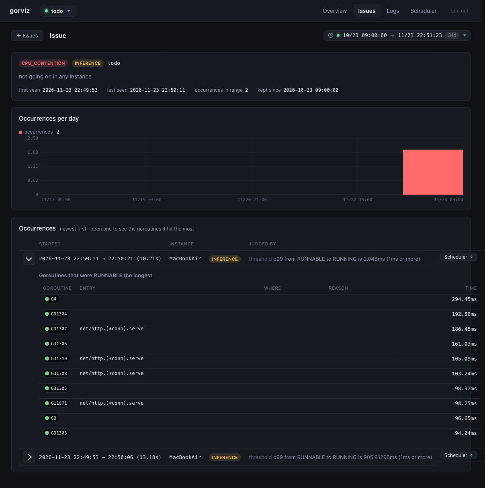

- `RUNNABLE` から `RUNNING` になるまでの p99 が 1ms を超えたので、閾値で `INFERENCE`
- Goroutines that were RUNNABLE the longest
  - P を待たされた時間の長い G。ここでは統計で todo ごとに立てた `ComputeStats.func1` が並ぶ

### GC_PRESSURE

- mark assist の CPU の割合が 5% を超えたので `INFERENCE` (GC の CPU の割合が 50% に達していれば `FACT`)
- Goroutines made to do the most mark assist
  - mark assist をさせられた時間の長い G

### LONG_STW

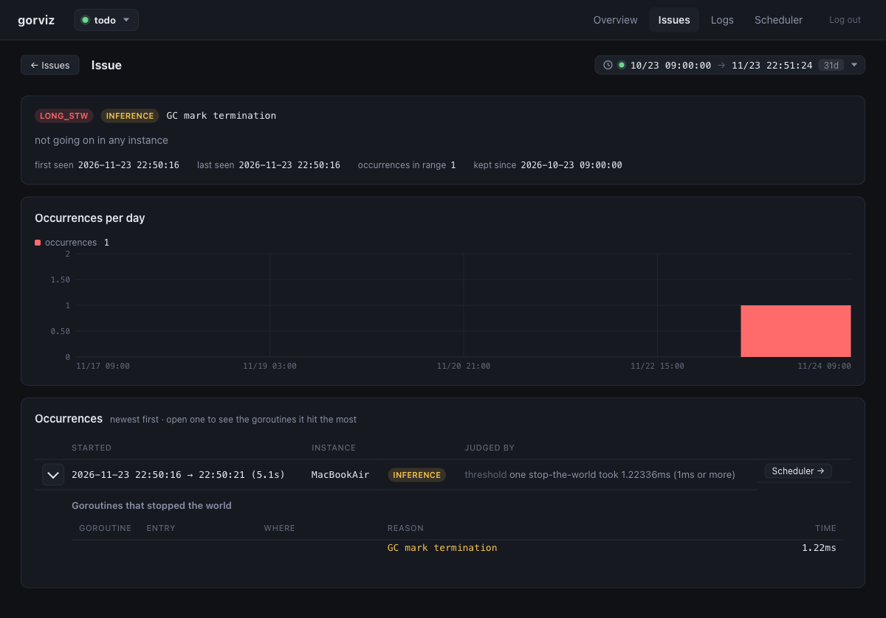

- 1 回の stop-the-world が 1ms 以上だったので `INFERENCE`。対象は STW の理由 (`GC mark termination`)
- Goroutines that stopped the world
  - STW の理由と長さ

## Logs

サービスのログの一覧と件数の推移。インスタンスをまたいで 1 本に並ぶ。

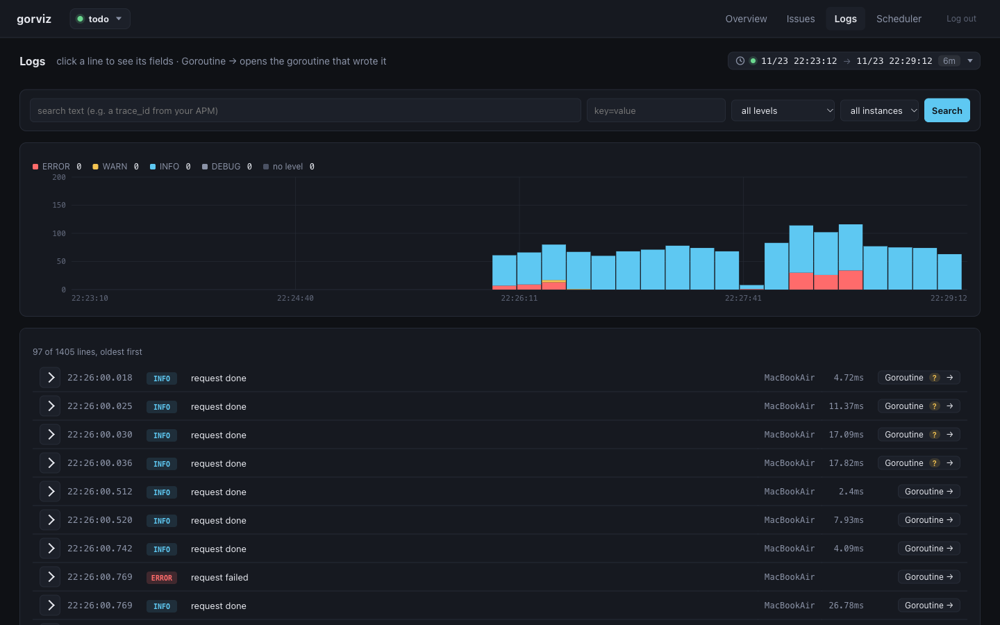

- 上の検索欄
  - 文字列・JSON のキーと値 (`path=/todos` の形)・レベル (この重さ以上)・インスタンスで絞る
- 件数の推移
  - レベルごとの色で積み上げる (ERROR・WARN・INFO・DEBUG・no level)。棒を押すと、その時間に絞る
- 一覧
  - 時刻・レベル・メッセージ・インスタンス・所要時間 (`duration` などのキーがあれば)・`Goroutine →`
  - 行の `>` か行そのものを押すと、すぐ下に JSON のキーと値が開く
  - `Goroutine →` は、書いた goroutine が分かればその Goroutine、分からなければその時刻の Scheduler へ移る
  - ロガーアダプタの番号のない行は、`Goroutine ? →` のように `?` が付く (書いた goroutine を時刻から推し量るため)

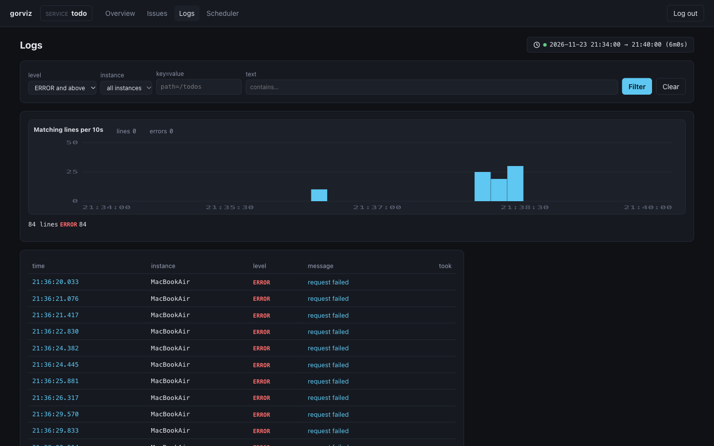

`ERROR and above` に絞ると、完了メールの送信先が落ちている間 (2 分のうち 30 秒) のエラーが山になって見える。

### 開いた行

URL に `?log={ID}` を付けると、その行を開いた状態で出す (共有できる)。開いた行には、キーと値の上に次が出る。

- written at と read from
  - ログに書かれた時刻 (なければ取り込んだ時刻) と、取り込み元
- written by
  - 書いた goroutine と結びつきの確かさ。ロガーアダプタが振った番号で結んだら `FACT`、その時刻に走っていた goroutine が 1 つだけなら `INFERENCE`
- period to look at
  - Goroutine で調べる期間 (所要時間があればリクエストの区間、なければ書いた時刻の前後)
- kept traces
  - `ERROR` 以上のログの前後に残した execution trace。押すとその範囲の Scheduler

## Goroutine

1 つの goroutine の診断と根拠。どの画面から入っても最後はここに行き着く。旧 PoC と同じく、上に追っている G のカード、下に GMP の再生を置く。

### ログから入ったとき

- カードの見出し
  - `FOLLOWING`・G の番号・入口の関数・インスタンス。リークなら `GOROUTINE_LEAK` と確かさ。`Scheduler →`
- Diagnosis (左の列)
  - 主因と確かさ
  - interval は調べる期間と、その決まり方 (from the log line ...)
  - computed from は何から算出したか (`execution trace` / 1 分ごとの内訳 / スナップショット)。1 分ごとの内訳なら、期間を 1 分単位に合わせたことも出す
  - stopped in・location・wait reason は、最も長く止まっていた関数・場所・待機理由と、その長さ
  - woken by は、この G の待ちを終わらせて起こした G と、起こした場所・回数・待っていた時間。G を押すと、起こされた側が待っていた区間でその G を開く
  - created by と leak
  - 保持期間を過ぎて出せない欄は、隠さずに`past its retention, so it cannot be shown`と出す
- Time by state (右の列)
  - 状態別の時間内訳を棒で。`not recorded` は、その期間に G が居なかったか状態が記録されていない時間
  - その期間にこの G が書いたログ。押すと Logs でその行を開く

再生の見出しに、追っている G が今の時点でどの状態か、いつからか (`FOLLOWING G30 IO_WAIT since ...`) と、その状態に入った瞬間へ移るボタンが出る。窓の頭より前からその状態なら、execution trace を 5 分さかのぼって入った時刻を探し、その時刻から始まる画面へ移るボタンを出す。5 分で見つからなければ、さかのぼった先の画面へ移るボタンを出す。それより前の trace が残っていなければ `no earlier trace is recorded` と出す。

### Issue の発生から入ったとき

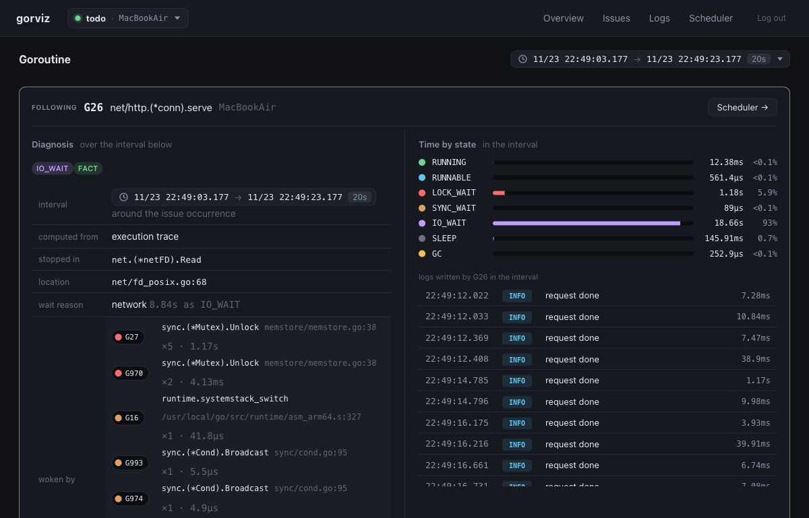

`LOCK_CONTENTION` の held by から開いた、バックアップのリクエストの G。期間は発生の前後 (`around the issue occurrence`) になる。主因は `SLEEP` で、止まっていた場所は遅いディスクへの書き出し (`backup_file_accessor.go:24`)。ロックを持ったまま 1.5 秒寝ていたことが分かる。

### リークした goroutine

- 主因は `SYNC_WAIT` (`chan send` で待ち続けている)
- カードの見出しに `GOROUTINE_LEAK` と確かさ、leak に`N of the M goroutines with the same stack leaked`

### Scheduler の G から入ったとき

Scheduler で local run queue に並んでいた G を押して開いたもの。期間は再生していた範囲になる。主因は `RUNNABLE` で、P を待たされていた時間が大半を占める。

## Scheduler

インスタンスの execution trace から、スケジューラの動きを GMP の概念図で再生する。Preact のアイランド (docs/frontend.md) で描く。

### 最新を追う

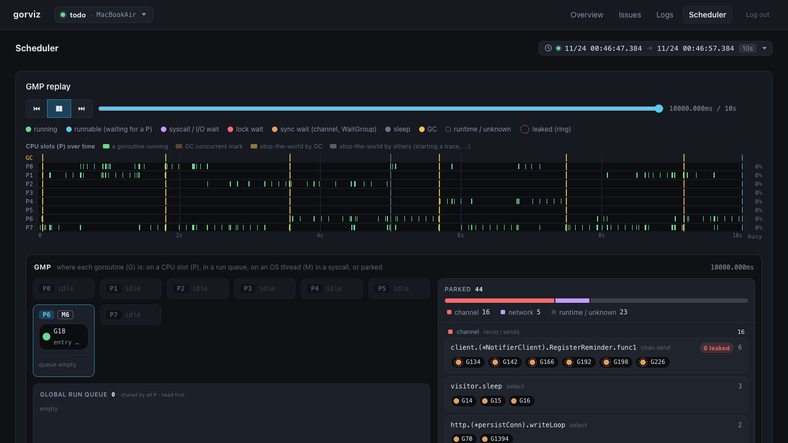

- 期間を `latest 10s` などの相対にすると、最新を追う。新しいチャンクが届いたら SSE で受け取り、録れている中でいちばん新しい時点を見せる
- 操作
  - ⏮ ⏭ で前後の出来事 (G か P の状態が変わった瞬間) へ 1 つずつ進む。窓の端では、前後の窓へ移る
  - ▶ で出来事を 1 つずつ自動で進める。❚❚ で止め、最新を追うのもやめる
  - つまみで時刻を動かす
- 凡例は、G の丸の色 (主因) と、リークの赤い輪
- CPU slots (P) over time
  - P ごとに、G が走った区間の帯。Goroutine の画面では、追っている G が走った区間を白で描く
  - いちばん上の GC の段は concurrent mark (薄い) と stop-the-world (濃い)
  - P の段を縦に貫く線は stop-the-world。GC によるものは黄色、それ以外 (agent が trace を取り始めるときなど) は灰色で、マウスを載せると理由が出る
  - 右端は P が G を走らせていた割合
  - 帯の種類は見出しの横に凡例として出す
  - 押すとその時刻へ移る
- GMP
  - P のカードに、乗っている M、走っている G、local run queue (待っている時間つき)
  - global run queue は並んだ順に番号つき
  - M in syscall, P released は、P を手放した M の上で syscall を続けている G
  - PARKED は、止まっている G を待っている相手 (channel・lock / sync・network・timer・runtime) ごとに分け、その中を「関数 × 待機理由」でまとめたもの。リークした G は件数の印と赤い輪
  - G のチップにマウスを載せると、入口・今いる関数・待機理由・起こした G・リークが出る。押すと「[Goroutine](#goroutine)」

### インスタンスを選ぶ

見出しのピルから、インスタンスを選ぶ。Scheduler・Goroutine を見ている間は、ピルにインスタンスの名前も出る。

### CPU の取り合いの瞬間

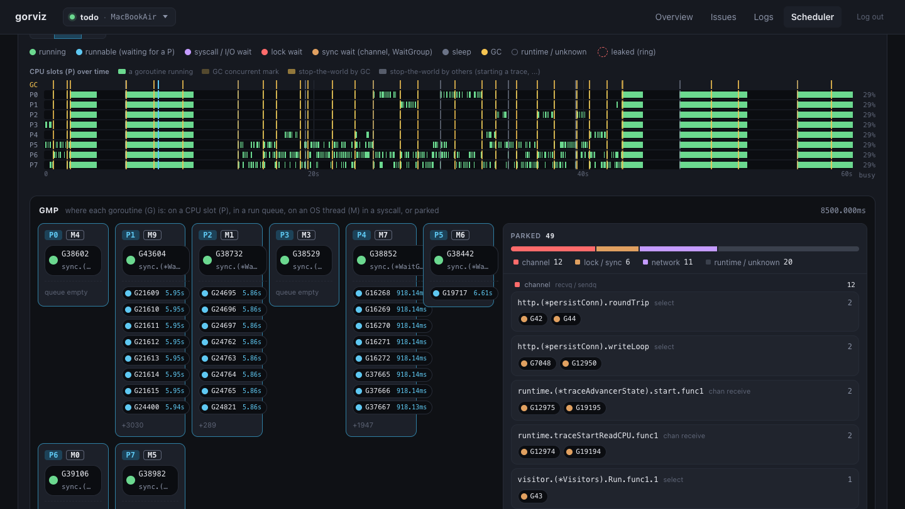

統計を開いたときの 1 分を再生し、実行待ちが最も多い瞬間まで進めたもの。統計の計算で todo ごとに立てた goroutine が、いくつもの P の local run queue に数千個ずつ並んでいる (先頭の 8 個だけを描き、残りは `+9628` のように数で出す)。CPU slots の黄色い帯は、同じころに走った GC。

### Issue の発生の前後に残した trace

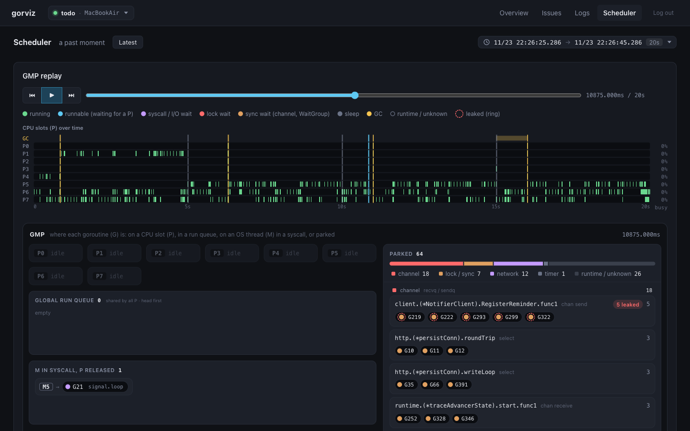

Issue の発生の行の `Scheduler →` から開いたもの。通常の execution trace が保持期間 (7 日) を過ぎたあとは、Issue の発生とエラーログの前後に残した trace から再生し、`from a kept trace` と示す。再生できない時刻では、その理由と、近くに残した trace へのリンクを出す。

## PoC で足りていないところ

画面を作ってみて分かった、design.md との差と直したいところ。

- `CPU_CONTENTION` の発生の時刻が、実行待ちの山より遅れることがある。発生の前後 (±10 秒) で開くと山を外すことがあり、この PoC の画像は前後 1 分で開いて探した
- `LOCK_CONTENTION` の「`Lock` を呼んだ関数」に、`sync.(*Mutex).Lock` そのものが出る。場所 (file:line) は呼んだ側だが、関数名は呼んだ側の関数にしたい (観測データの状態の変化に、利用者のコードの関数名を持たせる必要がある)
- 待たせていた側の goroutine は、起こされた側が待っていた区間ではなく、Issue の発生の前後の期間で開く
- woken by に、runtime の内部の G (`sync.(*Cond).Broadcast` など) まで並ぶ (先頭の 8 件だけを出している)
- 窓より前に作られ、窓の中でスタックが記録されなかった G は、入口が分からない (`entry unknown`)
- Logs の一覧は古い順 (旧 PoC は新しい順だった)。続きを `newer lines` で取る
- グラフの hover は区切りごとの帯で値を出すだけで、旧 PoC の縦線とドラッグでの拡大 (chart_sync) はまだ移していない
- favicon がない
