# PoC の画面と遷移

gorviz-server の GUI (PoC) の画面と、画面どうしの行き来をまとめたもの。振る舞いの仕様は [design.md](../design.md) の「4.2.4 GUI」にある。ここに書くのは、今の PoC で実際にどう見え、どこからどこへ移れるか。

スクリーンショットは、[example/todo-app](../../example/todo-app) を `make launcher.up` で観測し、チュートリアルの不具合 (リーク・ロックの待ち・CPU の取り合い・GC・エラーログ) を起こしたあとに撮った。インスタンスの名前は、launcher を動かしたホストの名前 (`MacBookAir`) になっている。

## 目次

- [遷移図](#遷移図)
- [共通の部品](#共通の部品)
- [ログイン](#ログイン)
- [Overview](#overview)
- [Issues](#issues)
- [Issue の詳細](#issue-の詳細)
- [Logs](#logs)
- [Goroutine](#goroutine)
- [Scheduler](#scheduler)
- [PoC で足りていないところ](#poc-で足りていないところ)

## 遷移図

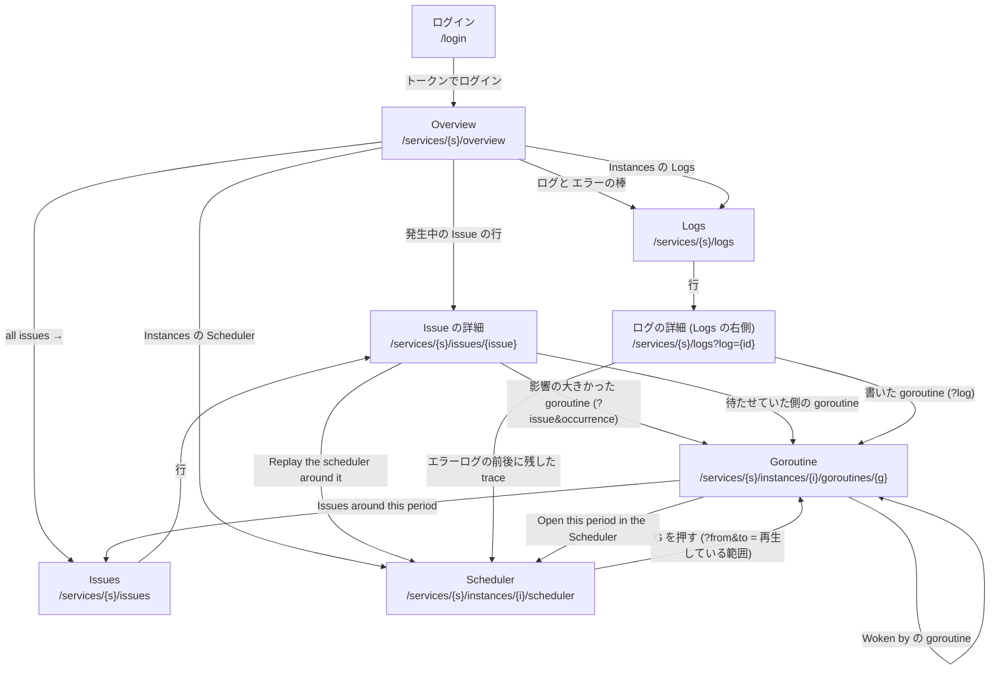

- どの画面からも、見出しの `Overview`・`Issues`・`Logs`・`Scheduler` (インスタンスを選ぶ) へ移れる
- 見るサービスは、見出しの `SERVICE` で切り替える
- サービス単位の画面 (Overview・Issues・Logs) から、インスタンス単位の画面 (Scheduler・Goroutine) へ移るとき、行のインスタンスに決まる
- Goroutine の調べる期間は、URL の query で入口ごとに決まる (design.md「4.2.6.1 調べる期間」)
  - `?log={ログの ID}`
    - 所要時間のあるログならそのリクエストの区間、なければ書いた時刻の前後
  - `?issue={Issue}&occurrence={発生の時刻}`
    - 発生の前後
  - `?from&to`
    - Scheduler で選んだ G (再生している範囲)

## 共通の部品

### 見出し

- 左から `gorviz` (トップへ)、`SERVICE` (サービスの切り替え)、`Overview`・`Issues`・`Logs`・`Scheduler` のタブ、`Log out`
- `SERVICE` を押すと、agent が観測データに付けて送ってきたサービスの一覧が出る (この PoC では `todo` だけ)
- `Scheduler` のタブはインスタンスを選ぶメニュー (「[Scheduler](#scheduler)」)

### 期間を選ぶ部品

- 右上の時計のボタンで開く。緑の点は、最新を追っている (`last 1h` のような今からの相対の期間) ことを示す
- 上の段は決まった期間 (`last 15m`・`last 1h`・`last 6h`・`last 24h`・`last 7d`)。画面ごとに候補が違う (Scheduler は `latest 5s`〜`latest 1m`、Issues は 31 日まで)
- 下の段で、from・to をブラウザの時刻で入れて `Apply` する。URL にはそのまま `from`・`to` (RFC 3339) で載るので、URL を共有すれば同じ期間を開ける

## ログイン

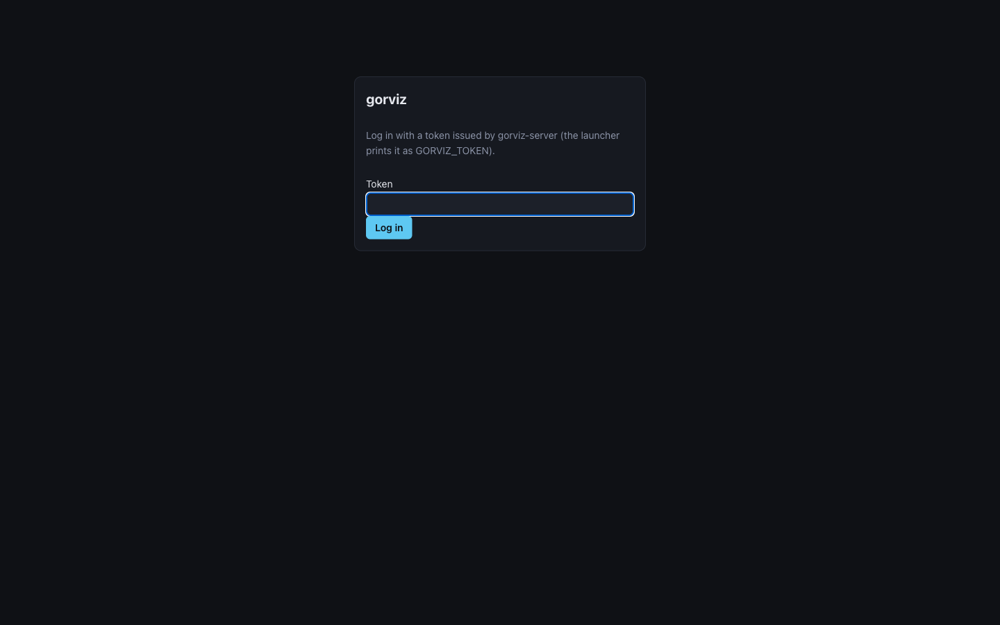

- GUI はログインが要る。トークンを入れて `Log in` する (PoC では server が発行したトークンでログインする。launcher はログに `GORVIZ_TOKEN=...` として出す)
- ログインすると cookie にトークンを持ち、もとの URL (なければ最初のサービスの Overview) に戻る
- HTTP API (cli・mcp) は同じトークンを `Authorization
  - Bearer` で渡す

## Overview

サービスの全体の様子。サービスを開いたときの最初の画面。

- Ongoing issues
  - どこかのインスタンスで発生が続いている Issue の数 (赤い丸) と一覧。行の種類・対象・確かさ・発生しているインスタンス・最後に始まった時刻。行を押すと「[Issue の詳細](#issue-の詳細)」へ。`all issues →` で「[Issues](#issues)」へ
- Trends
  - 選んだ期間の推移。どのグラフも横軸の時刻がそろっている
  - Goroutines (インスタンスを足し合わせた数)
  - Logs and errors (10 秒ごとのログとエラーの件数。棒を押すとその時間の Logs へ)
  - CPU wait
    - `RUNNABLE` から `RUNNING` になるまでの p99 (赤の点線は `CPU_CONTENTION` の閾値 1ms)
  - Share of goroutine time spent RUNNABLE
  - Heap (heap と GC の目標値)
  - GC CPU share (GC と mark assist。点線は `GC_PRESSURE` の閾値)
  - Lock wait per running time (ロックの待ちと実行中の時間の比。点線は `LOCK_CONTENTION` の閾値 100%)
  - OS threads
- 緑の縦の点線はインスタンスの始まり、黄色は同じ名前での再起動、灰色は終わり (design.md「3.4.1 インスタンスのライフサイクル」)
- 最新を追っている間は、SSE で数秒ごとに描き直す (`updated` の時刻が進む)
- Instances
  - インスタンスごとの状態 (緑の点は動いている)。`Scheduler` と `Logs` へ移れる。下に、この期間の始まり・終わりの一覧

この画像では、ロックの待ち・CPU 待ち・mark assist の山と、ヒープの山が同じころに出ている (チュートリアルで起こした不具合)。

## Issues

検出した runtime 層の問題の一覧 (31 日残る)。

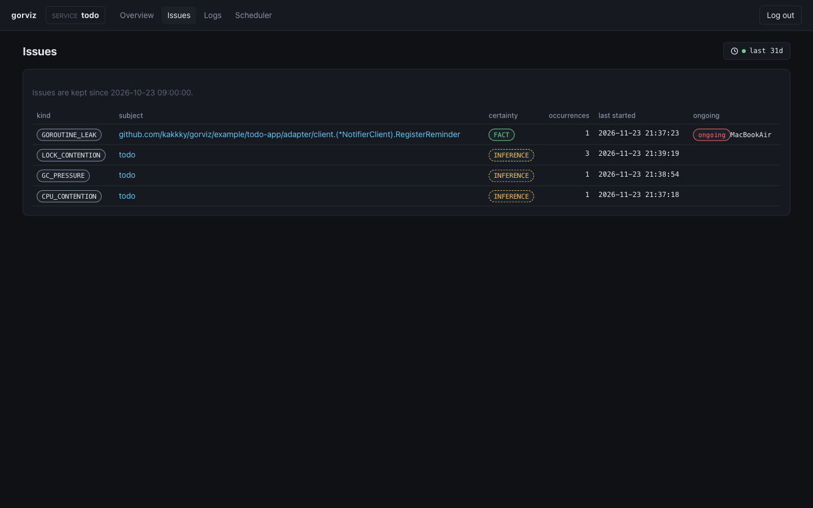

- 列は、種類・対象・確かさ・発生の回数・最後に始まった時刻・発生中か (発生中ならインスタンス)
- 対象は、`GOROUTINE_LEAK` なら生成元の関数、ほかの種類ならサービス (インスタンス全体で判定するため)
- 確かさの印にマウスを載せると意味が出る
  - `FACT` は runtime の判定や trace の記録から直接言える
  - `INFERENCE` は gorviz が推移や比較から推し量った
- 行を押すと「[Issue の詳細](#issue-の詳細)」へ

## Issue の詳細

上に Issue の要点、下に発生ごとの調べ始める先が並ぶ。どの種類も同じ形で、発生ごとの表の中身だけが種類で変わる。

- 上の段
  - 確かさ、発生中か、ネクストアクション (どこを見直すかの方向)
- Occurrences per day
  - 日ごとの発生の回数
- Occurrences
  - 発生ごとに、インスタンス・始まりと終わり・確かさ・何で判定したか (閾値・普段との比較・リーク判定) と、その値
  - `Replay the scheduler around it`
    - 発生の前後に残した execution trace を Scheduler で再生する (31 日残るので、通常の trace (7 日) が消えたあとでも開ける)
  - 影響の大きかった goroutine の表。G の番号を押すと、発生の前後を調べる期間にして「[Goroutine](#goroutine)」へ

### GOROUTINE_LEAK

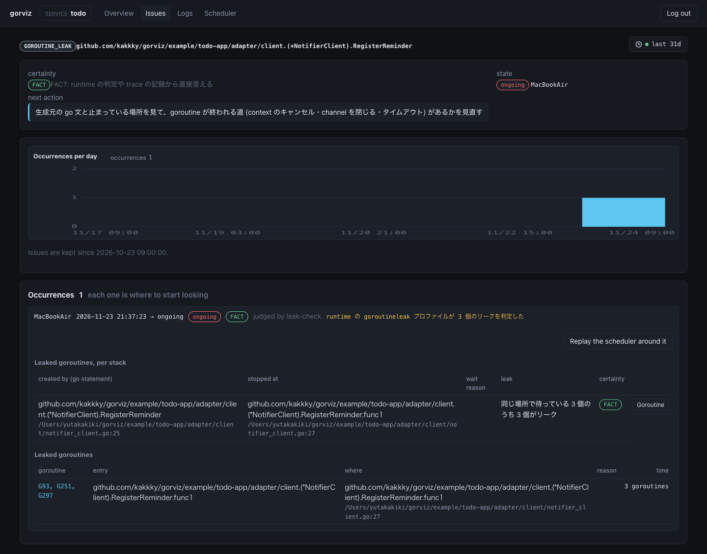

- runtime の goroutineleak プロファイルが判定したので `FACT`
- Leaked goroutines, per stack
  - スタックごとに 1 行。生成元 (go 文を書いた関数と file:line)・止まっている場所 (file:line)・「同じ場所で待っている M 個のうち N 個がリーク」・確かさ
- Leaked goroutines
  - リークした G の番号の一覧

### LOCK_CONTENTION

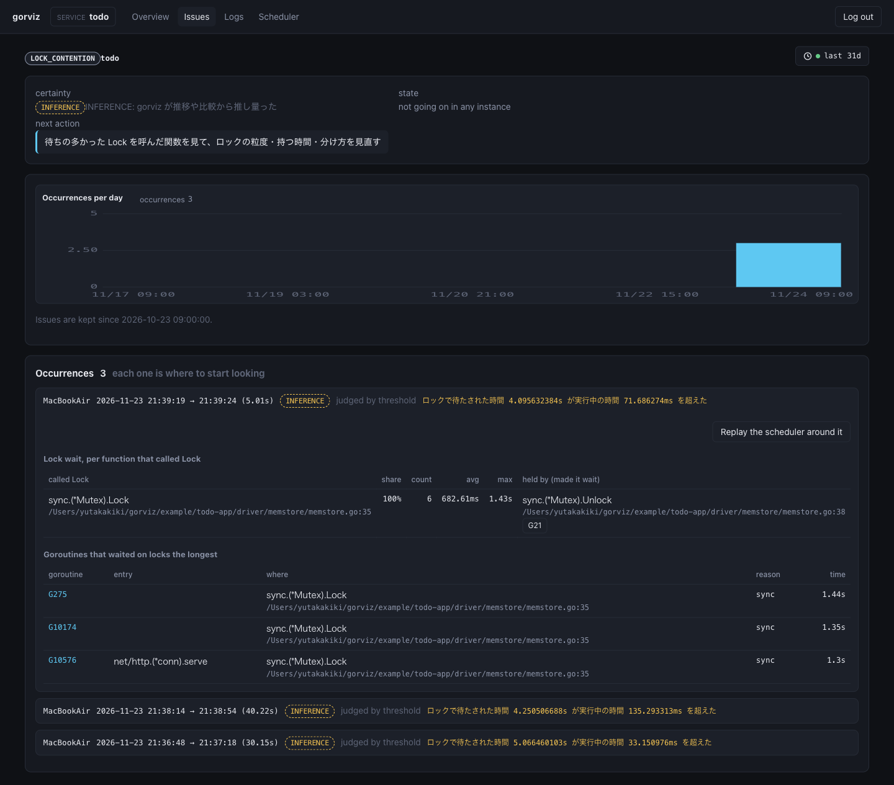

- Lock wait, per function that called Lock
  - `Lock` を呼んだ場所ごとに 1 行。待ち時間の割合・回数・1 回あたりの平均と最大・止まった場所 (file:line)・待たせていた側 (held by) の関数と場所と G
  - 回数と 1 回あたりの長さを並べて、ロックを取る回数が多すぎるのか、誰かが長く持っているのかを見分ける
  - held by の G を押すと、ロックを持っていた側の Goroutine へ (何をしていたかを見る)
- Goroutines that waited on locks the longest
  - ロックで長く待たされた G

### CPU_CONTENTION

- `RUNNABLE` から `RUNNING` になるまでの p99 が 1ms を超えたので、閾値で `INFERENCE`
- Goroutines that were RUNNABLE the longest
  - P を待たされた時間の長い G。ここでは `ComputeStats.func1` (統計で todo ごとに立てた goroutine) が並ぶ

### GC_PRESSURE

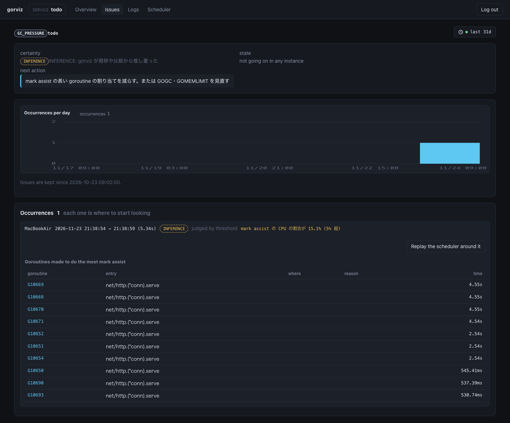

- mark assist の CPU の割合が 5% を超えたので `INFERENCE` (GC の CPU の割合が 50% に達していれば `FACT`)
- Goroutines made to do the most mark assist
  - mark assist をさせられた時間の長い G。ここでは CSV エクスポートのリクエスト (`net/http.(*conn).serve`)

## Logs

サービスのログの一覧と件数の推移。インスタンスをまたいで 1 本に並ぶ。

- 上の段の絞り込み
  - レベル (この重さ以上)・インスタンス・JSON のキーと値 (`path=/todos` の形)・文字列
- Matching lines per 10s
  - 絞ったログの 10 秒ごとの件数。下にレベルごとの件数
- 一覧
  - 時刻・インスタンス・レベル・メッセージ・所要時間 (`duration` などのキーがあれば)。行を押すと右にログの詳細が開く

`ERROR and above` に絞ると、完了メールの送信先が落ちている間 (2 分のうち 30 秒) のエラーが山になって見える。

### ログの詳細

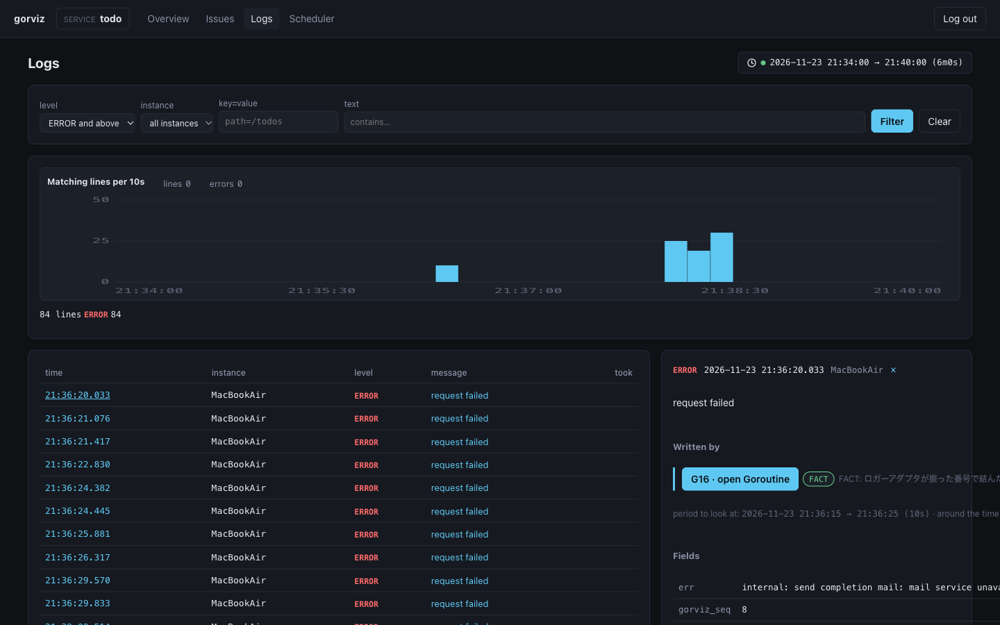

- 右側にログ 1 行の詳細が開く (URL に `?log={ID}` が付くので、そのまま共有できる)
- Written by
  - このログを書いた goroutine と、結びつきの確かさ
  - ロガーアダプタが振った番号で execution trace と結んだら `FACT`。その時刻に走っていた goroutine が 1 つだけなら `INFERENCE`
  - `G… · open Goroutine` を押すと、このログを入口にした期間で「[Goroutine](#goroutine)」へ
  - 分からないときは、その時刻の Scheduler へのリンクになる
- period to look at
  - Goroutine で調べる期間 (所要時間があればリクエストの区間、なければ書いた時刻の前後)
- Execution traces kept around this error
  - `ERROR` 以上のログの前後に残した execution trace。押すとその範囲の Scheduler へ
- Fields
  - JSON のキーと値、元の行

## Goroutine

1 つの goroutine の診断と根拠。どの画面から入っても最後はここに行き着く。

### ログから入ったとき

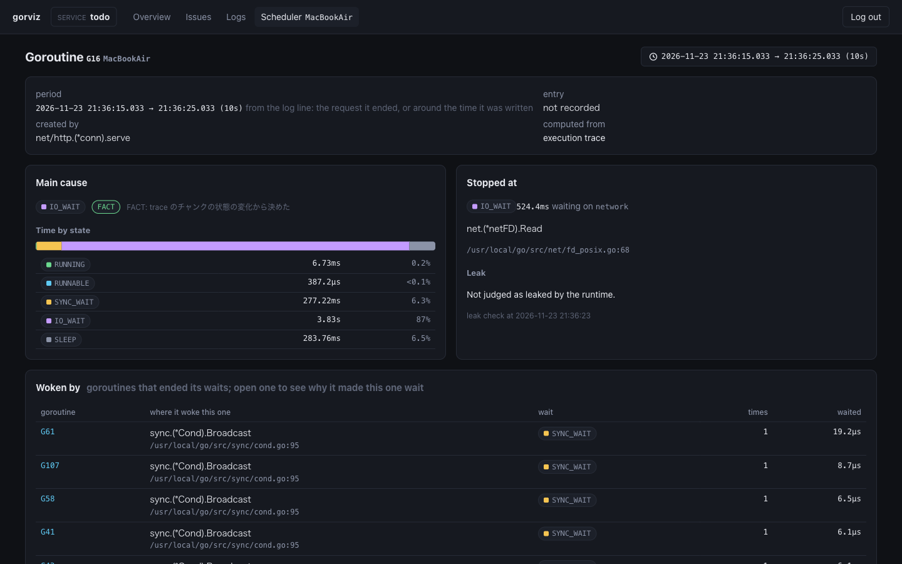

- 上の段
  - 調べる期間とその決まり方 (`from the log line ...`)、入口の関数、生成元、何から算出したか (`execution trace` / 1 分ごとの内訳 / スナップショット)
- Main cause
  - 主因と確かさ。trace の状態の変化から決めたので `FACT`
  - 主因が `SYNC_WAIT`・`LOCK_WAIT` なら「待っていた相手を見る」、`RUNNABLE` なら「同じ時間の CPU_CONTENTION を見る」といった次の一手を出す
- Time by state
  - 状態別の時間内訳 (帯と表)。`not recorded` は、その期間に G が居なかったか状態が記録されていない時間
- Stopped at
  - 最も長く止まっていた状態・時間・待機理由と、関数・file:line
- Leak
  - runtime がリークと判定したか (最後のリーク判定の時刻つき)
- Woken by
  - この G の待ちを終わらせて起こした goroutine と、起こした場所。押すとその G へ
- Logs written in the period
  - この G が期間中に書いたログ
- GMP replay
  - 期間のスケジューラの動きの再生 (この G を白い枠で強調する)

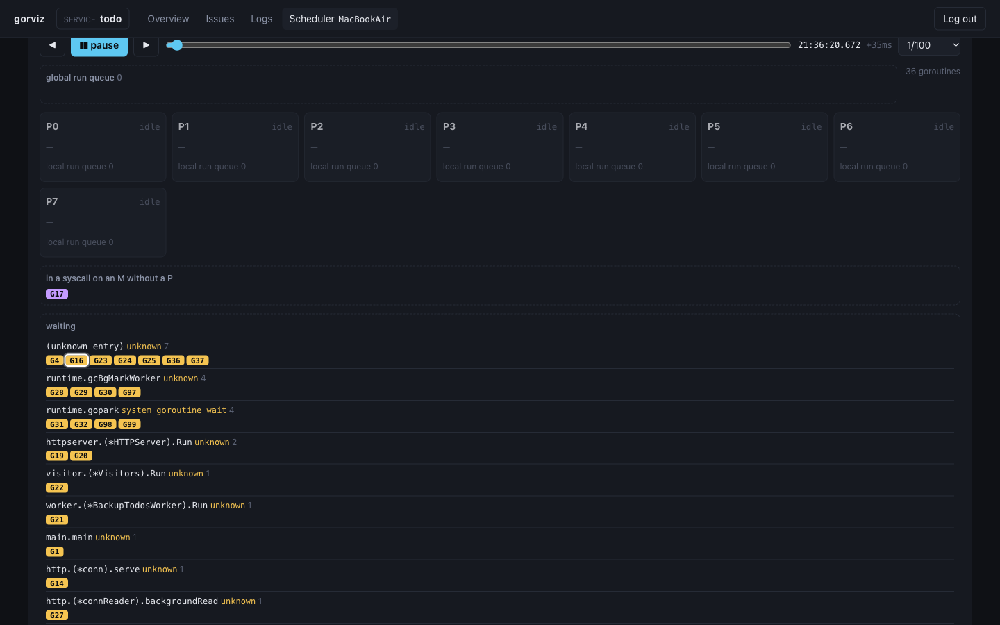

### Issue の発生から入ったとき

`LOCK_CONTENTION` の held by から開いた、バックアップの worker の G。期間は発生の前後 (`around the issue occurrence`) になる。時間の大半を `SYNC_WAIT` (次のバックアップまでの待ち) で過ごしているが、`SLEEP` の 1.5 秒が、ロックを持ったまま遅いディスクへの書き出しを待っていた時間にあたる。

### リークした goroutine

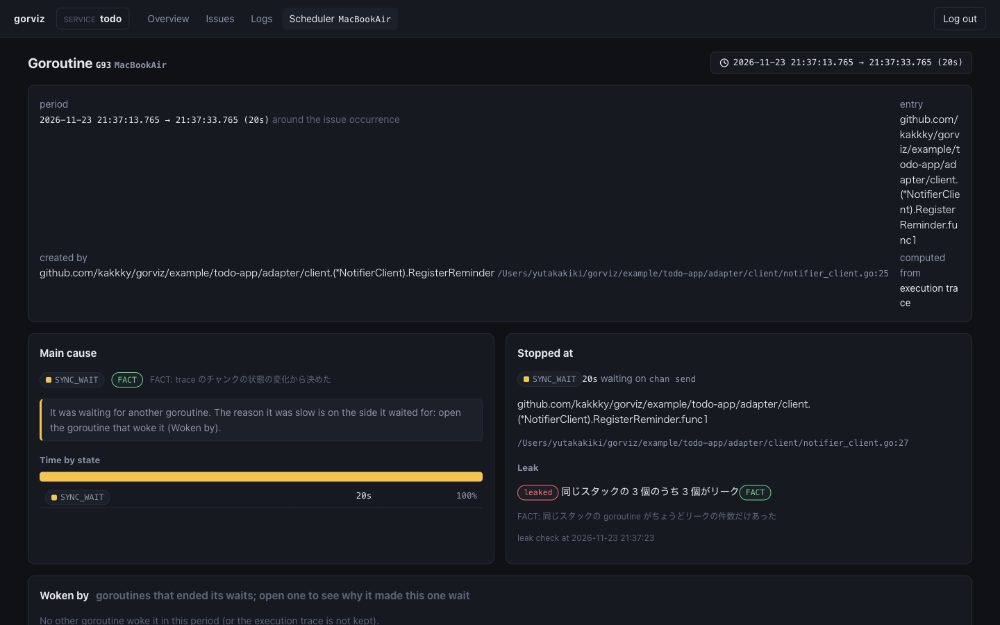

- 主因は `SYNC_WAIT` (`chan send` で 20 秒待ち続けている)
- **Leak** に `leaked`・「同じスタックの M 個のうち N 個がリーク」・確かさ (同じスタックの G がちょうどリークの件数だけあったので `FACT`)

### Scheduler の G から入ったとき

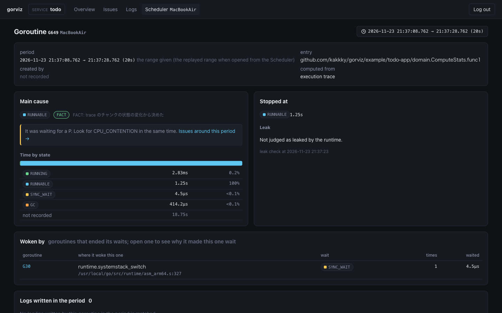

Scheduler で local run queue に並んでいた G を押して開いたもの。期間は再生していた範囲になる。主因は `RUNNABLE` で、P を待たされていた時間が大半を占める。

## Scheduler

インスタンスの execution trace から、スケジューラの動きを GMP の概念図で再生する。Preact のアイランド (docs/frontend.md) で描く。

### 最新を追う

- 期間を `latest 10s` などの相対にすると、最新を追う (右上の `live`)。新しいチャンクが届いたら SSE で受け取り、見ている窓の端まで再生し終えたところで続きをつなぐ
- 上の操作
  - 前の窓 (⏮)・前の変化 (◀)・再生と一時停止・次の変化 (▶)・次の窓 (⏭)・時刻のつまみ・今の時刻と窓の始まりからの経過・再生の速さ (既定は 1/100。スケジューラの動きは µs の単位なので引き延ばす)
- 概念図
  - global run queue
    - グローバルの実行待ちキュー
  - P0〜P7
    - P ごとに、乗っている M、走っている G (緑)、local run queue
  - in a syscall on an M without a P
    - P を手放した M の上で syscall を続けている G
  - waiting
    - 待機中の G を、入口の関数 (分からなければ今いる関数) と待機理由ごとにまとめたもの
  - G の色は主因の色。赤い枠はリークした G。マウスを載せると、入口・主因・待機理由・今いる関数・起こした G・リークが出る。押すと「[Goroutine](#goroutine)」へ
- 下に、P ごとにどの G が走ったかの帯 (押した位置へ移る) と、直近の状態の変化の一覧

### インスタンスを選ぶ

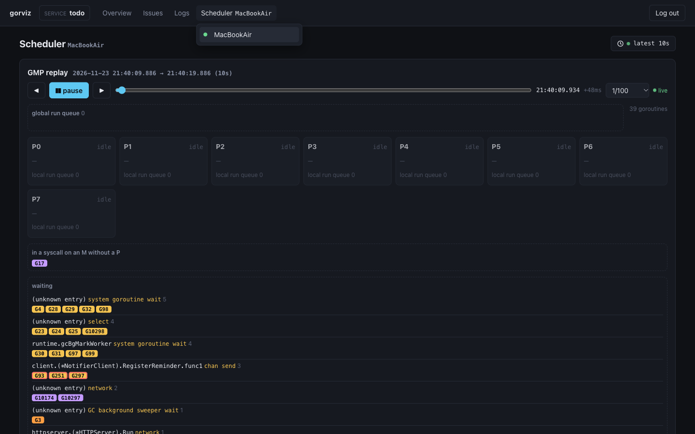

見出しの `Scheduler` から、インスタンスを選ぶ。緑の点は動いているインスタンス。

### CPU の取り合いの瞬間

`CPU_CONTENTION` の発生の前後を再生し、実行待ちが最も多い瞬間まで進めたもの。統計の計算で todo ごとに立てた goroutine が、P0・P5・P7 の local run queue に数千個並んでいる (先頭の 48 個だけを描き、残りは `+2367` のように数で出す)。

### Issue の発生の前後に残した trace

Issue の詳細の `Replay the scheduler around it` から開いたもの。通常の execution trace が保持期間 (7 日) を過ぎたあとは、Issue の発生とエラーログの前後に残した trace から再生し、`from a kept trace` と示す。再生できない時刻では、その理由と、近くに残した trace へのリンクを出す。

## PoC で足りていないところ

画面を作ってみて分かった、design.md との差と直したいところ。

- 待たせていた側の goroutine は、起こされた側が待っていた区間ではなく、Issue の発生の前後の期間で開く (`?woken` の期間はまだ使っていない)
- `LOCK_CONTENTION` の「`Lock` を呼んだ関数」に、`sync.(*Mutex).Lock` そのものが出る。場所 (file:line) は呼んだ側だが、関数名は呼んだ側の関数にしたい (観測データの状態の変化に、利用者のコードの関数名を持たせる必要がある)
- Goroutine の Woken by が長くなりすぎることがある (runtime の内部の G を含めて全部並べている)
- 再生の waiting に `(unknown entry)` が残る。窓より前に作られ、窓の中でスタックが記録されなかった G は、入口も今いる関数も分からない
- 時間の幅の広いグラフ (Issue の日ごとの発生) で、目盛りの文字が横に伸びる (SVG を枠に合わせて伸ばしているため)
- favicon がない
- ログイン画面は、トークンを貼るだけの最小のもの (design.md ではログイン。SSO は前段のリバースプロキシに任せる想定)
