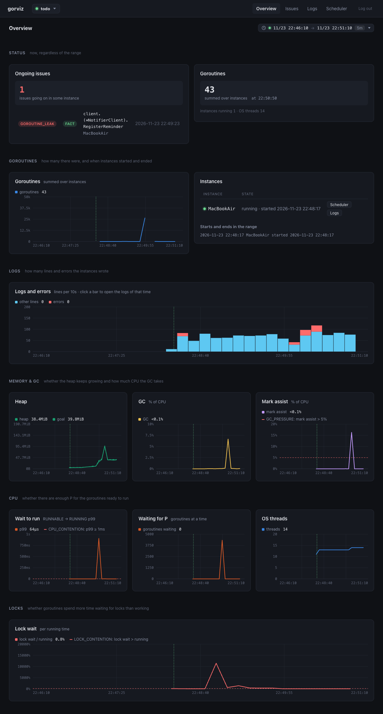
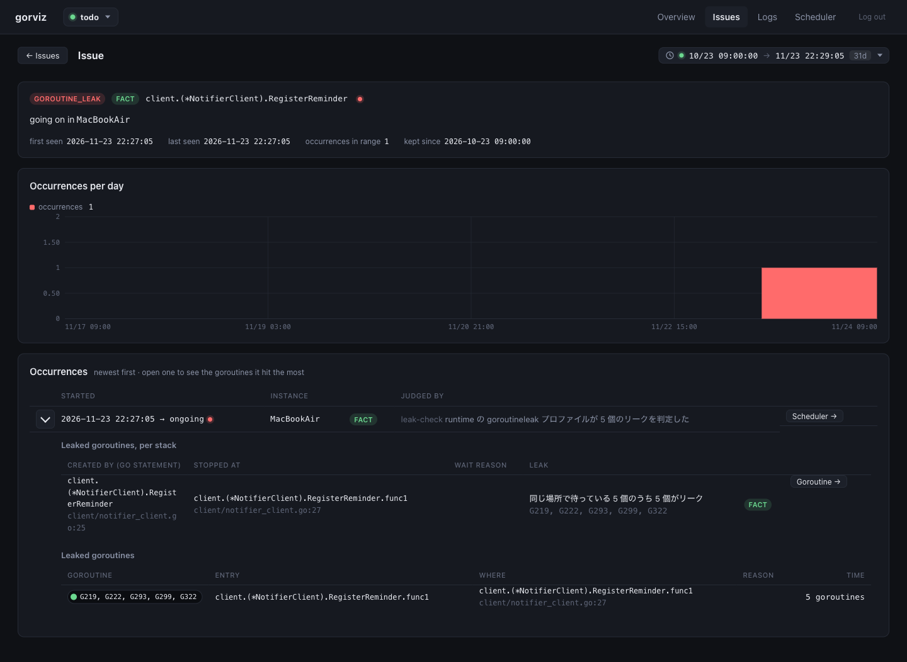
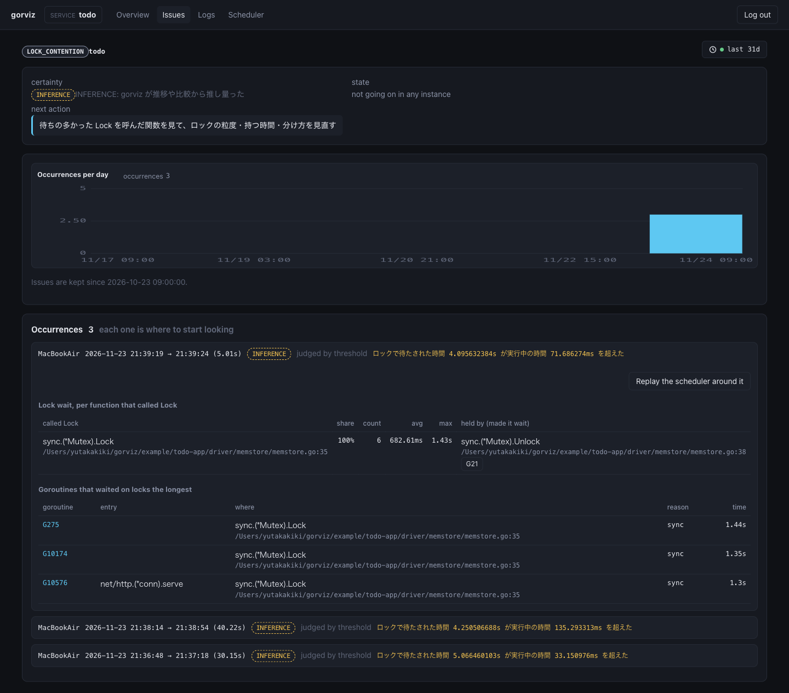
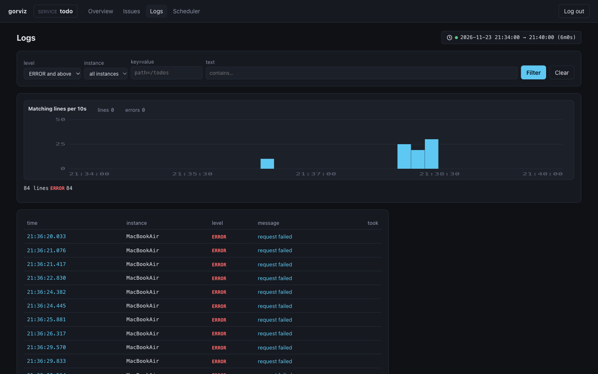
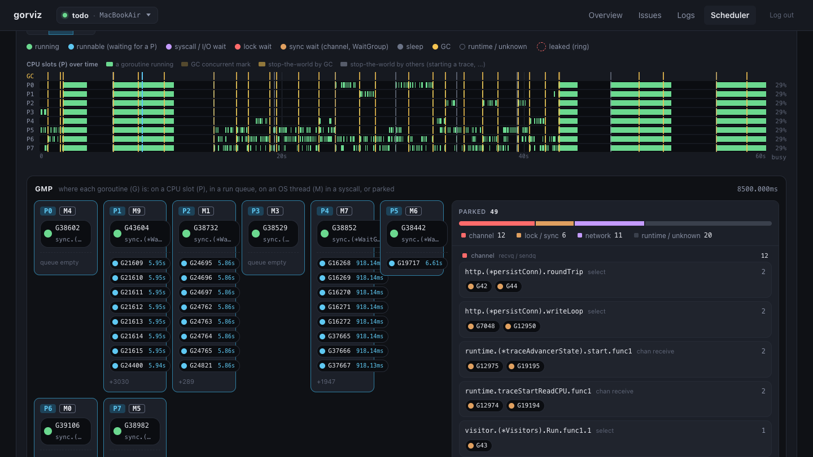
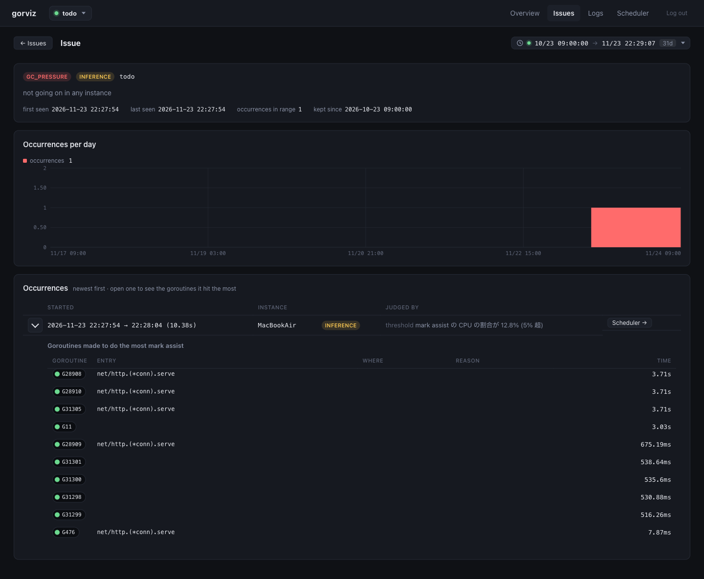

# todo-app: gorviz で goroutine の不具合を調べるチュートリアル

ブラウザで操作する Todo アプリ。実際の Web アプリにありがちな goroutine の不具合を 5 つ含んでいて、gorviz で 1 つずつ原因まで辿れる。

中の構成は gorviz 自身と同じ層に分けてある (`config/`・`driver/`・`presentation/`・`worker/`・`usecase/`・`domain/`・`adapter/`、組み立ては `main.go`)。層の決まりは [docs/architecture.md](../../docs/architecture.md) と [docs/coding-rule.md](../../docs/coding-rule.md) にある。

## 目次

- [起動する](#起動する)
- [0. 平常時を見ておく](#0-平常時を見ておく)
- [1. goroutine が溜まり続ける](#1-goroutine-が溜まり続ける)
- [2. ときどきリクエストが遅い](#2-ときどきリクエストが遅い)
- [3. エラーが急に増える](#3-エラーが急に増える)
- [4. CPU が足りない](#4-cpu-が足りない)
- [5. GC が多すぎる](#5-gc-が多すぎる)
- [6. 調査を LLM エージェントに任せる](#6-調査を-llm-エージェントに任せる)

## 起動する

リポジトリの直下で次を実行する。todo-app の出力をパイプで gorviz-launcher に渡し、launcher の中で gorviz-server と gorviz-agent が動く。

```sh
make launcher.up
# 中身は次と同じ
# go run ./example/todo-app 2>&1 | ./bin/gorviz-launcher --pprof-addr localhost:6060 --service todo --data-dir bin/data
```

- Todo アプリは http://localhost:8090 で開く (pprof は localhost:6060)
- gorviz は http://localhost:7070 で開く
  - ログインのトークンは、launcher の最初のログの `GORVIZ_TOKEN=...`
- 裏で仮想の訪問者が 3 人、一覧を見たり todo を追加・完了したりしている。触らなくてもリクエストは流れている

設定は環境変数で変えられる。

| 環境変数 | 既定 | 中身 |
| --- | --- | --- |
| `TODO_ADDR` | `localhost:8090` | アプリの待ち受け |
| `TODO_PPROF_ADDR` | `localhost:6060` | pprof の待ち受け |
| `TODO_VISITORS` | `3` | 仮想の訪問者の数 (0 で止める) |
| `TODO_BACKUP_EVERY` | `1m` | 自動のバックアップの間隔 |
| `TODO_BACKUP_DIR` | `/tmp` | バックアップの書き出し先 |
| `TODO_REMINDER_TIMEOUT` | `1s` | リマインダーの登録を諦めるまでの時間 |

gorviz の Issues が見つけるのは runtime 層の問題だけ。遅いリクエストやエラーの増加に気づくのは APM (Datadog など) の役目で、本番ではそこで見つけた時間帯やログを手がかりに gorviz に入る。シナリオ 2・3 はその流れで、APM の代わりに Todo アプリの画面とログで異常に気づく。

シナリオは 1 つずつ試す。原因のコードは、各シナリオの最後に書いてある。画面の全体と遷移は [docs/poc/screen-flow.md](../../docs/poc/screen-flow.md) にまとめてある。

## 0. 平常時を見ておく

1. gorviz を開いてログインすると、サービス `todo` の **Overview** が開く
   - 右上の時計で期間を選ぶ。`last 15m` くらいが見やすい
   - Ongoing issues は、どこかのインスタンスで発生が続いている Issue
   - Trends は、goroutine 数・ログとエラー・CPU 待ち・ヒープ・GC・ロックの待ち・OS のスレッドの推移。赤い点線は Issue の判定の線
2. Instances の `Scheduler` を押す
   - P のカードに、今走っている G が出る。ほとんどの P は idle のはず
   - ◀ ▶ で状態の変化を 1 つずつ進められる。G を押すと、その goroutine の診断に移る



## 1. goroutine が溜まり続ける

本番なら、メモリが増え続けるアラートや OOM での再起動で気づくところ。

1. Todo アプリで **リマインダー** にチェックを入れて、5〜10 回追加する
   - ときどき「reminder could not be registered (timeout)」が出る
2. 1〜2 分待つと、gorviz の Overview の Ongoing issues に `GOROUTINE_LEAK` が出る。行を押して Issue の詳細を開く
   - 確かさは `FACT`。runtime の goroutineleak プロファイルが「この channel に届く G はもういない」と判定した
   - Leaked goroutines, per stack に、生成元 `(*NotifierClient).RegisterReminder` (`notifier_client.go:25`)・止まっている場所 (`notifier_client.go:27`)・「同じ場所で待っている M 個のうち N 個がリーク」が出る
3. 右の `Goroutine` を押して、リークした G の診断を開く
   - 主因は `SYNC_WAIT`、待機理由は `chan send` (送れずに止まっている)
   - Leak に `leaked` と「同じスタックの M 個のうち N 個がリーク」(`FACT`)
4. 考える: なぜ送り先がいないのか



**答え**: `adapter/client/notifier_client.go` の `RegisterReminder`。結果を buffer のない channel に送るが、タイムアウトで受け手 (`select`) が先に返ると、送り手は永久に止まる。`make(chan error, 1)` にすれば直る。

## 2. ときどきリクエストが遅い

本番なら、APM で「この時間帯に p99 が跳ねた」と気づくところ。

1. Todo アプリで **今すぐバックアップ** を押し、すぐ別のタブで一覧を開く (1 分ごとにも自動で起きる)
   - 一覧の表示に 1 秒以上かかる
2. gorviz の Issues に `LOCK_CONTENTION` が出る。開いて、Lock wait, per function that called Lock の行を見る
   - 回数は少ないのに、1 回あたりの平均と最大が長い。ロックを取る回数が多すぎるのではなく、誰かがロックを長く持っている
   - 止まった場所は `driver/memstore/memstore.go:35` (置き場の `Do` のロック)
   - held by に、ロックを持って待たせていた側の G が出る
3. held by の G を押す
   - バックアップの worker (`(*BackupTodosWorker).Run`) の G。時間の大半は次のバックアップまでの待ち (`SYNC_WAIT`) だが、`SLEEP` の 1.5 秒が、ロックを持ったまま遅いディスクへの書き出しを待っていた時間
4. Logs を開き、同じ時間帯の `took` が 1 秒を超えた `request done` (`path` が `/`) の行を開いて、書いた G へ移る
   - 待たされた側は、主因が `LOCK_WAIT`、止まっていた場所が `sync.(*Mutex).Lock` (`memstore.go:35`)
   - Woken by に、ロックを手放して起こした G (`sync.(*Mutex).Unlock`) が出る
5. 考える: 誰が、なぜロックを長く握っているか



**答え**: `usecase/backup_todos_usecase.go`。`WithAllLocked` の中 (置き場のロックを握ったまま) で、1.5 秒かかる書き出し (`BackupFileAccessor.Write`) を呼んでいる。ロックの中では JSON にするところまでにして、書き出しはロックの外でする。

## 3. エラーが急に増える

本番なら、APM でエラー率の山に気づくところ。

1. Todo アプリで未完了の todo を **完了** にする。2 分のうち 30 秒は「send completion mail failed」になる
   - 仮想の訪問者も完了にしているので、待っていても出る
2. gorviz の Logs で level を `ERROR and above` にする
   - 件数の推移が、2 分ごとに山になる
   - メッセージは `request failed`。行を開くと、JSON のキーと値に `mail service unavailable (503)` がある
3. ログの詳細の Written by から、書いた G へ移る
   - 結びつきは `FACT` (ロガーアダプタが振った番号で、ログ行と execution trace を結んだ)
   - 主因は `IO_WAIT` で、`LOCK_WAIT` はほとんどない。goroutine 同士の待ち合わせの問題ではない
   - エラーログの前後の execution trace は 31 日残すので、後日でも書いた瞬間を再生できる
4. 考える: 自分のコードの問題か、外の問題か



**答え**: `adapter/client/mail_client.go`。外部のメール送信サービスが周期的に落ちている。gorviz では「goroutine は止まっておらず、外の呼び出しが失敗している」と切り分けられる。

## 4. CPU が足りない

1. Todo アプリで **サンプルを 1000 件追加** を 3 回押す
2. **統計を見る** を何度か押す (1 回に数秒かかる)
3. gorviz の Issues に `CPU_CONTENTION` が出る。開いて Goroutines that were RUNNABLE the longest を見る
   - `ComputeStats.func1` の G が、P を待って何秒も `RUNNABLE` のまま並んでいる
4. `Replay the scheduler around it` を押し、時刻のつまみを動かして実行待ちが最も多い瞬間を探す
   - すべての P が埋まり、local run queue に `ComputeStats.func1` の G が数千個並んでいる
   - 並んでいる G を押すと、主因が `RUNNABLE` の診断が出る
5. Logs で、統計を開いたリクエスト (`took` が数秒の `request done`) から書いた G へ移る
   - 主因は `SYNC_WAIT` (`sync.(*WaitGroup).Wait`)。自分は子の goroutine の終わりを待っているだけで、遅い理由は子の側 (P を待たされた `ComputeStats.func1`) にある
6. 考える: なぜ P が足りなくなるのか



**答え**: `domain/stats.go` の `ComputeStats`。todo ごとに goroutine を立てて重いハッシュを計算するので、件数の数だけ実行待ちの G ができ、ほかのリクエストも P を待たされる。同時に動かす数を P の数までに絞るか、結果をキャッシュする。

## 5. GC が多すぎる

1. シナリオ 4 のあと、**サンプルを 1000 件追加** をさらに数回押して todo を 1 万件近くにする
2. **CSV エクスポート** を、いくつかのタブで続けて押す
3. gorviz の Issues に `GC_PRESSURE` が出る
   - mark assist の CPU の割合が 5% を超えたので `INFERENCE`
   - Goroutines made to do the most mark assist は、CSV エクスポートのリクエスト (`net/http.(*conn).serve`)
4. Overview の Heap と GC CPU share を見る
   - mark assist が跳ね、heap が一時的に膨らんでから戻る。残るメモリは増えておらず、一時的な確保が多い
5. 考える: 何がそんなにメモリを確保しているのか



**答え**: `domain/csv.go` の `ExportCSV`。1 行足すたびに CSV 全体の文字列を作り直すので、件数の 2 乗のメモリを確保する。`strings.Builder` か `encoding/csv` で書く。

## 6. 調査を LLM エージェントに任せる

同じ調査を、gorviz の CLI か MCP から LLM エージェントに任せられる。どちらも server の HTTP API を呼び、TOON (少ないトークンで同じ中身を渡す形) で返す。

```sh
make build
export GORVIZ_SERVER_URL=http://localhost:7070 GORVIZ_TOKEN=<launcher が出したトークン>

./bin/gorviz docs getting-started            # まず読ませるドキュメント
./bin/gorviz list-issues --service todo      # Issue の一覧
./bin/gorviz search-logs --service todo --level ERROR
./bin/gorviz get-log --service todo --log <ログの ID>
./bin/gorviz diagnose-goroutine --service todo --instance <インスタンス> --goroutine <G> --log <ログの ID>
```

- 応答には、次に呼ぶ操作 (`diagnosis`・`stateChanges` など) と、人が確かめるための GUI の URL (`guiUrl`・`schedulerUrl`) が付く
- 主因・Issue の種類・確かさの意味は `./bin/gorviz docs` で引ける
- Claude Code なら、MCP として登録して使える

  ```sh
  claude mcp add gorviz --env GORVIZ_SERVER_URL=http://localhost:7070 --env GORVIZ_TOKEN=<トークン> -- "$(pwd)/bin/gorviz-mcp"
  ```

  そのうえで「todo サービスのエラーの原因を gorviz で調べて」と頼むと、ドキュメントを読み、Issue とログから goroutine の診断まで辿って、原因の関数と file:line を返す。
